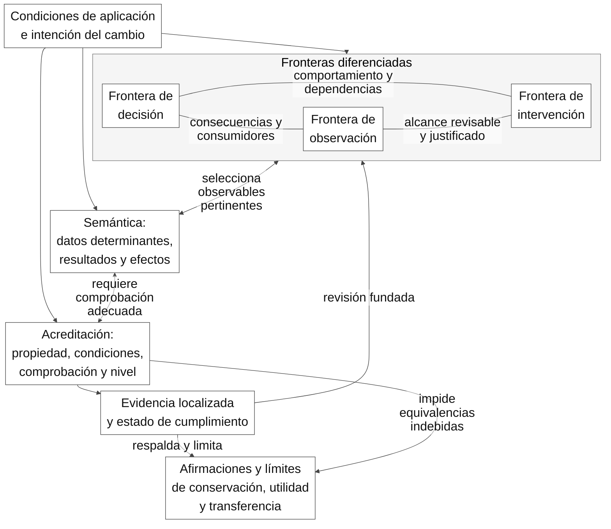
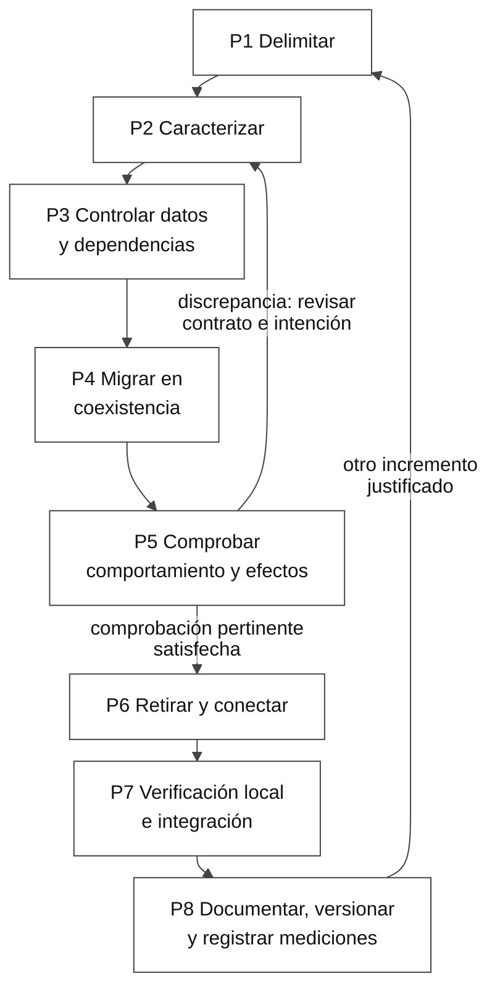
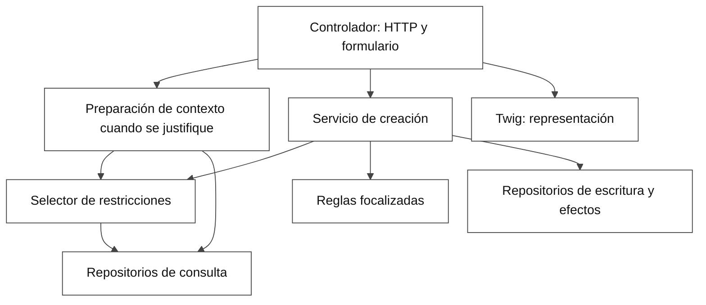
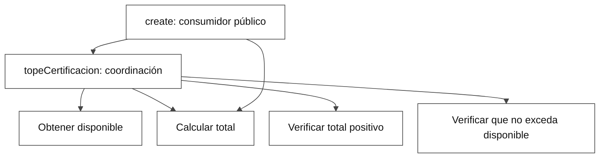

# Carátula

**UNIVERSIDAD AUTÓNOMA DEL BENI**

**«JOSÉ BALLIVIÁN»**

**ALSIE CONSULTORES PEDAGÓGICOS**

[Logotipo institucional pendiente de incorporación y verificación]

**TÍTULO**

**Diseño y evaluación de un método de refactorización arquitectónica incremental para subcircuitos de aplicaciones heredadas modelo-vista-controlador**

**Tesis de grado para optar al grado de Magíster en Ingeniería de Software**

**Postulante:** Mario Arturo Uriarte Marin

**Tutor:** Luis Roberto Pérez Rios, Ph.D.

**Mes y año:** noviembre de 2026

**Cochabamba–Bolivia**

# Agradecimientos

Apartado opcional reservado al tesista. Se requiere su decisión de omitirlo o aportar el texto personal; no se atribuyen agradecimientos ni autorizaciones no documentadas.

# Dedicatoria

Apartado opcional reservado al tesista. Se requiere su decisión de omitirlo o aportar una dedicatoria propia; no se redacta una manifestación personal en su nombre.

# Resumen

Fue estudiada la refactorización arquitectónica incremental de aplicaciones heredadas organizadas bajo modelo-vista-controlador, en el subcircuito de ejecución del plan operativo anual del sistema de planificación y presupuesto de la Caja Petrolera de Salud, con aplicaciones y evaluaciones en La Paz, Bolivia. Fue diseñado y evaluado un método para orientar cambios verificables sin reescritura completa, con la finalidad original de mejorar modificabilidad, testabilidad y trazabilidad. Fueron empleados análisis bibliográfico focalizado, inspección de código e historial, consulta funcional, aplicaciones controladas y comprobaciones automatizadas por escenarios. Fue formalizada una secuencia de ocho pasos; mediante una primera aplicación asistida fueron identificadas dificultades que motivaron cuatro ajustes, y fue examinada posteriormente la versión rediseñada con otro participante. Fue añadida una aplicación del autor sobre la decisión de importe, con cinco escenarios y veinticinco aserciones reproducidos satisfactoriamente. Como novedad incremental fueron articuladas tres reglas contextualizadas sobre diferenciación de fronteras, selección semántica de comprobaciones y acreditación de propiedades según el nivel de evidencia. Fue respaldada su operacionalización en aplicaciones delimitadas, no su superioridad causal. Fueron conservadas una discrepancia temporal, una comprobación parcial de rechazo previo a efectos, un registro descriptivo de esfuerzo y la ausencia de medición del cambio posterior. Fue concluida la factibilidad de aplicación asistida y conservación acotada, sin que fueran demostrados ahorro, mejora conjunta de atributos, mantenibilidad empírica o transferencia externa. Fue delimitada su utilidad para el mantenimiento institucional, con asistencia de inteligencia artificial y restricciones explícitas de generalización.

# Índice

La localización se realiza por epígrafes y títulos. No se atribuyen páginas a un archivo Markdown sin composición paginada. La paginación y el límite de la Introducción por páginas deben verificarse en la conversión posterior; no se declaran satisfechos por esta nota.

- 1. Introducción
  - 1.1. Pertinencia y contexto social
  - 1.2. Problema científico y delimitación
  - 1.3. Objeto y campo de acción
  - 1.4. Objetivos y equivalencia institucional
  - 1.5. Hipótesis y alcance de contraste
  - 1.6. Aporte teórico y significación práctica
  - 1.7. Métodos, técnicas, población y selección
- 2. Capítulo I. Diagnóstico de la investigación: caracterización de la refactorización y su verificación
  - 2.1. Contexto, factores y unidades diagnosticadas
  - 2.2. Operacionalización e instrumentos
  - 2.3. Resultados de la consulta funcional
  - 2.4. Resultados técnicos y significado de las discrepancias
  - 2.5. Esfuerzo, configuración y límites del diagnóstico
  - 2.6. Caracterización integrada y conclusiones del capítulo
- 3. Capítulo II. Marco teórico de la investigación: sistematización de los fundamentos
  - 3.1. Cambio seguro, caracterización y refactorización
  - 3.2. Arquitectura, responsabilidades y atributos de calidad
  - 3.3. Testabilidad, evidencia reciente y límites de atribución
  - 3.4. Antecedentes, comparación y estado ideal del objeto
  - 3.5. Fundamentación de las decisiones y posición del investigador
- 4. Capítulo III. Modelo teórico de la investigación: precisión de componentes y relaciones
  - 4.1. Fundamentos y naturaleza de la representación
  - 4.2. Representación gráfica y componentes
  - 4.3. Relaciones contextualizadas PA1–PA3
  - 4.4. Respaldo, condiciones y párrafos conclusivos
- 5. Capítulo IV. Propuesta de la investigación: elaboración del método y su aplicación
  - 5.1. Definición, objetivos y estructura asumida
  - 5.2. Alternativas y compromisos de decisión
  - 5.3. Requisitos y trazabilidad de diseño
  - 5.4. Guía metodológica de aplicación P1–P8
  - 5.5. Arquitectura de referencia y condiciones operativas
  - 5.6. Plan, construcción, versiones y verificación interna
  - 5.7. Validación para el rediseño: P01 y M-R1
  - 5.8. Validación posterior: P02
  - 5.9. Aplicación adicional del autor: importe
  - 5.10. Enlace diagnóstico–modelo–propuesta y matriz de solución
  - 5.11. Balance de objetivos, amenazas y viabilidad
- 6. Conclusiones
- 7. Recomendaciones
- 8. Referencias bibliográficas
- 9. Anexos
  - Anexo A. Instrumentos aplicados y matrices de comprobación
    - A.1. Cuestionario funcional: modelo en blanco
    - A.2. Matriz ordinaria, observables y registro técnico
    - A.3. I03: protocolo completo de registro humano y casos auxiliares
    - A.4. X01–X06: expectativas aceptadas, instrumento no aplicado
    - A.5. Registro de aplicación del método y criterios técnicos
    - A.6. Programa original de cierre bisiesto
    - A.7. Programa original O01–O05 y control
    - A.8. Programa original M08/M09 y control
    - A.9. Programa original O06 y condiciones de aislamiento
    - A.10. Programa original del formulario temporal
    - A.11. Programa original de interacciones S31/S14/S16
    - A.12. Cuestionario recibido: transcripción íntegra
    - A.13. Instrumento original de registro de aplicación
    - A.14. Consulta de seguimiento funcional preparada
    - A.15. Salida original B01/B02 y condiciones del registro humano
    - A.16. Informe original de fecha documental anterior
    - A.17. Informe original de invariancia horaria
    - A.18. Archivo original de pruebas del servicio de creación
    - A.19. Auxiliar original de selección de restricciones
    - A.20. Prueba común original de selección
    - A.21. Procedimiento original de comparación retrospectiva
    - A.22. Bitácora original del registro humano I03
    - A.23. Instrucciones originales de la actividad humana
    - A.24. Matriz original de escenarios y observables
    - A.25. Documento original de revisión del instrumento bisiesto
    - A.26. Textos de seguimiento funcional aportados por el tesista
    - A.27. Registro histórico de recuentos estáticos iniciales
  - Anexo B. Ficha reproducible de la propuesta
  - Anexo C. Mapa de equivalencias Design Science → ALSIE
    - C.1. Vigencia, decisiones y conservación
    - C.2. Equivalencias terminológicas
    - C.3. Mapa apartado por apartado
    - C.4. Comparación y reservas de la nueva versión
    - C.5. Vacíos, tensiones y control de integridad
  - Anexo D. Arquitectura de referencia y ejemplo de importe
    - D.1. Arquitectura de referencia, excepciones y hallazgos
    - D.2. Ejemplo explicado de importe

**Índice de tablas**

- Tabla 1. Operacionalización y estado de los cuatro indicadores — §2.2.
- Tabla 2. Resultados completos del cuestionario y sus aclaraciones — §2.3.
- Tabla 3. Resultados diagnósticos por instrumento y nivel observado — §2.4.
- Tabla 4. Esfuerzo humano descriptivo consolidado de la actividad B01/B02 — §2.5.
- Tabla 5. Ocho antecedentes comparados y posición de la propuesta — §3.4.
- Tabla 6. Decisiones D01–D09 y fundamento aplicado — §3.5.
- Tabla 7. Respaldo contextual y frontera de validación del modelo — §4.4.
- Tabla 8. Configuraciones del método y destino arquitectónico considerados — §5.2.
- Tabla 9. Catorce requisitos de la propuesta — §5.3.
- Tabla 10. Guía operativa M-R1: entradas, productos y condiciones — §5.4.
- Tabla 11. Responsabilidades, conexiones y límites de la aplicación de referencia — §5.5.
- Tabla 12. Plan histórico, preguntas y riesgos preservados — §5.6.
- Tabla 13. Verificación histórica del software de referencia — §5.6.
- Tabla 14. Hallazgos de P01 y cuatro ajustes aprobados en M-R1 — §5.7.
- Tabla 15. Comprobaciones finales reproducidas de P01 — §5.7.
- Tabla 16. Dictamen por paso de P02 aceptado por el tesista — §5.8.
- Tabla 17. Resultados y procedencia de las comprobaciones P02 — §5.8.
- Tabla 18. Criterios previos A01–A05 y conservación observada — §5.9.
- Tabla 19. Resultados y secuencia documentada de importe — §5.9.
- Tabla 20. Concreción del modelo y respuesta al diagnóstico — §5.10.
- Tabla 21. Matriz vigente de problema, requisito, decisión, criterio, evidencia, grado y límite — §5.10.
- Tabla 22. Control íntegro de cobertura de requisitos — §5.10.
- Tabla 23. Cumplimiento de los objetivos fuente conservados — §5.11.
- Tabla 24. Amenazas, controles y efecto residual de la evaluación — §5.11.
- Tabla A1. Casos del cuestionario funcional: modelo en blanco — Anexo A.1.
- Tabla A2. Matriz de escenarios ordinarios y observables de registro — Anexo A.2.
- Tabla A3. Campos de la bitácora humana por tramo — Anexo A.3.
- Tabla A4. Expectativas no ejecutadas de ampliación de ventana extraordinaria — Anexo A.4.
- Tabla A5. Registro de observación por paso del método — Anexo A.5.
- Tabla C1. Archivos de la entrega anterior preservados y huellas de identificación — Anexo C.1.
- Tabla C2. Equivalencias terminológicas entre Design Science y ALSIE — Anexo C.2.
- Tabla C3. Trazabilidad de los apartados del IFI a sus fuentes — Anexo C.3.
- Tabla C4. Estado de vacíos, decisiones y verificaciones — Anexo C.5.

Se identifican 33 tablas editoriales: 24 principales y nueve de anexos. Las tablas reproducidas dentro de bloques cercados son contenido literal de documentos/instrumentos, no tablas editoriales adicionales del IFI; se localizan por su apartado A.6–A.27 sin modificar sus originales. Los localizadores anteriores son apartados, no números de página.

**Índice de figuras**

- Figura 1. Modelo relacional de delimitación, observación y acreditación del incremento — §4.2.
- Figura 2. Secuencia operativa de aplicación del método — §5.4.
- Figura 3. Dependencias de la arquitectura de referencia para certificación — §5.5.
- Figura D1. Coordinación y reutilización del cálculo del importe — Anexo D.2.

Las cuatro representaciones Mermaid son provisionales: requieren inspección visual tras renderizado y comprobación de su ubicación en la composición final. Se conservarán número, título y nota APA 7; este índice no certifica esa revisión ni una paginación inexistente.

# 1. Introducción

## 1.1. Pertinencia y contexto social

La continuidad de un sistema institucional no elimina su necesidad de evolución. Cuando las decisiones se distribuyen entre presentación, coordinación y persistencia, un cambio requiere identificar qué se conserva, dónde se observa y qué evidencia permite declararlo verificado. Esta necesidad resulta actual para aplicaciones heredadas que continúan prestando servicios, sin que la antigüedad tecnológica pruebe por sí sola un defecto arquitectónico. La investigación aborda ese problema en la ejecución de la planificación operativa y presupuestaria de la Caja Petrolera de Salud, en Bolivia.

Las aplicaciones y evaluaciones documentadas se realizaron en La Paz, Bolivia. Esta es la delimitación espacial de las actividades del caso; Cochabamba corresponde a la presentación del IFI y no sustituye el lugar del estudio. La precisión no atribuye a La Paz la totalidad de dependencias, usuarios o despliegues de SIGPP en la institución.

El Sistema Integral de Gestión POA Presupuesto, denominado SIGPP en el cuerpo, articula tareas, operaciones, acciones de corto plazo, recursos y certificación. Su área dueña es el Departamento Nacional de Gestión y Planificación, según el contexto declarado. La continuidad operativa, las reglas institucionales y la sensibilidad de la información restringen los cambios admisibles. La utilidad social del estudio consiste en hacer examinable la intervención técnica sobre un soporte de planificación y asignación de recursos; no se afirma una mejora medida de la atención en salud, del gasto o del servicio al usuario final.

El encuadre comienza el 27 de septiembre de 2026 y los resultados se cierran al 7 de noviembre. Las extracciones de marzo de 2025 constituyen antecedentes, no construcción retrospectivamente atribuida al método formalizado. La elaboración del plan, su validación ministerial y la evaluación trimestral se mantienen como contexto; no se incorporan como módulos intervenidos. El trabajo tampoco promete sustituir Symfony o Doctrine, implantar microservicios o renovar toda la arquitectura.

## 1.2. Problema científico y delimitación

El mantenimiento del subcircuito presenta separación parcial existente y decisiones repartidas entre controladores, servicios, repositorios, entidades, consultas y vistas. Se observaron duplicación concreta de selección de restricciones y diferencias locales en la validación temporal. El problema no consiste en que todo SIGPP carezca de arquitectura o pruebas. Su consecuencia verificable es la necesidad de diferenciar puntos de decisión y comprobación para delimitar cambios; el costo institucional agregado y el ahorro potencial no fueron cuantificados.

Feathers (2004), Bass et al. (2021) y Girjoaba y Capiluppi (2024) ofrecen procedimientos de cambio seguro, razonamiento arquitectónico y secuencias de transformación. La revisión focalizada no acredita inexistencia universal de soluciones. La necesidad de conocimiento se concentra en explicitar y examinar reglas de adaptación para decisiones distribuidas, sus consumidores y sus niveles de evidencia, dentro de las restricciones del caso.

**Problema científico:** delimitación y comprobación insuficientemente explícitas de cambios sobre decisiones funcionales distribuidas en el subcircuito de ejecución de la planificación operativa anual de SIGPP, para quienes mantienen el sistema de la Caja Petrolera de Salud, en el caso de aplicación y evaluación realizado en La Paz, Bolivia.

La delimitación temática comprende refactorización incremental y verificación de decisiones; la poblacional, practicantes y unidades técnicas de las tareas examinadas, no todos los usuarios institucionales; la espacial, las aplicaciones y evaluaciones documentadas de SIGPP realizadas en La Paz, Bolivia, en los entornos locales descritos. La ciudad de aplicación y evaluación documentada fue La Paz. No se infiere una dirección física específica, ubicación de todas las dependencias o cobertura de todo el despliegue nacional. Cochabamba permanece como ciudad de presentación, no como ubicación de las aplicaciones del estudio.

## 1.3. Objeto y campo de acción

**Objeto de estudio:** la refactorización arquitectónica incremental de aplicaciones heredadas organizadas bajo modelo-vista-controlador. El método es la propuesta que permite estudiar el objeto y SIGPP es el contexto de aplicación y evaluación; no se altera con ello la definición del objeto utilizada en los productos originales.

**Campo de acción:** las relaciones entre las fronteras de decisión, observación e intervención, la semántica de los escenarios y la acreditación de propiedades mediante comprobaciones de distinto nivel, en cambios incrementales de subcircuitos de aplicaciones heredadas organizadas bajo modelo-vista-controlador. El campo es una parte del objeto: no incluye toda la evolución del software ni se identifica con el sistema completo.

La investigación se concreta en creación de certificaciones: selección de restricciones, diagnóstico temporal y decisión de importe. La clase de referencia requiere código accesible, consumidores y efectos identificables, posibilidad de caracterización y necesidad de cambio sin reescritura total. Su extensión a contextos semejantes se argumenta analíticamente, no como desempeño externo comprobado. Ver anexo C para la equivalencia y su procedencia.

El campo se examinó mediante las aplicaciones y evaluaciones de SIGPP realizadas en La Paz. Esta concreción espacial no amplía la clase de referencia ni constituye una transferencia a otro sistema, equipo o ciudad.

## 1.4. Objetivos y equivalencia institucional

**Objetivo general conservado:** diseñar y evaluar un método de refactorización arquitectónica incremental para subcircuitos de aplicaciones heredadas organizadas bajo modelo-vista-controlador, aplicado en la ejecución de la planificación operativa anual de SIGPP, para mejorar la modificabilidad, la testabilidad y la trazabilidad de cambios sin reescritura completa del sistema, en las tareas de mantenimiento examinadas de la Caja Petrolera de Salud, con aplicación y evaluación en La Paz, Bolivia.

«Mejorar» expresa la finalidad original, no el resultado alcanzado. El balance documenta diseño y evaluación acotados, pero no mejora conjunta de los tres atributos. La localización y población explícitas son una adaptación de presentación, no la ampliación de una muestra a toda la institución.

Los seis objetivos fuente se conservan en el balance del §5.11: diagnosticar; sistematizar; diseñar el método; aplicarlo; evaluar utilidad; formular y evaluar conocimiento con contexto y límites. La rúbrica demanda cuatro logros por capítulos. Se adopta la siguiente **equivalencia institucional**, sin sustituir retrospectivamente esos seis compromisos:

1. **Caracterizar** el estado de la refactorización y su comprobación en el subcircuito de ejecución de SIGPP mediante los indicadores y registros documentados.
2. **Sistematizar** los fundamentos de cambio seguro, responsabilidades arquitectónicas, testabilidad y métodos incrementales que sustentan el objeto y el campo.
3. **Precisar** los componentes y relaciones esenciales entre fronteras, escenarios y acreditación de propiedades, con su respaldo contextual y sus límites.
4. **Elaborar** la propuesta metodológica que concreta esas relaciones y documentar su aplicación y validación para atender las dificultades de delimitación y comprobación del caso.

El primero corresponde al objetivo fuente 1 y el segundo al 2. El tercero expresa el resultado conceptual del objetivo fuente 6 y las relaciones formalizadas en el diseño; el cuarto reúne los compromisos de los objetivos fuente 3–5 y su enlace con el 6. La reorganización no elimina incumplimientos, mediciones ausentes o reservas de validación institucional. Esta equivalencia de presentación por capítulos no acredita cumplimiento integral de las metas científicas o técnicas ni modifica los objetivos de los archivos fuente.

## 1.5. Hipótesis y alcance de contraste

La hipótesis de diseño traduce las relaciones finales de la investigación, con su carácter posterior y respaldo contextual. Su redacción no reabre PA1–PA3 (principios de adaptación) ni sustituye la evidencia que los sustenta.

**Hipótesis de diseño:** el método de refactorización arquitectónica incremental, estructurado en ocho pasos y caracterizado por la diferenciación de fronteras de decisión, observación e intervención, la selección de escenarios según la semántica del comportamiento y la acreditación de propiedades por nivel de comprobación, permite delimitar y sustentar la verificación de cambios sobre las decisiones seleccionadas de creación de certificaciones del sistema institucional de planificación operativa y presupuesto de la Caja Petrolera de Salud, en La Paz, Bolivia, porque vincula explícitamente cada decisión con sus consumidores, efectos observables y evidencia pertinente.

La formulación sigue la estructura institucional: lo propuesto es el método de refactorización arquitectónica incremental; sus características esenciales corresponden a las tres relaciones desarrolladas en el capítulo III; la finalidad es delimitar y sustentar la verificación de los cambios seleccionados; y el mecanismo explicativo es la correspondencia explícita entre decisión, consumidores, efectos y evidencia. La descripción del sistema conserva el mismo caso, sin renombrarlo oficialmente; su nombre y las versiones del método se identifican en el capítulo IV. La novedad incremental no se atribuye a inventar por separado caracterización, análisis de consumidores o niveles de prueba. La finalidad acotada no sustituye el compromiso original de mejorar atributos ni declara su cumplimiento integral.

Su fundamento procede de E10 (etapa de contribución), secciones A–D y H, y de la cadena de evidencia E8/E9 (evaluación y enlace): P01 (primer participante) aportó hallazgos para rediseño; P02 (segundo participante) examinó la versión rediseñada después de los ajustes; e importe examinó otra decisión del mismo sistema con el suplemento declarado. La diferencia de fronteras se hizo observable al comprobar efectos desde `create()` y revisar la intervención por el cálculo duplicado; las categorías semánticas y los alcances de integración se distinguieron en los episodios documentados. Son respaldos de operacionalización y aplicación, no una comparación causal aislada.

La hipótesis se formula después del análisis y se mantiene como suposición explicativa fundamentada, no como conclusión causal universal o contraste prospectivo de esta oración. No afirma ahorro, mayor mantenibilidad, reducción causal de errores, autonomía, equivalencia universal o transferencia externa. La autoridad temporal única y la solución completa de fechas no se presentan como logradas. La rúbrica HIP-1 evalúa afirmación, novedad concreta, relación lógica causa-efecto y estructura; no se añaden como requisitos de ese criterio una aprobación del tutor o un experimento prospectivo que no exige. La adopción resuelve el enunciado institucional, no los límites de contrastación: no se declara confirmación causal por el solo hecho de formularlo o aceptarlo.

## 1.6. Aporte teórico y significación práctica

El aporte teórico consiste en la explicitación conjunta de tres relaciones contextualizadas: la distinción y revisión justificada de fronteras; la correspondencia entre semántica de decisiones y escenarios; y la acreditación diferenciada de propiedades por nivel de comprobación. Las relaciones explican cómo adaptar la delimitación y verificación del incremento sin copiar una estructura de clases. Se reconoce la caracterización, investigación de usos y pruebas de integración como conocimiento anterior. La originalidad incremental reclamada reside en su especificación conjunta y la evidencia contextual, no en ser el primer procedimiento que utiliza esas prácticas.

La significación práctica consiste en una guía de ocho pasos aplicada con asistencia en tareas delimitadas, con cambios comprobables, conservación acotada y registro de límites. Su nexo con el aporte se expresa en los productos: fronteras y consumidores identificados, escenarios pertinentes y separación de comprobación local e integración. No fue medida una magnitud de ahorro o mejora de mantenibilidad. El resultado práctico conserva I01 (correspondencia de decisiones) con discrepancia, I02 (rechazo antes de efectos) parcial, I03 (esfuerzo humano) descriptivo e I04 (extensión de cambio) sin medición.

## 1.7. Métodos, técnicas, población y selección

**Métodos teóricos.** El análisis y la síntesis bibliográficos se aplicaron al objetivo fuente 2 (sistematizar) y al capítulo II; se contrastaron fundamentos y antecedentes sin declarar una revisión sistemática exhaustiva. La modelación documental articuló las relaciones del diseño y de la contribución para el capítulo III, vinculadas al objetivo fuente 6 (formular y evaluar el conocimiento); no se la presenta como descubrimiento de una ley universal. Estas funciones corresponden a los equivalentes institucionales 2 y 3 (sistematizar y precisar), respectivamente.

**Métodos empíricos.** El análisis de documentos funcionales, código e historial se aplicó al diagnóstico y al objetivo fuente 1, equivalente institucional 1. La consulta mediante cuestionario y seguimiento funcional precisó expectativas; no evaluó el método. Las aplicaciones controladas, el autorregistro de P01 y la observación del autor en P02 aportaron evidencia para aplicación, rediseño y validación del capítulo IV, vinculados a los objetivos fuente 3–5 y su enlace con el 6, equivalente institucional 4. Las aplicaciones no se califican como experimento causal o evaluación de campo.

**Técnicas.** La inspección de diferencias y matrices de contexto sirvió a la caracterización del capítulo I; la comparación focalizada y la trazabilidad de fuentes, al capítulo II; las matrices de relaciones/evidencia, al capítulo III; y los escenarios de entrada y efectos, dobles de prueba, ejecución automatizada, contraste de salidas y matrices de solución, a la aplicación y evaluación del capítulo IV. Cada técnica acreditó propiedades distintas: una prueba de interacción no acreditó persistencia real y un retorno de configuración satisfactorio no acreditó comportamiento integrado. La diferenciación entre evaluación para rediseño y valoración posterior se apoyó metodológicamente en Venable et al. (2016); la construcción y examen de propuestas se fundamentaron en Hevner et al. (2004), Peffers et al. (2007) y Wieringa (2014), con el alcance de consulta registrado en la base local.

La población de referencia es la clase de decisiones de subcircuitos de aplicaciones heredadas delimitada por las condiciones del §1.3; no existe un censo numérico de esa clase. El caso accesible es un sistema. Se examinaron tres familias de decisión: temporal, selección de restricciones e importe. Hubo dos practicantes distintos del autor, P01 y P02, y una aplicación adicional del autor; la fuente funcional respondió un cuestionario y sus seguimientos. Las pruebas parametrizadas no son participantes ni observaciones institucionales independientes.

**Unidades y casos efectivamente documentados.** La unidad de observación de la aplicación es cada paso del método aplicado a una tarea, según el instrumento original de registro; su producto, ayuda y estado se examinan por separado. La unidad técnica pertinente es la decisión funcional con sus consumidores y efectos, no un archivo o persona por el solo hecho de contarlos. Cada escenario conserva datos, expectativa, punto de comprobación y resultado; pruebas y aserciones no se convierten automáticamente en observaciones independientes.

Se distinguen tres familias técnicas examinadas en el conjunto del trabajo y dos familias en las aplicaciones del método: selección de restricciones e importe. Los tres episodios son P01, sobre el material previo M-P01 (método preliminar); P02, sobre M-R1 (método, versión 1); e importe, por el autor con M-R1 y suplemento de registro progresivo. P01 y P02 examinan la misma tarea con actores y condiciones distintos, no dos sistemas o decisiones independientes. La decisión temporal aporta diagnóstico, discrepancias y criterios pendientes; no se añade como un cuarto episodio de aplicación ni se presenta como una corrección ya construida. Estos recuentos describen el material analizado, no una tasa poblacional de efectividad.

**Contexto humano del caso:** el equipo de mantenimiento de SIGPP durante el período del estudio comprendió dos personas, incluido el autor. P01 trabajaba en otro proyecto y colaboró únicamente para la actividad documentada, por lo que no corresponde a la otra persona del equipo de mantenimiento. P02 colaboró únicamente para la evaluación y tampoco integraba ese equipo. Así, los dos practicantes evaluadores se distinguen de los dos mantenedores; el autor intervino adicionalmente en la aplicación de importe. No se infieren institución distinta, nombre del proyecto actual de P02 o ausencia de experiencia previa. Esta delimitación no acredita censo, autonomía, independencia plena o transferencia externa.

La selección fue intencional, por acceso al código, relevancia de decisiones distribuidas, posibilidad de comprobación y disponibilidad técnica antes del plazo. Se justificó para examinar mecanismos y condiciones, no para estimar parámetros poblacionales. No fue un estudio censal ni una muestra probabilística. Se conservaron la exposición, familiarización, asistencia, entorno y referencia de cada episodio para interpretar sus productos y límites. La clase de referencia no tiene un total numérico acreditado y no se presenta un inventario exhaustivo del universo técnico accesible; ello limita la generalización cuantitativa, sin autorizar a reconstruir una población después de conocer los resultados. La selección analítica no exige por sí sola un censo de todo el código: su sustento se encuentra en las condiciones de inclusión, los casos delimitados, los productos examinados y el alcance de las conclusiones.

**Alcance de la selección y de las inferencias.** Se distinguen tres planos: la clase de referencia delimita las condiciones bajo las cuales podrían resultar pertinentes las relaciones propuestas; el caso empírico es SIGPP, con aplicaciones y evaluaciones en La Paz; y el material seleccionado comprende las familias y episodios cuantificados anteriormente. El vínculo entre problema y población se concreta en las decisiones y tareas de mantenimiento examinadas de ese caso, no en una frecuencia estimada para todas las aplicaciones de la clase. La relación entre población y muestra se sustenta en la selección intencional de decisiones pertinentes, consumidores identificables y evidencia examinable. Los resultados permiten argumentar mecanismos, condiciones y límites en el caso; no estimar prevalencias, representar estadísticamente a otros equipos o atribuir eficacia poblacional. Estas distinciones explicitan la selección documentada, sin añadir casos, transformar los episodios en un censo o atribuirles independencia no acreditada.

# 2. Capítulo I. Diagnóstico de la investigación: caracterización de la refactorización y su verificación

Este capítulo responde a la caracterización del estado actual del objeto en el caso. Describe los factores objetivos y subjetivos, operacionaliza los cuatro indicadores, presenta todos los aspectos diagnósticos consolidados y distingue sus resultados de las aplicaciones posteriores del método. El cierre del diagnóstico no significó que la política temporal estuviera resuelta o que existiera una línea base integral.

## 2.1. Contexto, factores y unidades diagnosticadas

SIGPP enlaza elaboración, validación y ejecución del plan operativo, presupuesto y certificaciones. Las tareas se vinculan con operaciones y acciones de corto plazo; la evaluación trimestral es una función del contexto, no una restricción automática de fechas de certificación. El sistema utiliza PHP 7.4, Symfony 4.4, Doctrine, formularios y Twig. Se cuenta con pruebas y servicios existentes: describir ausencia absoluta de ambos sería incompatible con la evidencia.

Los factores objetivos comprendieron lógica distribuida, consultas y decisiones en diferentes capas, coexistencia de referencias Git, restricciones de continuidad y límites de datos. La fuente documental institucional permitió situar tareas y recursos. El reglamento presupuestario de la Caja Petrolera de Salud (2007), su reglamento de programación de operaciones (2019) y sus directrices de formulación para 2027 (2026) sustentaron el contexto; no se les atribuyeron excepciones temporales que sus pasajes inspeccionados no contenían. La vigencia jurídica integral y posibles modificaciones no fueron verificadas externamente.

Durante el estudio, dos personas realizaron efectivamente el mantenimiento de SIGPP, incluido el autor. Se registró ese tamaño como característica del equipo operativo, sin derivar jornadas, carga de trabajo, productividad o insuficiencia de recursos no medidas. Los roles de constructor, practicante y fuente funcional conservaron su identificación en los episodios; el tamaño del equipo no sustituyó la descripción de participantes y ayudas.

P01 (primer participante) se encontraba en otro proyecto y ayudó para la actividad de aplicación del método, no como integrante del equipo que mantenía SIGPP en ese período. P02 (segundo participante) colaboró solo para la evaluación, sin pertenecer al equipo de mantenimiento. Esta procedencia se registró sin convertirla en independencia plena: se conservaron autorregistro u observación según el episodio, asistencia de IA, familiaridad declarada y límites de comprobación. Las aclaraciones no cambiaron productos, criterios o resultados.

Entre los factores subjetivos, el autor dispuso de conocimiento privilegiado por haber creado y mantenido el sistema. Esa familiaridad facilitó localizar comportamientos, pero introdujo riesgo de confirmación. Las declaraciones de planificación aportaron expectativas diferentes de las inicialmente supuestas por el constructor. Las ayudas de inteligencia artificial formaron parte de la preparación y comprobación; no se confundieron con esfuerzo humano independiente. La disponibilidad de un revisor tampoco se convirtió en revisión exhaustiva efectivamente realizada.

La primera unidad diagnóstica fue la decisión temporal de creación de certificaciones, con habilitación y admisibilidad documental diferenciadas. Se conservó además la selección de restricciones como evidencia estructural de dos consumidores y la inspección de importe como contexto de la coordinación. Saldo, permisos y todo el sistema no se convirtieron por ello en una intervención obligatoria.

La ubicación declarada de las aplicaciones y evaluaciones fue La Paz. Esta precisión geográfica no cambia las referencias técnicas, los datos, los participantes o el nivel de control documentado de cada comprobación; no se utiliza como prueba de evaluación de campo, despliegue productivo o representatividad de otras sedes.

La referencia de diagnóstico se identificó como `feature/propuesta-tesis`, `7c0bca08`, con comprobaciones de limpieza registradas. La referencia `5e0fec3d` tuvo otra ejecución documentada y `master` en `7ef29a4f` divergió de la rama de tesis. La denominación operativa «v2.0» y un nombre de rama mutable no se utilizaron como identificación suficiente de una versión reproducible. El acceso a producción no se verificó sobre el despliegue real.

## 2.2. Operacionalización e instrumentos

La variable operativa del diagnóstico es la capacidad de delimitar y comprobar el comportamiento del cambio seleccionado. Se concreta en cuatro dimensiones: correspondencia funcional de decisiones; rechazo previo a efectos; esfuerzo humano de preparación y comprobación; y extensión de un cambio posterior. No se iguala esta definición a una medición completa de mantenibilidad. El conjunto se deriva de la intención conservadora, la autoridad de decisiones y los escenarios de atributos (Feathers, 2004; Bass et al., 2021).

**Tabla 1**  
*Operacionalización y estado de los cuatro indicadores*

| Indicador y dimensión | Definición, unidad y fuente | Línea base y criterio conservados |
|:--|:--|:--|
| I01. Correspondencia de decisiones | Casos con decisión esperada / casos ejecutados del conjunto definido; proporción y resultado individual, según regla y consumidor pertinentes. | Línea base local parcial. Criterio: 100 % del conjunto previamente acordado, sin retirar fallos o contar decisiones no observadas como aciertos. |
| I02. Rechazo antes de efectos | Casos que requieren rechazo, son rechazados y no producen los cuatro efectos prohibidos / casos ejecutados que requieren rechazo. Registrar motivo e interacciones o estado. | Criterio: 100 % del subconjunto de rechazo acordado, sin crear certificación, seguimiento, autorización o adjuntos. Un caso con dobles no completa el indicador. |
| I03. Esfuerzo humano activo | Suma de intervalos no superpuestos de preparación de datos/instrumento, escritura/ajuste/revisión y análisis. Minutos por fase; espera y ejecución automática separadas. | Registro descriptivo consolidado de 26 min 33,87 s, por autoinforme y capturas. Sin meta de ahorro o comparación equivalente aprobadas. |
| I04. Extensión de cambio posterior | Número de componentes existentes modificados y nuevos; archivos de producción, pruebas y configuración separados, con mapa de responsabilidades. | Escenario aceptado: ampliar cierre extraordinario del 8 al 10 de febrero de 2027 con cero archivos de producción modificados o añadidos. No medido por ausencia de la capacidad previa necesaria. |

*Nota.* Fuentes: diagnóstico, tabla de indicadores y acuerdos posteriores; matriz temporal y protocolo I04. Se presenta la definición actual con su cronología: el criterio acordado de I04 prevalece sobre la celda anterior que decía «no fijado». Las decisiones no observadas y los datos ausentes no son cero. Las mediciones contra la propuesta quedaron registradas como parciales, no satisfechas por cerrar E6.

El cuestionario funcional incluyó doce decisiones y seis aclaraciones, autorización de uso y observaciones finales. La matriz O01–O06 representó mismo día, cierre mensual en día 8, día 9 fuera del plazo, día anterior, fecha futura y otra gestión. Los cuatro últimos se vincularon con I02. M08/M09 fueron un antecedente del límite mensual, no observaciones independientes adicionales al ampliarse el conjunto. B01/B02 fueron auxiliares para el registro de esfuerzo y cierre bisiesto; X01–X06 definieron expectativas de I04 sin ejecución. Los instrumentos y sus matrices se incluyen en el Anexo A, diferenciando preparación de aplicación.

## 2.3. Resultados de la consulta funcional

La consulta mostró que el contrato requerido no podía derivarse de la pantalla existente ni de una interpretación única inicial del desarrollador. Las respuestas sobre cierre mensual precisaron el límite del día 8; las de gestión anterior exhibieron tensiones entre días documentales y ventanas de registro. En consecuencia, las doce respuestas no se trataron como doce expectativas definitivas de eficacia del sistema.

**Tabla 2**  
*Resultados completos del cuestionario y sus aclaraciones*

| Ítem | Resultado comunicado | Significado y límite |
|:--|:--|:--|
| 1. Mismo día, 15/06/2026 | Admitir. | Concordancia ordinaria; no ejecución técnica. |
| 2. Documento 31/05 al intentar 15/06 | Rechazar; se permite el mes anterior hasta el día 8. | Corrigió la formulación inicial sin límite mensual. |
| 3. Documento 14/06 al intentar 15/06 | Rechazar. | Se distingue día anterior de cierre mensual permitido. |
| 4. Documento 16/06 al intentar 15/06 | Rechazar. | Fecha futura no admisible en el escenario ordinario. |
| 5. Documento 29/02/2028 al intentar 01/03 | Admitir como último día del mes anterior. | Origen funcional de B01; no resultado de SIGPP. |
| 6. Documento 31/12/2025 para tarea 2026 | Rechazar por gestión. | Justificó observar esta propiedad separadamente. |
| 7. Agosto, tarea 2025, documento 29/12 | Rechazar; cierre habitual en primer trimestre. | La respuesta inicial no separaba inequívocamente día documental y plazo. |
| 8. Agosto, tarea 2025, documento 31/12 | Admitir bajo algo realmente extraordinario que no había ocurrido. | Respuesta hipotética, no autorización efectiva de agosto. |
| 9. Agosto, tarea 2025, documento 30/12 | Igual admisión hipotética. | Contradijo la lista inicial fija 29/31; requirió seguimiento. |
| 10. Ordinaria abierta, extraordinaria vencida | Rechazar. | Ordinaria no sustituye habilitación pertinente. |
| 11. Extraordinaria para otra gestión | Rechazar. | Se requiere correspondencia de gestión. |
| 12. Tarea de 2024 en 2026 | Rechazar por antigüedad. | Resultado de ese caso, no regla universal de toda consulta histórica. |
| Aclaración 1. Fecha y hora | Hora sin significado documental; fecha representa el día solicitado y disponibilidad de recursos para ese día. | No se ratificó zona horaria; `America/La_Paz` se adoptó como referencia temporal. |
| Aclaración 2. Apertura extraordinaria | Solicita unidad de producción; analizan presupuestos y planificación; apertura mediante jefatura. | Procedimiento declarado, no circular inspeccionada. |
| Aclaración 3. Inicio y fin | Al inicio se registra; al final no debería aparecer el botón. | Visibilidad no define por sí sola rechazo en servidor. |
| Aclaración 4. Rechazo | Si el parámetro no habilita, normalmente no se ingresa al formulario. | No especificó transacciones o ausencia de efectos por petición directa. |
| Aclaración 5. Trimestres | Programación trimestral distribuye recursos para evaluación; no limita certificación. | No agregar una prohibición por trimestre de la tarea. |
| Aclaración 6. Respaldo | RE-SPO y circulares internas de la gestión. | Orienta búsqueda; no acredita artículos o vigencia específicos. |
| Observación final | Ninguna. | No equivale a aprobar método o solución técnica. |

*Nota.* Cuestionario respondido el 29 de octubre y revisado el 30; consentimiento académico e identificación pública solo por cargo, Planificador Nacional. Los motivos se expresan aquí como paráfrasis de las respuestas, sin atribuir una transcripción de entrevista.

El seguimiento verbal del 3 de noviembre fue adicional al cuestionario. Se comunicó de memoria y no existe una transcripción inspeccionada. La confirmación posterior fue recibida el 4 de noviembre, sin hora exacta verificada. Confirmó día 8 incluido y último día hábil de diciembre, y expresó que en abril ya no se podían registrar certificaciones de tareas de la gestión pasada. Esta precisión corrigió la síntesis que dejaba abierta una autorización en cualquier mes del año; no estableció un cierre universal el 8 de febrero o admisión automática durante marzo.

El calendario de días no laborables aplicable y la frontera horaria marzo–abril no quedaron especificados. El último día hábil no se sustituyó por una lista fija de 29/31 ni por lunes a viernes sin conocer feriados y asuetos. La extraordinaria requiere autorización y gestión pertinente; no dispensa saldo, permisos o elegibilidad. Las expectativas ficticias de febrero de I04 permanecieron dentro del período y no fueron ejecución de una apertura institucional.

Los tres textos de seguimiento aportados se conservaron en el Anexo A.26. Se distinguieron del instrumento preparado A.14 y del cuestionario recibido A.12; no se reconstruyó una transcripción de la conversación verbal ni se atribuyó a su confirmación posterior el origen de evidencia previa.

## 2.4. Resultados técnicos y significado de las discrepancias

La medición histórica inicial comprendió once archivos, aproximadamente 4177 líneas, 46 instanciaciones `new`, dos llamadas a `getDoctrine()` en controladores críticos, nueve ocurrencias de SQL nativo o construcción SQL y trece métodos privados del servicio principal. El registro desglosado recuperado añadió ocho anotaciones de rutas y los resultados individuales que se conservan en la tabla 3. Estas cifras situaron la dimensión del subconjunto inicial; no formaron un inventario completo, una métrica de calidad ni una reducción demostrada. El borrador del 5 de octubre resumió seis recuentos; su antecedente técnico se conservó en el borrador de la propuesta de tesis (§2.5), revisión documental `5e0fec3d854f0cf74feaa4935caeb19736b40bbb` de SIGPP, recuperado íntegramente en el Anexo A.27. La recuperación identificó el documento, no los comandos originales o la revisión exacta del código medido. La afirmación inicial de ausencia de prueba directa del servicio quedó superada por la inspección del 18 de octubre; no se utilizó como defecto vigente.

La comparación de `5313c0e1` con `8dc63307` identificó dos implementaciones de selección centralizadas en un resolvedor y tres archivos de producción con +57/−63 líneas, además de cinco archivos de prueba/auxiliar. Las dependencias de constructor de dos consumidores pasaron localmente de siete a seis; el resolvedor conservó dos repositorios. La dependencia se redistribuyó, no desapareció globalmente. La comprobación común de trece pruebas y 65 aserciones por estado fue retrospectiva, con clases anteriores cargadas en el entorno actual y dobles: no reconstruyó toda la aplicación histórica ni probó el orden de caracterización previo a la extracción. Ver anexo A.19–A.21 para el auxiliar, la prueba común y el procedimiento original; no se ejecutaron nuevamente durante la traducción.

El análisis temporal reveló que puntos de comprobación diferentes aceptaban propiedades distintas. El servicio comparaba rango anual y no representaba el día del intento; la función de pantalla observada no distinguía el día 8 del 9. La consulta de habilitados localizada después del bloque de creación no acreditó una barrera previa. La inspección de `EmitirCertificacionType::verificarDia()` encontró retorno verdadero tanto dentro como al terminar el bucle; fue evidencia estática, no reproducción de una petición indebida. No se realizó una auditoría completa de seguridad o de todos los controles externos.

**Tabla 3**  
*Resultados diagnósticos por instrumento y nivel observado*

| Comprobación | Resultado conservado | Interpretación y reserva |
|:--|:--|:--|
| Recuento histórico: `Tarea.php` | Aproximadamente 1018 líneas y 110 métodos públicos. | Entidad con relaciones, estados y programación; tamaño no equivale a defecto. |
| Recuento histórico: `Certificacion.php` | 726 líneas y 86 métodos públicos. | Entidad relacionada con tarea, presupuesto y datos de certificación. |
| Recuento histórico: `TareaRepository.php` | 646 líneas y 17 métodos públicos. | Consultas especializadas; no medida causal de esfuerzo. |
| Recuento histórico: `PresupuestoAsignado.php` | 447 líneas y 46 métodos públicos. | Relaciones entre tarea, presupuesto, kardex y certificaciones. |
| Recuento histórico: `CreateCertificacionService.php` | 278 líneas y dos métodos públicos; trece privados reportados. | Recuento histórico, no extensión de la versión actual. |
| Recuento histórico: `NewTareaController.php` | 269 líneas y dos métodos públicos. | Creación, validación, presupuesto, kardex, persistencia y navegación. |
| Recuento histórico: `KardexPresupuesto.php` | 253 líneas y 33 métodos públicos. | Entidad de movimientos; no intervención completa realizada. |
| Recuento histórico: `TareaOneLineSql.php` | 224 líneas y dos métodos públicos. | Construcción de consulta/listado; no rendimiento SQL medido. |
| Recuento histórico: `EditTareaController.php` | 216 líneas y dos métodos públicos. | Edición de tarea y dependencias del flujo. |
| Recuento histórico: `TareaOneLineController.php` | 49 líneas y dos métodos públicos. | Entrada de consulta; no ausencia inicial de interfaz. |
| Recuento histórico: `CertificacionOneLineController.php` | 51 líneas y dos métodos públicos. | Entrada de consulta, no integración externa comprobada. |
| Anotaciones de rutas del subconjunto | Ocho anotaciones reportadas. | No ocho usuarios, pruebas o interfaces nuevas construidas. |
| Agrupación histórica por nombre: Tarea | 103 archivos PHP, aproximadamente 11933 líneas. | Coincidencia nominal, no conjunto completo intervenido o grupo independiente. |
| Agrupación histórica por nombre: Certificacion | 56 archivos PHP, aproximadamente 7120 líneas. | No se suman grupos que pueden solaparse. |
| Agrupación histórica por nombre: Presupuesto | 54 archivos PHP, aproximadamente 6290 líneas. | Contexto de extensión, no población estadística. |
| Agrupación histórica por nombre: Kardex | Ocho archivos PHP, aproximadamente 967 líneas. | No obligación de intervenir todo el grupo. |
| Búsqueda histórica en pruebas: `Tarea` | Once archivos con referencia, 95 ocurrencias. | Referencias textuales, no casos ejecutados o cobertura medida. |
| Búsqueda histórica en pruebas: `PresupuestoAsignado` | Tres archivos con referencia, catorce ocurrencias. | No catorce pruebas o aserciones. |
| Búsqueda histórica en pruebas: `Certificacion` | Dos archivos con referencia, 24 ocurrencias. | No porcentaje de cobertura. |
| Búsqueda histórica en pruebas: `KardexPresupuesto` | Cero archivos y cero ocurrencias reportados. | Búsqueda inicial acotada, no ausencia universal o actual certificada. |
| Búsqueda histórica en pruebas: `CreateCertificacionService` | Cero archivos y cero ocurrencias reportados. | Estado inicial superado por la prueba directa observada el 18/10. |
| Búsqueda histórica en pruebas: `TareaOneLineSql` | Cero archivos y cero ocurrencias reportados. | No sustituye cobertura dinámica o ejecución de consultas. |
| Fecha documental local, 30/10 | 1 prueba, 1 aserción, 1 fallo. Se solicitó correlativo antes del rechazo temporal requerido. | Se llegó a esa interacción, no a persistencia demostrada. El fallo final fue de expectativa capturada; auxiliar con gestión 2025 frente a entrada 2026 y sin reloj controlado. |
| Invariancia horaria, 30/10 | 3 pruebas, 5 aserciones, 1 fallo: 31/12/2026 a 00:00 y 12:00 retornó; a 23:59:30 lanzó excepción de gestión. | Hora alteró admisibilidad local del mismo día; no porcentaje del uso institucional ni fallo de I03, que mide esfuerzo. |
| M08/M09, 02/11 en Bolivia | Campo conservado sin avisos tanto el 8 como el 9; control 30/05 produjo aviso y vaciado. | Una concordancia y una discrepancia del subconjunto; control técnico separado. No validó servidor. |
| O01–O05, pantalla, 03/11 | O01/O02 sin rechazo; O04/O05 con aviso y campo vacío; O03 conservó fecha al día 9. | Cuatro concordancias de cinco del fragmento. No se suman M08/M09 como dos casos independientes ni se completa I01. |
| O06, servicio, 03/11 | 1 prueba, 8 aserciones satisfactorias; clase exacta `RuntimeException`, mensaje `Fecha en gestión incorrecta`; cero llamadas a guardar certificación, seguimiento, autorización, archivo, correlativo y resolvedor. | Los cuatro primeros fueron efectos I02 y los dos últimos auxiliares. No persistencia real, reloj 10/01 controlado o I02 global. Primer reporte interrumpido por `TestResult::numberOfAssertions()` inexistente; se corrigió reporte, no datos o expectativas. |
| Formulario F01, 03/11 | Entrada `08/06/2026 12:00`; enviado, sincronizado y válido; campo habilitado; fecha final `2026-06-08T12:00:00-04:00`, sin errores. | Coincidió con expectativa del componente, no admisibilidad funcional o autorización de crear. |
| Formulario F02, 03/11 | Entrada `31/05/2026 12:00`; enviado, sincronizado y válido; campo habilitado; fecha final `2026-05-31T12:00:00-04:00`, sin errores. | No representó dos intentos en días 8/9 ni dos observaciones independientes. |
| Formulario F03, 03/11 | Entrada `14/06/2026 12:00`; enviado, sincronizado y válido; campo habilitado; fecha final `2026-06-14T12:00:00-04:00`, sin errores. | No se controló un intento del día 15 para juzgar esa fecha como anterior. |
| Formulario F04, 03/11 | Entrada `16/06/2026 12:00`; enviado, sincronizado y válido; campo habilitado; fecha final `2026-06-16T12:00:00-04:00`, sin errores. | No se controló un intento del día 15 para juzgarla como futura. |
| Formulario C01, control vacío | Excepción `Symfony\Component\PropertyAccess\Exception\InvalidArgumentException`: `Expected argument of type "DateTimeInterface", "null" given at property path "fecha".` | Discrepó de la expectativa de formulario no válido sin excepción. Primer intento interrumpido; segundo capturó excepciones por caso y terminó con salida 1. No rechazo temporal correcto o nuevo alcance de corrección. |
| Formulario C02, control de formato | Entrada `fecha-invalida`: formulario no válido, campo de fecha no sincronizado, error `This value is not valid.`; conservó fecha inicial de entidad `15/06/2026 12:00`. | Control de transformación concordante, no rechazo de negocio. Los seis casos usaron Form/Validator reales sin CSRF, HTTP, servicio o persistencia. |
| Interacciones S31, 03/11 | Documento `31/05/2026`, retorno normal con fecha conservada y total 20; una llamada a resolvedor, correlativo, guardar certificación y seguimiento; cero autorización/archivo. | Rama sin restricción y colaboradores sustituidos, no escrituras reales o ejecución de O03. |
| Interacciones S14, 03/11 | Documento `14/06/2026`, retorno normal con fecha conservada y total 20; una llamada a cada uno de esos cuatro colaboradores y cero autorización/archivo. | No se representó día operativo; no comprobación completa de O04. |
| Interacciones S16, 03/11 | Documento `16/06/2026`, retorno normal con fecha conservada y total 20; una llamada a cada uno de esos cuatro colaboradores y cero autorización/archivo. | No se representó día operativo; no comprobación completa de O05 o I02 global. |
| B01/B02, cierre bisiesto | Cierre 29/02 sin rechazo local; 28/02 con rechazo local; ambas expectativas concordantes y salida 0. | Fragmento original y fecha controlada en instrumento; no servidor ni nuevo conjunto global de I01. |

*Nota.* Fuentes: diagnóstico, registros de las comprobaciones temporales, resultado del registro humano I03 e instrumento asociado. Para las cuatro matrices iniciales, el borrador de la propuesta de tesis (§2.5), revisión documental `5e0fec3d`, íntegro en A.27. La suma del desglose de once archivos coincide con 4177 líneas, sin certificar por ello el procedimiento original o el código medido. Los informes de los dos ensayos del 30/10 se recuperaron en `7c0bca084b05c462137fd62c24e6b025bb09a12c`: ver anexo A.16–A.19. Son resultados originales conservados; no se ejecutaron pruebas nuevas para traducir este IFI. Búsquedas, pantalla, formulario, interacciones y persistencia no se agregan en una tasa homogénea.

El resultado relevante no fue un porcentaje global: la dispersión semántica impidió tratar «fecha válida» como una única comprobación. Un rango anual compatible no equivale al contrato de día documental ni a una ventana autorizada. Por ello, una extracción que conserve exactamente el rango anual puede ser conservadora y, simultáneamente, insuficiente para satisfacer la regla requerida. Corregirla constituye cambio funcional y necesita sus propias expectativas.

En S31/S14/S16 se verificaron la identidad de la certificación retornada respecto de la entregada al repositorio, su fecha y total, y la relación y fecha del seguimiento. La secuencia fue resolvedor → correlativo → guardado de certificación → guardado de seguimiento. El consolidado final informó tres pruebas y 36 aserciones satisfactorias, sin errores, fallos u omisiones y salida 0. El campo anticipado de cero aserciones por escenario se capturó antes de consolidar el contador; no representó ausencia de comprobaciones ni se utilizó para producir métricas individuales. En el formulario se mantuvieron los datos de los seis casos entre intentos: capturar la excepción de mapeo permitió conservar el resultado, no convertirlo en éxito.

La inspección estática complementaria distinguió el acceso general `ROLE_POA` de un permiso específico de certificar por unidad, no acreditado en el recorrido revisado. Identificó además fecha inicial mediante reloj PHP, dependencia del atributo de campo respecto de `verificarDia()`, validación anual anterior a saldo/restricciones y consulta de habilitados posterior a creación. La búsqueda acotada de anotaciones, configuración y suscriptores no identificó otra restricción temporal en los elementos revisados; no fue una auditoría exhaustiva de dependencias o controles externos. La existencia de varios puntos `flush()` motivó una reserva de atomicidad, no demostró ausencia de transacción externa. El estado de ejecución del servicio y las dependencias de presentación/archivo del objeto de entrada mostraron una separación parcial, no una independencia global alcanzada.

## 2.5. Esfuerzo, configuración y límites del diagnóstico

Los primeros tiempos de actividad asistida no midieron esfuerzo humano. El registro de 178 segundos incluyó preparación, escritura/evidencia, coordinación y ventana automática, con subtotal 2,9667 minutos; se conservó como auxiliar, no como I03. Otra actividad registró dieciséis segundos de ejecución automatizada y una ventana automática de un segundo, pero el intervalo 14:34:57–15:46:49 no se convirtió en 71 minutos 52 segundos de trabajo humano. Sus pausas y esperas no fueron medidas.

La actividad bisiesta permitió un registro posterior por tramos, con capturas y autoinforme. Se conservaron errores, reinicios y correcciones en lugar de seleccionar el intento favorable. A1 fue confirmado como preparación activa adicional; A2 incluyó consulta de calendario. Los intervalos entre marcar la última vuelta y pausar se mantuvieron separados sin inferir actividad: 4,75 segundos en A1, 1,72 en A2 y 2,55 en B. Los totales mostrados al pausar no se sumaron nuevamente a las vueltas. Ver anexo A.22–A.25 para la bitácora íntegra, las instrucciones originales, la matriz y el material completo revisado en B; sus notas históricas de pendientes no prevalecieron sobre la consolidación final.

**Tabla 4**  
*Esfuerzo humano descriptivo consolidado de la actividad B01/B02*

| Tramo | Segundos activos informados | Tratamiento |
|:--|--:|:--|
| A1. Preparación inicial con datos que requirieron ajuste | 257,76 | Se conserva; no se descarta por error. |
| A2. Preparación corregida | 228,07 | Dos vueltas: 151,72 y 76,35 s. |
| B. Lectura del instrumento y revisión de Twig | 682,90 | Vueltas de 608,89 y 74,01 s. |
| C1. Primer análisis | 270,14 | Unidades aclaradas como minutos, segundos y centésimas. |
| C2/C3. Correcciones | 155,00 | Un tramo agregado, no duplicado por mensaje. |
| Total descriptivo | 1593,87 | 26 min 33,87 s; no costo integral auditado. |

*Nota.* Preparación total 485,83 s; análisis/corrección 425,14 s. Esperas, ejecución automática y diferencias de cierre no asignadas no se suman como actividad humana. Fuente: diagnóstico y bitácora de cierre bisiesto. La procedencia es autoinforme asistido, no observación independiente o comparación causal.

I04 exigía una capacidad extraordinaria ya existente para ampliar su cierre mediante configuración. El escenario conservó inicio 01/02/2027 y cambió únicamente cierre 08 a 10/02; los seis instantes esperados se mantienen en el Anexo A. Se acordó inicio incluido y corte exclusivo a las 00:00 del día siguiente al cierre, en `America/La_Paz`, sin excluir fracciones de segundo. El instante operativo sería obtenido por PHP, nunca aceptado del formulario; el instrumento podría suministrarlo internamente.

La lectura efectiva de parámetros debía comprobarse por separado de la decisión directa: controlar PHP no controla `CURRENT_TIMESTAMP()` y una colección cargada previamente no prueba que se leyó un cierre actualizado. La inspección de fábricas y carga no identificó la capacidad extraordinaria requerida. Construirla para medir una ampliación de algo inexistente habría añadido capacidad nueva y confundido costo inicial con cambio posterior. Se dejó I04 no medido; no se fabricaron seis rechazos o cero aciertos como línea base.

Una consulta para contratación fue considerada y no seleccionada como sustitución de I04. Ya existían puntos de lectura para tareas y certificaciones, con delegación a servicios; no se partía de ausencia de interfaz. Se confirmó necesidad de consultar gestiones actuales o anteriores y datos disponibles al momento de la consulta, no reconstrucción histórica. Los importes certificado, movimiento con signo, devengado, pagado y disponible no son equivalentes. La sospecha inicial sobre un signo negativo se retiró; no se utilizó como defecto confirmado o justificación de una intervención. Los campos, filtros de unidad, permisos y actualidad financiera no quedaron resueltos; no se construyó integración de contratación, sincronización financiera o CI/CD como parte de esta tesis.

## 2.6. Caracterización integrada y conclusiones del capítulo

En el alcance diagnosticado se identificó una regularidad: decidir, representar y acreditar un comportamiento fueron responsabilidades relacionadas, pero no coincidentes. El resultado de la pantalla no acreditó rechazo en servidor, la aceptación anual no acreditó la regla mensual y la prueba con dobles no acreditó efectos persistidos. La arquitectura existente permitió algunas comprobaciones focalizadas, mientras otras dependieron de información no representada en el punto elegido. Esto explica por qué más casos favorables de otra decisión no resolvieron la brecha temporal.

La separación parcial y la centralización de restricciones mostraron que una intervención incremental fue técnicamente plausible sin sustituir el marco. No demostraron mejora de mantenibilidad o independencia de persistencia. El diagnóstico fundamentó una necesidad de delimitación y evidencia por propiedad, no una condena general del patrón modelo-vista-controlador.

Se concluyó que la situación debía abordarse diferenciando comportamiento observado, requerido e intención del cambio; consumidores y efectos; y alcance real de cada comprobación. El cierre de E6 congeló una línea base parcial con indicadores y criterios explícitos. No convirtió I01 en satisfactorio, I02 en completo, I03 en ahorro ni I04 en medido. Estas inferencias sustentan el modelo relacional y permanecen como límites de la propuesta.

# 3. Capítulo II. Marco teórico de la investigación: sistematización de los fundamentos

El capítulo sistematiza el conocimiento que sustenta las decisiones de delimitación, protección y acreditación del cambio. No reproduce una sucesión de citas ni confunde documentación tecnológica con resultados científicos. Se articula una trayectoria desde modularización y coordinación hasta escenarios de calidad, cambio seguro y métodos recientes, conservando el alcance de acceso de cada fuente.

## 3.1. Cambio seguro, caracterización y refactorización

Feathers (2004, pp. 14–20) aborda la dificultad circular de probar código cuyas dependencias impiden aislarlo y de cambiarlo sin pruebas. Su tratamiento permite separaciones mínimas conservadoras para introducir puntos de prueba; no exige cobertura total antes de cualquier movimiento. En esta investigación, la caracterización expresa el comportamiento actual accesible y no el comportamiento normativo deseado (pp. 186–190). Una discrepancia diagnóstica no se convierte en expectativa conservadora por llamarla prueba de caracterización.

La comprobación debe alcanzar la conexión entre lo extraído y su consumidor (Feathers, 2004, pp. 194–195). La pertinencia de un punto de observación deriva de las consecuencias incluidas en el contrato: si interesa rechazo antes de guardado, el resultado privado de una condición no basta. La selección por necesidad de cambio y responsabilidades, no por tamaño exclusivamente, se apoya además en pp. 249–251 y 265–268. El estudio asume estas orientaciones como conocimiento anterior; su aplicación en un sistema boliviano no las convierte en invenciones.

Fowler (2018, pp. 45–47) distingue refactorización de incorporación de funcionalidad. El cambio estructural conserva comportamiento observable; una corrección o ampliación modifica aceptaciones, rechazos o efectos. Las dos actividades pueden alternarse en incrementos pequeños, pero requieren evidencia y atribución diferenciadas. Así, mover la selección existente de restricciones no equivale a incorporar habilitación extraordinaria o corregir el límite 8/9. La posición del investigador es conservar explícita la intención y no utilizar la etiqueta «refactorización» para ocultar reglas nuevas.

Fowler (2023) describe desarrollo guiado por pruebas como prueba previa, implementación que la satisface y refactorización. La existencia de una batería final no acredita esa secuencia. Las narraciones de pasos intermedios conservan su valor documental, pero no se presentan como estados históricos reejecutados si no se conservaron. Esta distinción es necesaria para examinar la conservación sin atribuir una cronología que las fuentes no prueban.

La técnica de transición por abstracción de Fowler (2014) describe coexistencia y migración gradual de consumidores. Se utiliza como comparador práctico de sustitución incremental, no como estudio experimental científico ni justificación automática para introducir abstracciones en todos los casos. La investigación conserva el principio de proporcionalidad: una errata de presentación confirmada no obliga a ejecutar una reorganización arquitectónica completa; una decisión distribuida exige investigar su alcance antes de elegir una intervención.

La práctica de crear puntos de prueba mediante separaciones mínimas tiene respaldo empírico reciente, aunque con alcance distinto. Reich y Maalej (2023), en una prepublicación presentada en ICSE 2023, analizaron 346 841 solicitudes de integración Java de 621 proyectos y describieron diez patrones compuestos de refactorización orientados a la testabilidad; los más frecuentes consisten en extraer un método para sobrescribirlo o invocarlo, ampliar el acceso a un método para invocarlo y extraer una clase para invocarla, operaciones que en su mayoría rompen dependencias en coincidencia con Feathers (2004). El hallazgo confirma que separar para observar es una operación conocida, no una invención de este trabajo; se limita a Java de código abierto y a solicitudes de integración, y no evalúa la preservación del comportamiento. En la misma dirección, Gomes et al. (2022) examinaron la efectividad de las suites de regresión como mecanismo de validación de la refactorización *Extract Method* en un estudio brasileño, lo que sitúa la comprobación posterior a la transformación como requisito de la técnica. Ambas fuentes refuerzan, sin demostrarlo por sí mismas, que la selección de qué separar y qué comprobar sigue dependiendo de la decisión funcional, de sus consumidores y de sus efectos.

## 3.2. Arquitectura, responsabilidades y atributos de calidad

Parnas (1972), en el resumen contrastado de su trabajo, vincula la utilidad de la modularización al criterio de descomposición. Su uso en este estudio se limita a ese alcance de lectura; no se presume consulta íntegra. Bass et al. (2021, secs. 3.2–3.3 y 8.2) permiten relacionar estructura con escenarios de calidad y responsabilidades. Arquitectura no se define aquí por carpetas o por adoptar el nombre de una escuela, sino por decisiones sobre responsabilidades, dependencias y posibilidades de cambio.

En consecuencia, una frontera funcional es una delimitación justificada por la decisión, sus consumidores y consecuencias. No tiene que coincidir con una clase o archivo. La modificabilidad exige precisar el cambio, el entorno, la respuesta y la medida. La distinción entre preparar un mecanismo de variación y utilizarlo después (Bass et al., 2021, cap. 8) impide inferir ahorro neto al medir solo el uso de una configuración e ignorar su incorporación inicial. El cambio posterior de I04 pretendía observar una propiedad distinta de la construcción de la extraordinaria.

La testabilidad requiere control de entradas/dependencias y observación de resultados (Bass et al., 2021, secs. 12.1–12.2). Un instante controlable es pertinente para decisiones temporales, no para toda selección. Una configuración correctamente compilada tampoco equivale a persistencia observada. ADD contempla refinamiento iterativo de elementos existentes y documentación de decisiones (secs. 20.1–20.2); no debe presentarse como sinónimo de migración total para hacer parecer novedosa una propuesta incremental.

Stafford (2003) define una capa de servicios como frontera de operaciones y coordinación. La documentación de Symfony (s. f.-b, s. f.-d) recomienda separar negocio del controlador, pero admite consultas directas en ejemplos y situaciones. Por tanto, prohibir toda consulta en un controlador sería un compromiso local más fuerte, no una ley del marco. La documentación histórica de persistencia y configuración mínima (Symfony, s. f.-a, s. f.-c) muestra que ejemplos de acceso a datos coexistían con recomendaciones de separación. El aprendizaje declarado motiva el contexto, pero no demuestra que el marco o un libro no contrastado causaran el problema.

La posición operativa es mantener el monolito y declarar dependencias transitorias cuando el costo de eliminarlas no está justificado. Un resolvedor con repositorios concretos puede centralizar una precedencia sin constituir un núcleo independiente. `UploadedFile`, entidades y repositorios conservados son acoplamientos reconocidos, no excepciones invisibles a una supuesta arquitectura pura.

Metz (2019, pp. 29–32) fundamenta responsabilidad acotada a nivel de método y reutilización de comportamiento existente. Su ejemplo admite posponer una decisión de clase independiente; no prohíbe crearla ni garantiza inocuidad de cualquier número de llamadas. En importe, separar operaciones y reutilizar el cálculo es consistente con esos criterios, pero no acredita que todo el servicio tenga responsabilidad única o que sea globalmente «mejor diseño». La autora advierte límites de métricas como indicadores directos de calidad (pp. 9–10 y 13). Se asume una justificación de diseño concreta, no una medición de mantenimiento por autoridad bibliográfica.

## 3.3. Testabilidad, evidencia reciente y límites de atribución

AlOmar et al. (2021, secs. 4.1–4.2 y 6), consultados en su manuscrito de autor, describen extracción y movimiento en refactorizaciones orientadas a reutilización y límites de las métricas para representar su intención. La fuente obliga a distinguir querer reutilizar, efectuar una transformación y medir una mejora. Los metadatos de la publicación posterior se contrastaron, pero no se declara identidad íntegra de versiones o lectura de la edición final.

Zakeri-Nasrabadi y Parsa (2022, versión 2, secs. 3.1, 3.3.1, 4.5 y 5) combinan esfuerzo y efectividad bajo presupuesto de prueba y examinan transformaciones sobre clases Java. El estudio sirve para impedir que un recuento de pruebas sustituya una definición de testabilidad. No se adopta su predictor como instrumento validado en PHP ni se trasladan porcentajes al caso. I03 registra trabajo humano asistido de una tarea, no el resultado de aquel modelo.

Noei et al. (2025, sec. 3.2.3, tablas 2–3 y secs. 4–5) informan diferencias entre cohesión/acoplamiento y problemas arquitectónicos al observar refactorizaciones por versión. Se deriva la necesidad de considerar consumidores y complejidad desplazada, no de leer una dependencia menos en un servicio como mejora global. La evidencia es observacional y contextual, no efecto causal comprobado en certificación.

Abbasi et al. (2026) se utilizan exclusivamente en el alcance de su resumen y metadatos: predominio de enfoques sobre clases orientadas a objetos y Java, desacuerdos sobre métricas y vacíos entre niveles. Se cotejaron nuevamente autores, año, volumen 58, número 12, rango 1–44 y DOI con el depósito editorial en Crossref, corroborado en OpenAlex. No se adjudican conclusiones del texto completo no consultado ni se inventa un número de artículo adicional ausente de esos campos; el acceso directo al editor permaneció limitado. La revisión de Bagheri-Galle y colaboradores no se utiliza para atribuir resultados porque su contenido no fue verificado. No se incorpora como cita confirmatoria para aumentar artificialmente actualidad.

Hevner et al. (2004), Peffers et al. (2007) y Wieringa (2014) sustentan construcción y evaluación explícitas de propuestas. Gregor y Hevner (2013) permiten distinguir producción útil y contribución al conocimiento. Venable et al. (2016) diferencian evaluación orientada al rediseño y valoración posterior, y condiciones artificiales o naturalistas. Las referencias metodológicas fueron contrastadas en el libro base registrado; no se inventan citas directas o localizadores del artículo no inspeccionado. El alcance operativo del estudio no se atribuye como mandato universal de esos autores.

Los dobles de prueba permiten aislar dependencias, pero no son neutros respecto de lo que acreditan. Fazzini et al. (2022) examinaron 1006 aplicaciones Android y analizaron manualmente 2365 dobles de Mockito/Mockito-Kotlin que sustituían 784 clases en diez aplicaciones; hallaron que el 90 % de las clases sustituidas eran externas o estaban acopladas a dependencias externas y que los dobles pueden introducir olores de prueba y errores. La evidencia es de Android y de diez aplicaciones, por lo que no se traslada como frecuencia a PHP. Su utilidad es conceptual: refuerza la distinción ya establecida entre una prueba de interacción con dobles y una comprobación con persistencia real; el doble delimita la conexión que se observa, no sustituye el recurso que reemplaza.

La asistencia de modelos de lenguaje al refactorizar exige mantener la comprobación independiente. Cordeiro et al. (2026) evaluaron cinco modelos sobre 30 proyectos Java de Apache y hallaron que los modelos de producción (GPT-4o y DeepSeek-v3) superan el 90 % de aprobación de pruebas unitarias en cinco intentos, pero que los desarrolladores siguen superando a los modelos en refactorizaciones complejas y sensibles al contexto, como la encapsulación de atributos; los autores recomiendan pruebas exhaustivas. Horikawa et al. (2026) analizaron 51 412 instancias de refactorización de agentes de codificación en 12 256 solicitudes de Java y no ejecutaron pruebas de preservación del comportamiento; señalan que mezclar refactorización con otros cambios dificulta verificar la conservación. Gheyi et al. (2026) examinaron 226 errores reales de motores de refactorización de IDE y mostraron que incluso las herramientas deterministas introducen cambios de comportamiento, y que los modelos de lenguaje (GPT-OSS-20B con 80,5 % de acierto y GPT-5.4 con 93,8 %) pueden detectarlos solo de forma parcial, sin ofrecer garantías de equivalencia. Las tres investigaciones son de Java de código abierto y no estudian aplicaciones MVC heredadas; su aporte es de límites de evidencia: confirman que la asistencia de IA obliga a separar refactorización, corrección y nueva funcionalidad, y no autorizan a atribuir a SIGPP la eficacia o fiabilidad que reportan.

La definición propia asumida es que la capacidad de prueba de un incremento consiste en controlar los determinantes pertinentes y observar sus resultados y efectos para una propiedad declarada, bajo condiciones identificadas. Esta definición relaciona aislamiento, consumidor y nivel de evidencia; no identifica testabilidad con pureza arquitectónica, cantidad de clases o facilidad percibida. El resultado empírico debe respetar esa delimitación.

## 3.4. Antecedentes, comparación y estado ideal del objeto

La trayectoria histórico-lógica parte de modularización (Parnas), coordinación de operaciones (Stafford), cambio protegido en código heredado (Feathers), transformaciones conservadoras y transición gradual (Fowler), escenarios y refinamiento arquitectónico (Bass et al.) y propuestas recientes de transformación y evaluación. No se la presenta como revisión histórica exhaustiva. Los antecedentes macro son internacionales. En el corpus original no quedaron tratados los niveles regional latinoamericano y nacional boliviano. Los documentos administrativos de contexto nacional no sustituyen investigaciones sobre la transformación de software.

Al precisar este vacío, se completó una búsqueda complementaria de antecedentes científicos latinoamericanos y bolivianos. Se incorporan a continuación dos fuentes primarias como **complemento bibliográfico posterior al cierre del corpus original**, no como parte de una revisión regional previa. Su procedencia, consultas, localizadores y límites constan en el registro de la búsqueda complementaria y en el mapa del Anexo C. La incorporación no modifica el diseño, los criterios, los resultados de SIGPP o las conclusiones empíricas.

La revisión original fue focalizada: priorizó el período de octubre de 2021 a octubre de 2026, conservando fundacionales. Consultó Crossref y rastreo bibliográfico y empleó OpenAlex para localizar versiones. Las cadenas base combinaron software existente, refactorización incremental/arquitectónica, testabilidad/modificabilidad/preservación y decisiones de negocio. No se ejecutaron literalmente como una única consulta booleana. Se examinaron 21 registros en cuatro consultas, sin equipararlos a 21 soluciones únicas. Esas cantidades no incluyen las consultas complementarias posteriores. Se registraron accesos a resumen, manuscrito y publicación y sus límites.

Se incluyeron métodos, procedimientos o herramientas con mecanismo explícito de transformación/verificación y relación con aplicaciones existentes; se excluyeron recomendaciones sin procedimiento pertinente y reescrituras totales sin trayectoria aplicable. No se excluyó una propuesta solo por usar otra arquitectura. Las ocho dimensiones de comparación fueron: selección del incremento; conservación frente a cambio; decisiones/contexto/dependencias; protección y conexión; aplicabilidad; modificabilidad/testabilidad; iteración/reproducibilidad; evidencia y transferencia. Son dimensiones de revisión, no umbrales retrospectivos de éxito de SIGPP.

**Tabla 5**  
*Ocho antecedentes comparados y posición de la propuesta*

| Antecedente | Cobertura, mecanismo y evidencia | Posición y límite de transferencia |
|:--|:--|:--|
| Feathers (2004) | Localización de cambio, puntos de prueba, ruptura de dependencias, caracterización y conexión. | Comparador directo; sus prácticas son heredadas. No se probó insuficiencia universal. |
| ADD, Bass et al. (2021) | Escenarios de atributos, refinamiento de elementos existentes, iteración y documentación. | Sustenta razonamiento; no rival idéntico ni reescritura total. |
| Zakeri-Nasrabadi y Parsa (2022) | Modelo de testabilidad, esfuerzo/efectividad y transformación de 42 clases Java. | Comparador parcial de medición/transformación; no guía equivalente del flujo institucional. |
| Fischer et al. (2025) | Modelos SysMLv2, teorías de Isabelle y obligaciones para transformaciones de componentes, canales e invariantes; equivalencia de un modelo de comunicación cifrada. | No demuestra comportamiento del código PHP. Requiere correspondencia modelo–implementación y costo de formalización no evaluados aquí. |
| Orosz y Kozsik (2026) | LADY y generación C#, reespecificación industrial, pruebas de sistema, revisión de arquitectos propietarios y métricas CK. | Revisión de propietarios no es automáticamente independencia; componentes externos figuran como trabajo futuro. Herramienta no ejecutada en este estudio. |
| Fowler (2014) | Abstracción, coexistencia y migración gradual de clientes con comprobación continua. | Técnica de práctica, no estudio controlado; costo y necesidad de abstracción deben justificarse por incremento. |
| Girjoaba y Capiluppi (2024) | Siete pasos: investigar, migrar sin retirar, comprobar comportamiento, retirar/limpiar, probar dependencias, integrar y probar integración; seis interfaces C++ de un ejecutor. | Base operativa adoptada. El manuscrito aportado resolvió el acceso al contenido; correspondencia íntegra con edición final por verificar. Muestra y aprendizaje limitan causalidad. |
| Özkan et al. (2023) | Refactorización guiada por diseño dirigido por el dominio de una rebanada de extremo a extremo con capa anticorrupción; investigación-acción en una empresa; entrevistas ISO 25010 y cuestionario de aceptación. | Comparador cercano por alcance y aislamiento. Mantenibilidad percibida, sin medición de preservación; Java/Spring con servicios REST y una sola rebanada. |

*Nota.* Fuente: comparación C01–C08 y lectura focalizada de antecedentes. Los métodos tienen propósitos y niveles distintos; no constituyen siete competidores intercambiables ni fueron replicados en SIGPP.

El ciclo de origen retira interfaces obsoletas cuya funcionalidad interna sigue siendo necesaria. En SIGPP se intervienen decisiones vivas dentro de un flujo: puede no existir un archivo completo a eliminar. Se reutilizan investigación de usos, migración antes del retiro y comprobación de conexiones. No se deduce que el ciclo solo funcione en C++ o que no contemple reglas por carecer de las palabras usadas en el caso boliviano.

La adaptación explicita cuatro productos: A01 delimita decisión y consumidores; A02 separa observado, requerido e intención; A03 relaciona punto de comprobación y efectos; A04 distingue costo de transformar y evolución posterior. Se complementa con selección proporcional. El razonamiento no reclama novedad aislada de cada práctica. En el ejemplo documental de fecha, el rango anual podía aceptar 14/06/2026 mientras el predicado de hoy/cierre no lo admitía bajo un intento ficticio de 15/06; esa comparación inicial fue deducción, no petición ejecutada. Justificó registrar el punto de observación, no declarar un fallo global de servidor.

El estado ideal del objeto consiste en incrementos cuya necesidad, fronteras, intención, escenarios, dependencias, consumidores y evidencias sean explícitos; cuya conservación o corrección se compruebe en los niveles pertinentes; y cuyos resultados parciales no se declaren completos. Es una referencia de trabajo, no un estado plenamente alcanzado por SIGPP. Si se reclama mejora de un atributo, el estado ideal requiere además una medida pertinente y condiciones comparables: la documentación de una ausencia no reemplaza la medición exigida.

**Antecedente meso: secuenciación controlada de refactorizaciones en una investigación mexicana.** Barón Pérez (2026), en una tesis doctoral del Centro Nacional de Investigación y Desarrollo Tecnológico, en Cuernavaca, México, aborda la interferencia entre técnicas de refactorización. Representa estados estructurales y transiciones sujetas a precondiciones, postcondiciones y una función de calidad; adapta un algoritmo voraz para evaluar candidatos antes de incorporarlos a una secuencia. La implementación MRefactoring Web distribuye funciones entre microservicios. El carácter regional corresponde a la producción académica en México, no a una nacionalidad atribuida a todos los sistemas de entrada.

La validación documentada comprende treinta proyectos Java obtenidos de GitHub y seis órdenes de aplicación de tres técnicas asociadas con protección modular, herencia de implementación y abstracción (Barón Pérez, 2026, pp. 68–72, 80–87). Se comparan métricas iniciales, valores por secuencia y selecciones del algoritmo tradicional y del adaptado. El antecedente informa que las secuencias pueden diferir porque el adaptado controla transiciones y no busca únicamente el mayor valor final de la función. La selección de una secuencia distinta no acredita por sí sola mayor calidad en todos los atributos, conservación funcional o ahorro. Los treinta proyectos no se presentan como treinta organizaciones o casos industriales mexicanos, y sus herramientas no fueron ejecutadas para este IFI.

La autora declara límites especialmente pertinentes para este estudio: Java y tres dimensiones no cubren todos los lenguajes o atributos; facilidad de prueba, comprensión y esfuerzo de mantenimiento requieren mediciones adicionales; y la evaluación funcional debe complementarse con pruebas unitarias, de regresión u otros mecanismos (Barón Pérez, 2026, pp. 92–93). El control mediante postcondiciones estructurales no equivale a comprobar comportamiento y efectos desde un consumidor. Por ello, el antecedente permite contrastar la acreditación de propiedades de PA3 y los escenarios de PA2, pero no prueba la originalidad o superioridad de M-R1. Tampoco introduce una obligación de migrar SIGPP a microservicios: en aquella propuesta los microservicios organizan la herramienta de refactorización. Se mantienen como diferencias el alcance automatizado de técnicas estructurales y la aplicación asistida a decisiones funcionales de este trabajo.

**Antecedente micro: reingeniería de sistemas hospitalarios existentes en Bolivia.** Huanca Mamani (2024) presenta en la Universidad Mayor de San Andrés un proyecto de grado sobre la plataforma web y móvil del Seguro Social Universitario de La Paz. La introducción identifica limitaciones de GEHMA v.2.0 y SIGHO y declara una solución que unifica y reemplaza esos sistemas, centralizando consultorios, especialidades, especialistas, horarios y citas mediante canales web, móvil y kiosco (pp. 1–2). El contexto boliviano se verifica en la portada y el caso, no por el idioma de la publicación. Se conserva 2024, año de la obra y de su portada, sin sustituirlo por la creación técnica del archivo en 2025 o su incorporación al repositorio en 2026.

El proyecto describe desarrollo con Scrum, modelado UWE y evaluación de características de calidad, incluyendo una encuesta de usabilidad y pruebas de agendamiento. Su resultado documentado es una plataforma y una evaluación descritas en el texto, no una réplica realizada en esta investigación. Las conclusiones de su autor afirman mejoras operativas y de accesibilidad; no se trasladan como beneficios causales medidos de SIGPP ni como validación externa del método de esta tesis. Su institución de aplicación es el Seguro Social Universitario, distinta de la Caja Petrolera de Salud.

La lectura crítica mantiene reservas sobre la interpretación de magnitudes. La tabla de usabilidad de Huanca Mamani (2024, p. 116) presenta promedios por ítem, un total de 4,3 y un cálculo posterior de 82,5 % redondeado a 83 %, cuya correspondencia no se reconstruye de manera transparente en el pasaje. La descripción alterna un encargado y un grupo sin que se infiera de ello un tamaño muestral. La tabla de calidad global (p. 122) informa varios porcentajes y un agregado de 70,39 %; esos valores no se adoptan como medidas equivalentes de costo de cambio o mantenibilidad de SIGPP. Una prueba de agendamiento satisfactoria acredita el recorrido examinado, no fiabilidad universal. Esta cautela delimita la evidencia consultada, sin declarar que todo el proyecto sea inválido o que no exista otro material fuera de los pasajes leídos.

Este es un **antecedente nacional indirecto de reingeniería y sustitución, no un método boliviano equivalente de refactorización conservadora**. Su pertinencia radica en responder a limitaciones de sistemas institucionales existentes y en permitir distinguir unificación/ampliación de capacidades de conservación del comportamiento. Los pasajes revisados no acreditan una comparación conservadora completa entre GEHMA/SIGHO y la plataforma resultante, ni un cambio posterior medido equivalente a I04. Se conserva esa diferencia: no se atribuyen a su autor las mismas restricciones de continuidad o el mismo método de SIGPP para completar un rótulo geográfico.

**Justificación de los niveles de contraste.** El problema común de los antecedentes es cómo transformar sistemas existentes y con qué evidencia se acredita el cambio. El nivel macro aporta métodos y mecanismos de protección, transformación y evaluación; el meso permite contrastar selección y control de secuencias estructurales; el micro documenta, en un contexto institucional boliviano, una trayectoria de sustitución y ampliación de capacidades frente a la conservación incremental de esta propuesta. El antecedente nacional cumple así una función comparativa delimitada, no de validación del método o demostración de equivalencia técnica. Su carácter indirecto limita el contraste disponible, pero no significa que el nivel nacional esté ausente. La revisión no exige encontrar una propuesta idéntica en cada nivel ni permite afirmar que no existen otras por no haberlas localizado. Tampoco se trasladan al caso boliviano las mejoras o magnitudes de otra investigación.

**Antecedente macro adicional: refactorización guiada por diseño dirigido por el dominio en una empresa.** Özkan et al. (2023) informan una investigación-acción sobre un sistema industrial por capas (controlador, servicio y repositorio) con dominio anémico. Refactorizaron una rebanada acotada de extremo a extremo —dos controladores, cuatro servicios, un repositorio y nueve objetos de datos— aislada con una capa anticorrupción, y la evaluaron mediante entrevistas semiestructuradas alineadas con ISO 25010 y un cuestionario de aceptación, con un puntaje global de 84. La estructura se asemeja a la delimitación por decisión y a la protección de consumidores que propone esta tesis. La diferencia es de evidencia y de fondo: los autores reelaboraron pruebas, pero no informan mediciones de preservación del comportamiento, de regresión ni de defectos, y declaran la mantenibilidad como percibida y no medida, con un equipo y una base de código y sin pretensión de generalización. Este método comparte el alcance acotado y la separación mediante una frontera, pero distingue de forma explícita lo observado de lo esperado y no extrae una mejora medida de modificabilidad que aquel estudio no produjo.

**Contraste reciente de la práctica y de la evidencia de modernización.** Nogueira et al. (2024) encuestaron a 53 profesionales, con el 77,4 % en Brasil, sobre la migración de sistemas heredados a microservicios; la migración gradual es mayoritaria (50,9 %) y las pruebas unitarias (83 %) y de integración (79 %) figuran como la verificación habitual, con muestreo por conveniencia y datos autoinformados, sin pruebas de caracterización ni medición de la preservación del comportamiento. Abgaz et al. (2023), en una revisión sistemática de 35 estudios de descomposición de monolitos publicados hasta 2021, señalan que la mayoría evalúa su producto con métricas de acoplamiento y cohesión, predominan las aplicaciones Java, solo el 10 % usa más de cuatro aplicaciones y faltan métricas y conjuntos de datos estándar. Ambos estudios se ocupan de microservicios y no de refactorización dentro de un monolito MVC, por lo que no sirven de comparador directo de M-R1. Permiten, en cambio, situar la limitación de esta tesis: la evidencia de modernización es en general métrica o autoinformada y rara vez muestra preservación del comportamiento, de modo que la exigencia de declarar el nivel de evidencia de cada propiedad no es un exceso de cautela sino una carencia frecuente del campo.

**Síntesis del complemento y posición crítica.** El contraste macro permanece sustentado por los ocho antecedentes; el meso se amplía con una investigación mexicana de control de secuencias y límites de acreditación estructural, además de la evidencia brasileña sobre prácticas de migración; el micro incorpora una respuesta boliviana de reingeniería con comparabilidad indirecta. La bibliografía posterior refuerza la necesidad de declarar intención, atributo, procedimiento y evidencia, sin constituir nueva comprobación de PA1–PA3. No se reclama ausencia universal de métodos en Bolivia ni exhaustividad de la búsqueda regional. El detalle no equivale a una lectura personal ya realizada por el solo hecho de haber autorizado la búsqueda; su examen permanece necesario.

## 3.5. Fundamentación de las decisiones y posición del investigador

Las fuentes no se incorporan por prestigio o cantidad. Cada una cambia una decisión: sin caracterización se pierde protección del comportamiento; sin distinción estructural/funcional se pierde atribución; sin escenarios se pierde significado de «mejora»; sin contraste empírico reaparece la confusión entre recuentos y atributos; sin versiones no se distingue aplicación de aprendizaje. La tabla siguiente mantiene las nueve conexiones desarrolladas en la fundamentación original.

**Tabla 6**  
*Decisiones D01–D09 y fundamento aplicado*

| Decisión | Fundamento y localizador | Consecuencia y evidencia exigible |
|:--|:--|:--|
| D01. Seleccionar por cambio y riesgo | Feathers (2004, pp. 18–20, 249–251); Bass et al. (2021, secs. 3.3, 8.2). | Escenario y frontera justificables; no limpieza general de carpetas. |
| D02. Separar por responsabilidad y conexiones | Bass et al. (2021, sec. 8.2); Feathers (2004, pp. 249–251, 265–268). | Distinguir lectura, habilitación, fecha y coordinación sin clase obligatoria por casilla. |
| D03. Caracterizar y comprobar consumidor | Feathers (2004, pp. 138–141, 186–190, 194–195). | Contrato accesible e interacciones pertinentes; prueba aislada no sustituye conexión. |
| D04. Controlar y observar | Bass et al. (2021, secs. 12.1–12.2, 15.1–15.3); Feathers (2004, pp. 21–28, 30–36). | Datos determinantes y efectos observables, tiempo solo si corresponde. |
| D05. Reutilizar variación existente | Bass et al. (2021, cap. 8 y sec. 8.2). | Configuración antes de infraestructura general; costo de incorporación separado. |
| D06. Separar conservación y capacidad | Fowler (2018, pp. 45–47); Feathers (2004, pp. 186–190). | Versiones y expectativas por intención, sin presentar rechazos nuevos como simple extracción. |
| D07. Revisar consumidores y dependencias | Bass et al. (2021, secs. 8.2, 22.3); Noei et al. (2025). | Declarar dependencias desplazadas/transitorias; no inferir calidad global de un constructor menor. |
| D08. Evaluar por escenarios y condiciones | Bass et al. (2021, sec. 3.3 y cap. 12); AlOmar et al. (2021); Zakeri-Nasrabadi y Parsa (2022). | Comparación pertinente de esfuerzo, conservación y efectividad cuando se afirmen mejoras. |
| D09. Versionar decisiones y evidencia | Bass et al. (2021, secs. 20.1–20.2, 22.7); Venable et al. (2016). | Pregunta, hallazgo, ajuste y examen posterior diferenciados; documentación no equivale a validación general. |

*Nota.* Fuente: mapa de fundamentación de 28/10. Las fuentes sustentan decisiones, no reglas administrativas de fechas, saldo o permisos. La aprobación e implementación de cada decisión conservan su cronología en el capítulo IV.

El investigador asume como refactorización incremental verificable una intervención proporcional, con intención explícita, protección del comportamiento y evidencia delimitada por propiedad. Esta definición propia integra y acota los fundamentos; no sustituye los compromisos de medición por una preferencia estética. La contribución se interpreta como conocimiento de adaptación de nivel de clase, conforme a la distinción entre utilidad y conocimiento, no como una teoría universal. El capítulo sostiene el modelo siguiente sin prometer independencia tecnológica, mejora medida o transferencia que la evaluación no produjo.

# 4. Capítulo III. Modelo teórico de la investigación: precisión de componentes y relaciones

Este capítulo precisa la abstracción conceptual que conecta las dificultades diagnosticadas con la propuesta. Su contenido procede de PA1–PA3 (principios de adaptación) y del diseño documentado; no se crea una nueva investigación ni se presenta el diagrama de construcción como modelo teórico. La representación organiza relaciones interpretadas después de las aplicaciones y conserva el alcance contextual de su respaldo.

## 4.1. Fundamentos y naturaleza de la representación

El modelo se sitúa en Ingeniería de Software y estudia las condiciones para intervenir y acreditar decisiones en aplicaciones heredadas. Su fundamento es el cambio seguro y la conexión con consumidores de Feathers (2004), la distinción de intención de Fowler (2018), los escenarios y control/observación de Bass et al. (2021), y la transformación gradual con comprobación de Girjoaba y Capiluppi (2024). No se adopta un enfoque filosófico específico o una «ley fundamental» no declarados por el autor en las fuentes.

El conocimiento se obtiene de una propuesta aplicada y examinada bajo restricciones, con interpretación analítica de decisiones y evidencia. Lo observado informa relaciones de adaptación, no una relación causal aislada o estimación estadística. El modelo es una representación institucional de esas relaciones; no un modelo estadístico ajustado, una teoría universal o la arquitectura completa de SIGPP. Las prácticas heredadas se reconocen y la construcción original se limita a su explicitación conjunta y contextual.

## 4.2. Representación gráfica y componentes

La figura distingue tres grupos relacionados: fronteras, semántica de escenarios y acreditación. El contexto y la intención condicionan a los tres; la evidencia retroalimenta la revisión de la frontera y limita la afirmación de resultado. No es un flujo de pasos P1 a P8 (los pasos del método): sus flechas expresan relaciones de correspondencia, alcance y restricción.

**Figura 1**  
*Modelo relacional de delimitación, observación y acreditación del incremento*



*Nota.* Elaboración relacional a partir de PA1–PA3 adoptadas en E10 y del diseño de la propuesta. La figura representa una síntesis conceptual original de esas relaciones, no una copia del ciclo de un autor ni un hallazgo empírico adicional. Las flechas no prueban causalidad. Representación Mermaid provisional para convertir en figura APA 7 conservando título y nota.

La **frontera de decisión** comprende los datos y operaciones que determinan un resultado. Su localización no se deduce del nombre de una clase: en importe se sitúa inicialmente en `topeCertificacion()`; en restricciones, la selección y sus dos consumidores deben distinguirse. El fundamento es el criterio de cambio y responsabilidad, no fragmentar por tamaño.

La **frontera de observación** comprende el alcance desde el cual son visibles las consecuencias incluidas en el criterio. Puede alcanzar un consumidor público aunque la decisión sea privada. Se fundamenta en caracterización y conexión (Feathers, 2004); observar un objeto de datos aislado no acredita que no se guardó una certificación.

La **frontera de intervención** comprende los puntos efectivamente modificados y sus exclusiones. Puede revisarse si se identifica duplicación o una conexión pertinente: observar `create()` no implicó modificarlo desde el inicio, pero después se amplió la intervención para reutilizar un cálculo. La revisión requiere razón y evidencia; no autoriza ampliar por preferencia estética.

La **semántica de escenarios** identifica entradas determinantes, resultados normales, ausencia, rechazo y fallo cuando correspondan, con efectos permitidos y prohibidos. Su definición se apoya en control/observación y contrato. No se impone un instante o rechazo de dominio a una consulta que solo selecciona, devuelve ausencia o falla. Una excepción de infraestructura no se convierte en ausencia válida para obtener continuidad aparente.

La **acreditación por propiedad y nivel** vincula lo afirmado con condiciones, comprobación y evidencia. Distingue regla aislada, interacciones con dobles, configuración e integración real. Se fundamenta en las conexiones de Feathers y los niveles de comprobación del ciclo; estos niveles no se inventaron en la tesis. Su especificación explícita impide declarar integración completa porque una batería local pasó.

La **evidencia y el estado de cumplimiento** reúnen productos, versiones, salidas, decisiones y límites. No son una dimensión de calidad por sí solos, sino el soporte para afirmar o negar el alcance de una propiedad. «No medido», «parcial» y «no acreditado» son estados distintos de cero y de éxito. La trazabilidad informa la conclusión, no fabrica un dato ausente.

## 4.3. Relaciones contextualizadas PA1–PA3

**PA1. Fronteras diferenciadas y revisables.** Para delimitar incrementos verificables en decisiones de aplicaciones heredadas cuyos consumidores o cálculos alcanzan varios puntos del flujo, se distinguen decisión, observación e intervención y se justifica su revisión. El mecanismo propuesto es la no coincidencia necesaria entre condición, consumidor donde se observan efectos y lugares que repiten el cálculo. La relación es nueva como explicitación contextual conjunta del estudio, no como invención del análisis de usos o de los puntos de prueba.

Esta relación permite explicar por qué observar desde `create()` resulta pertinente para efectos aun cuando la decisión esté en un método menor. No prescribe clase nueva, excepción, objeto vacío o separación total. El escenario hipotético de inventarios discutido por el autor ilustra el razonamiento: consultar disponibilidad no equivale a comprobar si el consumidor reservó y confirmó. Fue un ejercicio conceptual y no un segundo sistema evaluado.

**PA2. Comprobaciones según la semántica.** Para conservar comportamiento en decisiones con dependencias y resultados diferentes, se identifican entradas realmente determinantes y resultados/efectos de cada escenario, justificando categorías no aplicables. Su mecanismo propuesto consiste en evitar que categorías ajenas o el colapso de ausencia y fallo produzcan comprobaciones que no representen el contrato. En restricciones existen selección específica, alternativa general, ausencia y fallos; en importe se distinguen admisión y rechazo por los criterios acordados.

La relación conserva la separación entre transformación conservadora y corrección o extensión. No convierte la decisión temporal requerida en comportamiento histórico ni permite sostener equivalencia universal. Los criterios C01–C05 (de conservación) y A01–A05 antecedieron a sus aplicaciones; los nombres PA1–PA3 son posteriores. Se distinguen así aprendizaje y contraste prospectivo sin alterar la cronología.

**PA3. Acreditación por propiedad y nivel.** Para determinar qué parte del incremento está verificada bajo restricciones de entorno y datos, cada propiedad se relaciona con condiciones, comprobación y evidencia y se mantiene explícita su parcialidad. El mecanismo propuesto consiste en impedir equivalencias indebidas: prueba con dobles no es persistencia real, validación del contenedor no es recorrido de negocio y controlador directo no es HTTP completo.

Esta relación explica que P7 de P01 permanezca parcial aunque el participante lo haya llamado «completado con pendientes». M-R1 separó P7-L/P7-I; P02 acreditó ambos en el alcance acordado e importe tuvo otro alcance autorizado. Las diferencias de entorno y ayuda impiden afirmar que la redacción de P7 causó una mejora. La relación permite declarar límites con evidencia, no rebajar condiciones después de incumplirlas.

## 4.4. Respaldo, condiciones y párrafos conclusivos

El examen de respaldo distingue operacionalización/aplicación de cada relación y efectos no validados. La pertenencia a un conjunto final adoptado no sustituye ese examen. La adopción de una relación confirma lo que sostiene, no garantiza aprobación institucional.

**Tabla 7**  
*Respaldo contextual y frontera de validación del modelo*

| Relación | Evidencia específica | Afirmación no respaldada |
|:--|:--|:--|
| PA1 | Dos consumidores en restricciones; observación de importe desde `create()`; ampliación por cálculo duplicado; elección sin clase nueva. | Frontera óptima, menor costo o aplicación independiente en otro sistema. |
| PA2 | P01 → RD01/RD02 → M-R1; P02 con selección/ausencia/fallos; importe con admisión/rechazo y efectos. | Menor ambigüedad o errores por efecto aislado de la nueva instrucción; autonomía o equivalencia universal. |
| PA3 | P01 parcial; separación local/integración; P02 con integración delimitada; importe con dobles y configuración. | Causalidad de P7, integración completa, persistencia real en importe o ausencia universal de regresiones. |

*Nota.* Fuente: E10, B–H, balance global y revisiones de episodios. «Validación contextual» significa operacionalización de reglas y examen de productos/escenarios delimitados; no necesidad causal universal, superioridad o desempeño externo.

Las condiciones de aplicación requieren acceso al código, decisiones y efectos identificables, comportamiento caracterizable y cambio incremental. Las observaciones se produjeron con conocimiento técnico, asistencia de IA y entornos/datos delimitados. La falta de permiso o de una dependencia controlable limita una comprobación y debe declararse; no autoriza simular integración o marcarla satisfactoria.

Se concluye que el modelo representa relaciones de adaptación entre alcance, significado y evidencia. Sus componentes explican las diferencias diagnósticas entre una decisión y su comprobación y fundamentan los productos de la guía. No exige una topología de clases universal ni añade la demostración de las nueve características retirada por la rúbrica vigente.

El conocimiento resultante se sostiene como explicitación conjunta de nivel de clase con respaldo contextual. Las relaciones pueden orientar otra guía o implementación sin copiar nombres de SIGPP; su desempeño fuera del caso permanece sin comprobar. El modelo sustenta la propuesta como criterio de delimitación y acreditación, no como garantía de resolver toda la política temporal o mejorar atributos no medidos.

# 5. Capítulo IV. Propuesta de la investigación: elaboración del método y su aplicación

El capítulo desarrolla la propuesta que concreta el modelo: un método incremental con requisitos, entradas, productos, condiciones y guía operativa. Presenta las alternativas, construcción, rediseño, aplicaciones, evidencia y matriz de solución. Se distingue el método de su aplicación técnica y se conserva la diferencia entre objetivos, hechos observados y limitaciones.

## 5.1. Definición, objetivos y estructura asumida

La propuesta se define como una secuencia documentada de actividades y decisiones para intervenir comportamientos distribuidos de forma proporcional, proteger lo existente y acreditar cada resultado en su alcance. No consiste en una herramienta de auditoría general ni en la entrega de un sistema reescrito. Su producto es un método y una aplicación demostrativa compuesta; el conocimiento se expresa en las relaciones del capítulo III.

Su estructura de referencia con autor es el ciclo de Girjoaba y Capiluppi (2024), adoptado expresamente el 28 de octubre y complementado por Feathers (2004), Fowler (2018) y Bass et al. (2021). Los siete momentos heredados son investigación, migración antes del retiro, comprobación de comportamiento, retiro/limpieza, prueba de dependencias, integración y prueba de integración. La adaptación desarrolla P1–P8 (los pasos del método): P1–P3 y P8 son adiciones/concreciones propias declaradas; P4–P7 reorganizan migración, comprobación, retiro y conexiones. No se atribuye al artículo el contenido literal de los ocho pasos.

La estructura declarada del desarrollo comprende definición y objetivo; alternativas; requisitos; guía; arquitectura de aplicación; construcción/versiones; validación; enlace y balance. Estos componentes se desarrollan en ese orden en §§5.1–5.11. Su revisión institucional se realiza con la rúbrica vigente, la guía de contenido, los indicadores compatibles y APA 7: autoría de la estructura, definición operativa, correspondencia del desarrollo y guía de aplicación se verifican directamente en CIV-2–CIV-5. No se atribuyen reglas a documentos externos no consultados ni se presume homologación por el nombre de un documento. Los vacíos restantes se registran como datos o decisiones concretos, no como exigencias documentales inventadas.

## 5.2. Alternativas y compromisos de decisión

La aplicación literal del ciclo reduce formalización, pero no explicita por sí sola las adaptaciones que el investigador decidió examinar. Esto no demuestra incapacidad del antecedente o que toda aplicación carezca de valor. La migración amplia tiene fundamento, pero no resulta factible para el alcance adoptado. La elección se realizó sobre costo, riesgo, sustento y posibilidad de producir conocimiento contextual, no mediante puntuaciones ficticias.

**Tabla 8**  
*Configuraciones del método y destino arquitectónico considerados*

| Alternativa | Alcance y fundamento | Costo, riesgo y decisión |
|:--|:--|:--|
| M1. Aplicación literal | Seguir siete pasos del ciclo publicado y su aplicación al caso. | Costo bajo y sustento directo; no examina la explicitación propia elegida. No seleccionada para la contribución pretendida, sin declarar fracaso empírico del ciclo. |
| M2. Adaptación acotada | A01 decisión/consumidores, A02 observado–requerido–intención, A03 conexiones/efectos, A04 costo inicial/posterior y selección proporcional. | Mayor formalización; factibilidad media-alta y riesgo operativo bajo en el alcance controlado. Elegida; la suficiencia de la evidencia debía examinarse, no presuponerse. |
| M3. Migración amplia | Sustitución gradual por abstracción o análisis arquitectónico extenso de una frontera completa. | Costo y alcance altos; riesgo de afectar operación y prometer independencia no acreditada. Descartada por sobrealcance. |
| Arquitectónica A | Extracciones puntuales sin contrato explícito de responsabilidades. | Bajo trabajo inmediato, pero desplaza concentración sin criterio verificable. No elegida como destino. |
| Arquitectónica B | Monolito con frontera de aplicación incremental y dependencias transitorias. | Aprovecha servicios/repositorios existentes; no exige costo de migración total. Elegida junto a M2. |
| Arquitectónica C | Núcleo independiente mediante puertos y adaptadores. | Mayor aislamiento potencial; contratos/adaptadores no justificados para el caso. Descartada. |

*Nota.* Fuente: alternativas E7a y su defensa del 4/11. Las valoraciones cualitativas de factibilidad y riesgo son decisiones de planificación, no mediciones comparativas de eficacia. M2 + B no acredita superioridad por ser la alternativa elegida.

La primera tensión fue madurez arquitectónica frente a viabilidad: se aceptaron dependencias transitorias en lugar de afirmar una arquitectura pura. La segunda fue protección frente a corrección: la política temporal discrepante no debía preservarse y corregirse como si fueran la misma intención. La tercera fue generalidad frente a especificidad: el método no obliga a copiar selectores, entidades o infraestructura, pero la evidencia procede de un sistema. La contribución conserva condiciones explícitas y transferencia analítica, no estadística.

## 5.3. Requisitos y trazabilidad de diseño

Los requisitos abarcan el método y su aplicación. Cada uno conserva métrica, fuente y prioridad; su existencia documental no prueba cumplimiento. Las formulaciones actuales incorporan RD01/RD02 para R5 sin atribuirlas retrospectivamente a P01.

**Tabla 9**  
*Catorce requisitos de la propuesta*

| ID y prioridad | Requisito, tipo y métrica | Fuente y ubicación operativa |
|:--|:--|:--|
| R1. Alta | Selección por necesidad y riesgo, no carpetas; contextual. Escenario que justifica frontera. | Situación distribuida y proporcionalidad; P1/D01. |
| R2. Alta | Delimitar decisión y consumidores antes de intervenir; metodológico. Entradas, consumidores y efectos registrados. | A01 y duplicación/consulta posterior; P1. |
| R3. Alta | Distinguir observado, requerido e intención; metodológico. Clasificación conservación/corrección/extensión y punto observable. | A02/D06; P2. |
| R4. Alta | Caracterizar antes de mover; funcional. Prueba pertinente de comportamiento movido. | D03 y ausencia inicial de prueba identificada; P2. La prueba directa fue localizada después. |
| R5. Alta | Controlar decisión y observar efectos; funcional. Datos/dependencias pertinentes, instante solo temporal, resultados normales/ausencia/fallos y efectos. | D04/I01–I02, RD01–RD02; P3/P5. |
| R6. Alta | Reutilizar mecanismos de variación; contextual. Cambio mediante configuración existente cuando corresponda. | D05/I04; P6. |
| R7. Media | Separar costo inicial y evolución; metodológico. Registros separados de ambos cuando se estudian. | A04/D05/I04; P8. |
| R8. Media | Revisar consumidores y dependencias transitorias; contextual. Lista justificada de dependencias/excepciones. | D07 y desplazamiento de dependencia; P6 y revisión. |
| R9. Media | Evaluar atributos por escenarios/condiciones; metodológico. Esfuerzo, conservación y efectividad comparables si se afirman. | D08/I03 y cautelas Java–PHP; P8/validación. |
| R10. Alta | Versionar decisiones y evidencia; metodológico. Pregunta, hallazgo y cambio por versión. | D09; P8/rediseño. |
| R11. Alta | Mantener monolito y frontera incremental; contextual. Separar responsabilidades en el alcance sin núcleo independiente. | M2 + B; arquitectura de aplicación. |
| R12. Alta | Autoridad temporal en servidor; funcional. Definición única y consumidores, sin duplicación de regla en interfaz. | Explicación de E4 y acuerdo 30/10; aplicación temporal no completada. |
| R13. Alta | Criterios funcionales; funcional. I01/I02 al 100 % de sus conjuntos e I04 con cero archivos de producción para ampliación. | Diagnóstico y acuerdos; P5/validación. |
| R14. Media | Esfuerzo humano activo medible; metodológico. I03 por fase con espera/automatización aparte. | Diagnóstico; P8. |

*Nota.* Fuente: E7b, diseño y rediseño. Los resultados efectivos de estos catorce compromisos se mantienen en la tabla 21; R12/R13 no se satisfacen por centralizar otra decisión.

## 5.4. Guía metodológica de aplicación P1–P8

Otro equipo debe preparar antes de transformar una necesidad concreta, referencia de código y estado local, consumidores pertinentes, datos/entorno autorizados, versión de la guía y condiciones de asistencia. Si usa IA, debe conservar las propuestas relevantes y las decisiones revisadas por el practicante. La guía no concede permiso para intervenir producción, conectar servicios o publicar datos. El practicante realiza y registra; el revisor contrasta productos y límites; la fuente funcional confirma reglas requeridas. La disponibilidad de esos roles no se confunde con ejecución ya realizada.

**Tabla 10**  
*Guía operativa M-R1: entradas, productos y condiciones*

| Paso | Entrada y acción | Producto y condición de salida |
|:--|:--|:--|
| P1. Delimitar | Partir de escenario y necesidad; localizar decisión, consumidores y efectos; justificar alcance proporcional. | Frontera y exclusiones identificables, con razón para intervenir. No seleccionar una clase por estética. |
| P2. Caracterizar | Examinar código y comportamiento accesible; registrar observado, requerido e intención; preparar comprobación pertinente antes de mover. | Comportamiento fijado en el alcance; incertidumbre funcional declarada. No presentar decisión del desarrollador como aprobación externa. |
| P3. Hacer controlable | Inventariar datos y dependencias determinantes; elegir cómo suministrarlos/controlarlos y dónde observar. | Decisión reproducible en alcance declarado; dependencias no controlables y límites explícitos. Instante solo si depende del tiempo. |
| P4. Migrar sin retirar | Con caracterización previa y destino justificado, preparar implementación coexistente sin retirar la original antes de comprobar. | Nueva vía disponible y original conservada durante comparación; no duplicar efectos reales al comparar. |
| P5. Comprobar | Ejecutar escenarios pertinentes y observar resultados/efectos: normales, ausencia, rechazo y fallos cuando correspondan. | Conservación o cambio intencional respaldado en el conjunto; discrepancias y límites registrados. No cambiar producción para ocultar un resultado. |
| P6. Retirar y conectar | Tras comprobaciones pertinentes satisfactorias, retirar vía sustituida y ajustar consumidores/configuración/dependencias. | Conexiones coherentes, duplicación retirada en el alcance y dependencias transitorias declaradas. No eliminar archivos completos sin necesidad. |
| P7. Integrar y verificar | Separar comprobación local P7-L de integración P7-I en el entorno objetivo; definir antes los niveles necesarios y autorizados. | Ambas partes acreditadas en su alcance. Si falta una necesaria, parcial o no completado; no «integral con pendientes». |
| P8. Documentar y versionar | Reunir pregunta, referencia, productos, alternativas, hallazgos, ayudas, diferencias y mediciones con protocolo. | Trazabilidad completa y estado de cada medición. «No medido» limita una afirmación; no cumple una meta empírica. |

*Nota.* Traducción operativa del manual M-R1 y diseño E7c. Se conservan ocho pasos, sin convertirlos en un procedimiento diferente. Las aplicaciones deben identificar qué versión recibieron; M-R1 no fue el material de P01.

En P3, entradas no significa exclusivamente valores escalares. Pueden ser configuración, consultas, estado previo y dependencias pertinentes. Controlar un reloj solo es necesario cuando influye en la decisión y no garantiza control de relojes de base de datos. Si el entorno impide controlar algo necesario, se registra la propiedad no comprobada en lugar de exigir una arquitectura nueva para completar una casilla.

En P5, ausencia válida y fallo no son intercambiables. Una consulta puede devolver ausencia sin rechazo de dominio; capturar una excepción y devolver ausencia puede ocultar la imposibilidad de determinar una restricción. La lista de escenarios depende del contrato. Una llamada no realizada a un doble acredita esa interacción y no atomicidad, ausencia de todos los efectos reales o equivalencia universal. El estado esperado debe fijarse antes de ejecutar el episodio.

P7-L comprende pruebas pertinentes, sintaxis, revisión de diferencias y conexiones según la tarea. Registra comandos, condiciones, resultados y omisiones. P7-I selecciona configuración de dependencias, integración con persistencia o recorridos de aplicación cuando son necesarios; no toda intervención exige la misma lista. Se conserva el criterio previo y no se reduce después de conocer resultados. Una prueba omitida no se cuenta como satisfactoria.

P8 exige trazabilidad aun cuando no exista medición de esfuerzo. Un commit puede preservar una referencia, pero no sustituye el razonamiento ni es la única identificación posible. Esfuerzo, espera, costo inicial y evolución requieren actividades y unidades fijadas antes de medir. No se reconstruyen minutos desde horarios de sesión ni se asigna cero a lo ausente. El suplemento posterior de notas durante cada paso puede utilizarse si se identifica; no se atribuye a P02 o a M-R1 original ni se afirma que redujo carga.

La figura 2 muestra el proceso operativo, deliberadamente diferente del modelo del capítulo III. El retorno por discrepancia obliga a revisar comportamiento, intención y evidencia; no ordena modificar el código solo para obtener una prueba favorable.

**Figura 2**  
*Secuencia operativa de aplicación del método*



*Nota.* Adaptación del diseño E7c a la terminología institucional. Es un diagrama procesal del método, no representación del modelo teórico. Una integración pendiente conserva estado parcial aunque continúe la documentación.

## 5.5. Arquitectura de referencia y condiciones operativas

La aplicación conserva el monolito, entidades y repositorios existentes. La frontera incremental distingue coordinación HTTP, preparación opcional de contexto, creación, reglas y efectos. Es un destino de referencia con dependencias transitorias, no una estructura completamente alcanzada. Preparación en otra clase solo se justifica por necesidad; no es requisito universal de la guía.

**Tabla 11**  
*Responsabilidades, conexiones y límites de la aplicación de referencia*

| Componente | Responsabilidad y dependencias admitidas | Límite |
|:--|:--|:--|
| Controlador | Petición/formulario/respuesta, acceso, mapeo, mensajes, redirección y datos de vista; operación y consultas transitorias. | No introducir precedencia de restricciones o coordinación de escrituras; lecturas directas conservadas son excepción reconocida. |
| Preparación opcional | Tarea, saldo y contexto de pantalla mediante consultas y datos explícitos. | Sin escrituras, creación, formularios o renderizado. |
| Servicio de creación | Validaciones autoritativas, reglas, persistencia, seguimiento/autorización/archivo mediante colaboradores. | Sin `Request`, formulario o Twig; `UploadedFile`, entidades y repositorios concretos son acoplamientos declarados. |
| Regla/selector | Decisión identificable y precedencia de selección, con datos y consultas pertinentes. | Sin HTTP, Form, Twig o escrituras; no es regla pura si consulta repositorios. |
| Repositorios/almacenamiento | Recuperar, persistir o almacenar con mecanismos existentes. | No decidir navegación o mensajes; almacenar no decide si el contrato requiere adjunto. |
| Objetos de transferencia/vista | Transportar datos explícitos y representar. | No leer formularios dentro del objeto ni duplicar decisiones de negocio en Twig. |

*Nota.* Fuentes: diseño E7c y arquitectura de referencia. La autoridad de la creación en el servidor no se demuestra ocultando un botón. El detalle y la ficha de hallazgos se conservan en el Anexo D.

**Figura 3**  
*Dependencias de la arquitectura de referencia para certificación*



*Nota.* Traducción del diagrama de diseño; flechas de dependencia de referencia, no evidencia de implementación completa. El selector histórico y los componentes de P01/P02 pueden tener nombres y representaciones distintos. El método no impone `RestriccionSubPartidaResolver` como clase universal.

Para fechas se mantiene día documental sin significado horario y autoridad PHP en `America/La_Paz`. La habilitación y la admisibilidad son propiedades distintas. Se acordó una definición temporal única reutilizada por consumidores, pero no se construyó la solución integral. La configuración extraordinaria, sus fábricas/carga y lectura efectiva permanecieron como capacidad futura; no se añade motor genérico, entidad o calendario por completar una representación.

## 5.6. Plan, construcción, versiones y verificación interna

El producto mínimo documentado fue método formalizado, catorce requisitos, trazabilidad y aplicación parcial verificada. Quedaron fuera la refactorización completa de tareas/presupuesto y el núcleo independiente. El plan histórico V1–V3 no son tres aplicaciones experimentales: V1 examinó el antecedente; V2 reunió diagnóstico y comprobación; V3 consolidó método y evidencia. La auditoría del 5 de noviembre observó que formalización y diagnóstico no bastaban para acreditar aplicación y valoración posterior; los episodios P01/M-R1/P02 resolvieron esa ausencia en su alcance, sin rehabilitar el diagnóstico como validación sumativa.

**Tabla 12**  
*Plan histórico, preguntas y riesgos preservados*

| Elemento | Pregunta, condición o riesgo | Tratamiento |
|:--|:--|:--|
| V1 exploratoria | ¿La separación previa permite probar y localizar el problema? | Antecedentes 2025 examinados en 2026; mezcla de datos/formulario y falta inicial de prueba identificada motivaron precisión. |
| V2 experimental | ¿Caracterización y control localizan la brecha? | Comprobaciones temporales, registro I03 y protocolo I04; diagnóstico, no solución. |
| V3 operacional | ¿Formalización y aplicación parcial permiten evaluar lo declarado? | Pasos, requisitos y ficha; posteriormente se exigió evidencia de aplicación/rediseño y valoración posterior, ya documentada. |
| Suficiencia planificada | Método reproducible, aplicación documentada, rediseño y criterios con estado declarado. | La evolución de este criterio no elimina metas no medidas o insuficiencia empírica. |
| Evaluación débil: probabilidad alta, impacto alto | Riesgo de exceder respaldo. | Condiciones y contribución acotadas; ausencia de campo sigue siendo límite. |
| Aplicación parcial: probabilidad media, impacto medio | No completar todas las decisiones. | Declarar lo ejecutado y lo no construido. |
| Plazo: probabilidad alta, impacto medio | Falta de nueva evidencia. | Priorizar formalización/análisis sin inventar resultados. |
| Sesgo del constructor: probabilidad media, impacto alto | Conocimiento y selección del autor. | Diferenciar participantes, fuente funcional, ayudas y revisión; sesgo residual permanece. |
| Extrapolación: probabilidad media, impacto alto | Reclamar principios universales desde un caso. | Transferibilidad analítica y condiciones, no estadística o desempeño externo. |

*Nota.* Fuente: plan E7d y cabecera de cierre. Las probabilidades son cualitativas de planificación, no frecuencias medidas.

Los commits `815ce6c0`, `6e333e27` y `9d4af430` pertenecen al antecedente de marzo de 2025. `CreateCertificacionService` coordinó creación/efectos; `CreateCertificacionInput` transportó entrada con mezcla de referencia a formulario; el servicio de autorización tuvo prueba directa; el resolvedor seleccionó específica/general/ausencia. Los cinco archivos de prueba que se describieron sin seguimiento al 18 de octubre tuvieron seguimiento posterior mediante `8dc63307` y `1294047e`; no se mantiene esa ausencia como actual.

**Tabla 13**  
*Verificación histórica del software de referencia*

| Registro y comando | Resultado | Alcance |
|:--|:--|:--|
| 13/10, `rtk phpunit` | 151 pruebas, 235 aserciones satisfactorias. | Estado anterior registrado, no comparación causal. |
| 18/10, `make test` | 188 pruebas, 540 aserciones satisfactorias. | PHP 7.4.29/PHPUnit 9.6.15, sin cobertura medida. |
| 18/10, `vendor/bin/phpunit tests/Certificacion` | 37 pruebas, 305 aserciones satisfactorias. | Subconjunto de la batería, no sumable a ella; dobles, no HTTP/persistencia completa. |
| Verificación de formato/sintaxis | `git diff --check` sin errores; versión PHP identificada. | Consistencia técnica, no validación del método. |
| 29/10, rama tesis `5e0fec3d`, `rtk make test` | 188/540, 0,372 s y 18 MB registrados. | Nueva ejecución con coincidencia numérica, no identidad de batería/entorno demostrada por el número. |
| 29/10, master local, `rtk make test` | 159/260, 1 omitida, 0,225 s y 18 MB. | Referencia diferente; diferencias de ramas y correcciones impiden usarla como antes/después causal. |

*Nota.* Fuentes: construcción E7e y diagnóstico. Las pruebas del servicio invocaron `create()` con dobles y verificaron resultados, validaciones y orden de efectos. No probaron archivos reales, transacciones o contrato HTTP completo. El tiempo automático no es I03.

La formalización M-R1 (método, versión 1) ocurrió el 6 de noviembre, después de P01. El manual, ficha, requisitos y registro identificaron la versión anterior M-P01 (método preliminar) y cuatro ajustes; no se modificaron los productos del participante para hacerlos concordar con instrucciones posteriores. Los objetos Git locales preservados no se consideran archivo permanente: deben conservarse antes de limpiar copias u objetos, sin publicar originales sensibles.

## 5.7. Validación para el rediseño: P01 y M-R1

P01 aplicó el material previo en una copia sobre `7ef29a4f`, rama `eval/metodo-restriccion-p01-master`, con autorregistro y asistencia sustantiva de IA. No hubo observación directa. El participante declaró desconocer la solución histórica y el registro no informó consultarla; no se auditaron todos los accesos, por lo que no fue un ensayo ciego. La asistencia de IA produjo código y pruebas, propuso alternativas y explicó instrucciones; las decisiones y ratificaciones humanas no se interpretaron como ejecución autónoma.

**Pertenencia y función de P01:** trabajaba en otro proyecto y colaboró para esta actividad; no era la segunda persona del equipo de mantenimiento de SIGPP. La descripción previa de experiencia en el sistema no se sustituye por una supuesta ausencia de conocimiento: experiencia previa y pertenencia actual no son equivalentes. Tampoco se deducen otra institución, evaluación ciega o independencia causal por esa procedencia. Se mantiene la función documentada de practicante en la validación para rediseño y la separación entre ayuda de IA, decisiones humanas y reproducción posterior del estado final.

El resultado incorporó un selector compartido que recargó la tarea por identificador, priorizó restricción específica, luego general y devolvió ausencia cuando correspondía. El controlador delegó y el servicio reasignó el resultado incluso si era ausencia. Los dos archivos existentes tuvieron +9/−72 líneas; se añadió un archivo de producción de 54 líneas y tres de pruebas con 769 líneas. Son medidas de extensión, no costo o mantenibilidad. Los horarios de lectura/apertura/cierre no se transformaron en esfuerzo activo.

Los ocho pasos dejaron productos: P1 delimitó con localización inicial proporcionada; P2 aportó pruebas finales y relato de ejecución previa; P3 conservó recarga sin añadir tiempo ajeno; P4 dejó componente nuevo y relato de coexistencia; P5 comprobó escenarios con dobles; P6 retiró duplicación; P7 verificó localmente sin acreditar compilación/integración Symfony; P8 documentó alternativas y límites sin esfuerzo/evolución medidos. La ratificación posterior del participante no cambió el dictamen de P7 parcial.

**Tabla 14**  
*Hallazgos de P01 y cuatro ajustes aprobados en M-R1*

| Hallazgo | Decisión y cambio | Examen posterior requerido |
|:--|:--|:--|
| Ejemplos temporales de P3 no pertinentes a toda decisión | RD01: datos/dependencias propios; instante condicionado. La consigna ya advertía esta posibilidad. | Identificar entradas sin tiempo innecesario; no atribuir descubrimiento no anticipado al participante. |
| Rechazo de P5 necesitó interpretación para consulta | RD02: distinguir resultados normales, ausencia y fallos con efectos pertinentes. | No inventar rechazo ni ocultar una excepción como ausencia. |
| P7 reportado completo con integración pendiente | RD03: separar P7-L/P7-I y conservar parcialidad si falta una necesaria. | Evidencia por nivel sin reducir el criterio después de incumplirlo. |
| P8 mezcló trazabilidad y medición no disponible | RD04: documentación obligatoria y mediciones con protocolo; ausencia explícita. | No inventar datos ni eliminar medidas necesarias para una mejora. |

*Nota.* Fuente: revisión P01 y registro de rediseño. Se mantuvieron P1/P2/P4/P6, tipología, intención conservadora, C01–C05 e I01–I04. La explicación adicional de criterios fue un hallazgo de material, no un quinto cambio sustantivo aprobado.

**Tabla 15**  
*Comprobaciones finales reproducidas de P01*

| Comprobación | Resultado y límite |
|:--|:--|
| Batería completa, sin caché/cobertura | 183 pruebas, 341 aserciones, 1 omitida; sin fallos/errores informados. |
| Certificación, `--testdox` | 24 pruebas, 81 aserciones satisfactorias. |
| Sintaxis de consumidores/selector | Sin errores, PHP 7.4.29. |
| Diferencias seguidas | `git diff --check` sin errores. |
| C01 específica/C02 general/C03 ausencia | Resultados y parámetros en selector y consumidores, con dobles; no SQL real o toda configuración. |
| C04 excepciones | Recarga y consultas específica/general con propagación pertinente; fallos simulados. |
| C05 estado anterior | Selecciones/creaciones consecutivas de la misma instancia; no aplica al controlador sin ese estado. |

*Nota.* La omitida requirió conexión aislada `RESUMEN_TEST_PG_DSN` y `psql`; no fue satisfactoria. Pruebas previas, mutaciones, coexistencia y ejecuciones aleatorias quedaron relatadas, no reconstruidas por la revisión. La reproducción final no constituyó otra aplicación independiente.

Los problemas de dobles, herramienta de terminal o falta de compilación no se atribuyeron automáticamente al método. El valor del episodio para rediseño fue hacer explícitas ambigüedades y criterios de salida, no demostrar que cada dificultad tuviera una causa única. M-R1 conservó los hallazgos y sus límites, y P02 valoró después su aplicación.

## 5.8. Validación posterior: P02

P02 aplicó M-R1 el 6 de noviembre sobre la misma tarea en SIGPP, con participante distinto del autor y de P01, observación presencial y asistencia sustantiva de IA. Su experiencia en SIPOA3 no constituye evaluación en un segundo sistema. La referencia inicial fue `8256bb8c`, rama `eval/metodo-mr1-p02`; la recepción tuvo cambios locales sin commit. La localización posterior de `origin/eval/metodo-mr1-p02` en `0ddd7174` no sustituye el estado inicial de recepción o prueba que todos los originales estuvieran allí.

**Pertenencia y función de P02:** colaboró únicamente para la evaluación y no integraba el equipo de mantenimiento de SIGPP. La aclaración distingue procedencia y función, sin atribuirle una institución o proyecto actual no especificados. La experiencia previa en SIPOA3 se mantiene como condición de familiaridad, no como otro contexto evaluado. Trabajar fuera del equipo de mantenimiento no elimina las amenazas asociadas con la asistencia de IA, la presencia del autor o la exposición no auditada; no se declara evaluación plenamente independiente o autónoma.

Se inspeccionaron dos consumidores, selector nuevo y un objeto que representa restricción o ausencia. Los cambios de archivos seguidos fueron +12/−48 y no incluyen clases nuevas. Se mantuvieron recarga de tarea, estado y conversión a entidad o `null`; no se declaró desacoplamiento completo. La IA propuso diseño, código, pruebas, procedimientos y registro; P02 escogió opciones y ratificó explicaciones. El autor aclaró aspectos operativos y autorizó datos; ausencia de intervención en un paso no equivale a autonomía del episodio.

**Tabla 16**  
*Dictamen por paso de P02*

| Paso | Resultado y evidencia | Reserva |
|:--|:--|:--|
| P1 | Delimitación explícita con dos consumidores, efectos y exclusiones. | Intervención propuesta por IA, tarea ya seleccionada; no elección autónoma entre riesgos. |
| P2 | Caracterización del servicio con dobles y salidas previas de repositorio/servicio/controlador. | Orden y mutaciones según registro, no copia histórica completa reejecutada. |
| P3 | Inventario pertinente de entradas, estado y observables, sin reloj artificial. | Control limitado a datos y casos preparados. |
| P4 | Componentes nuevos y comparación original/nueva. | Coexistencia relatada, sin commits intermedios que acrediten la secuencia por sí solos. |
| P5 | C01–C05 en sus niveles: específica/general/ausencia reales, fallos con dobles y estado del servicio. | C05 no aplica al controlador; no equivalencia universal. |
| P6 | Precedencia centralizada y consumidores conectados. | Dependencias y conversiones persistentes; no independencia tecnológica. |
| P7-L | Clases nuevas reproducidas y batería final conservada. | Omisión previa declarada; batería completa no repetida por revisión. |
| P7-I | Configuración y tres casos reales de repositorio/servicio/controlador directo contrastados antes/después. | No HTTP/firewall/CSRF; servicio construido manualmente, controlador obtenido del contenedor; no reejecución de escrituras por revisión. |
| P8 | Referencia, diferencias, productos, ayudas, intentos y revisiones. | Esfuerzo no medido; commit no exigido como único mecanismo de versión. |

*Nota.* «Realizado» refiere aplicación asistida en el alcance acordado. P7 fue integral respecto de ese alcance, no de SIGPP completo. Fuente: revisión P02, §7.

**Tabla 17**  
*Resultados y procedencia de las comprobaciones P02*

| Evidencia | Resultado y procedencia |
|:--|:--|
| Batería inicial | Salida conservada: 159 pruebas, 260 aserciones, 1 omitida. |
| Prueba nueva de servicio | 7 pruebas, 18 aserciones satisfactorias, reproducidas por revisión con dobles. |
| Prueba nueva de selector | 7 pruebas, 11 aserciones satisfactorias, reproducidas con dobles. |
| Batería final | Salida conservada: 173 pruebas, 289 aserciones, 1 omitida; no repetida completa por revisión. |
| Repositorio y servicio reales | Específica/general con autorización pertinente; ausencia con estado elaborado sin autorización; salidas previas y posteriores contrastadas. |
| Controlador directo | Tres respuestas 200 y observables de alerta/campo; Doctrine/Twig reales, sin petición HTTP completa. |
| Configuración posterior | Revisión ejecutó `lint:container --env=dev --no-debug`, retorno 0 sin salida; no ejecución atribuida a P02. |

*Nota.* Los procedimientos que escribieron datos no se repitieron en la revisión. Código de salida exitoso y longitud HTML no son por sí solos verificadores de conformidad; se contrastaron observables esperados. Aumento de 14 pruebas/29 aserciones es descripción, no mejora medida.

Se conservaron incidencias relevantes. La guía preparada exigió `config/bootstrap.php`, inexistente en esa referencia; fue error del instrumento, no del participante o del método. `make test` apuntó a un nombre de contenedor diferente del activo; la atribución a reconstrucción CI/CD no se verificó en el historial. La asistencia de IA recuperó memoria de antecedentes no auditada íntegramente: no se certificó ausencia de exposición.

La base local contenía datos reales y se permitieron filas ficticias; ocultar datos en el informe no equivale a anonimizar toda la base. El observador aportó un dato personal para localizar un usuario, que no se reproduce. El instrumento informó nueve certificaciones de ensayo persistentes y limpieza de restricciones/montos marcados; la revisión no inspeccionó la base para confirmar ese estado. La autorización de dejar efectos se comunicó durante la actividad, sin hora exacta. El borrado anunciado para el final del día no se registra como realizado ni como recuperación comprobada.

P02 fue valoración controlada posterior de M-R1, no evaluación de campo. Participante, entorno, referencia y modalidad difirieron de P01; por tanto, no se aisló el efecto causal del rediseño. El resultado respaldó aplicación asistida y conservación de escenarios en niveles acordados, no ahorro, transferencia externa o satisfacción de los indicadores temporales originales.

## 5.9. Aplicación adicional del autor: importe

La aplicación del 7 de noviembre examinó otra decisión del mismo sistema. El autor, con IA, utilizó M-R1 más suplemento posterior de registro progresivo, en `eval/metodo-mr1-importe-autor` desde `7ef29a4f`. Se mantuvieron clase e interfaz pública. La decisión inicial fue no crear otra clase; era una opción contextual, no imposibilidad técnica de diseñar una clase con datos preparados.

La frontera inicial fue `topeCertificacion()` y se observó mediante `create()` para comprobar efectos. Luego se amplió la intervención a este consumidor por repetición del cálculo. Se añadieron cuatro métodos privados: `disponibleCertificacion()`, `totalCertificacion()`, `verificarTotalPositivo()` y `verificarTotalNoExcedeDisponible()`. La coordinación reutilizó total calculado; la condición redundante de positividad se conservó como comprobación previa separada. Esta es refactorización interna, no una nueva frontera entre capas.

**Tabla 18**  
*Criterios previos A01–A05 y conservación observada*

| Caso, disponible ficticio 100 | Expectativa y resultado final | Alcance |
|:--|:--|:--|
| A01. Total 50 | Continuó, total esperado; un guardado y un seguimiento. | Dobles, sin autorización/archivo en esa rama. |
| A02. Total 100 | Continuó en límite inclusivo con las mismas comprobaciones. | No toda condición o precisión monetaria. |
| A03. Total 101 | Excepción pertinente de exceso; cero llamadas a los cuatro colaboradores de efectos. | Fragmento de mensaje, no atomicidad real. |
| A04. Total 0 | Excepción de no positivo y ausencia de esas llamadas. | Mensaje «menor a 1» preservado; no se cambió umbral a uno. |
| A05. Total −1 | Igual rechazo previo a efectos acordados. | No todas las entradas negativas, decimales o no numéricas. |

*Nota.* Fuente: revisión de importe, criterios aceptados antes de transformar. Los observables son llamadas con dobles; no ausencia universal de efectos reales.

**Tabla 19**  
*Resultados y secuencia documentada de importe*

| Momento/comprobación | Resultado | Procedencia |
|:--|:--|:--|
| Preparación | 159/260/1 omitida. | Ejecución inicial. |
| Caracterización previa | 5/25; batería 164/285/1. | Registro de aplicación, no reejecución histórica por revisión. |
| Coexistencia temporal | 10/30; batería 169/290/1. | Registro; prueba y vía temporales retiradas después. |
| Prueba permanente final | 5 pruebas, 25 aserciones satisfactorias. | Reproducida. |
| Batería final | 164 pruebas, 285 aserciones, 1 omitida; sin fallos/errores informados. | Reproducida. |
| Configuración | `lint:container`, retorno 0 sin salida. | Reproducida; no persistencia real. |
| Diferencia estructural | Un servicio +24/−5; cuatro métodos privados nuevos; métodos activos 14→18; multiplicación en dos lugares→uno, con dos usos. | Inspección y conteo; nuevos documentos/prueba sin commit en recepción. |

*Nota.* La conexión PostgreSQL específica no estaba configurada; la omitida no fue éxito. Secuencia intermedia relatada y estado final reproducido se mantienen separados. No se suma esta batería a P01 o P02.

P1 fue explorado el día anterior y registrado después; P3 se documentó después de P2 porque las dependencias se prepararon en la prueba. El registro no se reordenó para aparentar una cronología ideal. El autor confirmó posteriormente revisión personal del material; eso no constituye examen independiente de comprensión. El suplemento tuvo productos por pasos, no reducción comparativa de carga demostrada.

La separación de operaciones y reutilización es consistente con Metz (2019, pp. 29–32); el cotejo primario complementario ocurrió después de la aplicación y no se convirtió en criterio de éxito prospectivo. El conteo textual de líneas con llamadas internas pasó de 16 a 21 e incluyó algunas comentadas presentes en ambos estados; no es métrica semántica exhaustiva de complejidad. El compromiso favorable de eliminar duplicación conserva la contrapartida de más métodos/conexiones.

Los cuatro escenarios hipotéticos posteriores —cambiar fórmula, origen del disponible y dos mensajes— no fueron ejecutados. La fórmula pasó potencialmente de dos lugares de edición a uno; los otros tres conservaron un lugar. Son análisis estructural exploratorio posterior, no I04 satisfecho, esfuerzo medido, menor riesgo o mantenibilidad empírica. Ver anexo D para el ejemplo explicativo, que deriva de esta misma evidencia y no agrega una muestra.

## 5.10. Enlace diagnóstico–modelo–propuesta y matriz de solución

La correspondencia no se deduce de que los capítulos compartan términos. Cada parte del método materializa relaciones y atiende falencias concretas. Su resultado se acredita por fuente y propiedad; una matriz completa puede contener incumplimientos. Se conserva íntegra la matriz vigente de catorce filas, con sus fuentes, grados y límites, traduciendo los términos metodológicos sin elevar resultados.

**Tabla 20**  
*Concreción del modelo y respuesta al diagnóstico*

| Relación del modelo | Parte operativa | Falencia y resultado |
|:--|:--|:--|
| PA1: fronteras diferenciadas | P1, P2, revisión en P4/P6; mapa de consumidores y exclusiones. | Localizar una condición no bastaba para observar efectos. Restricciones e importe documentaron fronteras distintas/revisadas. |
| PA2: semántica pertinente | P2/P3/P5, RD01/RD02, escenarios por intención. | Tiempo o rechazo impuestos a toda decisión deformaban contrato. Se examinaron selección/ausencia/fallos e importe admisible/rechazado. |
| PA3: acreditación por nivel | P7-L/P7-I y P8, RD03/RD04, matriz de evidencia. | Pantalla, dobles y configuración no acreditaban la misma propiedad. Se mantuvieron P01 parcial, P02 delimitado e importe sin persistencia real. |

*Nota.* Concreción de relaciones adoptadas, no prueba causal de que cada instrucción produjo el resultado. La discrepancia temporal y la medición faltante siguen pendientes.

Las fuentes de la matriz son EV-D, diagnóstico y comprobaciones; EV-F, revisión P01; EV-R, manual y rediseño; EV-S, dictamen P02; EV-A, revisión de importe; EV-B, balance global. Sus rutas exactas se conservan en el Anexo C. Los criterios locales no sustituyen los compromisos originales.

**Tabla 21**  
*Matriz vigente de problema, requisito, decisión, criterio, evidencia, grado y límite*

| ID | Problema o necesidad | Requisito | Decisión | Criterio/indicador | Evidencia | Grado | Límite |
|:--|:--|:--|:--|:--|:--|:--|:--|
| T01 | Intervenir por archivos sin necesidad/frontera. | R1, R2 | Delimitar decisión, consumidores, efectos y exclusiones; admitir revisión justificada. | Escenario y delimitación identificables antes de transformar. | EV-S/P1; EV-A/P1–P4: dos consumidores y fronteras de importe. | Respaldado en aplicaciones asistidas. | Tareas preseleccionadas; no selección autónoma entre riesgos o frontera óptima. |
| T02 | Confundir conservación, corrección o capacidad. | R3 | Registrar observado, requerido e intención; cambios funcionales fuera de extracción. | Clasificación y expectativas por caso. | EV-R; EV-S/P2/P5; EV-A/A01–A05, umbral/mensajes. | Respaldado en conservación acotada. | No toda combinación de corrección/extensión; temporal sin corregir. |
| T03 | Mover sin comprobación previa pertinente. | R4 | Caracterizar y comprobar antes de retirar. | Casos previos/posteriores y punto declarado. | EV-S/P2/P4/P5; EV-A/P2/P5: previo relatado y final 5/25 reproducido. | Respaldado con reserva histórica. | Sin commits intermedios completos; comparador de importe retirado, no reejecutado. No equivalencia universal. |
| T04 | Categorías ajenas, ausencia confundida con fallo o efectos no observados. | R5 | RD01/RD02: datos pertinentes y escenarios por significado. | C01–C05; A01–A05 y rechazo antes de cuatro efectos. | EV-R; EV-S/P3/P5; EV-A/prueba permanente. | Respaldado para casos/niveles definidos. | Dobles y datos acotados; no atomicidad o efectos reales universales; no I02 temporal. |
| T05 | Desplazar dependencias sin declarar permanencia. | R8 | Revisar consumidores y dependencias transitorias. | Dependencias/excepciones identificadas. | EV-S/P6: repositorios/recarga/estado; EV-A/P6/P7: interfaz y colaboradores. | Parcial. | Sin inventario exhaustivo o independencia de Symfony/Doctrine. |
| T06 | Inferir atributos de recuentos favorables. | R9 | Escenarios/condiciones y estructura separados de atributos. | Conservación; esfuerzo/efectividad comparables si se afirman. | EV-S/amenazas; EV-A/casos y conteos; EV-B. | Parcial: conservación y límites. | Sin comparación equivalente; pruebas o duplicación no prueban mantenibilidad mejorada. |
| T07 | Migración total no justificada. | R11 | Mantener modelo-vista-controlador e incremento, sin núcleo/clase obligatorios. | Coordinación y separación en alcance. | EV-S: selector y dos consumidores; EV-A: descomposición/cálculo. | Parcial respecto del requisito completo. | No todas las lecturas/reglas/efectos separados; importe es interno, no frontera entre capas. |
| T08 | Autoridad temporal dispersa. | R12 | Definición temporal única en servidor propuesta. | Regla reutilizada, sin duplicación de interfaz. | EV-D discrepancias; EV-B solución no construida. | Cumplimiento no acreditado. | Otras centralizaciones no satisfacen R12; diagnóstico no es solución. |
| T09 | Correspondencia temporal y rechazo completo no demostrados. | R13 | Conservar I01/I02, sin sustituir por otras decisiones. | 100 % de conjuntos y rechazos sin efectos. | EV-D discrepancia y O06 con dobles; EV-B. | Parcial/no satisfactorio conjunto. | O06 no cubre todo ni persistencia real; criterios locales no sustituyen. |
| T10 | Atribuir modificabilidad sin evolución posterior. | R6, R7, R13 | Reutilizar variación y separar capacidad/cambio posterior. | I04 ampliación sin código y costos separados. | EV-D/EV-B capacidad ausente; EV-A escenarios posteriores no ejecutados. | No medido/no acreditado. | Dos→un lugar potencial no cumple I04 o mide costo. No construir capacidad para completar matriz. |
| T11 | Afirmar ahorro sin esfuerzo comparable. | R7, R9, R14 | Fases, espera/automatización y ausencias explícitas. | I03 activo; costos separados cuando corresponda. | EV-D 26:33,87 por autoinforme; EV-S/P8 y EV-A sin esfuerzo medido. | Descriptivo parcial, sin mejora. | Horario no es esfuerzo; no ahorro, comparación equivalente o costo total. |
| T12 | Perder versiones, decisiones, ayudas y resultados. | R10 | Conservar pregunta/hallazgo/cambio y referencias. | Trazabilidad documental. | EV-F→EV-R→EV-S; EV-A/registro y revisión personal. | Respaldado documentalmente. | Registros con IA; P1 retrospectivo/P3 después de P2 en importe; carga no medida. |
| T13 | Iteración implícita o prueba final como rediseño. | R10 | Hallazgo→ajuste→versión→valoración posterior. | Rediseño identificable y criterios previos. | EV-F/EV-R/EV-S; cierre acotado E8. | Proceso evaluativo acotado respaldado. | No campo, causalidad o validación total por contar ciclos. |
| T14 | Confundir utilidad con conocimiento transferible. | R9, R10; objetivo fuente 6 | Separar aplicación, relaciones de adaptación y antecedentes. | Contexto, mecanismo, evidencia y límites. | EV-B/PA1–PA3 y contraste; adopción/dictamen E10. | Formulación/trazabilidad; respaldo contextual dictaminado. | No validación general, invención de prácticas o transferencia externa por completar fila. |

*Nota.* Fuente: matriz vigente T01–T14 de E9, secciones A–E. Se conservan sus catorce filas y ocho campos, incluidos incumplimientos, cronología y límites. La traducción no sustituye «parcial» por «cumplido con limitaciones».

**Tabla 22**  
*Control íntegro de cobertura de requisitos*

| Requisito | Filas | Requisito | Filas |
|:--|:--|:--|:--|
| R1 | T01 | R8 | T05 |
| R2 | T01 | R9 | T06, T11, T14 |
| R3 | T02 | R10 | T12, T13, T14 |
| R4 | T03 | R11 | T07 |
| R5 | T04 | R12 | T08 |
| R6 | T10 | R13 | T09, T10 |
| R7 | T10, T11 | R14 | T11 |

*Nota.* Cobertura significa destino trazable para los catorce compromisos, no catorce resultados positivos. Ver anexo C para la procedencia documental.

La propuesta atendió la delimitación y comprobación mediante aplicaciones asistidas, conservación en escenarios y rediseño trazable. No resolvió toda la decisión temporal, produjo ahorro o demostró mejora conjunta de atributos. Demostrar una intervención operativa no basta para concluir utilidad general; evaluar casos tampoco prueba por sí solo conocimiento original. El modelo y el contraste de antecedentes delimitan qué explicitación se reclama y con qué evidencia.

## 5.11. Balance de objetivos, amenazas y viabilidad

El balance conserva el objetivo general y los seis específicos originales. La organización en cuatro capítulos no se utiliza para eliminar compromisos desfavorables. La formulación vigente de conocimiento corresponde a E10 A–H, que prevalece sobre los candidatos y pendientes históricos del primer balance.

**Tabla 23**  
*Cumplimiento de los objetivos fuente conservados*

| Objetivo | Resultado y reserva |
|:--|:--|
| General: diseñar/evaluar para mejorar tres atributos | Método, rediseño y valoración acotada respaldados; mejora conjunta no demostrada. |
| 1. Diagnosticar | Respaldado en alcance de inspección/comprobaciones; línea base parcial y sin costo institucional cuantificado. |
| 2. Sistematizar | Fundamentación y comparación focalizada; no cobertura bibliográfica exhaustiva ni validación por autoridad. |
| 3. Diseñar pasos/criterios/entradas/salidas | Ocho pasos, catorce requisitos, ficha y cuatro ajustes; suplemento posterior identificado. |
| 4. Aplicar con compatibilidad y datos ficticios | Aplicaciones y conservación delimitadas. P02 usó base local con datos reales y filas ficticias; no se cumplió una condición de entorno íntegramente sintético/anonimizado. |
| 5. Evaluar utilidad, revisión y validación institucional | Parcial. Dos practicantes distintos no equivalen a revisión exhaustiva independiente; fuente funcional no validó todo el método. |
| 6. Formular/evaluar conocimiento con límites | PA1–PA3 adoptadas con respaldo contextual de operacionalización y aplicación, tras contraste y E10. No superioridad, causalidad aislada o transferencia externa. |

*Nota.* Fuente: perfil, balance global y actualización final E10. Se mantiene el compromiso original aunque sus resultados sean parciales o negativos.

**Tabla 24**  
*Amenazas, controles y efecto residual de la evaluación*

| Tipo | Amenaza | Control documentado | Efecto residual |
|:--|:--|:--|:--|
| Constructo | Éxito técnico y uso de IA confundidos con comprensión, mantenibilidad o esfuerzo mejorados. | Criterios por caso, atribución de ayudas, distinción dobles/efectos reales y ausencias. | Solo aplicación asistida y propiedades examinadas; no calidad no medida. |
| Interna | Autor conoce sistema/solución; cambian participante/entorno/modalidad; memoria IA no auditada íntegramente. | Protocolos, intervenciones, referencias y reproducción final diferenciadas. | No evaluación ciega ni efecto causal de M-R1 frente a P01. |
| Externa | Un sistema, pocas decisiones y autor en importe. | Clase, condiciones y actores explícitos, sin contar tareas como organizaciones independientes. | Transferibilidad analítica argumentada, no desempeño externo. |
| Conclusión | Pocos casos, estados intermedios relatados y escenarios estructurales posteriores. | Positivos/negativos/omisiones preservados y evidencia reproducida separada. | Conservación acotada, sin equivalencia universal, ahorro o costo de cambio medido. |

*Nota.* Fuente: E10 E y revisiones de P02/importe. Declarar controles no elimina las amenazas.

La viabilidad se respaldó en aplicaciones controladas y asistencia disponibles, no en prometer resultados iguales a cualquier equipo. La factibilidad del método en tareas seleccionadas y su trazabilidad constituyeron resultados. La efectividad respecto de todo el problema práctico y las metas técnicas permaneció parcial. La ausencia de campo es una limitación, no una obligación de inventar nuevas sesiones o llamar «campo» a una tarea local. El cierre de investigación no equivale a aprobación de tribunal o a entrega institucional lista sin sus reservas de forma.

# 6. Conclusiones

1. **Caracterización, capítulo I:** se identificó que la distribución de decisiones y sus comprobaciones generó alcances no equivalentes: O03 no distinguió el límite mensual, O06 acreditó rechazo con dobles y la hora alteró una admisibilidad local. La evidencia justificó separar decisión, observación e intención; no permitió inferir ausencia total de arquitectura, prueba o una tasa global de defecto. I01 quedó con discrepancia, I02 parcial, I03 descriptivo de 26 min 33,87 s e I04 sin medición.
2. **Sistematización, capítulo II:** se fundamentaron nueve decisiones y se compararon siete antecedentes de distinto propósito, reconociendo cobertura anterior de caracterización, transición e integración. Se delimitó la adaptación como explicitación contextual y no como invención de esas prácticas. La revisión fue focalizada y no acreditó inexistencia universal, superioridad o antecedentes científicos completos de los tres niveles geográficos exigidos.
3. **Precisión del modelo, capítulo III:** PA1–PA3 articularon fronteras diferenciadas/revisables, escenarios según semántica y acreditación por propiedad/nivel. Su respaldo procedió de dos consumidores, revisión de frontera en importe, rediseño de datos/resultados y distintos alcances de integración. Se obtuvo conocimiento de adaptación de nivel de clase con validación contextual de operacionalización/aplicación; no causalidad aislada, frontera óptima, teoría universal o transferencia externa comprobada.
4. **Elaboración y validación, capítulo IV:** se formalizó un método de ocho pasos y catorce requisitos; P01 motivó cuatro ajustes en M-R1, valorado posteriormente por P02, y la aplicación adicional del autor conservó cinco escenarios de importe con prueba final 5/25 reproducida. Se respaldaron aplicación asistida, conservación acotada y trazabilidad T01–T14; no se demostró mejora conjunta de modificabilidad/testabilidad/trazabilidad, ahorro, mantenibilidad empírica o solución temporal completa. La centralización de un cálculo fue un resultado estructural, no una medición del costo de cambio.

Estas conclusiones responden, en el mismo orden, a los cuatro objetivos institucionales ratificados y conservan, mediante la tabla 23, el balance de los seis objetivos originales. La correspondencia por capítulos no convierte resultados parciales en cumplimiento integral; ninguna conclusión declara cumplidos requisitos que la matriz registra como parciales o no acreditados.

# 7. Recomendaciones

1. A partir de las conclusiones 1 y 4, se sugiere resolver funcionalmente la regla temporal y, si se decide construir la extraordinaria, evaluar esa capacidad nueva y su evolución posterior con protocolo propio. No correspondería presentar esa futura construcción como refactorización conservadora histórica.
2. En relación con las conclusiones 2 y 3, sería pertinente contrastar las relaciones en decisiones y sistemas independientes, caracterizando experiencia y asistencia, para examinar condiciones de transferencia sin prometer los mismos resultados.
3. A partir de la conclusión 3, se recomienda estudiar comprensión y aplicabilidad con instrumentos que distingan guía, experiencia, ayudas y resultados técnicos; las pruebas satisfactorias no deberían sustituir esa evaluación.
4. Respecto de las conclusiones 1 y 4, se sugiere medir un cambio posterior real y su esfuerzo mediante protocolo prospectivo, separando incorporación inicial, evolución, preparación de pruebas, espera y automatización. Los escenarios hipotéticos de edición no reemplazarían esa medición.
5. En relación con la conclusión 4, sería conveniente examinar de forma comparable el registro progresivo. Su aplicación suplementaria permite estudiar la práctica, pero no acredita todavía menor carga de documentación o reconstrucción.

# 8. Referencias bibliográficas

Las referencias corresponden a fuentes citadas en este documento. Los archivos internos identifican procedencia de datos propios y se rastrean en el Anexo C; no se inventan como publicaciones científicas. Las reservas de acceso y versión no se eliminan al normalizar APA 7.

Abbasi, N., Parsa, S., & Zakeri, M. (2026). A systematic literature review on design for testability approaches in software systems. *ACM Computing Surveys, 58*(12), 1–44. https://doi.org/10.1145/3787493

Abgaz, Y., McCarren, A., Elger, P., Solan, D., Lapuz, N., Bivol, M., Jackson, G., Yilmaz, M., Buckley, J., & Clarke, P. (2023). Decomposition of monolith applications into microservices architectures: A systematic review. *IEEE Transactions on Software Engineering, 49*(8), 4213–4242. https://doi.org/10.1109/TSE.2023.3287297

AlOmar, E. A., Wang, T., Raut, V., Mkaouer, M. W., Newman, C., & Ouni, A. (2021). *Refactoring for reuse: An empirical study* [Prepublicación, versión 1]. arXiv. https://doi.org/10.48550/arXiv.2111.07002

Barón Pérez, N. (2026). *Coreografía de microservicios de refactorización de software legado* [Tesis doctoral, Tecnológico Nacional de México, Centro Nacional de Investigación y Desarrollo Tecnológico]. Repositorio Institucional del Tecnológico Nacional de México. https://rinacional.tecnm.mx/handle/TecNM/13949

Bass, L., Clements, P., & Kazman, R. (2021). *Software architecture in practice* (4th ed.). Addison-Wesley Professional. https://www.sei.cmu.edu/library/software-architecture-in-practice-fourth-edition/

Caja Petrolera de Salud. (2007). *Reglamento específico del Sistema de Presupuesto de la C.P.S.*

Caja Petrolera de Salud. (2019). *Reglamento específico del Sistema de Programación de Operaciones de la CPS* (Versión 1).

Caja Petrolera de Salud. (2026). *Directrices para la formulación del Plan Operativo Anual y anteproyecto de presupuesto institucional gestión 2027*.

Cordeiro, J., Noei, S., & Zou, Y. (2026). An empirical study on the code refactoring capability of large language models. *ACM Transactions on Software Engineering and Methodology*, Article 3801158. https://doi.org/10.1145/3801158

Fazzini, M., Choi, C., Copia, J. M., Lee, G., Kakehi, Y., Gorla, A., & Orso, A. (2022). Use of test doubles in Android testing: An in-depth investigation. En *Proceedings of the 44th International Conference on Software Engineering (ICSE '22)* (pp. 2266–2278). ACM. https://doi.org/10.1145/3510003.3510175

Feathers, M. C. (2004). *Working effectively with legacy code*. Prentice Hall PTR. https://www.informit.com/store/working-effectively-with-legacy-code-9780131177055

Fischer, L., Kausch, H., Rumpe, B., Stachon, M., Stüber, S., & Wollenhaupt, L. (2025). Methodical and formally verified model-driven architecture refactoring. *Journal of Object Technology, 24*(2), 2:1–2:14. https://doi.org/10.5381/jot.2025.24.2.a13

Fowler, M. (2014, 7 de enero). *Branch by abstraction*. https://martinfowler.com/bliki/BranchByAbstraction.html

Fowler, M. (2018). *Refactoring: Improving the design of existing code* (2nd ed.). Addison-Wesley Professional. https://martinfowler.com/books/refactoring.html

Fowler, M. (2023, 11 de diciembre). *Test driven development*. https://martinfowler.com/bliki/TestDrivenDevelopment.html

Gheyi, R., Melo, R., Oliveira, J., Ribeiro, M., & Fonseca, B. (2026). Foundation models as oracles for refactoring correctness detection. *Empirical Software Engineering, 32*(1), Article 32. https://doi.org/10.1007/s10664-026-10951-y

Girjoaba, A. V., & Capiluppi, A. (2024). Refactoring legacy code using cleaning up cycles: An experience report. En *2024 IEEE International Conference on Software Maintenance and Evolution (ICSME)* (pp. 753–764). IEEE. https://doi.org/10.1109/ICSME58944.2024.00079

Gomes, L., Cordeiro, C., & Alves, E. L. G. (2022). Evaluating the effectiveness of regression test suites for Extract Method validation. En *Proceedings of the 7th Brazilian Symposium on Systematic and Automated Software Testing (SAST 2022)* (pp. 1–8). ACM. https://doi.org/10.1145/3559744.3559745

Gregor, S., & Hevner, A. R. (2013). Positioning and presenting design science research for maximum impact. *MIS Quarterly, 37*(2), 337–355. https://doi.org/10.25300/MISQ/2013/37.2.01

Hevner, A. R., March, S. T., Park, J., & Ram, S. (2004). Design science in information systems research. *MIS Quarterly, 28*(1), 75–105. https://doi.org/10.2307/25148625

Horikawa, K., Li, H., Kashiwa, Y., Adams, B., Iida, H., & Hassan, A. E. (2026). Agentic refactoring: An empirical study of AI coding agents. *ACM Transactions on Software Engineering and Methodology*, Article 3859242. https://doi.org/10.1145/3859242

Huanca Mamani, R. (2024). *Plataforma web y móvil para la gestión hospitalaria del Seguro Social Universitario. Caso: Módulo de plataforma* [Proyecto de grado de licenciatura, Universidad Mayor de San Andrés]. Repositorio Institucional de la Universidad Mayor de San Andrés. https://repositorio.umsa.bo/handle/123456789/44549

Metz, S. (2019). *Practical object-oriented design: An agile primer using Ruby* (2nd ed.). Addison-Wesley Professional. https://www.informit.com/store/practical-object-oriented-design-an-agile-primer-using-9780134456478

Noei, S., Li, H., & Zou, Y. (2025). An empirical study on release-wise refactoring patterns. *Proceedings of the ACM on Software Engineering, 2*(FSE), Article FSE019. https://doi.org/10.1145/3715734

Nogueira, V. L., Felizardo, F. S., Amaral, A. M. M. M., Assunção, W. K. G., & Colanzi, T. E. (2024). Insights on microservice architecture through the eyes of industry practitioners. En *2024 IEEE International Conference on Software Maintenance and Evolution (ICSME)* (pp. 765–777). IEEE. https://doi.org/10.1109/ICSME58944.2024.00080

Orosz, B. D., & Kozsik, T. (2026). Case study: Refactoring with design and architectural patterns. *Annales Mathematicae et Informaticae, 63*, 107–121. https://doi.org/10.33039/ami.2026.07.003

Özkan, O., Babur, Ö., & van den Brand, M. (2023). Refactoring with domain-driven design in an industrial context: An action research report. *Empirical Software Engineering, 28*(4), Article 94. https://doi.org/10.1007/s10664-023-10310-1

Parnas, D. L. (1972). On the criteria to be used in decomposing systems into modules. *Communications of the ACM, 15*(12), 1053–1058. https://doi.org/10.1145/361598.361623

Peffers, K., Tuunanen, T., Rothenberger, M. A., & Chatterjee, S. (2007). A design science research methodology for information systems research. *Journal of Management Information Systems, 24*(3), 45–77. https://doi.org/10.2753/MIS0742-1222240302

Reich, P., & Maalej, W. (2023). *Testability refactoring in pull requests: Patterns and trends* [Prepublicación]. arXiv. https://doi.org/10.48550/arXiv.2303.14253

Stafford, R. (2003, 5 de marzo). *Service layer*. Martin Fowler. https://martinfowler.com/eaaCatalog/serviceLayer.html

Symfony. (s. f.-a). *Building your own framework with the MicroKernelTrait* (documentación 3.x). https://symfony.com/doc/3.x/configuration/micro_kernel_trait.html

Symfony. (s. f.-b). *Controllers* (documentación 3.x, buenas prácticas). https://symfony.com/doc/3.x/best_practices/controllers.html

Symfony. (s. f.-c). *Databases and the Doctrine ORM* (documentación 3.x). https://symfony.com/doc/3.x/doctrine.html

Symfony. (s. f.-d). *The Symfony framework best practices* (documentación 4.x). https://symfony.com/doc/4.x/best_practices.html

Venable, J., Pries-Heje, J., & Baskerville, R. (2016). FEDS: A framework for evaluation in design science research. *European Journal of Information Systems, 25*(1), 77–89. https://doi.org/10.1057/ejis.2014.36

Wieringa, R. J. (2014). *Design science methodology for information systems and software engineering*. Springer. https://doi.org/10.1007/978-3-662-43839-8

Zakeri-Nasrabadi, M., & Parsa, S. (2022). *An ensemble meta-estimator to predict source code testability* [Prepublicación, versión 2]. arXiv. https://doi.org/10.48550/arXiv.2208.09614

**Reservas bibliográficas:** los metadatos básicos fueron cotejados nuevamente para once fuentes utilizadas. Abbasi conserva acceso sustantivo limitado al resumen: autores, año y datos 58(12), 1–44 están confirmados en registros, pero no se certifica un identificador editorial adicional o el texto completo tras el acceso limitado al editor. Parnas se utiliza en el alcance de su resumen. AlOmar y Zakeri-Nasrabadi mantienen las versiones de manuscrito identificadas, sin certificar identidad íntegra con la publicación posterior. Girjoaba y Capiluppi conservan metadatos finales verificados y correspondencia íntegra del manuscrito con la edición final por verificar. Metz tiene ejemplar y pp. 29–32 cotejados, sin lectura íntegra o medición de SIGPP. Las tres fuentes CPS fueron verificadas localmente, no en autenticidad/vigencia jurídica externa completa. Las fuentes de práctica y documentación técnica no se califican como artículos científicos.

**Criterio de identificación de versiones y datos editoriales:** se conserva Zou en Noei et al. y el artículo FSE019 según la página inicial de la publicación, aunque la cubierta añadida por el repositorio contenga otra grafía y paginación de catálogo. Para Fischer et al. se mantiene 2:1–2:14: el recurso `a13` no convierte ese sufijo en número de página. Las versiones 1 y 2 de las prepublicaciones de AlOmar y Zakeri-Nasrabadi, respectivamente, fueron identificadas en arXiv; la fecha de Fowler (2023) corresponde a la revisión utilizada y la autoría de *Service layer* a Stafford. Entre las incorporaciones recientes, Reich y Maalej (2023) se cita como prepublicación de arXiv, sin DOI de versión final confirmado; Cordeiro et al. (2026) y Gheyi et al. (2026) se citan por sus versiones publicadas y no por sus prepublicaciones, que difieren en modelos y cifras de acierto. Estas comprobaciones no añaden investigaciones al corpus, no acreditan lecturas integrales nuevas ni replican resultados; las referencias permanecen en 38 entradas.

**Incorporaciones posteriores autorizadas:** Barón Pérez y Huanca Mamani se verificaron en ficha institucional y pasajes primarios focalizados, no se declara lectura lineal o réplica de sus resultados. Se distinguen tesis doctoral y proyecto de licenciatura, no artículos indexados. El segundo tiene comparabilidad indirecta y reservas de evaluación explícitas. Además, se incorporan nueve fuentes recientes verificadas en registros Crossref o arXiv como ampliación bibliográfica posterior al corpus original: Özkan et al. (2023), Fazzini et al. (2022), Abgaz et al. (2023), Gomes et al. (2022), Nogueira et al. (2024), Horikawa et al. (2026), Cordeiro et al. (2026), Gheyi et al. (2026) y Reich y Maalej (2023). Su detalle, lectura y reservas constan en el registro de verificación bibliográfica; no se atribuye su lectura previa al autor ni se alteran por ello los resultados o conclusiones empíricas.

# 9. Anexos

Los anexos presentan instrumentos, ficha, mapeo y materiales de aplicación. Una plantilla en blanco no constituye resultado; los resultados y las condiciones de aplicación se informan en los capítulos. No se divulgan originales nominales, credenciales, correos o certificaciones reales. Los documentos transcritos conservan su ortografía y redacción originales.

## Anexo A. Instrumentos aplicados y matrices de comprobación

### A.1. Cuestionario funcional: modelo en blanco

**Título original:** Validación funcional de fechas y habilitación de certificaciones en SIGPP. **Versión:** 29/10/2026. **Dirigido a:** Planificador Nacional, referente funcional. **Solicitante:** Mario Arturo Uriarte Marin, Maestría en Ingeniería de Software.

**Presentación:** como parte de la tesis se necesita confirmar reglas funcionales de fechas y habilitación antes de cambios y pruebas. No se evalúa desempeño personal ni se solicita revisar programación. Los ejemplos son ficticios y no requieren certificaciones reales. Si una situación no está definida, requiere consulta o corresponde a mejora futura, debe indicarse en lugar de asumir una respuesta.

**Autorización y datos:** fecha de respuesta: ______; cargo o función: ______. ¿Autoriza conservar y utilizar sus respuestas como evidencia académica? Sí [ ] / No [ ] / Necesito aclarar condiciones [ ]. Si no autoriza o requiere aclaración puede detener el llenado. No sustituye otras autorizaciones institucionales. Identificación permitida: nombre y cargo [ ] / únicamente cargo [ ] / otra condición: ______. Restricciones de difusión: ______.

**Instrucciones originales de resolución:** en cada caso marcar admitir, rechazar o requiere aclaración y explicar el motivo. Responder según comportamiento institucional, no según la pantalla actual. Identificar cambios propuestos frente a reglas vigentes y corregir supuestos si no representan la práctica. Día de registro significa día del intento; fecha documental, fecha solicitada; gestión, año de la tarea; ordinaria, apertura habitual; extraordinaria, apertura específica cuya extensión se consulta. Suponga permiso, tarea elegible y saldo suficiente. Solo se consulta fecha/habilitación y admitir no dispensa otros controles. Ordinaria vigente en casos 1–6.

**Tabla A1**

*Casos del cuestionario funcional: modelo en blanco*

| Caso completo del instrumento | Decisión en blanco | Motivo/condición |
|:--|:--|:--|
| 1. Intento 15/06/2026, tarea 2026, documento 15/06/2026. | Admitir [ ] Rechazar [ ] Aclarar [ ] | ______ |
| 2. Intento 15/06/2026, tarea 2026, documento 31/05/2026. | Admitir [ ] Rechazar [ ] Aclarar [ ] | ______ |
| 3. Intento 15/06/2026, tarea 2026, documento 14/06/2026. | Admitir [ ] Rechazar [ ] Aclarar [ ] | ______ |
| 4. Intento 15/06/2026, tarea 2026, documento 16/06/2026. | Admitir [ ] Rechazar [ ] Aclarar [ ] | ______ |
| 5. Intento 01/03/2028, tarea 2028, documento 29/02/2028. | Admitir [ ] Rechazar [ ] Aclarar [ ] | ______ |
| 6. Intento 10/01/2026, tarea 2026, documento 31/12/2025, sin extraordinaria. | Admitir [ ] Rechazar [ ] Aclarar [ ] | ______ |
| 7. Intento 20/08/2026, tarea 2025, documento 29/12/2025; extraordinaria vigente para 2025, ordinaria cerrada. | Admitir [ ] Rechazar [ ] Aclarar [ ] | ______ |
| 8. Mismo intento/tarea/habilitación del 7, documento 31/12/2025. | Admitir [ ] Rechazar [ ] Aclarar [ ] | ______ |
| 9. Mismo intento/tarea/habilitación del 7, documento 30/12/2025. | Admitir [ ] Rechazar [ ] Aclarar [ ] | ______ |
| 10. Intento 20/08/2026, tarea 2025, documento 31/12/2025; ordinaria abierta y extraordinaria 2025 vencida. | Admitir [ ] Rechazar [ ] Aclarar [ ] | ______ |
| 11. Intento 20/08/2026, tarea 2025, documento 31/12/2025; ordinaria cerrada y solo extraordinaria 2024 vigente. | Admitir [ ] Rechazar [ ] Aclarar [ ] | ______ |
| 12. Intento 20/08/2026, tarea 2024, documento 31/12/2024; extraordinaria 2024 vigente y ordinaria cerrada. | Admitir [ ] Rechazar [ ] Aclarar [ ] | ______ |

**Seis preguntas de aclaración, sin respuestas sugeridas:**

1. ¿Qué representa institucionalmente la fecha documental? ¿La hora tiene algún significado para admitir o rechazar el documento? ¿Qué referencia local debe utilizar el sistema para determinar el día en que se registra? Respuesta: ______.
2. ¿Quién puede disponer una habilitación extraordinaria, para qué gestiones y en qué momentos del año? Distinga lo ya autorizado del cambio deseado. Respuesta: ______.
3. ¿Qué debe ocurrir exactamente al llegar al inicio y al fin del período habilitado? Si existe hora límite, indíquela; si no está definido, señálelo. Respuesta: ______.
4. Cuando corresponde rechazar por fecha o habilitación, ¿qué debe informarse y qué registros o archivos, si alguno, deben conservarse? Distinga certificación de eventual registro del intento rechazado. Respuesta: ______.
5. ¿La programación trimestral de la tarea limita las fechas en que se puede certificar o cumple otra función? ¿Qué excepciones relevantes faltan? Respuesta: ______.
6. ¿Qué documentos, instrucciones o decisiones respaldan las reglas? Indique denominación/fecha si las conoce, sin información sensible. Identifique decisiones nuevas o propuestas no aprobadas. Respuesta: ______.

**Observaciones finales:** ¿Desea corregir algún supuesto o añadir una condición? ______. Al recibir respuestas se remite síntesis para confirmar/corregir interpretación. Completar el cuestionario no implica aprobar solución técnica ni validar el método.

*Nota.* Modelo en blanco recompuesto a partir del instrumento recibido; conserva todos los casos, preguntas, instrucciones y consentimiento, con presentación tabular y correcciones ortográficas editoriales. A.1 no se declara reproducción facsimilar literal: la transcripción íntegra del documento recibido y autorizado se incorpora en A.12. Los resultados por ítem y las correcciones posteriores están en §2.3.

### A.2. Matriz ordinaria, observables y registro técnico

**Condiciones comunes:** gestión de tarea 2026, permiso/elegibilidad/saldo pertinentes y apertura ordinaria como supuestos. Control temporal solo en el instrumento que lo permita; no cambiar reloj productivo. Registrar referencia, estado local, entorno, fuente/huellas, comando, resultado, motivo, errores, asistencia y límites. Una etiqueta de día no cambia el contexto de un servicio que no recibe ese dato.

**Tabla A2**

*Matriz de escenarios ordinarios y observables de registro*

| Caso | Intento | Documento | Expectativa previa | Resultado/observable por completar |
|:--|:--|:--|:--|:--|
| O01 | 08/06/2026 | 08/06/2026 | Admitir respecto de fecha. | ______ |
| O02 | 08/06/2026 | 31/05/2026 | Admitir cierre mensual en día 8. | ______ |
| O03 | 09/06/2026 | 31/05/2026 | Rechazar por plazo. | ______ |
| O04 | 15/06/2026 | 14/06/2026 | Rechazar día anterior no permitido. | ______ |
| O05 | 15/06/2026 | 16/06/2026 | Rechazar futuro. | ______ |
| O06 | 10/01/2026 | 31/12/2025 | Rechazar gestión ajena sin extraordinaria. | ______ |

Para O03–O06 registrar por separado decisión/motivo y ausencia de llamadas a `EmitirCertificacionRepository::save()`, `SeguimientoCertificacionRepository::save()`, `CreateCertificacionAutorizacionService::create()` y `UploadFileService::upload()`. Si se examina persistencia/archivo real, conservar estado antes/después y condiciones aisladas autorizadas; no inferirlo de dobles. Correlativo es interacción auxiliar y no se presume persistente. Un rechazo por otro motivo o posterior a efecto prohibido no satisface el criterio. Conservar fallos y no retirar casos después de observarlos.

M08/M09 observan el mismo cierre mensual el 8 y 9 con documento 31/05 y control técnico 30/05. La ampliación O01–O05 no convierte su repetición en otra muestra. El fragmento pantalla registra aviso/campo; O06 requiere tarea y punto de servicio diferente. No se calculan porcentajes conjuntos de capas heterogéneas. Los registros originales contienen sus programas/huellas y salidas; esta matriz documental no los reemplaza como programa ejecutable.

### A.3. I03: protocolo completo de registro humano y casos auxiliares

Identificar participante autorizado, fecha, referencia/estado local, escenario, punto de comprobación, expectativa y condición de término antes de cronometrar. Registrar conocimiento previo, asistencia e instrumentos reutilizados. La fuente es autoinforme con cronómetro y capturas auxiliares, no inferencia desde chat o tiempo del agente. Se permite IA y no se exige escribir código a mano.

**Fase A:** abrir registro antes de revisar datos/expectativas y redactar lo que se comprobará. Parar al terminar y anotar duración, pausas y ayuda. **Fase B:** revisar programa/instrucciones, entradas/observables y solicitar ajustes, separando espera; no ejecutar durante la revisión. **Ejecución automática:** conservar comando/salida y duración aparte. **Fase C:** leer salida, explicar concordancias/discrepancias y límites, con cronómetro activo solo durante el trabajo. Conservar errores, intentos y correcciones; si falta un tramo, no asignar cero o estimar. Sumar intervalos humanos activos no superpuestos.

**Tabla A3**

*Campos de la bitácora humana por tramo*

| Campo por tramo | Registro en blanco |
|:--|:--|
| Participante, consentimiento y fecha | ______ |
| Referencia, estado local, entorno y material | ______ |
| Escenario, expectativa y condición de término | ______ |
| Actividad A/B/C, inicio/fin o duración cronometrada | ______ |
| Pausas, espera y ejecución automática separadas | ______ |
| Ayudas de IA/personas, errores y ajustes | ______ |
| Producto y salida vinculados | ______ |
| Alcance, bloqueo o resultado y limitaciones | ______ |

B01 fija intento ficticio 01/03/2028 a 12:00 en `America/La_Paz` y documento 29/02/2028: sin rechazo local. B02 mantiene intento y documento 28/02/2028: rechazo local. Gestión 2028 es supuesto, no tarea consultada. Se observan aviso y campo simulado, no PHP, HTTP o persistencia. Se extrae función original `verificarDiaAnteriorMes()` de plantilla en `7c0bca08`, sin reimplementarla; se verifican SHA-256 de plantilla `6f0000418c17a48b13584a64c772f30dc46233964b26d38fe922b11fe5cdc864` y fragmento `d1d14948a7de977066eee70f7538c9617df723df9c1ad5f9d7ade4e937f9cf9c`. Una diferencia detiene el ensayo, no se sustituye fuente para favorecer resultado. Cada caso usa contexto Node.js independiente y fecha fijada en el instrumento, sin cambiar reloj del equipo.

La clasificación se realiza como `rechazo_local` ante campo vacío y aviso de error, `sin_rechazo_local` ante campo conservado y ausencia de avisos, y error/inconcluso en otro caso. El proceso compara esperado/observado y retorna 1 si no coinciden; una excepción de instrumento no es rechazo funcional correcto. La generación y ejecución por el asistente no se atribuyen al participante. El código ejecutable original completo se incorpora en A.6. Su presencia documental no significa que se haya vuelto a ejecutar para este informe.

El producto reúne fuente, referencia, huellas, programa, salidas por caso, explicación de alcance y bitácora. La tarea termina con revisión/análisis humano o declaración de bloqueo, no por generar código. La comparación de ahorro requiere tareas, nivel, asistencia y aprendizaje comparables definidos antes; no estuvo aprobada una comparación JavaScript–PHP. B01/B02 no se añaden a O01–O06 o X01–X06 para elevar resultados.

### A.4. X01–X06: expectativas aceptadas, instrumento no aplicado

Ventana ficticia de la misma gestión destinataria: inicio 01/02/2027, cierre original 08/02 y ampliado 10/02. Inicio a 00:00 incluido; corte exclusivo a 00:00 del día posterior al cierre; ejemplos con segundos no excluyen fracciones. Mantener otros controles e identificar separadamente apertura ordinaria para que no oculte rechazos de la extraordinaria.

**Tabla A4**

*Expectativas no ejecutadas de ampliación de ventana extraordinaria*

| Caso | Instante ficticio en Bolivia | Original | Ampliada |
|:--|:--|:--|:--|
| X01 | 31/01/2027 23:59:59 | No habilitado | No habilitado |
| X02 | 01/02/2027 00:00:00 | Habilitado | Habilitado |
| X03 | 08/02/2027 23:59:59 | Habilitado | Habilitado |
| X04 | 09/02/2027 00:00:00 | No habilitado | Habilitado |
| X05 | 10/02/2027 23:59:59 | No habilitado | Habilitado |
| X06 | 11/02/2027 00:00:00 | No habilitado | No habilitado |

Separar decisión directa de lectura efectiva por consumidor antes de creación; registrar cierre actualizado/recarga, gestión, estado y reloj pertinente. No filtrar antes con reloj real de base de datos que descarte la ventana ficticia. Contabilizar configuración y pruebas aparte de archivos de producción; costo inicial separado del posterior. **No aplicado:** capacidad previa ausente, no resultados observados ni seis fallos fabricados. No se amplió el cierre productivo para traducir la tesis.

### A.5. Registro de aplicación del método y criterios técnicos

**Apertura:** fecha/horario, código participante/consentimiento, referencia/entorno, versión entregada, ayudas y exposición previa. Distinguir familiarización del uso. No entregar solución resuelta como instrucción. P01 utiliza autorregistro; P02 observación del autor. La unidad es paso en la tarea, no opinión global.

**Categorías:** explicación de comprensión atribuida al participante; aplicación sin aclaración del observador (admite documentación/IA, no autonomía); con aclaración (conservar consulta/respuesta); no completado (motivo y consecuencias); no aplicable justificado (no éxito automático); producto examinable; dificultad y fuente de ayuda; IA con propuestas adoptadas/rechazadas. Si la causa no es distinguible, mantenerla indeterminada. Registrar errores y aciertos sin sugerir solución.

**Tabla A5**

*Registro de observación por paso del método*

| Paso del material recibido | Comprensión | Aplicación | Producto | Dificultad/ayuda |
|:--|:--|:--|:--|:--|
| P1. Delimitar | ______ | ______ | ______ | ______ |
| P2. Caracterizar | ______ | ______ | ______ | ______ |
| P3. Hacer controlable | ______ | ______ | ______ | ______ |
| P4. Migrar sin retirar | ______ | ______ | ______ | ______ |
| P5. Comprobar comportamiento/efectos | ______ | ______ | ______ | ______ |
| P6. Retirar/ajustar | ______ | ______ | ______ | ______ |
| P7. Integrar/verificar | ______ | ______ | ______ | ______ |
| P8. Registro y versión, según material | ______ | ______ | ______ | ______ |

**Incidencia:** identificador, paso, momento/orden, pregunta/conducta, respuesta, fuente de ayuda, interpretación, consecuencia y evidencia. No reconstruir minutos sin procedimiento. **Cierre:** qué instrucciones ayudaron, fueron ambiguas o faltaron; contrastar explicación con producto, permitir corrección de atribución sin borrar original. Hallazgo→paso→evidencia→mantener/aclarar/modificar/retirar→justificación→versión→comprobación posterior. No hay puntuación agregada o umbral sumativo inventados.

Criterios de conservación de restricciones: **C01**, selección específica por actividad cuando corresponde; **C02**, alternativa general ante ausencia de específica; **C03**, ausencia cuando no existe restricción aplicable; **C04**, propagación de excepciones pertinentes, sin convertir fallo en ausencia; **C05**, limpieza de estado de una selección anterior entre llamadas de la misma instancia. Registrar aplicabilidad por consumidor; C05 no se impone a controlador sin ese estado. Los cinco criterios técnicos no sustituyen el registro de comprensión o I01–I04.

### A.6. Programa original de cierre bisiesto

Se transcribe sin cambios el bloque ejecutable del instrumento I03. Requiere la fuente y condiciones descritas en A.3; no utilizarlo para certificar propiedades del servidor o ejecutar cambios productivos. Se conservan rutas históricas como identificadores de reproducción, no como promesa de disponibilidad en otra máquina.

```bash
TZ=America/La_Paz node -e 'const fs = require("node:fs");
const vm = require("node:vm");
const crypto = require("node:crypto");
const cp = require("node:child_process");
const repo = "/home/mario/dev/sf_projects/sipoa4";
const path = repo + "/templates/poa/emitir_certificacion/new.html.twig";
const RealDate = Date;
const started = new RealDate().toISOString();
const template = fs.readFileSync(path, "utf8");
const start = template.indexOf("function verificarDiaAnteriorMes(fecha)");
const end = template.indexOf("function verificarDiaAnteriorMesYAnteriorGestion(fecha)", start + 1);
if (start < 0 || end <= start) throw new Error("No se localiza la funcion original");
const fragment = template.slice(start, end).trim();
const sha = text => crypto.createHash("sha256").update(text).digest("hex");
if (sha(template) !== "6f0000418c17a48b13584a64c772f30dc46233964b26d38fe922b11fe5cdc864" || sha(fragment) !== "d1d14948a7de977066eee70f7538c9617df723df9c1ad5f9d7ade4e937f9cf9c") throw new Error("Fuente distinta de la referencia: detener y revisar");
const cases = [
 {id:"B01", now:"2028-03-01T12:00:00-04:00", documentary:"2028-02-29", initial:"29/02/2028", expected:"sin_rechazo_local"},
 {id:"B02", now:"2028-03-01T12:00:00-04:00", documentary:"2028-02-28", initial:"28/02/2028", expected:"rechazo_local"}
];
const results = cases.map(spec => {
 const fixed = RealDate.parse(spec.now);
 class FixedDate extends RealDate {
  constructor(...args) { super(...(args.length ? args : [fixed])); }
  static now() { return fixed; }
 }
 const field = {value:spec.initial};
 const notices = [];
 const context = vm.createContext({
  Date:FixedDate,
  document:{getElementById(id) {if (id !== "emitir_certificacion_fecha") throw new Error("Campo inesperado: " + id); return field;}},
  swal(args) {notices.push({title:args.title,type:args.type});}
 });
 let error = null;
 try {
  vm.runInContext(fragment, context, {timeout:1000});
  vm.runInContext("verificarDiaAnteriorMes(new Date(" + JSON.stringify(spec.documentary + "T12:00:00-04:00") + "));", context, {timeout:1000});
 } catch(e) {error = {name:e.name,message:e.message};}
 let observed = "inconcluso";
 if (error) observed = "error_instrumento";
 else if (field.value === "" && notices.some(x=>x.type === "error")) observed = "rechazo_local";
 else if (field.value === spec.initial && notices.length === 0) observed = "sin_rechazo_local";
 return {...spec,observed,field_final:field.value,notices,error,concordant:observed === spec.expected};
});
console.log(JSON.stringify({
 started_utc:started,finished_utc:new RealDate().toISOString(),node:process.version,
 timezone:Intl.DateTimeFormat().resolvedOptions().timeZone,
 revision:cp.execFileSync("git",["-C",repo,"rev-parse","HEAD"],{encoding:"utf8"}).trim(),
 template_sha256:sha(template),fragment_sha256:sha(fragment),
 scope:"isolated screen function; no PHP, HTTP or persistence",results
},null,2));
process.exitCode = results.every(x=>x.concordant) ? 0 : 1;'
```

### A.7. Programa original O01–O05 y control

Se transcribe el bloque completo de la ampliación ordinaria. La salida 1 por O03 es un resultado diagnóstico conservado, no motivo para retirar ese caso o reparar producción sin autorización. El control no entra al denominador ordinario y O06 no se ejecuta en este instrumento.

```bash
TZ=America/La_Paz node -e 'const fs = require("node:fs");
const vm = require("node:vm");
const crypto = require("node:crypto");
const cp = require("node:child_process");
const repo = "/home/mario/dev/sf_projects/sipoa4";
const path = repo + "/templates/poa/emitir_certificacion/new.html.twig";
const RealDate = Date;
const started = new RealDate().toISOString();
const template = fs.readFileSync(path, "utf8");
const start = template.indexOf("function verificarDiaAnteriorMes(fecha)");
const end = template.indexOf("function verificarDiaAnteriorMesYAnteriorGestion(fecha)", start + 1);
if (start < 0 || end <= start) throw new Error("No se localiza el fragmento original esperado");
const fragment = template.slice(start, end).trim();
const sha = text => crypto.createHash("sha256").update(text).digest("hex");
if (sha(template) !== "6f0000418c17a48b13584a64c772f30dc46233964b26d38fe922b11fe5cdc864" || sha(fragment) !== "d1d14948a7de977066eee70f7538c9617df723df9c1ad5f9d7ade4e937f9cf9c") throw new Error("La fuente difiere del diagnostico anterior");
const cases = [
 {id:"O01", role:"ordinario", now:"2026-06-08T12:00:00-04:00", documentary:"2026-06-08", initial:"08/06/2026", expected:"sin_rechazo_local"},
 {id:"O02", role:"ordinario", now:"2026-06-08T12:00:00-04:00", documentary:"2026-05-31", initial:"31/05/2026", expected:"sin_rechazo_local"},
 {id:"O03", role:"ordinario", now:"2026-06-09T12:00:00-04:00", documentary:"2026-05-31", initial:"31/05/2026", expected:"rechazo_local"},
 {id:"O04", role:"ordinario", now:"2026-06-15T12:00:00-04:00", documentary:"2026-06-14", initial:"14/06/2026", expected:"rechazo_local"},
 {id:"O05", role:"ordinario", now:"2026-06-15T12:00:00-04:00", documentary:"2026-06-16", initial:"16/06/2026", expected:"rechazo_local"},
 {id:"CTRL", role:"control_instrumento", now:"2026-06-08T12:00:00-04:00", documentary:"2026-05-30", initial:"30/05/2026", expected:"rechazo_local"}
];
const results = cases.map(spec => {
 const fixed = RealDate.parse(spec.now);
 class FixedDate extends RealDate {
  constructor(...args) { super(...(args.length ? args : [fixed])); }
  static now() { return fixed; }
 }
 const field = {value:spec.initial};
 const notices = [];
 const context = vm.createContext({
  Date:FixedDate,
  document:{getElementById(id) {if(id !== "emitir_certificacion_fecha") throw new Error("Campo inesperado: " + id); return field;}},
  swal(args) {notices.push({title:args.title,type:args.type});}
 });
 let error = null;
 try {
  vm.runInContext(fragment, context, {timeout:1000});
  vm.runInContext("verificarDiaAnteriorMes(new Date(" + JSON.stringify(spec.documentary + "T12:00:00-04:00") + "));", context, {timeout:1000});
 } catch(e) { error = {name:e.name,message:e.message}; }
 let observed = "inconcluso";
 if(error) observed = "error_instrumento";
 else if(field.value === "" && notices.some(x => x.type === "error")) observed = "rechazo_local";
 else if(field.value === spec.initial && notices.length === 0) observed = "sin_rechazo_local";
 return {...spec,observed,field_final:field.value,notices,error,concordant:observed === spec.expected};
});
const ordinary = results.filter(x => x.role === "ordinario");
console.log(JSON.stringify({
 started_utc:started,finished_utc:new RealDate().toISOString(),node:process.version,
 timezone:Intl.DateTimeFormat().resolvedOptions().timeZone,
 revision:cp.execFileSync("git",["-C",repo,"rev-parse","HEAD"],{encoding:"utf8"}).trim(),
 source:path,template_sha256:sha(template),fragment_sha256:sha(fragment),
 source_function:"verificarDiaAnteriorMes",results,
 summary:{ordinary_cases:ordinary.length,ordinary_concordant:ordinary.filter(x=>x.concordant).length,control_concordant:results.find(x=>x.id==="CTRL").concordant,O06:"no ejecutado en este instrumento",I02:"no observado en este instrumento",I03:"sin medicion humana"}
},null,2));
process.exitCode = results.every(x=>x.concordant) ? 0 : 1;'
```

### A.8. Programa original M08/M09 y control

Se conserva el programa de la comprobación del cierre mensual, sin reescribir la función observada. La referencia fue `7c0bca08`, Node.js v26.13.0 y proceso en `America/La_Paz`. El instrumento lee la plantilla y ejecuta el fragmento original en contextos independientes; no utiliza navegador, PHP o persistencia. Antes de atribuir identidad a una reproducción deben cotejarse revisión y huellas de A.3/A.7. Se mantienen M08 admisible, M09 fuera de plazo y el control técnico separado. Su salida histórica 1 conserva la discrepancia M09, no un error de preparación o un permiso de corrección. No se volvió a ejecutar este bloque para este informe.

```bash
TZ=America/La_Paz node -e 'const fs = require("node:fs");
const vm = require("node:vm");
const crypto = require("node:crypto");
const cp = require("node:child_process");
const repo = "/home/mario/dev/sf_projects/sipoa4";
const path = repo + "/templates/poa/emitir_certificacion/new.html.twig";
const RealDate = Date;
const started = new RealDate().toISOString();
const template = fs.readFileSync(path, "utf8");
const start = template.indexOf("function verificarDiaAnteriorMes(fecha)");
const end = template.indexOf("function verificarDiaAnteriorMesYAnteriorGestion(fecha)", start + 1);
if (start < 0 || end <= start) throw new Error("No se localiza el fragmento original esperado");
const fragment = template.slice(start, end).trim();
const sha = text => crypto.createHash("sha256").update(text).digest("hex");
const cases = [
 {id:"M08", role:"principal", now:"2026-06-08T12:00:00-04:00", documentary:"2026-05-31", initial:"31/05/2026", expected:"sin_rechazo_local"},
 {id:"M09", role:"principal", now:"2026-06-09T12:00:00-04:00", documentary:"2026-05-31", initial:"31/05/2026", expected:"rechazo_local"},
 {id:"CTRL", role:"control_instrumento", now:"2026-06-08T12:00:00-04:00", documentary:"2026-05-30", initial:"30/05/2026", expected:"rechazo_local"}
];
const results = cases.map(spec => {
 const fixed = RealDate.parse(spec.now);
 class FixedDate extends RealDate {
  constructor(...args) { super(...(args.length ? args : [fixed])); }
  static now() { return fixed; }
 }
 const field = {value:spec.initial};
 const notices = [];
 const context = vm.createContext({
  Date:FixedDate,
  document:{getElementById(id) {if(id !== "emitir_certificacion_fecha") throw new Error("Campo inesperado: " + id); return field;}},
  swal(args) {notices.push({title:args.title,type:args.type});}
 });
 let error = null;
 try {
  vm.runInContext(fragment, context, {timeout:1000});
  vm.runInContext("verificarDiaAnteriorMes(new Date(" + JSON.stringify(spec.documentary + "T12:00:00-04:00") + "));", context, {timeout:1000});
 } catch(e) { error = {name:e.name,message:e.message}; }
 let observed = "inconcluso";
 if(error) observed = "error_instrumento";
 else if(field.value === "" && notices.some(x => x.type === "error")) observed = "rechazo_local";
 else if(field.value === spec.initial && notices.length === 0) observed = "sin_rechazo_local";
 return {...spec,observed,field_final:field.value,notices,error,concordant:observed === spec.expected};
});
const primary = results.filter(x => x.role === "principal");
console.log(JSON.stringify({
 started_utc:started,finished_utc:new RealDate().toISOString(),node:process.version,
 timezone:Intl.DateTimeFormat().resolvedOptions().timeZone,
 revision:cp.execFileSync("git",["-C",repo,"rev-parse","HEAD"],{encoding:"utf8"}).trim(),
 source:path,template_sha256:sha(template),fragment_sha256:sha(fragment),
 source_function:"verificarDiaAnteriorMes",results,
 summary:{primary_cases:primary.length,primary_concordant:primary.filter(x=>x.concordant).length,control_concordant:results.find(x=>x.id==="CTRL").concordant}
},null,2));
process.exitCode = results.every(x=>x.concordant) ? 0 : 1;'
```

### A.9. Programa original O06 y condiciones de aislamiento

Transcripción del programa de la comprobación O06 en el servicio, correspondiente a la ejecución completa posterior a corregir únicamente el reporte. Se conservan tarea ficticia 2026, documento 31/12/2025, disponible 100, cantidad 2 y precio 10; los cuatro efectos y dos interacciones auxiliares esperan cero llamadas. El 10/01/2026 es contexto, no reloj controlado. La imagen histórica fue `sha256:fbf938bf6ca2b810ad22ac4094dc5f17f0ddd152fd603a23f77047d198e9793c`, con PHP 7.4.29 y PHPUnit 9.6.15; su disponibilidad actual no se presume. El comando original especifica sin red, raíz/proyecto de solo lectura, usuario 1000, capacidades retiradas y sin privilegios nuevos. Se carga el autoloader, no el servidor o el núcleo de aplicación. No se volvió a ejecutar para este informe.

```bash
python3 -c 'import subprocess,sys
program = r"""<?php
require "vendor/autoload.php";
date_default_timezone_set("America/La_Paz");
$started = (new DateTimeImmutable("now", new DateTimeZone("UTC")))->format("Y-m-d\TH:i:s.u\Z");
class O06IsolatedDiagnosticTest extends PHPUnit\Framework\TestCase
{
    public array $rules = [];
    public ?array $observedException = null;
    public array $context = [];
    public function testDateOutsideTaskYearPrecedesEffects(): void
    {
        $gestion = $this->createMock(App\Entity\Gestion::class);
        $gestion->method("getNombre")->willReturn("2026");
        $task = $this->createMock(App\Entity\Tarea::class);
        $task->method("getGestion")->willReturn($gestion);
        $budget = new App\Entity\PresupuestoAsignado();
        $budget->setMontoModificado((new App\Entity\MontoModificado())->setDisponibleCertificacion("100"));
        $task->method("getPresupuestosAsignados")->willReturn(new Doctrine\Common\Collections\ArrayCollection([$budget]));
        $correlatives = $this->createMock(App\Repository\CertificacionRepository::class);
        $emissions = $this->createMock(App\Repository\EmitirCertificacionRepository::class);
        $resolver = $this->createMock(App\Service\Certificacion\RestriccionSubPartidaResolver::class);
        $tracking = $this->createMock(App\Repository\SeguimientoCertificacionRepository::class);
        $authorizations = $this->createMock(App\Service\CertificacionAutorizacion\CreateCertificacionAutorizacionService::class);
        $uploads = $this->createMock(App\Service\FileUpload\UploadFileService::class);
        foreach ([
            "certification_save" => [$emissions, "save"],
            "tracking_save" => [$tracking, "save"],
            "authorization_create" => [$authorizations, "create"],
            "upload" => [$uploads, "upload"],
            "correlative_auxiliary" => [$correlatives, "getNuevoCorrelativoCertificacion"],
            "restriction_auxiliary" => [$resolver, "resolve"],
        ] as $name => $pair) {
            $this->rules[$name] = $this->never();
            $pair[0]->expects($this->rules[$name])->method($pair[1]);
        }
        $service = new App\Service\Certificacion\CreateCertificacionService(
            $correlatives, $emissions, $resolver, $tracking, $authorizations, $uploads
        );
        $file = $this->createMock(Symfony\Component\HttpFoundation\File\UploadedFile::class);
        $input = new App\Service\Certificacion\Dto\CreateCertificacionInput(
            new DateTimeImmutable("2025-12-31T12:00:00-04:00"), "O06 diagnostic", "2", 10.0,
            "Fictitious request", "Fictitious observation", "Emitir", "3", "Personnel",
            false, "Contract", $file, "/unused/uploads"
        );
        $this->context = [
            "task_management" => $task->getGestion()->getNombre(),
            "documentary_date" => $input->getFecha()->format("c"),
            "reference_day" => "2026-01-10 (context only; not a controlled service input)",
            "available_budget" => "100", "quantity" => "2", "unit_price" => 10.0,
        ];
        try {
            $service->create($input, $task);
        } catch (RuntimeException $exception) {
            $this->observedException = ["class" => get_class($exception), "message" => $exception->getMessage()];
        }
        self::assertSame(RuntimeException::class, $this->observedException["class"] ?? null);
        self::assertSame("Fecha en gestión incorrecta", $this->observedException["message"] ?? null);
    }
}
$test = new O06IsolatedDiagnosticTest("testDateOutsideTaskYearPrecedesEffects");
$suite = new PHPUnit\Framework\TestSuite();
$suite->setName("O06 isolated diagnostic");
$suite->addTest($test);
$runner = new PHPUnit\TextUI\TestRunner();
$result = $runner->run($suite, ["cacheResult" => false, "colors" => "never", "columns" => 80, "verbose" => true, "extensions" => [], "loadedExtensions" => [], "notLoadedExtensions" => []], [], false);
$counts = [];
foreach ($test->rules as $name => $rule) $counts[$name] = $rule->getInvocationCount();
echo PHP_EOL . json_encode([
    "case" => "O06", "started_utc" => $started,
    "finished_utc" => (new DateTimeImmutable("now", new DateTimeZone("UTC")))->format("Y-m-d\TH:i:s.u\Z"),
    "php" => PHP_VERSION, "phpunit" => PHPUnit\Runner\Version::id(),
    "timezone" => date_default_timezone_get(), "context" => $test->context,
    "observed_exception" => $test->observedException, "calls" => $counts,
    "tests" => $result->count(), "assertions" => $test->getNumAssertions(),
    "errors" => $result->errorCount(), "failures" => $result->failureCount(),
    "skipped" => $result->skippedCount(), "successful" => $result->wasSuccessful(),
    "service_sha256" => hash_file("sha256", "src/Service/Certificacion/CreateCertificacionService.php"),
    "input_sha256" => hash_file("sha256", "src/Service/Certificacion/Dto/CreateCertificacionInput.php"),
    "composer_lock_sha256" => hash_file("sha256", "composer.lock"),
], JSON_PRETTY_PRINT | JSON_UNESCAPED_UNICODE) . PHP_EOL;
exit($result->wasSuccessful() ? 0 : 1);
"""
args = ["docker", "run", "--rm", "--pull=never", "--network=none", "--read-only", "--tmpfs", "/tmp:rw,noexec,nosuid,size=64m", "--cap-drop=ALL", "--security-opt=no-new-privileges", "--no-healthcheck", "--user", "1000", "--mount", "type=bind,src=/home/mario/dev/sf_projects/sipoa4,dst=/appdata/www,readonly", "--workdir", "/appdata/www", "--interactive", "--entrypoint", "php", "sha256:fbf938bf6ca2b810ad22ac4094dc5f17f0ddd152fd603a23f77047d198e9793c"]
result = subprocess.run(args, input=program.encode())
sys.exit(result.returncode)'
```

El resultado consolidado fue una prueba y ocho aserciones, excepción exacta de gestión y cero interacciones registradas. El primer intento del reporte falló al consultar un método inexistente de PHPUnit; no se borra ese intento ni se cuenta la repetición como otro caso. Se conservan las huellas del servicio `db0a8066152c72600307fb475484cf5153dec51cc62e35132bc2b3135710cfa7`, entrada `7c8f07e98259fa334d202c6a5f41cfb6c1d8924f96462047464e80378b6b1f4f` y dependencias `4ceb38b75ef70d9381a64a552672c64de3a2080fbb021df32e679b80ba0934e6`. Esto no completa I02 o persistencia real.

### A.10. Programa original del formulario temporal

Programa completo de la comprobación del formulario temporal. El ensayo utilizó la imagen local `sha256:b2f3c21070e7b3561784370e4dbd7f578eabd7b7214159ba02af8634446f3dad`, diferente de la histórica O06, PHP 7.4.29, Form/Validator v4.4.48 y anotaciones 1.14.3. Se suministró por entrada estándar en `/appdata/www` con proyecto de solo lectura, contenedor efímero sin red/descarga y `/tmp` temporal, sin arranque de aplicación, CSRF o base de datos. Los cuatro datos válidos se distinguen de los dos controles; no se controla el día operativo ni se ejecuta el servicio de creación. La captura por caso conserva el control vacío con excepción de mapeo, en vez de convertirla en un rechazo funcional correcto. Se transcribe, no se ejecuta.

```php
<?php
require "vendor/autoload.php";
date_default_timezone_set("America/La_Paz");
$validator = Symfony\Component\Validator\Validation::createValidatorBuilder()->enableAnnotationMapping()->getValidator();
$factory = Symfony\Component\Form\Forms::createFormFactoryBuilder()->addExtension(new Symfony\Component\Form\Extension\Validator\ValidatorExtension($validator))->getFormFactory();
$cases = ["F01"=>"08/06/2026 12:00", "F02"=>"31/05/2026 12:00", "F03"=>"14/06/2026 12:00", "F04"=>"16/06/2026 12:00", "C01"=>"", "C02"=>"fecha-invalida"];
$results = [];
foreach ($cases as $id=>$date) {
    try {
        $entity = new App\Entity\EmitirCertificacion();
        $entity->setFecha(new DateTimeImmutable("2026-06-15T12:00:00-04:00"));
        $entity->setTotal(20);
        $form = $factory->create(App\Form\poa\EmitirCertificacionType::class, $entity, ["esVeatico"=>false,"esRestringido"=>null]);
        $disabled = $form->get("fecha")->isDisabled();
        $form->submit(["fecha"=>$date,"descripcion"=>"Comprobacion ficticia del formulario", "notaSolicitud"=>"Solicitud ficticia", "observacion"=>"Diagnostico aislado", "cantidad"=>"2", "precioUnitario"=>"10"]);
        $errors = [];
        foreach ($form->getErrors(true) as $error) $errors[] = ["field"=>$error->getOrigin()->getName(),"message"=>$error->getMessage()];
        $actual = $entity->getFecha();
        $valid = $form->isValid();
        $expected = substr($id,0,1)==="F";
        $expectedDate = $expected ? DateTimeImmutable::createFromFormat("!d/m/Y H:i",$date,new DateTimeZone("America/La_Paz"))->format("c") : null;
        $matches = $valid === $expected && !$disabled && (!$expected || ($actual && $actual->format("c")===$expectedDate));
        $results[] = ["id"=>$id,"submitted_date"=>$date,"submitted"=>$form->isSubmitted(),"synchronized"=>$form->isSynchronized(),"valid"=>$valid,"date_disabled"=>$disabled,"date_synchronized"=>$form->get("fecha")->isSynchronized(),"entity_date"=>$actual ? $actual->format("c") : null,"errors"=>$errors,"matches_instrument_expectation"=>$matches];
    } catch (Throwable $exception) {
        $results[] = ["id"=>$id,"submitted_date"=>$date,"exception_class"=>get_class($exception),"exception_message"=>$exception->getMessage(),"matches_instrument_expectation"=>false];
    }
}
$versions = [];
foreach (["symfony/form","symfony/validator","doctrine/annotations"] as $package) $versions[$package] = Composer\InstalledVersions::getPrettyVersion($package);
$hashes = [];
foreach (["src/Form/poa/EmitirCertificacionType.php","src/Entity/Certificacion.php","src/Entity/EmitirCertificacion.php","composer.lock"] as $file) $hashes[$file] = hash_file("sha256",$file);
print json_encode(["executed_at"=>(new DateTimeImmutable())->format("c"),"php"=>PHP_VERSION,"versions"=>$versions,"results"=>$results,"hashes"=>$hashes], JSON_PRETTY_PRINT | JSON_UNESCAPED_UNICODE).PHP_EOL;
exit(count(array_filter($results,static fn($r)=>!$r["matches_instrument_expectation"])) ? 1 : 0);
```

La salida histórica 1 se debe a C01, cuyo resultado no coincidió con la expectativa de formulario inválido sin excepción; C02 rechazó formato inválido. No se presenta como conjunto íntegramente satisfactorio. Las huellas informadas fueron: formulario `401027bd48e83ea271c71bd3fd38cdb864906e14753662f89230a609f6a3168b`, entidad base `eb64a6604deb6b4562daa08484f49555242a28f5b340037c4e50d21c7ce49a53`, entidad de emisión `65b538b0069f59ca62b855c07d3082e36fd1b7e0f38cdf125a9831866fbe78b6` y dependencias `4ceb38b75ef70d9381a64a552672c64de3a2080fbb021df32e679b80ba0934e6`. Las versiones y huellas identifican el montaje; no acreditan la política temporal completa.

### A.11. Programa original de interacciones S31/S14/S16

Programa de la comprobación de interacciones entre fechas de gestión. Se transmitió a PHP por entrada estándar con la misma imagen del formulario, `/appdata/www` y montaje del proyecto en solo lectura. El comando de ejecución conservó `--rm --pull=never --network=none --read-only --tmpfs /tmp:rw,noexec,nosuid,size=64m --cap-drop=ALL --security-opt=no-new-privileges --no-healthcheck --user 1000`, con punto de entrada PHP. Los escenarios caracterizan fechas de gestión 2026 y rama sin restricción, no representan O03–O05 completos con día operativo controlado. El conteo anticipado de aserciones por escenario queda en el código original; el total consolidado posterior fue 36, no cero. No se volvió a ejecutar el programa para este informe.

```php
<?php
require "vendor/autoload.php";
date_default_timezone_set("America/La_Paz");
class SameManagementInteractionsTest extends PHPUnit\Framework\TestCase {
    public static array $observations = [];
    public function testMay31(): void { $this->exercise("S31", "2026-05-31"); }
    public function testJune14(): void { $this->exercise("S14", "2026-06-14"); }
    public function testJune16(): void { $this->exercise("S16", "2026-06-16"); }
    private function exercise(string $id, string $day): void {
        $events = [];
        $counts = ["resolver"=>0,"correlative"=>0,"certification_save"=>0,"tracking_save"=>0,"authorization_create"=>0,"upload"=>0];
        $saved = null;
        $trackingObject = null;
        $management = $this->createMock(App\Entity\Gestion::class);
        $management->method("getNombre")->willReturn("2026");
        $administration = $this->createMock(App\Entity\Administracion::class);
        $administration->method("getId")->willReturn(99);
        $administration->method("getSigla")->willReturn("HQ");
        $budget = new App\Entity\PresupuestoAsignado();
        $budget->setMontoModificado((new App\Entity\MontoModificado())->setDisponibleCertificacion("100"));
        $task = $this->createMock(App\Entity\Tarea::class);
        $task->method("getGestion")->willReturn($management);
        $task->method("getAdministracion")->willReturn($administration);
        $task->method("getPresupuestosAsignados")->willReturn(new Doctrine\Common\Collections\ArrayCollection([$budget]));
        $task->method("getUnidad")->willReturn(new App\Entity\UnidadProduccion());
        $task->method("getEstablecimiento")->willReturn(new App\Entity\Establecimiento());
        $codes = $this->createMock(App\Repository\CertificacionRepository::class);
        $emissions = $this->createMock(App\Repository\EmitirCertificacionRepository::class);
        $resolver = $this->createMock(App\Service\Certificacion\RestriccionSubPartidaResolver::class);
        $tracking = $this->createMock(App\Repository\SeguimientoCertificacionRepository::class);
        $authorizations = $this->createMock(App\Service\CertificacionAutorizacion\CreateCertificacionAutorizacionService::class);
        $uploads = $this->createMock(App\Service\FileUpload\UploadFileService::class);
        $resolver->expects($this->once())->method("resolve")->with($task)->willReturnCallback(function () use (&$events, &$counts) { $events[]="resolver"; $counts["resolver"]++; return null; });
        $codes->expects($this->once())->method("getNuevoCorrelativoCertificacion")->with("Emitir","2026",99)->willReturnCallback(function () use (&$events, &$counts) { $events[]="correlative"; $counts["correlative"]++; return "7"; });
        $emissions->expects($this->once())->method("save")->willReturnCallback(function ($object) use (&$events, &$counts, &$saved) { $events[]="certification_save"; $counts["certification_save"]++; $saved=$object; });
        $tracking->expects($this->once())->method("save")->willReturnCallback(function ($object) use (&$events, &$counts, &$trackingObject) { $events[]="tracking_save"; $counts["tracking_save"]++; $trackingObject=$object; });
        $authorizationRule = $this->never();
        $uploadRule = $this->never();
        $authorizations->expects($authorizationRule)->method("create");
        $uploads->expects($uploadRule)->method("upload");
        $service = new App\Service\Certificacion\CreateCertificacionService($codes,$emissions,$resolver,$tracking,$authorizations,$uploads);
        $date = new DateTimeImmutable($day."T12:00:00-04:00");
        $input = new App\Service\Certificacion\Dto\CreateCertificacionInput($date,"Fictitious diagnostic","2",10.0,"Fictitious request","Fictitious observation","Emitir","3","Personnel",false,"Contract",null,"/unused/uploads");
        try {
            $result = $service->create($input,$task);
            self::assertSame($saved,$result);
            self::assertSame($date,$result->getFecha());
            self::assertEquals(20,$result->getTotal());
            self::assertSame($result,$trackingObject->getCertificacion());
            self::assertSame($date,$trackingObject->getFecha());
            self::assertSame(["resolver","correlative","certification_save","tracking_save"],$events);
            $counts["authorization_create"] = $authorizationRule->getInvocationCount();
            $counts["upload"] = $uploadRule->getInvocationCount();
            self::$observations[] = ["id"=>$id,"task_management"=>"2026","documentary_date"=>$date->format("c"),"outcome"=>"normal_return","result_date"=>$result->getFecha()->format("c"),"counts"=>$counts,"events"=>$events,"assertions"=>$this->getNumAssertions(),"reference_day_controlled"=>false];
        } catch (Throwable $exception) {
            self::$observations[] = ["id"=>$id,"exception_class"=>get_class($exception),"exception_message"=>$exception->getMessage(),"counts"=>$counts,"events"=>$events];
            throw $exception;
        }
    }
}
$suite = new PHPUnit\Framework\TestSuite();
$suite->setName("Same-management dates diagnostic");
$tests = [];
foreach (["testMay31","testJune14","testJune16"] as $method) { $test = new SameManagementInteractionsTest($method); $tests[]=$test; $suite->addTest($test); }
$runner = new PHPUnit\TextUI\TestRunner();
$result = $runner->run($suite,["cacheResult"=>false,"colors"=>"never","columns"=>80,"verbose"=>true,"extensions"=>[],"loadedExtensions"=>[],"notLoadedExtensions"=>[]],[],false);
$hashes = [];
foreach (["src/Service/Certificacion/CreateCertificacionService.php","src/Service/Certificacion/Dto/CreateCertificacionInput.php","composer.lock"] as $file) $hashes[$file]=hash_file("sha256",$file);
print PHP_EOL.json_encode(["executed_at"=>(new DateTimeImmutable())->format("c"),"php"=>PHP_VERSION,"phpunit"=>PHPUnit\Runner\Version::id(),"tests"=>$result->count(),"assertions"=>array_sum(array_map(static fn($test)=>$test->getNumAssertions(),$tests)),"errors"=>$result->errorCount(),"failures"=>$result->failureCount(),"skipped"=>$result->skippedCount(),"successful"=>$result->wasSuccessful(),"observations"=>SameManagementInteractionsTest::$observations,"hashes"=>$hashes],JSON_PRETTY_PRINT | JSON_UNESCAPED_UNICODE).PHP_EOL;
exit($result->wasSuccessful() ? 0 : 1);
```

### A.12. Cuestionario recibido: transcripción íntegra

Se conserva literalmente la versión recibida y autorizada del cuestionario, con identificación de la fuente funcional únicamente por cargo. A.1 proporciona el modelo en blanco recompuesto para consulta; este bloque conserva el original con sus respuestas, instrucciones, consentimiento y redacción, sin corregirlo retrospectivamente. Las aclaraciones posteriores del §2.3 prevalecen como interpretación funcional vigente: las respuestas hipotéticas sobre agosto no se transforman en autorización actual. No se agrega una participante o una aplicación por transcribir el mismo instrumento.

```markdown
# Validación funcional de fechas y habilitación de certificaciones en SIGPP

**Dirigido a:** Planificador Nacional, referente funcional de SIGPP.
**Solicitante:** Mario Arturo Uriarte Marin.
**Programa:** Maestría en Ingeniería de Software.
**Versión del cuestionario:** 29 de octubre de 2026.

## Presentación

A la persona que ejerce el cargo de Planificador Nacional:

Como parte de mi tesis, necesito confirmar las reglas funcionales sobre las fechas y la habilitación del registro de certificaciones en SIGPP. El propósito es establecer qué comportamiento debe cumplir el sistema antes de realizar cambios y pruebas; no se evalúa su desempeño ni se le solicita revisar aspectos técnicos de programación. Los ejemplos utilizan datos ficticios y no requieren información de certificaciones reales. Si alguna situación no está definida, necesita consulta o corresponde a una mejora futura, por favor indíquelo en lugar de asumir una respuesta.

## 1. Autorización y datos de la respuesta

**Fecha en que responde:** _29 de octubre del 2026

**Cargo o función desde la que responde:**  Planificador Nacional

**¿Autoriza que sus respuestas se conserven y utilicen como evidencia académica de esta tesis?**

- [ X] Sí.
- [ ] No.
- [ ] Necesito aclarar las condiciones antes de autorizar.

Si no autoriza o necesita aclaraciones, puede detener aquí el llenado y comunicarlo al solicitante. Esta autorización no sustituye otras autorizaciones institucionales que correspondan.

**Si autoriza, ¿cómo permite que se le identifique en el documento académico?**

- [ ] Por mi nombre y cargo.
- [X ] Únicamente por mi cargo, sin publicar mi nombre.
- [ ] Otra condición: ____________________

**Restricciones sobre el uso o difusión de sus respuestas, si corresponde:**

Respuesta: ____________________________________________________________

## 2. Instrucciones para resolver los casos

En cada caso, marque **admitir**, **rechazar** o **requiere aclaración**, y explique brevemente el motivo. Responda según el comportamiento institucional que corresponde, no según lo que actualmente permita la pantalla. Si su respuesta describe un cambio propuesto y no una regla vigente, señálelo expresamente. Puede corregir los supuestos de cualquier caso si no representan la práctica institucional.

Para estos ejemplos:

- **Día de registro:** día en que el usuario intenta registrar la certificación.
- **Fecha documental:** fecha que se solicita consignar en la certificación.
- **Gestión de la tarea:** año al que pertenece la tarea.
- **Habilitación ordinaria:** apertura habitual para registrar certificaciones.
- **Habilitación extraordinaria:** apertura específica para registrar certificaciones de una gestión anterior; su alcance es parte de lo que se desea confirmar.

Suponga que el usuario tiene permiso, la tarea es elegible y existe saldo suficiente. Se consulta únicamente la decisión por fecha y habilitación temporal; admitir en estos ejemplos no significa omitir los demás controles. En los casos 1 a 6, la habilitación ordinaria está vigente.

### Caso 1. Fecha del mismo día

El intento se realiza el **15/06/2026**, para una tarea de la gestión **2026**, y se solicita fecha documental **15/06/2026**.

Decisión: [ X ] Admitir  [ ] Rechazar  [ ] Requiere aclaración

Motivo o condición: ___________________________________________________

### Caso 2. Último día del mes anterior

El intento se realiza el **15/06/2026**, para una tarea de la gestión **2026**, y se solicita fecha documental **31/05/2026**.

Decisión: [  ] Admitir  [ X ] Rechazar  [ ] Requiere aclaración

Motivo o condición:  solo se permite del dia del mes anterior hasta dia 8 del mes actual

### Caso 3. Día anterior al registro

El intento se realiza el **15/06/2026**, para una tarea de la gestión **2026**, y se solicita fecha documental **14/06/2026**.

Decisión: [ ] Admitir  [ X ] Rechazar  [ ] Requiere aclaración

Motivo o condición:  Solo certificaciones para este dia

### Caso 4. Fecha futura

El intento se realiza el **15/06/2026**, para una tarea de la gestión **2026**, y se solicita fecha documental **16/06/2026**.

Decisión: [ ] Admitir  [ X ] Rechazar  [ ] Requiere aclaración

Motivo o condición: solo certificaciones para este dia

### Caso 5. Cierre de febrero en año bisiesto

El intento se realiza el **01/03/2028**, para una tarea de la gestión **2028**, y se solicita fecha documental **29/02/2028**.

Decisión: [ X ] Admitir  [ ] Rechazar  [ ] Requiere aclaración

Motivo o condición: es ultimo dia del anterior mes

### Caso 6. Fecha de otra gestión sin habilitación extraordinaria

El intento se realiza el **10/01/2026**, para una tarea de la gestión **2026**, y se solicita fecha documental **31/12/2025**. No existe habilitación extraordinaria.

Decisión: [ ] Admitir  [ X ] Rechazar  [ ] Requiere aclaración

Motivo o condición:  la tarea es del 2026, no puede certificarse con fecha del 2025

### Caso 7. Registro extraordinario en agosto con fecha 29 de diciembre

El intento se realiza el **20/08/2026**, para una tarea de la gestión **2025**, y se solicita fecha documental **29/12/2025**. Existe habilitación extraordinaria vigente para **2025**, pero la ordinaria está cerrada.

Decisión: [ ] Admitir  [ X ] Rechazar  [ ] Requiere aclaración

Motivo o condición: por lo general las certificaciones del año pasado se cierran hasta el primer trimestre del año en curso

### Caso 8. Registro extraordinario en agosto con fecha 31 de diciembre

El intento se realiza el **20/08/2026**, para una tarea de la gestión **2025**, y se solicita fecha documental **31/12/2025**. Existe habilitación extraordinaria vigente para **2025**, pero la ordinaria está cerrada.

Decisión: [ X ] Admitir  [ ] Rechazar  [ ] Requiere aclaración

Motivo o condición: tendría que ser algo realmente extraordinario, que aun no paso que después del primer trimestre se tenga que introducir algo asi, talvez para igualar balances, pero no sucedió

### Caso 9. Registro extraordinario con fecha 30 de diciembre

El intento se realiza el **20/08/2026**, para una tarea de la gestión **2025**, y se solicita fecha documental **30/12/2025**. Existe habilitación extraordinaria vigente para **2025**, pero la ordinaria está cerrada.

Decisión: [ X ] Admitir  [ ] Rechazar  [ ] Requiere aclaración

Motivo o condición: tendría que ser algo realmente extraordinario, que aun no paso que después del primer trimestre se tenga que introducir algo asi, talvez para igualar balances, pero no sucedió

### Caso 10. Apertura ordinaria vigente y extraordinaria vencida

El intento se realiza el **20/08/2026**, para una tarea de la gestión **2025**, y se solicita fecha documental **31/12/2025**. La habilitación ordinaria está abierta, pero la extraordinaria para **2025** ha vencido.

Decisión: [  ] Admitir  [ X ] Rechazar  [ ] Requiere aclaración

Motivo o condición: Deberia haber una habilitacion extraordinaria, parametro sistema en certificaciones se habre de enero a diciembre, entonces estaria cerrada

### Caso 11. Habilitación extraordinaria de una gestión distinta

El intento se realiza el **20/08/2026**, para una tarea de la gestión **2025**, y se solicita fecha documental **31/12/2025**. La habilitación ordinaria está cerrada y solo existe una extraordinaria vigente para **2024**.

Decisión: [ ] Admitir  [ X ] Rechazar  [ ] Requiere aclaración

Motivo o condición: No es la gestion correcta

### Caso 12. Tarea de una gestión anterior a la inmediatamente precedente

El intento se realiza el **20/08/2026**, para una tarea de la gestión **2024**, y se solicita fecha documental **31/12/2024**. Existe habilitación extraordinaria vigente para **2024**, pero la ordinaria está cerrada.

Decisión: [ ] Admitir  [ X ] Rechazar  [ ] Requiere aclaración

Motivo o condición: Año muy antiguo

## 3. Aclaraciones de las reglas

### Pregunta 1. Significado de la fecha

¿Qué representa institucionalmente la fecha documental? ¿La hora tiene algún significado para admitir o rechazar el documento? ¿Qué referencia local debe utilizar el sistema para determinar el día en que se registra?

Respuesta: la hora no tiene sentido, la fecha documental representa el dia que se esta solicitando la certificacion, representa que para ese dia existe recursos disponibles

### Pregunta 2. Autorización extraordinaria

¿Quién puede disponer una habilitación extraordinaria, para qué gestiones y en qué momentos del año? Distinga lo que ya está autorizado de lo que se desea incorporar como cambio.

Respuesta: Lo solicita un unidad de produccion, y lo analizan El area de presupuestos y el area de planificacion, se habre por medio de solicitud por jefatura de planificacion

### Pregunta 3. Inicio y fin de una habilitación

¿Qué debe ocurrir exactamente al llegar al inicio y al fin del período habilitado? Si existe una hora límite, indíquela; si no está definido, señálelo.

Respuesta: Al llegar al inicio el operador ingresa las certificaciones, al final no deberia aparecerle el boton de crear certificaciones.

### Pregunta 4. Consecuencias del rechazo

Cuando corresponde rechazar por fecha o habilitación, ¿qué debe informarse al usuario y qué registros o archivos, si alguno, deben conservarse? Distinga la certificación de un eventual registro de intento rechazado.

Respuesta: Por lo general si no esta habilitado el parametro de certificacion, el usuario no puede ni ingresar al formulario

### Pregunta 5. Programación de la tarea y excepciones

¿La programación trimestral de la tarea limita las fechas en las que se puede certificar, o cumple otra función? ¿Qué excepciones relevantes no están representadas en los casos anteriores?

Respuesta: la programacion trimestral no limita, se utiliza para distribuir los recursos para ser evaluados, una certificacion a inicios de año podria gastar todo los que esta distribuido en 4 trimestres, la planificacion es dinamica y la ejecución tambien

### Pregunta 6. Respaldo y vigencia

¿Qué documentos, instrucciones o decisiones respaldan estas reglas? Indique su denominación y fecha si los conoce, sin adjuntar información sensible. Si alguna respuesta corresponde a una decisión nueva o a una propuesta todavía no aprobada, identifíquela.

Respuesta: RE-SPO institucional aprobado por el ministerio de economia y finanzas publicas, circulares internos sobre la POA de la gestion actual

## 4. Observaciones finales

¿Desea corregir algún supuesto del cuestionario o añadir una condición que debamos considerar?

Respuesta: Ninguna

Gracias por su colaboración. Una vez recibidas sus respuestas, le remitiré una síntesis de las reglas para que confirme o corrija mi interpretación antes de utilizarlas como especificación funcional. Completar este cuestionario no implica aprobar una solución técnica ni validar el método de refactorización de la tesis.
```

### A.13. Instrumento original de registro de aplicación

Transcripción íntegra del instrumento de observación de la aplicación del método. Su estado de «sesión no iniciada» describe el momento de preparación de esta versión, no el estado final de E8. Las notas de ruta conservan su secuencia y no acreditan disponibilidad pública de originales sensibles. En la terminología de este instrumento, evaluación formativa corresponde a la validación para rediseño y evaluación sumativa, a la valoración posterior; sus resultados efectivos están en §§5.7–5.8. No se convierte autorregistro en observación directa ni se completan retrospectivamente sus casillas con resultados.

```markdown
# Instrumento de observación de la aplicación del método

**Aprobación del esquema:** 5 de noviembre de 2026, respuesta del tesista «aceptado». **Estado:** instrumento preparado; sesión no iniciada. No contiene resultados ni acredita evaluación realizada.

> **Modalidad actualizada por solicitud del tesista:** la aplicación se realizará sin su intervención, mediante autorregistro del practicante externo y análisis posterior. El formulario operativo está incorporado en `docs/evaluacion-metodo-p01.md` de la copia `/home/mario/dev/sf_projects/sipoa4-evaluacion-p01`. Las referencias siguientes a observación describen el esquema inicial: no autorizan a atribuir observaciones directas no realizadas. Se conservarán la explicación del participante, ayudas y productos para contraste posterior; limitaciones detalladas en `preparacion_sesion_p01_2026-11-05.md`.

> **Ruta definitiva tras aceptar base master:** utilice el formulario de `/home/mario/dev/sf_projects/sipoa4-evaluacion-p01-master/docs/evaluacion-metodo-p01.md`, no la copia histórica mencionada en la nota anterior. El esquema de registro se mantiene; cambian base y batería inicial del preparador: 159 pruebas, 260 aserciones y 1 omitida. La omisión no es una prueba satisfactoria ni resultado del participante.

## 1. Propósito y unidad de observación

Registrar cómo el participante comprende y aplica cada paso del método durante la tarea de selección de restricción de subpartida. La unidad de observación es un paso aplicado a esa tarea, no una opinión general sobre el documento. La conservación técnica se examina separadamente mediante C01–C05 de `consigna_participante_restriccion_subpartida.md`.

## 2. Condiciones de apertura

Antes de comenzar se registrarán fecha y horario acordados, identificación anonimizada y consentimiento del participante, referencias de código y entorno, versión exacta del material entregado y condiciones de asistencia. Se reconfirmará su exposición previa a la solución y las pruebas históricas. Una eventual exposición se documentará y analizará, no se ocultará ni se asumirá que invalida automáticamente toda observación.

La familiarización funcional y la comprobación del entorno se distinguirán de la aplicación. No se entregará la implementación resuelta como instrucción. No se ejecutará la sesión hasta resolver las condiciones pendientes del protocolo.

## 3. Categorías y reglas de registro

| Campo | Regla |
|:--|:--|
| Comprensión | Registrar la explicación del participante sobre la acción y el producto esperado, mediante cita breve o síntesis identificada como tal. No atribuirle la interpretación del observador. |
| Aplicación sin aclaración del método | Completa el paso y produce evidencia sin una explicación adicional del observador sobre las instrucciones del método. Puede utilizar documentación e IA según lo acordado. No equivale a desempeño sin herramientas ni a ausencia de ayuda contextual. |
| Aplicación con aclaración del método | Completa el paso después de recibir una explicación adicional del observador sobre esas instrucciones; conservar la consulta y la respuesta. |
| No completado | No obtiene el producto o queda bloqueado; registrar motivo, condiciones y consecuencias. Una interrupción logística no se atribuirá automáticamente al método. |
| No aplicable justificado | El participante explica por qué el paso no corresponde al incremento. Registrar la justificación y el análisis del observador; no contarlo automáticamente como éxito ni como incumplimiento. |
| Producto | Identificar la evidencia examinable y su localización: nota, diferencia, prueba, salida o revisión. Una casilla marcada no sustituye el producto. |
| Dificultad y ayuda | Registrar evento y fuente: instrucción del método, dominio funcional, herramienta/entorno o combinación. Si no se puede distinguir, mantener causa indeterminada. |
| IA | Conservar consultas y respuestas relevantes y la explicación del participante sobre su adopción o rechazo. No contar todo uso como defecto del método ni atribuir la propuesta de IA a razonamiento humano autónomo. |

El observador pedirá aclaraciones de registro sin sugerir la solución. Si necesita dar una indicación que cambie la interpretación de un paso, la documentará como ayuda. Se conservarán tanto las decisiones acertadas como los errores y las discrepancias.

## 4. Registro por paso

La tabla siguiente es un formulario de observación sin aplicación iniciada. Los estados iniciales no son hallazgos ni resultados negativos; se sustituirán por evidencia durante la sesión.

| Paso | Comprensión | Aplicación | Producto | Dificultad y ayuda |
|:--|:--|:--|:--|:--|
| P1. Delimitar el incremento | Sin observar | Sin observar | Sin recoger | Sin observar |
| P2. Caracterizar el comportamiento | Sin observar | Sin observar | Sin recoger | Sin observar |
| P3. Hacer controlable la decisión | Sin observar | Sin observar | Sin recoger | Sin observar |
| P4. Migrar sin retirar el original | Sin observar | Sin observar | Sin recoger | Sin observar |
| P5. Probar comportamiento y efectos | Sin observar | Sin observar | Sin recoger | Sin observar |
| P6. Retirar el original y ajustar dependencias | Sin observar | Sin observar | Sin recoger | Sin observar |
| P7. Integrar y verificar | Sin observar | Sin observar | Sin recoger | Sin observar |
| P8. Registrar costo y versionar | Sin observar | Sin observar | Sin recoger | Sin observar |

Las definiciones de los pasos se tomarán de la versión identificada del material general del método que efectivamente reciba el participante. Este instrumento no modifica sus instrucciones ni aprueba adaptaciones ocultas para hacer que la tarea resulte favorable.

## 5. Registro de incidencias y asistencia

Por cada incidencia se abrirá una entrada con identificador, paso y momento u orden de ocurrencia, pregunta o conducta observada, respuesta recibida, fuente de ayuda, interpretación del participante, consecuencia y evidencia asociada. Los tiempos solo se usarán si su procedimiento fue fijado antes; de lo contrario, bastará el orden de los eventos, sin reconstruir minutos.

Se registrarán las ayudas del tesista, las consultas de documentación, las intervenciones de IA relevantes, los fallos de entorno y cualquier acceso a la solución histórica. Ninguna incidencia está registrada todavía porque la sesión no comenzó.

## 6. Cierre y análisis formativo

Al finalizar, el participante explicará qué instrucciones ayudaron a decidir, cuáles resultaron ambiguas y qué información faltó. El observador contrastará esas explicaciones con los productos y eventos, sin convertir una valoración favorable en validación por sí misma. Se permitirá al participante corregir errores de atribución de sus palabras sin borrar las observaciones originales.

Cada hallazgo se vinculará con el paso, la evidencia y una decisión de mantener, aclarar, modificar o retirar una instrucción, acompañada de justificación. Los cambios producirán una versión identificada del método y una comprobación posterior planificada. Si no se produce rediseño sustantivo, se declarará ese resultado: no se inventará un ciclo por exigencia del cronograma.

No se ha aprobado una puntuación agregada ni un umbral de éxito de aplicabilidad. Este instrumento caracteriza la aplicación formativa; no sustituye el diseño ni los criterios de la evaluación sumativa posterior.
```

### A.14. Consulta de seguimiento funcional preparada

Se conserva íntegro el mensaje de confirmación de la entrevista del 3 de noviembre de 2026. Es la consulta preparada para revisar la interpretación de la entrevista, no una transcripción de esta o una síntesis íntegramente aprobada. El punto 3 fue corregido por la respuesta funcional posterior: en abril no se admitía registrar certificaciones de tareas de la gestión pasada. La fecha de recepción reportada de esa respuesta fue el 4 de noviembre; no se verificaron mensaje original, metadatos u hora. Los resultados de seguimiento y su procedencia están desarrollados en §2.3. No se utiliza esta copia como permiso para aplicar retrospectivamente la formulación que fue corregida.

```markdown
# Mensaje de confirmación de aclaraciones funcionales

**Actualización posterior:** el tesista aporta respuesta por WhatsApp, conservada en `respuesta_confirmacion_funcional_whatsapp.md`. El punto 3 fue corregido por la referente: en abril ya no se permite registrar certificaciones de tareas de la gestión pasada. El texto siguiente se conserva como mensaje propuesto, no como síntesis íntegramente aceptada. Fecha efectiva de envío/respuesta no comprobada.

**Preparado:** 4 de noviembre de 2026. **Estado:** borrador solicitado por el tesista; envío y respuesta no acreditados. Corresponde al seguimiento verbal del 3 de noviembre, no sustituye el cuestionario previo. La síntesis se reconstruye a partir de los recuerdos comunicados por el tesista y los registros de la asesoría; no es una transcripción literal. La destinataria se identifica públicamente solo por su cargo: Planificador Nacional.

## Texto para enviar

Doctora, buenos días. Para documentar correctamente en mi tesis las aclaraciones que conversamos el martes 3 de noviembre sobre las fechas de certificación en SIGPP, le comparto lo que entendí. ¿Podría indicarme si cada punto es correcto y corregir lo que corresponda?

1. **Mes anterior:** se admite como fecha del documento el último día calendario del mes anterior, y su registro está permitido hasta el día 8 del mes actual, incluido. Por ejemplo, un documento con fecha 31 de mayo puede registrarse el 8 de junio, pero no el 9 de junio, bajo esta regla ordinaria.
2. **Gestión anterior:** corresponde como fecha del documento el último día hábil de diciembre de esa gestión; no necesariamente el 29 o el 31. ¿Qué calendario o disposición debemos consultar para determinar ese último día hábil, considerando feriados y otros días no laborables aplicables?
3. **Plazo para la gestión anterior:** el registro requiere una habilitación autorizada para esa gestión, cuyo plazo comunica la jefatura. El 8 de febrero es un cierre habitual, no una fecha fija universal; las ampliaciones requieren autorización. Que habitualmente se realicen dentro del primer trimestre no significa, por sí solo, que exista una prohibición absoluta después de marzo.

Esta consulta solo confirma las reglas de fechas y sus plazos; no supone omitir permisos, saldo u otros controles del sistema. Su respuesta se utilizará como aclaración funcional para la tesis, manteniendo su identificación pública únicamente por el cargo de Planificador Nacional, conforme a lo acordado. Muchas gracias.

## Conservación de la respuesta

Conservar el mensaje enviado y la respuesta con sus fechas reales. Registrar por separado cualquier corrección o punto sin respuesta; no interpretar silencio como conformidad. La confirmación, si se recibe, será posterior a la entrevista y no acreditará una transcripción contemporánea, aprobación institucional general o validación del método de refactorización.
```

### A.15. Salida original B01/B02 y condiciones del registro humano

La siguiente salida se transcribe del registro de resultados de la actividad de cierre bisiesto (formato JSON); no es una ejecución nueva. El instrumento se ejecutó después de la preparación A2 y la revisión B, con el cronómetro humano pausado. La fase C requirió leer e interpretar campos por caso y registrar actividad real, sin calcular esfuerzo desde el chat o las marcas automáticas. Se conservaron A1/A2, B, C1 y las correcciones agregadas C2/C3, incluidos datos equivocados y generalizaciones iniciales, en la bitácora de origen.

La preparación inicial había utilizado intento 02/01/2027 con documento 31/12/2027, que no representa el mes anterior sino una fecha futura, y otro escenario de noviembre distinto de B01/B02. No se corrigieron silenciosamente esas entradas ni se descartó su tiempo. La preparación posterior fijó 01/03/2028 con documentos 29/02 y 28/02; se aclaró que el carácter laboral no determina este cierre mensual. En el primer análisis se generalizaron el límite del día 8, todos los bisiestos y la ausencia de lógica en servidor; la revisión acotó el resultado a esos dos casos de pantalla y conservó la corrección como trabajo asistido, no como una prueba ejecutada adicional.

```json
{
  "started_utc": "2026-11-04T03:40:33.776Z",
  "finished_utc": "2026-11-04T03:40:33.779Z",
  "node": "v26.13.0",
  "timezone": "America/La_Paz",
  "revision": "7c0bca084b05c462137fd62c24e6b025bb09a12c",
  "template_sha256": "6f0000418c17a48b13584a64c772f30dc46233964b26d38fe922b11fe5cdc864",
  "fragment_sha256": "d1d14948a7de977066eee70f7538c9617df723df9c1ad5f9d7ade4e937f9cf9c",
  "scope": "isolated screen function; no PHP, HTTP or persistence",
  "results": [
    {
      "id": "B01",
      "now": "2028-03-01T12:00:00-04:00",
      "documentary": "2028-02-29",
      "initial": "29/02/2028",
      "expected": "sin_rechazo_local",
      "observed": "sin_rechazo_local",
      "field_final": "29/02/2028",
      "notices": [],
      "error": null,
      "concordant": true
    },
    {
      "id": "B02",
      "now": "2028-03-01T12:00:00-04:00",
      "documentary": "2028-02-28",
      "initial": "28/02/2028",
      "expected": "rechazo_local",
      "observed": "rechazo_local",
      "field_final": "",
      "notices": [
        {
          "title": "Fecha incorrecta",
          "type": "error"
        }
      ],
      "error": null,
      "concordant": true
    }
  ]
}
```

Las marcas identifican el proceso automático, aproximadamente las 23:40:33 del 3 de noviembre en Bolivia, no una muestra de rendimiento o el tiempo humano de la tarea. La salida histórica terminó con código 0. La precisión posterior del participante distinguió conservación de 29/02 y rechazo de 28/02; el título capturado fue `Fecha incorrecta`, no se modificó para coincidir con otra expresión del aviso. C1 quedó en 4 min 30,14 s y C2/C3 en un solo tramo de 2 min 35 s; el total descriptivo conserva tabla 4 y sus reservas. No se añaden B01/B02 a O01–O06 o a I04 para elevar porcentajes.

### A.16. Informe original de fecha documental anterior

El informe original citado e inspeccionado en el diagnóstico se recuperó mediante lectura del historial del repositorio del sistema, revisión `7c0bca084b05c462137fd62c24e6b025bb09a12c`. La revisión conserva el documento; no se presenta como identificador de la copia todavía modificada en la que se ejecutó el ensayo, registrada entonces sobre `5e0fec3d854f0cf74feaa4935caeb19736b40bbb`. La recuperación documental posterior al corte científico no constituye una nueva ejecución. Se conserva íntegro el contenido siguiente, sin modificar sus marcas o rótulos históricos.

**Aclaración metodológica vigente:** «fallo funcional de caracterización» es el rótulo original, no la clasificación adoptada. El ensayo contrastó un comportamiento requerido, no conservación del comportamiento observado. El fallo acreditó la solicitud de correlativo prohibida por la expectativa; no acreditó persistencia, carga de archivo o ejecución con día operativo controlado. Se mantiene la discrepancia entre tarea de entrada 2026 y tarea recargada 2025. Los 178 segundos describen actividad asistida, no esfuerzo humano I03. Las menciones de herramientas, instrucciones de trabajo y comprobaciones de Git son parte del registro histórico, no normativa adicional del IFI.

````markdown
# Evidencia: rechazo temprano de fecha documental anterior

**Resultado: fallo funcional de caracterización.** El único intento ejecutado llegó a solicitar un correlativo para una fecha documental anterior. No falló la preparación de los dobles. La prueba permanece fallida y la aplicación no se modificó.

## Caso y alcance

| Dato | Valor |
|------|-------|
| Gestión de la tarea de entrada | `2026`, mediante `creation_fixture()` existente |
| Fecha documental | `14/06/2026` (`2026-06-14`) |
| Día hipotético del escenario | `15/06/2026`; contexto, no inyectado ni simulado |
| Fecha real del sistema durante la actividad | `30/10/2026`, zona `-04:00` |
| Cantidad × precio unitario | `2 × 10.0 = 20`, disponible `100` |
| Datos ficticios existentes | Tarea `11`, administración `99`, sigla `HQ`, `Description`, `Request`, `Observation`, `Personnel`, `Contract` |
| Archivo | Doble existente de tipo `UploadedFile`; sin archivo real; destino ficticio `/unused/uploads` |
| Dobles | Reutilización de `creation_fixture()`, `RestrictionSelectionFixture` y `createMock()`; sin nuevos tipos de dobles |

Se agregó un solo método a `tests/Certificacion/CreateCertificacionServiceTest.php`: `test_past_documentary_date_is_rejected_before_correlative_persistence_and_upload`.

El servicio conserva su constructor sin dependencia de día de referencia (`src/Service/Certificacion/CreateCertificacionService.php:32-45`). `verrificarFecha()` delega únicamente en la validación de pertenencia a la gestión (`94-109`); no compara contra el día actual. No se cambió ni congeló el reloj y no se aplicaron monkeypatches ni sustituciones de tiempo. El ensayo no demuestra el comportamiento ejecutado específicamente el 15/06/2026.

El fixture compartido conserva una tarea recargada de gestión `2025` para la selección de restricciones; la tarea de entrada usada para validar la fecha y generar el código tiene gestión `2026`. No se alteró ese fixture. La salida confirma que se alcanzó el correlativo con `2026`.

## Expectativa y clasificación

- Se exige rechazo relacionado con la fecha antes de solicitar correlativo, guardar emisión o seguimiento, crear autorización o subir archivos: expectativas `never()` sobre esos dobles.
- La captura de `RuntimeException` exige que el mensaje contenga `fecha` y que no sea `Fecha en gestión incorrecta`. Un error de importe, presupuesto, adjunto u otro error temprano no constituye rechazo documental válido.
- En este intento, la excepción por invocar el correlativo prohibido también fue capturada como `RuntimeException`. La aserción de mensaje falló porque no contiene `fecha`: **no se confundió esa excepción con un rechazo de fecha**.
- **Demostrado:** el servicio atravesó la validación y solicitó `getNuevoCorrelativoCertificacion('Emitir', '2026', 99)` para el caso preparado, incumpliendo el rechazo previo requerido.
- **No demostrado:** persistencia efectiva, carga efectiva de archivos, finalización de la creación ni ejecución con día de referencia 15/06/2026. La ejecución se interrumpió en la solicitud prohibida del correlativo.
- No hubo fallos de configuración que se repararan, reintentos, instalaciones, inicio de contenedores ni ejecución de una suite amplia.

## Único intento: comando y salida completos

Directorio de trabajo: `/home/mario/dev/sf_projects/sipoa4`.

Disponibilidad inspeccionada: `command -v php` devolvió `/usr/bin/php`; `vendor/bin/phpunit` está presente. No se dedujo de ello una versión de PHP. El código agregado utiliza sintaxis compatible con PHP 7.4 y conserva el entorno Symfony 4.4.

```bash
vendor/bin/phpunit --colors=never --do-not-cache-result --filter test_past_documentary_date_is_rejected_before_correlative_persistence_and_upload tests/Certificacion/CreateCertificacionServiceTest.php
```

```text
PHPUnit 9.6.15 by Sebastian Bergmann and contributors.

F                                                                   1 / 1 (100%)

Time: 00:00.094, Memory: 8.00 MB

There was 1 failure:

1) App\Tests\Certificacion\CreateCertificacionServiceTest::test_past_documentary_date_is_rejected_before_correlative_persistence_and_upload
Failed asserting that 'app\repository\certificacionrepository::getnuevocorrelativocertificacion('emitir', '2026', 99): string was not expected to be called.' contains "fecha".

/home/mario/dev/sf_projects/sipoa4/tests/Certificacion/CreateCertificacionServiceTest.php:214

FAILURES!
Tests: 1, Assertions: 1, Failures: 1.
```

## Registro temporal y asistencia

Inicio registrado antes de la preparación: `2026-10-30T14:15:08-04:00` (proporcionado por la coordinación). Estado inicial limpio proporcionado y corroborado con `git status --short` sin salida.

Los límites siguientes se registraron con `date --iso-8601=seconds`; la duración en minutos es tiempo transcurrido de actividad asistida, no tiempo de trabajo humano. La ejecución se contabiliza aparte de la preparación y la escritura.

| Fase | Inicio (-04:00) | Fin (-04:00) | Segundos | Minutos |
|------|----------------|-------------|----------|---------|
| Coordinación/análisis inicial, incluida carga de skills | 2026-10-30T14:15:08 | 2026-10-30T14:15:59 | 51 | 0,8500 |
| Preparación de datos: lectura del servicio, fixture y disponibilidad | 2026-10-30T14:15:59 | 2026-10-30T14:16:24 | 25 | 0,4167 |
| Escritura/ajuste de la prueba | 2026-10-30T14:16:24 | 2026-10-30T14:16:41 | 17 | 0,2833 |
| Ventana de ejecución del intento | 2026-10-30T14:16:41 | 2026-10-30T14:16:47 | 6 | 0,1000 |
| Análisis del resultado y registro del hallazgo | 2026-10-30T14:16:47 | 2026-10-30T14:17:07 | 20 | 0,3333 |
| Escritura de evidencia | 2026-10-30T14:17:07 | 2026-10-30T14:17:53 | 46 | 0,7667 |
| Análisis y comprobación de diff/estado | 2026-10-30T14:17:53 | 2026-10-30T14:18:06 | 13 | 0,2167 |

Subtotal medido hasta el corte `2026-10-30T14:18:06-04:00`: **178 segundos (2,9667 minutos)**. Preparación: **0,4167 min**; escritura de prueba y evidencia: **1,0500 min**; coordinación/análisis/comprobaciones: **1,4000 min**; ventana de ejecución: **0,1000 min**. El cierre administrativo, esta actualización del registro y la respuesta posteriores al corte no se incluyen en estos subtotales.

La ventana de ejecución incluye las llamadas de herramientas; PHPUnit informó internamente `00:00.094`. Se conserva además una lectura intermedia de coordinación a las `2026-10-30T14:15:54-04:00`.

**Pausas:** no se registraron pausas explícitas; no se infieren pausas humanas ni se inventan tiempos humanos. **Asistencia de IA:** aplicada a toda la actividad (preparación, escritura, ejecución, análisis y documentación). Tiempo humano: no medido.

## Skills y unidad de trabajo

`skill_resolution: paths-injected`; leídos antes del trabajo:

- `/home/mario/.config/opencode/skills/work-unit-commits/SKILL.md`
- `/home/mario/.config/opencode/skills/cognitive-doc-design/SKILL.md`

Ruta directa, sin SDD. Unidad reversible: retirar únicamente el método nuevo y este archivo de evidencia. Límite de ejecución: PHPUnit focalizado, sin servicios externos reales. No se modificaron archivos de producción ni se crearon commits.

## Comprobación final

`git diff --check`: sin salida. `git diff -- tests/Certificacion/CreateCertificacionServiceTest.php`: únicamente un método agregado (22 líneas), sin cambios en los métodos ni dobles existentes.

`git status --short`:

```text
 M tests/Certificacion/CreateCertificacionServiceTest.php
?? docs/development/fecha-documental-tesis-evidencia.md
```

Referencias de revisión: prueba nueva `tests/Certificacion/CreateCertificacionServiceTest.php:200-220`; llamada con fecha `:212`; aserción que falla `:214`; expectativas sin efectos `:204-208`. Salida completa de ejecución en este documento, sección «Único intento».
````

### A.17. Informe original de invariancia horaria

Se conserva íntegro el informe de invariancia horaria, recuperado del mismo repositorio y revisión de A.16. Incluye entradas, expectativas, comando, salida fallida, límites y registro temporal. No se corrigió dentro del original la denominación histórica de la propiedad.

**Aclaración metodológica vigente:** el encabezado «Evidencia I03» y la expresión «I03 no se cumple» aludían a invariancia horaria. En los indicadores vigentes del diagnóstico, I03 mide esfuerzo humano; la invariancia horaria es una propiedad funcional relacionada con I01. Se preservó el resultado de tres entradas sin transformarlo en fallo del indicador de esfuerzo. Los dieciséis segundos del agente, la ventana automática y el intervalo rotulado como revisión por la persona no se convirtieron en minutos humanos. El límite de las 23:59 ya era conocido por inspección y no se presentó como descubrimiento inesperado ni validación de una mejora. El código íntegro y su auxiliar se conservan en A.18–A.19.

````markdown
# Evidencia I03: la hora no cambia la admisibilidad de una misma fecha documental

**Resultado: fallo funcional de caracterización en 1 de 3 entradas.** `31/12/2026 00:00:00` y `31/12/2026 12:00:00` se admiten; `31/12/2026 23:59:30` se rechaza con `Fecha en gestión incorrecta`. No fue un fallo de preparación de datos ni de dobles. La aplicación no se modificó.

## Condición de transparencia

Este ensayo es distinto del ensayo anterior (fecha documental pasada, `fecha-documental-tesis-evidencia.md`) y no es equivalente a él. Antes de ejecutarlo ya se conocía por inspección que el límite se construye a las 23:59 (`src/Service/Certificacion/CreateCertificacionService.php:104`: `$gestion . '-12-31 23:59'`). El resultado confirma esa inspección; no es un hallazgo inesperado. La propiedad I03 ya estaba declarada; no se incorpora una regla nueva.

## Caso y alcance

| Dato | Valor |
|------|-------|
| Gestión de la tarea | `2026`, mediante `creation_fixture()` existente |
| Cantidad × precio unitario | `2 × 10.0 = 20`, disponible `100` |
| Entradas | `2026-12-31 00:00:00`, `2026-12-31 12:00:00`, `2026-12-31 23:59:30` |
| Resultado requerido | Admitir en las tres, respecto de la fecha |
| Escenario | Registro el propio 31/12 y apertura ordinaria vigente (contexto, no simulado) |
| Dobles | Reutilización de `creation_fixture()`; sin nuevos tipos de dobles |

Prueba agregada: `test_time_of_day_does_not_change_date_admissibility_within_the_management_year` (`tests/Certificacion/CreateCertificacionServiceTest.php:222-250`), con data provider `same_day_times`. Es una prueba unitaria de `CreateCertificacionService::create()`, no una prueba en navegador: no se usa el formulario ni se guardan datos reales.

Alcance local: pertenencia a la gestión e irrelevancia de la hora. No valida el registro completo. El servicio no recibe día de referencia, así que no se verifica el comportamiento "el propio 31 de diciembre" como fecha de ejecución; no se cambió el reloj.

## Clasificación del fallo

La prueba invoca `create()` completo. Si el mensaje es exactamente `Fecha en gestión incorrecta`, falla como rechazo por fecha. Cualquier otra excepción se relanza para registrarse como fallo de preparación. En la ejecución el mensaje fue el de rechazo por fecha: **fallo funcional, no de preparación**.

## Comando y salida completos

Directorio de trabajo: `/home/mario/dev/sf_projects/sipoa4`. Único intento.

```bash
vendor/bin/phpunit --colors=never --do-not-cache-result --filter test_time_of_day_does_not_change_date_admissibility_within_the_management_year tests/Certificacion/CreateCertificacionServiceTest.php
```

```text
PHPUnit 9.6.15 by Sebastian Bergmann and contributors.

..F                                                                 3 / 3 (100%)

Time: 00:00.051, Memory: 8.00 MB

There was 1 failure:

1) App\Tests\Certificacion\CreateCertificacionServiceTest::test_time_of_day_does_not_change_date_admissibility_within_the_management_year with data set "last seconds of day" ('2026-12-31 23:59:30')
Date rejected although it belongs to the management year: 2026-12-31 23:59:30

/home/mario/dev/sf_projects/sipoa4/tests/Certificacion/CreateCertificacionServiceTest.php:242

FAILURES!
Tests: 3, Assertions: 5, Failures: 1.
```

| Entrada | Resultado |
|---------|-----------|
| 31/12/2026 00:00:00 | Admitida |
| 31/12/2026 12:00:00 | Admitida |
| 31/12/2026 23:59:30 | Rechazada (`Fecha en gestión incorrecta`) |

**Demostrado:** para la misma fecha, la admisibilidad depende de la hora; I03 no se cumple para `23:59:30`. La causa coincide con el límite `23:59` ya conocido: los 30 segundos finales quedan fuera.

**No demostrado:** que el resto del registro sea válido para esas fechas, ni el comportamiento con un día de referencia real.

## Registro temporal y asistencia

Tiempos de reloj del agente (`date`), separados por tipo. No son tiempo humano medido.

| Fase | Inicio (-04:00) | Fin (-04:00) | Segundos |
|------|-----------------|--------------|----------|
| Análisis: lectura del servicio y del test | 2026-10-30T14:34:41 | 2026-10-30T14:34:51 | 10 |
| Preparación/escritura del test | 2026-10-30T14:34:51 | 2026-10-30T14:34:57 | 6 |
| Revisión de sintaxis (`php -l`), no es ejecución de la prueba | 2026-10-30T14:34:57 | 2026-10-30T14:34:57 | ~0 |
| Revisión del instrumento por la persona | 2026-10-30T14:34:57 | 2026-10-30T15:46:49 | no es tiempo del agente |
| Ejecución automática | 2026-10-30T15:46:49 | 2026-10-30T15:46:50 | 1 |

- Tiempo activo del agente en preparación, escritura y análisis: **16 s**. La preparación de datos quedó dentro de la escritura (se reutilizó `creation_fixture()`).
- La espera de IA no se midió: el reloj registra instantes puntuales, no intervalos de espera.
- No se registraron pausas explícitas. Asistencia de IA: toda la actividad. Tiempo humano: no medido.
- La escritura de este documento ocurre después de la ejecución y no se incluye en los subtotales anteriores (inicio de escritura: 2026-10-30T15:57:34).

## Unidad de trabajo

Ruta directa, sin SDD. Unidad reversible: retirar el método y el data provider agregados y este archivo. No se modificaron archivos de producción ni se crearon commits. La prueba permanece fallida.
````

### A.18. Archivo original de pruebas del servicio de creación

Transcripción completa de `tests/Certificacion/CreateCertificacionServiceTest.php` en SIGPP, revisión `7c0bca084b05c462137fd62c24e6b025bb09a12c`. Incluye preparación de datos, dobles, escenarios anteriores y los dos ensayos de A.16–A.17; no se aislaron los métodos eliminando sus dependencias de preparación. La revisión conservada reúne las dos adiciones posteriores a la referencia inicial `5e0fec3d`; no acredita que este archivo combinado existiera idéntico antes de cada ensayo. La presencia de los otros métodos no demuestra una nueva ejecución conjunta o satisfactoria. Identificadores y mensajes originales se conservan literalmente.

```php
<?php

namespace App\Tests\Certificacion;

use App\Entity\Administracion;
use App\Entity\Certificacion;
use App\Entity\Establecimiento;
use App\Entity\FileUpload;
use App\Entity\Gestion;
use App\Entity\MontoModificado;
use App\Entity\PresupuestoAsignado;
use App\Entity\RestriccionSubPartida;
use App\Entity\SeguimientoCertificacion;
use App\Entity\UnidadProduccion;
use App\Entity\Usuario;
use App\Repository\CertificacionRepository;
use App\Repository\EmitirCertificacionRepository;
use App\Repository\SeguimientoCertificacionRepository;
use App\Service\Certificacion\CreateCertificacionService;
use App\Service\Certificacion\Dto\CreateCertificacionInput;
use App\Service\CertificacionAutorizacion\CreateCertificacionAutorizacionService;
use App\Service\CertificacionAutorizacion\Dto\CertificacionAutorizacionDtoInput;
use App\Service\FileUpload\Dto\UploadFileInput;
use App\Service\FileUpload\UploadFileService;
use Doctrine\Common\Collections\ArrayCollection;
use PHPUnit\Framework\TestCase;
use Symfony\Component\HttpFoundation\File\UploadedFile;

class CreateCertificacionServiceTest extends TestCase
{
    use RestrictionSelectionFixture;

    private function creation_fixture(): array
    {
        $fixture = $this->selection_fixture();
        $gestion = $this->createMock(Gestion::class);
        $gestion->method('getNombre')->willReturn('2026');
        $administration = $this->createMock(Administracion::class);
        $administration->method('getId')->willReturn(99);
        $administration->method('getSigla')->willReturn('HQ');
        $budget = new PresupuestoAsignado();
        $budget->setMontoModificado((new MontoModificado())->setDisponibleCertificacion('100'));
        $fixture['task']->method('getGestion')->willReturn($gestion);
        $fixture['task']->method('getAdministracion')->willReturn($administration);
        $fixture['task']->method('getPresupuestosAsignados')->willReturn(new ArrayCollection([$budget]));
        $fixture['task']->method('getUnidad')->willReturn(new UnidadProduccion());
        $fixture['task']->method('getEstablecimiento')->willReturn(new Establecimiento());
        $fixture['budget'] = $budget;
        $fixture['certifications'] = $this->createMock(CertificacionRepository::class);
        $fixture['emissions'] = $this->createMock(EmitirCertificacionRepository::class);
        $fixture['tracking'] = $this->createMock(SeguimientoCertificacionRepository::class);
        $fixture['authorizations'] = $this->createMock(CreateCertificacionAutorizacionService::class);
        $fixture['uploads'] = $this->createMock(UploadFileService::class);
        $fixture['service'] = $this->new_consumer(CreateCertificacionService::class, $fixture, [
            CertificacionRepository::class => $fixture['certifications'],
            EmitirCertificacionRepository::class => $fixture['emissions'],
            SeguimientoCertificacionRepository::class => $fixture['tracking'],
            CreateCertificacionAutorizacionService::class => $fixture['authorizations'],
            UploadFileService::class => $fixture['uploads'],
        ]);
        return $fixture;
    }

    private function input(?UploadedFile $file = null, bool $devolution = false, string $quantity = '2', string $date = '2026-06-01'): CreateCertificacionInput
    {
        return new CreateCertificacionInput(
            new \DateTime($date), 'Description', $quantity, 10.0,
            'Request', 'Observation', 'Emitir', '3', 'Personnel',
            $devolution, 'Contract', $file, '/unused/uploads'
        );
    }

    public function creation_cases(): array
    {
        return [
            'unrestricted' => [false, false, false, false],
            'restricted without optional requirements' => [true, false, false, false],
            'contract' => [true, true, false, false],
            'devolution' => [true, true, false, true],
            'attachment' => [true, false, true, false],
            'all requirements' => [true, true, true, false],
        ];
    }

    /** @dataProvider creation_cases */
    public function test_creation_preserves_restriction_effects_and_side_effect_order(
        bool $restricted,
        bool $contract,
        bool $attachment,
        bool $devolution
    ): void
    {
        $fixture = $this->creation_fixture();
        $events = [];
        $restriction = new RestriccionSubPartida();
        $recipient = new Usuario();
        $restriction->setUsuario($recipient);
        $restriction->setNecesitaTipoContrato($contract);
        $restriction->setNecesitaArchivoAdjunto($attachment);
        $fixture['tasks']->expects($this->once())->method('findById')->with(11)
            ->willReturnCallback(function () use ($fixture, &$events) {
                $events[] = 'reload';
                return $fixture['loaded'];
            });
        $fixture['restrictions']->expects($this->once())
            ->method('findOneByActivoAndSubpartidaAndActividad')
            ->with(22, '2025', 33, 44)->willReturn($restricted ? $restriction : null);
        $fixture['restrictions']->expects($restricted ? $this->never() : $this->once())
            ->method('findOneByActivoAndSubpartidaAndNullActividad')->willReturn(null);
        $fixture['certifications']->expects($this->once())->method('getNuevoCorrelativoCertificacion')
            ->with('Emitir', '2026', 99)->willReturnCallback(function () use (&$events) {
                $events[] = 'code';
                return '7';
            });
        $upload = $this->createMock(UploadedFile::class);
        $storedFile = new FileUpload();
        $fixture['uploads']->expects($attachment ? $this->once() : $this->never())->method('upload')
            ->with($this->callback(function (UploadFileInput $input) use ($upload) {
                return $input->getFile() === $upload && $input->getTargetDirectory() === '/unused/uploads';
            }))->willReturnCallback(function () use (&$events, $storedFile) {
                $events[] = 'upload';
                return $storedFile;
            });
        $saved = null;
        $fixture['emissions']->expects($this->once())->method('save')
            ->willReturnCallback(function (Certificacion $certification) use (&$saved, &$events) {
                $saved = $certification;
                $events[] = 'save';
            });
        $fixture['tracking']->expects($this->once())->method('save')
            ->with($this->callback(function (SeguimientoCertificacion $tracking) use (&$saved) {
                return $tracking->getCertificacion() === $saved
                    && $tracking->getEstado() === $saved->getEstado()
                    && $tracking->getFecha() === $saved->getFecha();
            }))->willReturnCallback(function () use (&$events) {
                $events[] = 'tracking';
            });
        $fixture['authorizations']->expects($restricted ? $this->once() : $this->never())->method('create')
            ->with($this->callback(function (CertificacionAutorizacionDtoInput $input) use (&$saved, $recipient) {
                return $input->getCertificacion() === $saved && $input->getUsuario() === $recipient;
            }))->willReturnCallback(function () use (&$events) {
                $events[] = 'authorization';
                return new \App\Entity\CertificacionAutorizacion();
            });

        $result = $fixture['service']->create($this->input($upload, $devolution), $fixture['task']);

        self::assertSame($saved, $result);
        self::assertSame($restricted ? Certificacion::ESTADO_AUTORIZACION : Certificacion::ESTADO_ELABORADO, $result->getEstado());
        self::assertSame($fixture['task'], $result->getTareas());
        self::assertSame($fixture['budget'], $result->getPresupuestoAsignado());
        self::assertSame('CER-7-HQ-2026', $result->getCodigoCertificacion());
        self::assertEquals(20, $result->getTotal());
        self::assertSame('Description', $result->getDescripcion());
        self::assertSame('3', $result->getDiasComision());
        self::assertSame('Personnel', $result->getComisionPersonal());
        if ($contract) {
            self::assertSame($devolution, $result->getEsDevolucion());
            self::assertSame($devolution ? null : 'Contract', $result->getTipoContrato());
        } else {
            $property = new \ReflectionProperty(Certificacion::class, 'tipoContrato');
            $property->setAccessible(true);
            self::assertFalse($property->isInitialized($result));
        }
        if ($attachment) {
            self::assertSame($storedFile, $result->getFile());
        } else {
            $property = new \ReflectionProperty(Certificacion::class, 'file');
            $property->setAccessible(true);
            self::assertFalse($property->isInitialized($result));
        }
        $expected = ['reload', 'code'];
        if ($attachment) {
            $expected[] = 'upload';
        }
        $expected = array_merge($expected, ['save', 'tracking']);
        if ($restricted) {
            $expected[] = 'authorization';
        }
        self::assertSame($expected, $events);
    }

    public function test_required_attachment_failure_precedes_persistence_and_authorization(): void
    {
        $fixture = $this->creation_fixture();
        $restriction = (new RestriccionSubPartida())->setNecesitaArchivoAdjunto(true)->setNecesitaTipoContrato(false);
        $fixture['tasks']->method('findById')->willReturn($fixture['loaded']);
        $fixture['restrictions']->method('findOneByActivoAndSubpartidaAndActividad')->willReturn($restriction);
        $fixture['certifications']->method('getNuevoCorrelativoCertificacion')->willReturn('7');
        $fixture['emissions']->expects($this->never())->method('save');
        $fixture['tracking']->expects($this->never())->method('save');
        $fixture['authorizations']->expects($this->never())->method('create');
        $fixture['uploads']->expects($this->never())->method('upload');

        $this->expectException(\RuntimeException::class);
        $this->expectExceptionMessage('Esta certificación necesita un archivo PDF de justificación');
        $fixture['service']->create($this->input(), $fixture['task']);
    }

    public function test_past_documentary_date_is_rejected_before_correlative_persistence_and_upload(): void
    {
        $fixture = $this->creation_fixture();
        $fixture['tasks']->method('findById')->willReturn($fixture['loaded']);
        $fixture['certifications']->expects($this->never())->method('getNuevoCorrelativoCertificacion');
        $fixture['emissions']->expects($this->never())->method('save');
        $fixture['tracking']->expects($this->never())->method('save');
        $fixture['authorizations']->expects($this->never())->method('create');
        $fixture['uploads']->expects($this->never())->method('upload');
        $upload = $this->createMock(UploadedFile::class);

        try {
            $fixture['service']->create($this->input($upload, false, '2', '2026-06-14'), $fixture['task']);
        } catch (\RuntimeException $exception) {
            self::assertStringContainsString('fecha', strtolower($exception->getMessage()));
            self::assertNotSame('Fecha en gestión incorrecta', $exception->getMessage());
            return;
        }

        self::fail('Expected rejection of the past documentary date before requesting a correlative, saving records or uploading files.');
    }

    public function same_day_times(): array
    {
        return [
            'start of day' => ['2026-12-31 00:00:00'],
            'midday' => ['2026-12-31 12:00:00'],
            'last seconds of day' => ['2026-12-31 23:59:30'],
        ];
    }

    /** @dataProvider same_day_times */
    public function test_time_of_day_does_not_change_date_admissibility_within_the_management_year(string $documentaryDate): void
    {
        $fixture = $this->creation_fixture();
        $fixture['tasks']->method('findById')->willReturn($fixture['loaded']);
        $fixture['certifications']->method('getNuevoCorrelativoCertificacion')->willReturn('7');

        try {
            $result = $fixture['service']->create($this->input(null, false, '2', $documentaryDate), $fixture['task']);
        } catch (\RuntimeException $exception) {
            if ($exception->getMessage() === 'Fecha en gestión incorrecta') {
                self::fail('Date rejected although it belongs to the management year: ' . $documentaryDate);
            }
            throw $exception;
        }

        self::assertEquals(new \DateTime($documentaryDate), $result->getFecha());
    }

    public function invalid_inputs(): array
    {
        return [
            'date before amount' => ['0', '2025-06-01', 'Fecha en gestión incorrecta'],
            'zero' => ['0', '2026-06-01', 'La certificación no puede ser menor a 1'],
            'negative' => ['-1', '2026-06-01', 'La certificación no puede ser menor a 1'],
            'over budget' => ['11', '2026-06-01', 'se supero el monto disponible'],
        ];
    }

    /** @dataProvider invalid_inputs */
    public function test_validation_fails_before_restriction_lookup_and_io(string $quantity, string $date, string $message): void
    {
        $fixture = $this->creation_fixture();
        $fixture['tasks']->expects($this->never())->method('findById');
        $fixture['restrictions']->expects($this->never())->method('findOneByActivoAndSubpartidaAndActividad');
        $fixture['restrictions']->expects($this->never())->method('findOneByActivoAndSubpartidaAndNullActividad');
        $fixture['certifications']->expects($this->never())->method('getNuevoCorrelativoCertificacion');
        $fixture['emissions']->expects($this->never())->method('save');
        $fixture['tracking']->expects($this->never())->method('save');
        $fixture['authorizations']->expects($this->never())->method('create');
        $fixture['uploads']->expects($this->never())->method('upload');

        $this->expectException(\RuntimeException::class);
        $this->expectExceptionMessage($message);
        $fixture['service']->create($this->input(null, false, $quantity, $date), $fixture['task']);
    }
}
```

### A.19. Auxiliar original de selección de restricciones

Transcripción completa de `tests/Certificacion/RestrictionSelectionFixture.php` en la misma revisión. Su SHA-256 completo coincide con el documentado en la comparación del 29/10: `8858b9550ad0c5b44d31edc344d5825b200f4248a367e508e9022c2c73b95bd3`. Se mantienen los identificadores ficticios y la gestión 2025 de la tarea recargada, sin corregirlos silenciosamente para aparentar integración. La construcción mediante reflexión y los repositorios sustituidos forman parte del alcance del instrumento.

```php
<?php

namespace App\Tests\Certificacion;

use App\Entity\Administracion;
use App\Entity\Gestion;
use App\Entity\ProgramaActividadProyecto;
use App\Entity\SubpartidaPresupuestaria;
use App\Entity\Tarea;
use App\Repository\RestriccionSubPartidaRepository;
use App\Repository\TareaRepository;
use App\Service\Certificacion\RestriccionSubPartidaResolver;

trait RestrictionSelectionFixture
{
    private function selection_fixture(): array
    {
        $task = $this->createMock(Tarea::class);
        $task->method('getId')->willReturn(11);
        $task->expects($this->never())->method('getSubpartida');

        $loaded = $this->createMock(Tarea::class);
        $subpartida = $this->createMock(SubpartidaPresupuestaria::class);
        $subpartida->method('getId')->willReturn(22);
        $gestion = $this->createMock(Gestion::class);
        $gestion->method('getNombre')->willReturn('2025');
        $administration = $this->createMock(Administracion::class);
        $administration->method('getId')->willReturn(33);
        $activity = $this->createMock(ProgramaActividadProyecto::class);
        $activity->method('getId')->willReturn(44);
        $loaded->method('getSubpartida')->willReturn($subpartida);
        $loaded->method('getGestion')->willReturn($gestion);
        $loaded->method('getAdministracion')->willReturn($administration);
        $loaded->method('getProgramaActividadProyecto')->willReturn($activity);

        return [
            'task' => $task,
            'loaded' => $loaded,
            'tasks' => $this->createMock(TareaRepository::class),
            'restrictions' => $this->createMock(RestriccionSubPartidaRepository::class),
        ];
    }

    private function new_consumer(string $class, array $fixture, array $overrides = [])
    {
        $dependencies = $overrides + [
            TareaRepository::class => $fixture['tasks'],
            RestriccionSubPartidaRepository::class => $fixture['restrictions'],
            RestriccionSubPartidaResolver::class => new RestriccionSubPartidaResolver(
                $fixture['tasks'],
                $fixture['restrictions']
            ),
        ];
        $reflection = new \ReflectionClass($class);
        $arguments = [];
        foreach ($reflection->getConstructor()->getParameters() as $parameter) {
            $type = $parameter->getType()->getName();
            $arguments[] = $dependencies[$type] ?? $this->createMock($type);
        }

        return $reflection->newInstanceArgs($arguments);
    }

    private function invoke_selection($consumer, Tarea $task)
    {
        $method = new \ReflectionMethod($consumer, 'estaRestringidaLaSubpartida');
        $method->setAccessible(true);
        $result = $method->invoke($consumer, $task);
        if ($consumer instanceof \App\Service\Certificacion\CreateCertificacionService) {
            $property = new \ReflectionProperty($consumer, 'esRestringido');
            $property->setAccessible(true);
            return $property->getValue($consumer);
        }

        return $result;
    }
}
```

### A.20. Prueba común original de selección

Transcripción completa de la prueba común de caracterización de la selección de restricciones, en la misma revisión. Su SHA-256 completo coincide con el identificado en la comparación retrospectiva de la extracción: `a07d03edff44961f199fa5b446df6dc1c00293bf6f3a216c2fff12b0ccfbe505`. Los proveedores representan seis selecciones, seis propagaciones de excepción y una limpieza de estado: trece casos. La igualdad documental acredita el contenido del instrumento conservado, no una nueva ejecución o identidad de todo el entorno histórico. El nombre de la clase no prueba por sí mismo una secuencia de desarrollo previa a la extracción.

```php
<?php

namespace App\Tests\Certificacion;

use App\Controller\poa\Certificacion\CreateCertificacionController;
use App\Entity\RestriccionSubPartida;
use App\Service\Certificacion\CreateCertificacionService;
use App\Service\Exception\TareaNoEncontradaException;
use PHPUnit\Framework\TestCase;

class RestrictionSelectionCharacterizationTest extends TestCase
{
    use RestrictionSelectionFixture;

    public function selection_cases(): array
    {
        $cases = [];
        foreach ([CreateCertificacionController::class, CreateCertificacionService::class] as $class) {
            foreach (['specific', 'general', 'none'] as $scenario) {
                $cases[$class . ':' . $scenario] = [$class, $scenario];
            }
        }
        return $cases;
    }

    /** @dataProvider selection_cases */
    public function test_selection_preserves_precedence_and_hydrated_arguments(string $class, string $scenario): void
    {
        $fixture = $this->selection_fixture();
        $fixture['tasks']->expects($this->once())->method('findById')
            ->with(11)->willReturn($fixture['loaded']);
        $specific = $scenario === 'specific' ? new RestriccionSubPartida() : null;
        $general = $scenario === 'general' ? new RestriccionSubPartida() : null;
        $fixture['restrictions']->expects($this->once())
            ->method('findOneByActivoAndSubpartidaAndActividad')
            ->with(22, '2025', 33, 44)->willReturn($specific);
        $fixture['restrictions']->expects($specific ? $this->never() : $this->once())
            ->method('findOneByActivoAndSubpartidaAndNullActividad')
            ->with(22, '2025', 33)->willReturn($general);

        $consumer = $this->new_consumer($class, $fixture);
        self::assertSame($specific ?: $general, $this->invoke_selection($consumer, $fixture['task']));
    }

    public function exception_cases(): array
    {
        $cases = [];
        foreach ([CreateCertificacionController::class, CreateCertificacionService::class] as $class) {
            foreach (['reload', 'specific', 'general'] as $stage) {
                $cases[$class . ':' . $stage] = [$class, $stage];
            }
        }
        return $cases;
    }

    /** @dataProvider exception_cases */
    public function test_selection_propagates_the_original_exception(string $class, string $stage): void
    {
        $fixture = $this->selection_fixture();
        $exception = $stage === 'reload' ? new TareaNoEncontradaException() : new \RuntimeException($stage);
        $reload = $fixture['tasks']->expects($this->once())->method('findById')->with(11);
        if ($stage === 'reload') {
            $reload->willThrowException($exception);
        } else {
            $reload->willReturn($fixture['loaded']);
        }
        $specific = $fixture['restrictions']->expects($stage === 'reload' ? $this->never() : $this->once())
            ->method('findOneByActivoAndSubpartidaAndActividad');
        if ($stage === 'specific') {
            $specific->willThrowException($exception);
        } else {
            $specific->willReturn(null);
        }
        $general = $fixture['restrictions']->expects($stage === 'general' ? $this->once() : $this->never())
            ->method('findOneByActivoAndSubpartidaAndNullActividad');
        if ($stage === 'general') {
            $general->willThrowException($exception);
        }

        $this->expectExceptionObject($exception);
        $this->invoke_selection($this->new_consumer($class, $fixture), $fixture['task']);
    }

    public function test_service_clears_a_previous_restriction(): void
    {
        $fixture = $this->selection_fixture();
        $restriction = new RestriccionSubPartida();
        $fixture['tasks']->expects($this->exactly(2))->method('findById')->willReturn($fixture['loaded']);
        $fixture['restrictions']->expects($this->exactly(2))
            ->method('findOneByActivoAndSubpartidaAndActividad')->willReturnOnConsecutiveCalls($restriction, null);
        $fixture['restrictions']->expects($this->once())
            ->method('findOneByActivoAndSubpartidaAndNullActividad')->willReturn(null);
        $consumer = $this->new_consumer(CreateCertificacionService::class, $fixture);

        self::assertSame($restriction, $this->invoke_selection($consumer, $fixture['task']));
        self::assertNull($this->invoke_selection($consumer, $fixture['task']));
    }
}
```

### A.21. Procedimiento original de comparación retrospectiva

Los dos bloques siguientes se conservan literalmente de la comparación retrospectiva de la extracción de la restricción («Reproducción de la comprobación»). El primero recuperó únicamente controlador y servicio anteriores, revisión `5313c0e150859d86dd9d82b1df21f719d2242076`, y los cargó en memoria con dependencias y dobles actuales; el segundo comprobó los consumidores posteriores. El auxiliar actual construyó también un resolvedor, no utilizado por los constructores históricos. Las pruebas y el auxiliar de A.19–A.20 permiten identificar el instrumento común por su contenido.

Los resultados conservados fueron trece pruebas y 65 aserciones satisfactorias por estado, sin omisiones informadas. Los tiempos de 0,104 y 0,109 segundos fueron registros internos de una ejecución por estado, con distinta preparación; no se compararon como rendimiento. La copia ejecutada posterior fue `5e0fec3d854f0cf74feaa4935caeb19736b40bbb`, cuyos árboles `src/tests` no diferían de `8dc63307f3164e67de7e837f5cd191d097e6acfd`. La comprobación de montaje y de cuatro huellas no demostró igualdad de todo el entorno. No se reconstruyó la aplicación histórica completa, se midió esfuerzo, se validó persistencia/HTTP o se probó una secuencia previa de desarrollo dirigido por pruebas. Estos bloques no se ejecutaron durante la traducción.

```python
import base64
import subprocess

revision = "5313c0e150859d86dd9d82b1df21f719d2242076"
paths = [
    "src/Controller/poa/Certificacion/CreateCertificacionController.php",
    "src/Service/Certificacion/CreateCertificacionService.php",
]
program = ['<?php require "vendor/autoload.php";']
for path in paths:
    source = subprocess.check_output(["git", "show", revision + ":" + path])
    encoded = base64.b64encode(source.removeprefix(b"<?php")).decode()
    program.append('eval(base64_decode("' + encoded + '"));')
program.append(r'''
$_SERVER["argv"] = $GLOBALS["argv"] = [
    "phpunit", "--do-not-cache-result", "--no-coverage", "--testdox",
    "tests/Certificacion/RestrictionSelectionCharacterizationTest.php"
];
$_SERVER["argc"] = $GLOBALS["argc"] = count($_SERVER["argv"]);
PHPUnit\TextUI\Command::main();
''')
result = subprocess.run(
    ["docker", "exec", "-i", "--user", "1000", "sigpp-app", "php"],
    input="\n".join(program).encode(),
)
raise SystemExit(result.returncode)
```

```bash
rtk docker exec --user 1000 sigpp-app vendor/bin/phpunit --do-not-cache-result --no-coverage --testdox tests/Certificacion/RestrictionSelectionCharacterizationTest.php
```

### A.22. Bitácora original del registro humano I03

Se transcribe íntegra la bitácora del registro humano de la actividad I03, tal como se llevó durante su realización. Su cabecera y consolidación final prevalecen sobre los estados intermedios conservados. El documento registra errores, ayudas, reformulaciones, confirmaciones y duraciones por autoinforme/capturas: no es observación independiente ni tiempo reconstruido. Las preguntas históricas ya resueltas y sus referencias técnicas internas se conservan como procedencia del registro, no como solicitudes actuales o nuevas fuentes teóricas del IFI. La tabla 4 mantiene el resultado consolidado sin duplicar vueltas y totales.

```markdown
# Bitácora I03 — actividad asistida de cierre bisiesto

## Estado del registro

Actividad B01/B02 realizada con preparación y revisión humanas asistidas, ejecución automática y análisis/correcciones conservados. El registro por tramos informados se consolida en **26:33.87**, incluida la preparación inicial equivocada y un único tramo de corrección C2/C3 de 02:35. No se duplican totales del cronómetro y vueltas ni se incluyen ejecución automática o intervalos de cierre mantenidos aparte. Es una medición descriptiva por captura/autoinforme, no observación independiente, costo integral auditado o comparación de ahorro del método.

## Registro A1: captura de cronómetro y notas

El tesista aporta una captura y pregunta «asi?». Se observan notas redactadas en un editor y un cronómetro con total **04:22.51**, una vuelta **03:04.82** y otra **01:12.94**. No se identifica el instante real de inicio, el tratamiento de esperas o pausas ni a qué categorías de I03 se asigna cada tramo. La captura documenta esos valores y las notas visibles, no una ejecución del sistema o una medición independiente del esfuerzo.

Las vueltas suman 04:17.76, distinto del total por 4,75 segundos. Esa diferencia se conserva sin atribuirla a espera, escritura, actividad o error; el estado del cronómetro en una sola imagen no permite reconstruir el proceso. No se eliminan tramos o se fuerza una suma para coincidir con una categoría. El total se mantendrá como duración mostrada, pendiente de clasificación por el participante.

### Datos y expectativas escritos por el tesista

| Nota visible | Datos escritos | Expectativa declarada, no resultado ejecutado |
|:--|:--|:--|
| `lap 1` | Intento 02/01/2027; documento 31/12/2027. | Admitir por corresponder supuestamente al mes anterior, incluso otra gestión. |
| `lap 2` | Intento 03/11/2026; documento 04/11/2026. | Rechazar por ser el día siguiente; mostrar advertencia. |

Las notas no corresponden a los datos B01/B02 ya aceptados. En la primera, 31/12/2027 es posterior al intento de enero de 2027, no el cierre del mes anterior; no se corrige silenciosamente su año ni se admite esa fecha como excepción. Si se hubiera querido expresar diciembre de 2026, tampoco se trataría automáticamente como cierre mensual ordinario: entran gestión de tarea y habilitación extraordinaria. La segunda expectativa de rechazo de una fecha futura concuerda con la regla general, pero es otro escenario y no reemplaza el cierre bisiesto acordado.

### Aclaración del asesor y ajuste requerido

El método de registro —cronómetro y notas— es pertinente, pero se debe conservar este intento y corregir la preparación, no borrar o reiniciar el registro para mostrar solamente una versión correcta. B01/B02 mantienen **intento 01/03/2028**, documentos **29/02/2028** y **28/02/2028**. La expectativa es admitir el primero respecto de fecha por ser cierre mensual y rechazar el segundo por no ser hoy o cierre permitido; ambos se observarán únicamente en la función de pantalla del instrumento.

No se pidió crear certificaciones ficticias dentro de SIGPP o cambiar el escenario para elegir cualquier fecha de ayer/hoy. La aclaración y el tiempo que el participante dedique a revisar y corregir forman parte del contexto asistido y deberán registrarse si se cronometran. No se reconstruye la duración de las explicaciones del chat. Sigue pendiente confirmar si el total mostrado excluye espera e interrupciones y completar los datos de preparación con alcance y familiaridad.

## Registro A2: segunda captura con datos del cierre bisiesto

El tesista aporta otra captura y expresa «ahora si». Se observa total **03:49.79** y vueltas **02:31.72** y **01:16.35**. Las vueltas suman 03:48.07; la diferencia de 1,72 segundos respecto del total no se atribuye automáticamente a espera o actividad. El total es menor que el de A1 y no se deduce de ello cómo se reinició o gestionó el cronómetro. Las dos capturas se conservan sin sumar, reemplazar o asumir intervalos no superpuestos.

| Nota visible | Datos escritos | Expectativa y razonamiento declarados |
|:--|:--|:--|
| `lap 1` | Intento 01/03/2028; documento 29/02/2028. | Admitir por estar dentro del plazo del mes y por ser día laboral en año bisiesto. |
| `lap 2` | Intento 01/03/2028; documento 28/02/2028. | No admitir, indicando que el día anterior es 29 por ser bisiesto y que ese día es laboral. |

Los datos y decisiones esperadas de A2 corresponden a B01/B02. Se aclara la justificación: el 29 es **último día calendario del mes anterior** y el intento del 1 de marzo está dentro del plazo mensual; el 28 no es hoy ni el cierre mensual de ese año. No se exige carácter laboral para esta regla mensual ni se traslada a ella el calendario de días hábiles pendiente de la gestión anterior. La aclaración no cambia los datos o decisiones acordados y se registra como asistencia adicional.

La captura contiene expectativas preparadas por el participante, no resultados del instrumento o del sistema. Sigue pendiente describir su alcance y familiaridad, y precisar qué tiempos son actividad humana y si A2 es un tramo adicional de corrección o una presentación distinta del mismo registro. No se crea código o se ejecuta la prueba mientras se confunde duración mostrada con esfuerzo clasificado. El registro A1 permanece como intento previo, sin descartarlo por contener datos incorrectos.

## Próximo dato necesario

### Aclaración del uso del cronómetro

El tesista explica: «puse lap al terminar lap1, y cuando termine la2 puse lap otra vez y luego puse pausa». Esta declaración permite asociar las vueltas con la preparación de cada caso, ambas dentro de la fase A. Para A2, las vueltas muestran 02:31.72 y 01:16.35, cuya suma es 03:48.07; el total al pausar es 03:49.79. Según la secuencia explicada, los 1,72 segundos restantes corresponden al intervalo posterior a marcar la segunda vuelta y anterior a pausar; no se clasifican por inferencia como espera o trabajo pertinente.

La explicación aclara el procedimiento de vueltas, no confirma por sí sola si se excluyeron las esperas del chat o interrupciones, ni la relación del cronómetro A2 con A1. No se trasladan las vueltas a categorías B/C ni se afirma que ya se escribió o ejecutó la prueba. Tampoco se interpreta la duración del primer caso como codificación o la del segundo como análisis de una salida inexistente.

### Confirmación posterior de actividad continua en A2

El tesista responde: «todo el tiempo estuve preparando las notas continuamente, claro que verifique el calendario para ver que dia caia 29 de febrero en 2028». Se acepta como autoinforme de actividad humana continua en las dos vueltas consultadas de A2, no como observación independiente. La consulta al calendario se incluye en preparación: aunque el carácter laboral no determina la regla mensual, fue trabajo realizado y no se elimina para reducir el esfuerzo informado. Las aclaraciones del asesor y los datos iniciales equivocados permanecen documentados.

| Registro | Clasificación al recibir la confirmación |
|:--|:--|
| A2, preparación B01 | 02:31.72, actividad humana continua informada. |
| A2, preparación B02 | 01:16.35, actividad humana continua informada. |
| A2, suma de vueltas | **03:48.07 = 228,07 s**, preparación humana registrada por autoinforme; aproximadamente 3,8012 min como conversión, no nueva medición. |
| A2, total al pausar | 03:49.79; se conserva el intervalo adicional de 1,72 s de cierre del cronómetro sin sumarlo de nuevo a las vueltas o atribuirlo a otra tarea. |
| A1 | Total y vueltas conservados; actividad y relación con A2 pendientes de aclaración antes de consolidar el costo completo del intento y corrección. |

La precisión centesimal corresponde a lo mostrado por el cronómetro, no a exactitud metrológica demostrada. La confirmación de A2 no se extiende a A1 ni a tiempo previo no cronometrado. Se puede avanzar a revisión B sin descartar esa incertidumbre; no se declara I03 total completado. El instrumento se prepara después de recibir este registro y no se ejecuta antes de su revisión.

## Próximo tramo: revisión B

El participante mantendrá pausado su cronómetro durante la preparación automática. Para B, lo activará antes de abrir y revisar `instrumento_i03_cierre_bisiesto_e6.md`, identificará fechas, resultados esperados, uso del código original y alcance local y registrará dudas o ajustes. Lo pausará al terminar o antes de esperar una respuesta del asesor. B puede tener varios intervalos activos; no se requiere programación manual ni dominio de cada detalle sintáctico para formular dudas pertinentes. Aún no se reportaron minutos de B, no se ejecutó el ensayo y C no comenzó. E6 permanece abierta.

## Registro B1: lectura del documento y revisión de Twig

**Actualización posterior:** el tesista aporta una captura con total **11:25.45** y vueltas **10:08.89** y **01:14.01**. Atribuye la primera a leer todo el documento y la segunda a revisar el código Twig. Se reciben como duraciones de lectura/revisión informadas por el participante y apoyadas por la captura, no observación independiente de su actividad. No informa esperas o interrupciones en ese tramo; no se calcula su duración desde el chat.

| Tramo informado | Duración mostrada |
|:--|:--|
| Lectura del documento del instrumento | 10:08.89. |
| Revisión de código Twig | 01:14.01. |
| Suma de vueltas B | **11:22.90 = 682,90 s** de lectura/revisión informada. |
| Total al pausar | 11:25.45; diferencia de 2,55 s conservada fuera de la suma de vueltas, sin atribución automática a espera o tarea. |

El participante identifica `verificarDiaAnteriorMes(fecha)` como comprobación de hoy/cierre previo con aviso `swal`, y la función envolvente `verificarDiaAnteriorMesYAnteriorGestion(fecha)` como tratamiento de otra gestión con condición de mes superior a 3. Señala que no encontró pruebas unitarias JavaScript en su revisión; se conserva como alcance de su búsqueda, no como inventario completo que demuestre ausencia de pruebas en todo el proyecto. No informa un cambio de datos o de expectativas del instrumento.

La lectura coincide con el fragmento de referencia, con dos precisiones del asesor: `getMonth()` devuelve 0–11 y por ello sumar 1 obtiene 1–12; la restricción enero–marzo y días fijos de la función heredada describen código actual, no una regla institucional nueva ratificada. La envolvente deriva a la función ordinaria cuando coincide el año; ninguna valida por sí sola toda la autorización de creación. El instrumento de B01/B02 ejecutará la función ordinaria y no la rama anual, manteniendo el alcance previamente fijado.

La revisión B se recibe sin ajustes concretos solicitados al código. Según la secuencia acordada, el siguiente trabajo es ejecución automática por el asistente, con cronómetro humano pausado; después el participante analizará la salida en C. No se suman todavía A1, A2, B y cierres como I03 completo ni se registra tiempo de C antes de que comience. A1 conserva su clasificación y relación pendientes.

### Referencia técnica de la aclaración

MDN contributors. (2025, 10 de julio). *Date.prototype.getMonth()*. MDN Web Docs. https://developer.mozilla.org/en-US/docs/Web/JavaScript/Reference/Global_Objects/Date/getMonth

**Verificada:** página primaria consultada para rango 0–11 y fecha de modificación visible. Se usa como aclaración técnica, no como teoría de diseño o resultado de investigación. No se incorpora la condición histórica enero–marzo como nueva regla a partir de esa consulta.

## Ejecución automática entre B y C

Recibida la revisión B, se extrajo el único bloque de código del documento preparado mediante Pandoc y se ejecutó en Bash. Node informó `v26.13.0`, zona `America/La_Paz` y revisión SIGPP `7c0bca08`; las huellas coincidieron con la fuente prevista. Inicio instrumentado `2026-11-04T03:40:33.776Z` y fin `2026-11-04T03:40:33.779Z`; las marcas no se suman a I03 humano ni representan preparación automática completa. No se reparó producción y Git posterior permaneció limpio en la misma revisión.

La salida estructurada se guardó en `resultado_i03_cierre_bisiesto_e6.md`. Se registró concordancia de los dos casos y código de salida 0, sin errores de instrumento, en alcance exclusivo de función de pantalla. No es I01 global, I02 de servidor, I04 o método validado. La interpretación del participante se recibirá en C; no se presenta esta descripción técnica del asistente como análisis humano ya realizado.

## Fase C: pendiente de registro humano

El participante debe conservar B y abrir un tramo separado de cronómetro antes de leer el archivo de resultado. Debe explicar por caso qué se esperaba, qué observó, en qué datos se apoya y qué no se comprobó, registrando dudas y ajustes. Si vio antes la salida en la interfaz o leyó el análisis del asistente, lo declarará; no se garantizará una lectura ciega o sin conocimiento previo. Se separarán espera y ejecución de la lectura y redacción activas.

Aún no se recibieron inicio, duración o conclusiones de C. Tampoco se resolvieron las dudas de relación temporal y clasificación de A1, ni se aprobó una comparación de mejora entre tareas o capas. A2 y B tienen registros parciales, no se elimina el intento inicial y no se estima su tiempo faltante. El total de I03 no se declara cerrado por completar la ejecución automática.

## Registro C1: primer análisis y duración escrita por el participante

**Actualización posterior:** el tesista envía su análisis y expresa que el cronómetro marca **`04:30:14`**. Se conserva esa cadena sin interpretarla como horas/minutos/segundos o minutos/segundos/centésimas hasta aclarar las unidades. No hay captura de este tramo ni se deduce su duración de las marcas del chat. Es un tiempo informado por el participante, no una medición independiente o un valor de ejecución automática.

### Análisis recibido, sin sustituirlo por la corrección

> En cada caso ocurrio lo esperado
>
> el cierre para el mes anterior es el dio 8 que esta en lo correcto
>
> los años bisisetos estan controlados
>
> Todo esto demuestra que la logica esta en la capa de presentacion y no en el backend, hay que buscar entre archivos php y js para encontrar reglas de negocios

Se conserva el texto recibido como primer intento de análisis. La primera observación coincide con la salida de B01/B02. Los campos locales que sustentan la correspondencia son fecha conservada y ausencia de avisos en B01, y campo vacío y aviso de error en B02. El participante no identificó expresamente esos campos en C1; se le solicitará precisar el fundamento con palabras propias, no copiar una conclusión preparada por el asesor.

### Aclaraciones del asesor y estado de C

- **Día 8:** es un límite mensual acordado, pero B01/B02 usan únicamente intento del 1 de marzo. Esta prueba no verifica la frontera 8/9; el ensayo anterior de esa frontera conservó discrepancia en el día 9. No se presenta la regla requerida como comportamiento ya demostrado.
- **Bisiestos:** la salida respalda estos dos documentos en el contexto de febrero de 2028; no demuestra todos los años bisiestos, calendarios o cierres.
- **Ubicación de lógica:** el código observado pertenece a la función de presentación extraída de Twig. El ensayo no examinó ni ejecutó PHP y por ello no demuestra ausencia de lógica de negocio en todo el servidor. Las inspecciones separadas ya identifican validación anual y saldo en PHP; la dispersión se fundamenta con ese conjunto de evidencias, no únicamente con B01/B02.

El análisis requiere reformulación acotada antes de declararse completado. No se eliminan C1 o su tiempo por contener generalizaciones, ni se sustituyen por un resultado correcto escrito por el asistente. Un tramo de corrección que el participante cronometre deberá conservarse aparte, con la asistencia recibida; lo que no midió no se reconstruye. No se ha recibido esa reformulación ni se ha aclarado el formato del tiempo, y A1 sigue con clasificación pendiente. El registro total I03 y E6 permanecen abiertos.

## Registro C2: reformulación acotada todavía inespecífica

El tesista envía:

> Se evidencio que el ingreso de las dos fechas en las prueba B que se hizo sobre año bisiesto, en fecha 1 de marzo de 2028 como fecha de ingreso pero fecha documentadas en 29 y 28 corresponde a la logica de negocios

C2 acota el contexto al 1 de marzo de 2028 y a los documentos 29/28, sin repetir expresamente las generalizaciones de C1. La expresión «corresponde a la lógica de negocios» no identifica todavía qué fecha se conservó, cuál se rechazó o qué observables respaldan cada resultado. No se la acepta como explicación completa de la evidencia ni como validación integral de reglas. No hubo ingreso real de certificaciones: se ejecutó una función aislada con contexto ficticio.

La siguiente aclaración solicitada se limita a comparar ambos casos con `field_final` y `notices`, para que el participante exprese el resultado con sus palabras. B01/B02 son identificadores de casos; la fase B fue revisión y la actual C es análisis. No se recibe una duración de esta corrección ni se la deduce del chat. C1 y C2 se conservan, las unidades de `04:30:14` y la clasificación A1 siguen pendientes y no se cierra I03/E6.

## Registro C3: resultados individuales identificados

El tesista precisa:

> la fecha del 28 genero aviso de "criterios aceptados", la fecha 29 se conservo

Se reciben correctamente diferenciados los dos resultados: el documento 28/02 activa rechazo y el 29/02 conserva el campo en el ensayo. Se aclara únicamente el texto del aviso: la salida estructurada registra título **`Fecha incorrecta`** y tipo `error`; «Critérios aceptados» forma parte del cuerpo del aviso en el Twig original, que este instrumento no capturó en `notices`. No se modifica la salida para hacerla coincidir con la descripción ni se trata esa diferencia de texto como otro caso fallido.

Con los resultados identificados por el participante, el asesor propone la siguiente redacción acotada como borrador de síntesis, no como palabras pronunciadas por el tesista:

> En el ensayo aislado con intento del 1 de marzo de 2028, la función conservó la fecha documental 29/02/2028 sin emitir aviso. Para 28/02/2028 vació el campo y produjo un aviso de error, conforme a las expectativas fijadas. La evidencia respalda los dos casos examinados del cierre mensual bisiesto en esa función. No demuestra todos los calendarios, la frontera de los días 8 y 9 o el comportamiento del servidor y la persistencia.

No se necesita repetir la pregunta sobre cuál fecha se conserva o rechaza. El primer análisis y sus generalizaciones permanecen como parte del trabajo asistido, sin reemplazo retrospectivo. No se recibe tiempo adicional de C2/C3 y no se lo infiere. El siguiente dato es confirmar si `04:30:14` significa cuatro minutos, treinta segundos y catorce centésimas; hasta entonces se conserva literal y no se suma a I03. La clasificación y relación de A1 también siguen pendientes.

## Confirmación de unidades de C1 y subtotal registrado

El tesista responde «si» a interpretar `04:30:14` como **4 minutos, 30 segundos y 14 centésimas**, equivalentes a **270,14 segundos**. Se normaliza como `04:30.14` conservando la cadena original y su aclaración. Corresponde al primer análisis C1, no se extiende automáticamente a las reformulaciones C2/C3. No debe volver a solicitarse esta confirmación de unidades.

| Tramo | Duración registrada | Procedencia |
|:--|:--|:--|
| A2, preparación de la corrección bisiesta | 03:48.07 = 228,07 s. | Dos vueltas y confirmación de actividad continua, incluida consulta de calendario. |
| B, lectura y revisión de Twig | 11:22.90 = 682,90 s. | Dos vueltas y actividades atribuidas por el participante. |
| C1, primer análisis | 04:30.14 = 270,14 s. | Tiempo escrito por el participante y unidades confirmadas. |
| **Subtotal de estos tramos** | **19:41.11 = 1181,11 s.** | Suma aritmética de registros informados; no costo humano completo de la actividad. |

No se incluyen dos veces los totales al pausar y las vueltas. Los intervalos de cierre del cronómetro, A1 y el tiempo adicional no informado de C2/C3 se conservan aparte, sin asignarlos a cero, recuperarlos por estimación o descartarlos para favorecer la duración. La incertidumbre sobre A1 es su relación con A2 y clasificación del tiempo, no inexistencia de sus capturas. El siguiente dato solicitado será si sus vueltas fueron preparación activa adicional antes de reiniciar para la corrección.

El subtotal es descriptivo de trabajo asistido informado, no una comparación antes/después, productividad o ahorro del método. Los resultados técnicos B01/B02 no permiten extrapolar a todos los calendarios o al servidor. El registro de esfuerzo no se declara completo mientras existan esos componentes sin clasificar; E6 sigue abierta.

## Aclaración posterior del primer intento y reinicios

Ante la pregunta de si las dos vueltas del primer intento fueron trabajo activo adicional antes de reiniciar para la corrección, el tesista responde:

> si para cada vuelta osea A el que me equivoque el cronometro estaba en 0 y para B tambien se reinicio el cronometro

La respuesta se registra en relación con la pregunta sobre el intento inicial y el reinicio de registros: A1 no es un tiempo acumulado que incluya A2. La denominación A/B utilizada en esa aclaración no cambia la clasificación por actividad de las capturas: el intento equivocado y su corrección son preparación; la lectura/revisión posterior corresponde a la fase B del protocolo. No se atribuye la duración a categorías distintas solo por la letra usada coloquialmente.

Se incorpora la suma de vueltas identificadas de A1 como preparación activa adicional por autoinforme. No se elimina ese esfuerzo por contener casos equivocados ni se suma otra vez el total al pausar. La incertidumbre de actividad/relación de A1 se considera aclarada en ese alcance y no debe preguntarse nuevamente. Los tiempos de lectura y revisión ya recibidos mantienen su procedencia declarada.

| Tramo | Duración de trabajo registrada |
|:--|:--|
| A1: preparación del intento inicial | 03:04.82 + 01:12.94 = **04:17.76**, 257,76 s. |
| A2: preparación corregida | **03:48.07**, 228,07 s. |
| B: lectura del instrumento y revisión de Twig | **11:22.90**, 682,90 s. |
| C1: primer análisis | **04:30.14**, 270,14 s. |
| **Subtotal de trabajo registrado** | **23:58.87**, 1438,87 s. |

La preparación A1+A2 suma 08:05.83; se preserva su desglose para mostrar el intento y corrección, sin seleccionar únicamente la parte correcta. El subtotal no incorpora por estimación los intervalos adicionales hasta pausar el cronómetro ni el tiempo aún no informado de C2/C3. Esa ausencia no equivale a cero esfuerzo. El siguiente dato será si el participante conserva medición cronometrada de esas reformulaciones; si no la midió, se registrará la limitación sin reconstruirla.

No se declara una comparación causal o un ahorro por sumar estos tramos. La tarea ya tenía asistencia, instrucciones e instrumentos previos y no se presenta como preparación ciega o sin aprendizaje. El subtotal y los componentes no clasificados deben permanecer diferenciados en cualquier uso académico. E6 continúa abierta y no se modifica una regla o resultado técnico por consolidar el registro humano.

## Tramo de corrección C2/C3 y consolidación del registro informado

Preguntado por la duración de las correcciones, el participante responde **«2minuitos 35 segunos»**. Se registra **un único valor agregado de 02:35 = 155 segundos** para el tramo consultado, sin atribuir 155 segundos a cada mensaje ni inventar un desglose C2/C3. La fuente es su autoinforme, sin captura adicional en este turno. No se calcula a partir de la distancia entre mensajes.

| Categoría de I03 | Componentes informados | Duración registrada |
|:--|:--|:--|
| Preparación | A1 intento inicial + A2 corrección de datos. | **08:05.83**, 485,83 s. |
| Revisión/ajuste asistido | B lectura del instrumento + revisión de Twig. | **11:22.90**, 682,90 s. |
| Análisis y corrección | C1 primer análisis + tramo agregado C2/C3. | **07:05.14**, 425,14 s. |
| **Total de los tramos informados** | A1+A2+B+C1+corrección agregada. | **26:33.87**, 1593,87 s. |

El total es aritmético y conserva la precisión nominal de las entradas; la corrección se informó en segundos y no implica exactitud centesimal independiente. No se selecciona únicamente el intento correcto ni se elimina el análisis inicial por sus generalizaciones. Los intervalos entre marcar vuelta y pausar se conservan separados del trabajo por vueltas, sin asumir que sean cero o esperar que coincidan todos los contadores. El código y la ejecución automática del asistente no se suman al tiempo humano.

Queda consolidado el registro descriptivo de la actividad delimitada según los tramos aportados. No se declara un costo integral auditado de todo el proceso de interacción, una línea base experimental independiente o una reducción respecto de un método alternativo. La reutilización del instrumento, la familiaridad previa, la consulta del calendario y la ayuda recibida permanecen como condiciones del dato. Una comparación futura necesita tareas, nivel de observación, asistencia y tratamiento del aprendizaje fijados antes de ejecutarla; no se ha aprobado esa comparación.

No debe volverse a pedir el tiempo de C2/C3, las unidades C1 o la relación de A1 ya aclarados. Los casos auxiliares no modifican O01–O06 o X01–X06 ni validan PHP, HTTP o persistencia. E6 permanece abierta por los demás compromisos; el registro I03 no demuestra por sí solo modificabilidad, testabilidad mejorada o principios validados.
```

### A.23. Instrucciones originales de la actividad humana

Se conserva íntegro el documento de propuesta de la actividad I03, incluidas las instrucciones efectivamente utilizadas para A/B/C. Su nombre de propuesta y los estados previos de preparación no significan que la actividad siguiera sin aplicarse: el registro final está en A.22. La transcripción no solicita reiniciar el cronómetro o repetir la tarea. Los ejemplos B01/B02 son entradas del instrumento, no datos institucionales reales.

```markdown
# Actividad prospectiva para I03: cierre bisiesto

## 1. Estado y motivo

**Actividad aceptada por el tesista:** responde «si acepto, como tengo que hacerlo». Aún no se declara iniciado el registro humano ni se preparó la prueba ejecutable de esta actividad. Después de revisar el trabajo de la otra PC, se mantiene la distinción entre nuevos intervalos medidos y tiempos anteriores no recuperables. La finalidad es observar esfuerzo activo de trabajo asistido, no exigir programación manual o sin IA. El archivo conserva su nombre de propuesta para mantener trazabilidad, pero la selección de la tarea ya está resuelta.

La actividad reutiliza el escenario de cierre bisiesto del caso 5 del cuestionario funcional: intento 01/03/2028, tarea 2028 y documento 29/02/2028, admitido por el Planificador Nacional en el alcance consultado. No se añade una funcionalidad, política anual o excepción extraordinaria. No figura una ejecución de este caso exacto en los registros diagnósticos revisados; ello no demuestra que el participante nunca haya preparado o estudiado una prueba equivalente. Si ya la preparó o revisó, se declarará ese conocimiento y no se presentará la actividad como primera preparación independiente.

## 2. Tarea y expectativas propuestas

Preparar y comprobar una observación aislada de la validación existente de fecha en pantalla, con contexto temporal explícito dentro del instrumento. Se podrá reutilizar el mecanismo ya documentado de extracción de código original, contexto aislado y dobles mínimos de aviso/campo. Esa reutilización y la ayuda del asesor son condiciones de partida y deben declararse. El resultado no acreditará servidor, tarea realmente verificada, HTTP o persistencia.

| Caso auxiliar de la actividad | Contexto ficticio | Expectativa respecto de fecha |
|:--|:--|:--|
| B01 | Intento 01/03/2028, documento 29/02/2028; gestión 2028 como supuesto. | Sin rechazo local del cierre mensual bisiesto. |
| B02 | Mismo intento, documento 28/02/2028. | Rechazo local: no es hoy ni el último día del mes anterior en ese año. |

B01 reutiliza la respuesta funcional recibida; B02 aplica la regla ordinaria de días admitidos como contraste. Los avisos y cambios del campo son observables locales, no permiso integral de crear. Los casos B01/B02 **no se incorporan a O01–O06 para modificar retrospectivamente I01**, ni reemplazan X01–X06 de I04. No se ejecutarán antes de acordar la actividad y abrir el registro humano.

## 3. Participación y reparto de tareas

- **Tesista:** revisar datos y expectativa con sus propias palabras; preparar o revisar las instrucciones y datos del instrumento; revisar el programa o ajuste propuesto; analizar la salida y sus límites. Puede delegar generación de código y ejecución, conservando registro de su intervención real.
- **Asistente:** orientar y generar o ajustar código si se solicita durante la actividad, comprobar aislamiento y ayudar a interpretar errores. Su trabajo y duración no se atribuyen al humano.
- **Herramientas:** ejecutar automáticamente el instrumento y producir salida. La duración de esa ejecución se registra aparte y no se suma como esfuerzo humano por el solo hecho de que el participante espere.

Si el asistente realiza toda la preparación y análisis y el tesista solo recibe el resultado sin registro, **I03 humano seguirá sin medirse**, como ocurrió en las actividades previas. No se asignan ceros ficticios a intervenciones humanas que no fueron observadas ni se infieren minutos a partir de marcas del chat. No se exige que el tesista copie código, escriba pruebas a mano o renuncie a IA.

## 4. Registro antes de empezar

La participación, el procedimiento y la selección de esta tarea ya fueron aceptados; no se preguntan nuevamente. Lo pendiente es iniciar y conservar el registro antes de preparar su ejecución. El participante debe indicar cuándo empieza y llevar su propio cronómetro de intervalos activos; la sola recepción de esta guía no prueba que el cronómetro esté en marcha. No se recupera tiempo de la mañana o de la lectura anterior por estimación.

En cada tramo se consignarán actividad, inicio y fin reales o duración activa cronometrada, pausas, ayuda recibida y producto generado. Las tres categorías de I03 se mantienen: preparación de datos/instrumento; escritura o ajuste —incluida revisión de trabajo asistido—; análisis del resultado. No se redefine el indicador para incluir espera o ejecución automática después de conocer su duración. Si dos actividades se superponen, no se cuenta dos veces el mismo intervalo humano.

Durante una espera de respuesta de IA o de ejecución automática se pausará el registro de actividad humana, salvo que se esté haciendo otra tarea pertinente, identificada y registrada. Los errores, ajustes y ensayos fallidos de esta actividad se conservarán. No se omite el esfuerzo de corregir un instrumento para presentar solo la ejecución final favorable. Los tiempos de preparación del presente protocolo por el asesor son asistencia previa declarada, no minutos del participante.

## 5. Producto y condición de término

El producto esperado es un registro que reúna contexto, revisión de código, huella del fragmento, instrucciones/programa utilizado, salida por B01/B02, explicación del alcance y bitácora humana por actividad. Una actividad completada debe conservar tanto las concordancias como las discrepancias. Si aparece un bloqueo que no permite terminar, se registra el intento y su duración activa como tarea incompleta, no como comprobación satisfactoria. No se fija una duración máxima o porcentaje de reducción que el tesista no haya acordado.

No se modifica producción o reloj del equipo para fabricar la referencia. La revisión de SIGPP y condiciones de entorno deberá efectuarse antes de ejecutar, sin suponer que la referencia de ensayos anteriores permanece idéntica. La tarea termina cuando el participante revisa y registra el resultado o declara el bloqueo; generar el código por IA no es por sí solo su terminación.

## 6. Comparación e inferencias permitidas

Esta actividad podría aportar un primer registro prospectivo de esfuerzo humano asistido en la tarea delimitada. No demuestra por sí sola mejora de testabilidad, ahorro o efecto causal del método. El participante ya conoce el problema, los instrumentos anteriores y la propuesta del asesor; no se presenta como una prueba ciega o sin aprendizaje. El resultado tendrá ese contexto incluso si no preparó antes estos dos casos exactos.

Una comparación posterior exigirá definir antes de ejecutarla tareas equivalentes, mismo nivel de observación, reglas de terminación, asistencia disponible y tratamiento del aprendizaje. **No está aprobada aquí una comparación entre esta función JavaScript y un futuro servicio PHP**, ni se trasladarán sus tiempos como si verificaran el mismo recorrido. Si no se logra equivalencia defendible, el esfuerzo se informará descriptivamente y no como reducción causal. La tarea no sustituye el diagnóstico completo, I04, evaluación del método o principios transferibles.

## 7. Procedencia y decisión registrada

Fuentes: `cuestionario_planificacion_certificacion.md`, caso 5; procedimiento de I03 en `06_diagnostico.md`; instrumentos previos `comprobacion_cierre_mensual_e6.md` y `comprobacion_ordinaria_pantalla_e6.md`; revisión de continuidad de otra PC. El tesista aceptó B01/B02 como tarea humana asistida, sin cambiar O01–O06 o I04. No se añade literatura, regla institucional o criterio de éxito a partir de resultados. E6 sigue abierta; aceptar la tarea no acredita su ejecución o una duración humana.

## 8. Instrucciones operativas al participante

No necesita editar una bitácora o escribir código a mano: puede reportar por este chat y el asesor registrará las duraciones que informe. La fuente será autoinforme del participante con cronómetro, no observación independiente o cálculo a partir del chat. No se sugieren duraciones ficticias para completar el registro. Si olvida medir un tramo, debe declararlo sin sustituirlo por estimación o tiempo del agente.

| Fase | Trabajo humano activo a registrar | Trabajo que no se suma como esfuerzo humano |
|:--|:--|:--|
| A. Preparación | Revisar datos/expectativas y redactar en palabras propias qué se comprobará en B01/B02. | Tiempo previo a abrir el registro y espera del agente. |
| B. Revisión o ajuste asistido | Revisar las instrucciones o código propuesto, identificar entradas y observables y solicitar ajustes pertinentes. | Generación automática de código mientras el participante espera. |
| C. Análisis | Leer la salida, identificar concordancias/discrepancias y explicar qué se probó y qué no. | Ejecución automática y espera sin otra actividad pertinente. |

**Comenzar únicamente A:** abrir un cronómetro, indicar que se inicia la fase A y activarlo antes de trabajar. Revisar el intento 01/03/2028, los documentos 29/02 y 28/02 y sus resultados esperados; redactar datos, decisión esperada y alcance de pantalla con palabras propias. Declarar si ya había preparado o revisado una prueba equivalente. Parar el cronómetro al terminar, anotar la duración real y enviar el texto junto con esa duración y cualquier pausa o ayuda adicional.

No mantener el cronómetro humano corriendo durante la espera de la respuesta. El asesor preparará el ajuste del instrumento después de recibir A, con el registro del participante pausado. B se iniciará cuando el participante revise ese material; cada consulta y espera se separará de la actividad real. Después de la revisión se ejecutará la comprobación aislada, separando su duración automática, y finalmente se abrirá C para el análisis humano. No se da por completada ninguna fase por entregar esta guía.

Las fases pueden tener varios intervalos si surgen dudas o correcciones; se sumarán solo los activos no superpuestos. La duración humana total se calculará después de recibir los tramos y conservar los intentos. No se inicia una comparación de mejora o ahorro sin su diseño prospectivo específico. La tarea sigue siendo trabajo asistido con conocimiento previo, no primera prueba ciega.
```

### A.24. Matriz original de escenarios y observables

Transcripción íntegra de la matriz de escenarios temporales y observables. Conserva conjuntos, supuestos, observables y separación de capas. Las notas de preparación, falta de línea base humana o etapa abierta describen su secuencia histórica; la consolidación I03 de A.22 y el cierre final de E6 prevalecen. X01–X06 continúan sin ejecución, no por falta de reproducción al elaborar este informe sino por ausencia de la capacidad previa requerida.

```markdown
# Matriz de escenarios temporales y observables — E6

**Estado:** conjunto ordinario **O01–O06 aceptado por el tesista**, quien responde «aceptamos». Los criterios I01 e I02 del 100 % también están aceptados. Esto no acredita ejecución completa, observables resueltos o cierre de E6. La ventana y los seis casos I04 ya aceptados se conservan aparte y no se someten a una nueva elección. No se agregan reglas o funcionalidades por aceptar esta matriz.

## 1. Separación de propiedades y alcance

- **I01:** correspondencia entre decisión temporal requerida y resultado del punto de comprobación elegido.
- **I02:** rechazo sin crear certificación, seguimiento, autorización ni almacenar adjuntos, en los casos que requieran rechazo.
- **I03:** esfuerzo humano activo de preparación y comprobación; no se obtiene de la ejecución automatizada o de esta documentación.
- **I04:** cambio posterior por ampliación de cierre configurado; no equivale a comparar costo inicial de construir esa capacidad.

Una decisión correcta de pantalla no demuestra permiso integral de creación ni rechazo sin efectos de servidor. Los resultados se informarán por caso y por punto observado, sin sumar verificaciones de capas diferentes como si fueran casos independientes de eficacia. Todos los casos del conjunto aprobado deberán comprobarse para declarar cumplimiento; ejecutar únicamente un subconjunto favorable no satisface el criterio del 100 %. La cobertura de ejecución se informará descriptivamente, sin crear un indicador de mejora adicional.

## 2. Conjunto ordinario aceptado

Supuestos comunes: tarea de gestión **2026**, apertura ordinaria vigente y pertinentes permisos, elegibilidad y saldo válidos. Se usarán datos ficticios y un contexto temporal controlado en el instrumento que lo permita; los supuestos no se presentarán como controles comprobados si no se observaron. El día documental se compara por calendario en `America/La_Paz`; no se cambian fechas de auditoría. El cambio de día no se simula mediante etiquetas sobre dos llamadas idénticas al servicio actual.

| ID | Día del intento | Fecha documental | Decisión requerida | I02 |
|:--|:--|:--|:--|:--|
| O01 | 08/06/2026 | 08/06/2026 | Admitir respecto de fecha: mismo día. | No corresponde a rechazo. |
| O02 | 08/06/2026 | 31/05/2026 | Admitir respecto de fecha: cierre mensual en día 8 incluido. | No corresponde a rechazo. |
| O03 | 09/06/2026 | 31/05/2026 | Rechazar: fuera del plazo mensual ordinario. | Sí. |
| O04 | 15/06/2026 | 14/06/2026 | Rechazar: día anterior distinto del cierre admitido. | Sí. |
| O05 | 15/06/2026 | 16/06/2026 | Rechazar: fecha futura. | Sí. |
| O06 | 10/01/2026 | 31/12/2025 | Rechazar: fecha de otra gestión para tarea 2026, sin extraordinaria. | Sí. |

O01/O04/O05/O06 se apoyan en las reglas y casos funcionales existentes; O02 incorpora la inclusión del día 8 aclarada por el tesista y O03 el límite ordinario resultante. Las entradas no son una muestra estadística de uso ni cubren todos los calendarios. La selección reúne decisión admisible, frontera y rechazos distintos sin intervenir saldo o permisos como reglas nuevas. La aprobación de los criterios porcentuales no sustituye la aceptación de este conjunto y la definición del instrumento.

## 3. Evidencia disponible: no confundir antecedente con ejecución del conjunto

**Interacciones auxiliares del servicio, 3 de noviembre:** `comprobacion_interacciones_fechas_gestion_e6.md`: tres fechas de gestión 2026 pasan la validación anual y llegan a una llamada de guardado de certificación y seguimiento cada una, con colaboradores sustituidos; 3 pruebas/36 aserciones satisfactorias. No hay día operativo controlado, persistencia real o ejecución de la ruta. S31/S14/S16 no se cuentan como O03–O05 completos ni como porcentaje global I01/I02; cero autorización/archivo corresponde solo a la rama sin restricción. Git `7c0bca08` permanece limpio y no se obtiene esfuerzo humano I03.

**Comprobación adicional del formulario, 3 de noviembre:** `comprobacion_formulario_temporal_e6.md` ejecuta Form y Validator reales, con anotaciones y sin iniciar la aplicación: cuatro fechas válidas conservadas y formularios válidos; fecha mal formada rechazada y fecha vacía provoca excepción de mapeo, conservada como discrepancia del control técnico. No controla día del intento ni ejecuta servicio, HTTP o persistencia. F01–F04 no se suman como O01–O05 completos ni producen un porcentaje nuevo de I01/I02. La imagen local utilizada difiere de la histórica de O06 y se identifica en el registro; SIGPP permanece en `7c0bca08` limpio.

| Caso o antecedente | Evidencia existente | Qué sigue faltando |
|:--|:--|:--|
| O01–O05, pantalla | En `comprobacion_ordinaria_pantalla_e6.md`, cuatro resultados concordantes y discrepancia O03, con contexto temporal controlado en fragmento aislado. | Comprobación del consumidor pertinente en servidor y conexión; no se validaron autorización o persistencia. |
| O02 y O03, antecedente | Primer instrumento M08/M09: campo conservado sin avisos en ambos días, con discrepancia al día 9. | No sumar su repetición en la ampliación como observaciones independientes. |
| O04, antecedente PHP | Registro local previo de solicitud de correlativo con fecha 14/06/2026 y tarea de entrada 2026. | En ese punto, día del intento controlado, datos auxiliares coherentes y recorrido pertinente; el registro previo conserva límites. |
| O06, servicio PHP | `comprobacion_o06_servidor_e6.md`: excepción de fecha esperada y cero llamadas a los cuatro colaboradores de efectos; 1 prueba, 8 aserciones satisfactorias. | Interacciones con dobles, no escrituras reales; día 10/01 contextual, no reloj controlado del servicio. No completa I02 para O03–O06. |
| Control 30/05 del instrumento mensual | Aviso y vaciado correctos en la comprobación aislada. | Se conserva como control técnico original; no se incorpora retrospectivamente para mejorar el porcentaje del conjunto ordinario. |

La nueva agrupación no convierte los ensayos anteriores en un protocolo definido antes de esas ejecuciones. Los registros mantienen sus condiciones y fecha. Para una comparación posterior se deberá fijar versión, condiciones y qué observaciones son equivalentes antes de construir o medir. No se reconstruye una línea base completa a partir de estos fragmentos heterogéneos.

## 4. Observables de rechazo para I02

Para O03–O06 se registrarán decisión y motivo, y se comprobarán por separado los cuatro efectos ya incluidos en el criterio aceptado. El diseño del instrumento deberá activar y observar el consumidor real pertinente, sin sustituir la decisión temporal evaluada por un doble que siempre rechace. No basta una excepción originada por saldo inválido u otro error ajeno al escenario temporal. Los datos de entrada, la tarea recargada y la gestión deberán ser coherentes; no se heredará silenciosamente la discrepancia 2025/2026 del auxiliar anterior.

| Efecto prohibido | Observable de interacciones disponible en pruebas aisladas | Comprobación de efectos reales aún por definir |
|:--|:--|:--|
| Crear certificación | Ausencia de llamada a `EmitirCertificacionRepository::save()`. | Estado antes/después de la persistencia aislada, si ese nivel se selecciona. |
| Crear seguimiento | Ausencia de llamada a `SeguimientoCertificacionRepository::save()`. | Ausencia de registros relacionados en el alcance de integración acordado. |
| Crear autorización | Ausencia de llamada a `CreateCertificacionAutorizacionService::create()`. | Ausencia de autorización persistida en ese mismo alcance. |
| Almacenar adjunto | Ausencia de llamada a `UploadFileService::upload()`. | Ausencia de archivo u objeto creado en almacenamiento de prueba. |

Las ausencias de llamadas con dobles respaldan únicamente el alcance aislado. No se declararán equivalentes a ausencia de escrituras reales sin un ensayo de integración. La solicitud de correlativo puede registrarse como interacción auxiliar —como ocurrió en el diagnóstico previo—, pero no se presume que esa llamada tenga por sí sola un efecto persistente ni se redefine I02 a partir de ella. Una respuesta de error después de cualquiera de los cuatro efectos prohibidos no cumple el criterio.

## 5. Punto de comprobación y barreras del instrumento

El servicio PHP actual en `7c0bca08` comprueba rango anual y no recibe ni consulta el día del intento. Las pruebas de O02/O03 necesitan distinguir contextos temporales que ese punto no representa; no se ejecutarán dos llamadas idénticas presentándolas como los días 8 y 9. La función JavaScript original permitió observar una discrepancia local, pero no reemplaza la autoridad PHP acordada. La ausencia del punto de decisión adecuado se registra como limitación, no como seis resultados fallidos prefabricados.

Antes de ejecutar el conjunto completo faltan seleccionar el consumidor y la forma de control y observación pertinentes a cada propiedad. Preparar datos o instrumentos no autoriza añadir la solución a producción para fabricar la línea base. En la capacidad futura deberá comprobarse tanto la decisión como su uso efectivo por consumidores. Esta matriz no aprueba un mecanismo de reloj, clase, contrato o alternativa de E7.

## 6. I04 permanece separado: seis casos ya aceptados

**Precisión aceptada el 4 de noviembre de 2026:** protocolo en `protocolo_i04_ampliacion_ventana.md`, con decisión directa y lectura efectiva de configuración separadas. Criterio de ampliación: cero archivos de producción modificados o añadidos, configuración y pruebas contabilizadas aparte. Falta seleccionar consumidor y control temporal del recorrido de lectura; no hay ejecución, construcción autorizada o validación del método. La tabla siguiente conserva sus expectativas originales.

Ventana ficticia original del **01 al 08/02/2027**, ampliada al **10/02/2027**; misma gestión destinataria y demás condiciones. Inicio a las 00:00 incluido y corte exclusivo a las 00:00 del día posterior al cierre, en `America/La_Paz`. Los ejemplos con segundos no limitan la definición del intervalo ni excluyen fracciones del día. Su aceptación no constituye una apertura institucional real ni una ejecución.

| ID | Instante ficticio | Cierre original 08/02 | Cierre ampliado 10/02 |
|:--|:--|:--|:--|
| X01 | 31/01/2027 23:59:59 | No habilitado | No habilitado |
| X02 | 01/02/2027 00:00:00 | Habilitado | Habilitado |
| X03 | 08/02/2027 23:59:59 | Habilitado | Habilitado |
| X04 | 09/02/2027 00:00:00 | No habilitado | Habilitado |
| X05 | 10/02/2027 23:59:59 | No habilitado | Habilitado |
| X06 | 11/02/2027 00:00:00 | No habilitado | No habilitado |

Los identificadores X01–X06 facilitan trazabilidad de la tabla original, sin crear casos o cambiar resultados. La capacidad extraordinaria y lectura efectiva de configuración todavía requieren instrumento y construcción autorizados en su etapa. No se miden modificabilidad o esfuerzo comparativos frente a una implementación anterior inexistente. El resultado estructural esperado de ampliación sin modificar código conserva separado el cambio de configuración y el costo inicial de incorporar la capacidad.

Al contrastar esta tabla se corrigió una errata del documento consolidado DSR: X05 aparecía habilitado en la ventana original que cerraba el día 8. La fuente aceptada de E6 ya decía «No habilitado». Se corrigió el Markdown y se dejó nota editorial; no se cambiaron criterios por resultados. El PDF previamente cargado no se actualiza por esa corrección y debe revisarse si se prepara una nueva versión.

## 7. Exclusiones y pendientes explícitos

- El calendario real de días hábiles y la ratificación completa de excepciones anuales siguen pendientes; no se rellenan con una autorización hipotética de agosto o días fijos 29/31.
- Las tres horas del 31/12 ya comprobadas permanecen como diagnóstico específico, no se mezclan con O01–O06 o X01–X06 para aumentar un porcentaje.
- La selección del conjunto ordinario no promete refactorización de todos los controles de certificación ni una nueva integración.
- I03 sigue sin línea base humana. La preparación de esta matriz y el ensayo automatizado anterior son asistencia declarada, no minutos activos del tesista.

## 8. Procedencia y decisiones resueltas

Fuentes: `06_diagnostico.md`, `reglas_fecha_certificacion.md`, `cuestionario_planificacion_certificacion.md` y `comprobacion_cierre_mensual_e6.md`. Los resultados de referencia se reutilizan con sus límites; la organización inicial de la matriz no efectuó nuevas ejecuciones. Los criterios I01/I02, O01–O06 y X01–X06 están aceptados y no debe repetirse su aceptación. Faltan completar puntos de comprobación, instrumentos y línea base; aceptar un conjunto no equivale a cumplirlo.

La ampliación aislada de pantalla para O01–O05 se documenta separadamente en `comprobacion_ordinaria_pantalla_e6.md`. O06 depende de la gestión de la tarea, que el fragmento seleccionado no recibe, y no se fuerza dentro de ese instrumento para completar artificialmente seis casos. Los cuatro efectos de I02 tampoco se comprueban mediante avisos y campos de pantalla.

O06 se comprobó posteriormente en el servicio real con dobles, mediante contenedor efímero sin red y montaje de solo lectura. Su registro preserva un primer fallo del reporte y la repetición con datos y expectativas iguales después de corregir solo el informe. No se suman esas dos ejecuciones ni los puntos de pantalla y PHP como casos homogéneos de un único porcentaje.
```

### A.25. Documento original de revisión del instrumento bisiesto

Se conserva íntegro el documento del instrumento de cierre bisiesto, no solo su programa ya reproducido en A.6. Esto permite verificar qué entradas, observables, alcance y condiciones debía revisar el participante en B. La duplicación documental del mismo programa no se cuenta como otra ejecución o caso independiente; su texto coincide con A.6. El estado posterior de A.22 prevalece sobre las notas de C y A1 todavía pendientes en este material histórico.

````markdown
# Instrumento de cierre bisiesto para revisión de la fase B de I03

**Estado actualizado:** preparado después de A2 y revisado por el participante en B; ejecutado posteriormente por el asistente, sin modificar sus datos o expectativas. La versión previa de este documento fue el material de revisión y se conserva el mismo código. Los resultados están separados en `resultado_i03_cierre_bisiesto_e6.md` para el análisis C; no se atribuye al participante una conclusión o duración que aún no informó. La asistencia de generación y ejecución se registra aparte.

## Qué revisar con el cronómetro de B

1. **Datos:** el día del intento es 01/03/2028 en ambos casos; documentos 29/02/2028 y 28/02/2028. La gestión 2028 es supuesto del escenario, no una tarea consultada en SIGPP.
2. **Expectativas:** el 29 es el cierre mensual y no debe activar rechazo local; el 28 no es hoy ni cierre mensual y debe activarlo. El carácter laboral no determina esta decisión.
3. **Código observado:** el instrumento extrae la función JavaScript original de la plantilla; no escribe otra función que ya devuelva los resultados esperados. Las huellas impiden ejecutarlo silenciosamente contra una fuente diferente de la referencia.
4. **Alcance:** se observan aviso y conservación/vaciado de un campo simulado. No se crean certificaciones, llama PHP, consulta la base de datos o valida permiso integral de guardar.

No debe ejecutar el comando durante la revisión B. Puede solicitar explicación o ajustes, separando el tiempo activo de la espera. Al terminar, informe lo revisado, las dudas encontradas y duración activa real. No se proporciona una duración de ejemplo ni se completa el tiempo a partir del chat.

## Condiciones de ejecución previstas

Se usará Node.js y `node:vm`, con un contexto independiente por caso. El proceso fija `TZ=America/La_Paz` y cada contexto recibe una clase `Date` con instante ficticio 01/03/2028 a las 12:00. No se altera el reloj del equipo o del servidor. El horario fija reproducibilidad del instrumento; no representa una comprobación de todas las horas del día.

La fuente corresponde a `templates/poa/emitir_certificacion/new.html.twig` en la revisión de referencia SIGPP `7c0bca084b05c462137fd62c24e6b025bb09a12c`. Antes de ejecutar se reconfirmarán revisión y estado local; el programa comprueba además las huellas exactas de plantilla y fragmento del diagnóstico anterior. Si difieren, se detiene y se revisa la referencia, sin sustituir el código para obtener éxito. No se escribe un archivo dentro de SIGPP.

`expected` expresa la expectativa fijada antes del ensayo; `observed` se calcula a partir de lo que haga la función original. Una excepción de preparación no se confunde con rechazo correcto. El proceso devuelve código 1 si algún caso no coincide, conservando su resultado en lugar de corregir producción. Se mantendrá el comando y la salida real después de autorizar la ejecución.

## Código preparado antes de B y ejecutado después de su revisión

```bash
TZ=America/La_Paz node -e 'const fs = require("node:fs");
const vm = require("node:vm");
const crypto = require("node:crypto");
const cp = require("node:child_process");
const repo = "/home/mario/dev/sf_projects/sipoa4";
const path = repo + "/templates/poa/emitir_certificacion/new.html.twig";
const RealDate = Date;
const started = new RealDate().toISOString();
const template = fs.readFileSync(path, "utf8");
const start = template.indexOf("function verificarDiaAnteriorMes(fecha)");
const end = template.indexOf("function verificarDiaAnteriorMesYAnteriorGestion(fecha)", start + 1);
if (start < 0 || end <= start) throw new Error("No se localiza la funcion original");
const fragment = template.slice(start, end).trim();
const sha = text => crypto.createHash("sha256").update(text).digest("hex");
if (sha(template) !== "6f0000418c17a48b13584a64c772f30dc46233964b26d38fe922b11fe5cdc864" || sha(fragment) !== "d1d14948a7de977066eee70f7538c9617df723df9c1ad5f9d7ade4e937f9cf9c") throw new Error("Fuente distinta de la referencia: detener y revisar");
const cases = [
 {id:"B01", now:"2028-03-01T12:00:00-04:00", documentary:"2028-02-29", initial:"29/02/2028", expected:"sin_rechazo_local"},
 {id:"B02", now:"2028-03-01T12:00:00-04:00", documentary:"2028-02-28", initial:"28/02/2028", expected:"rechazo_local"}
];
const results = cases.map(spec => {
 const fixed = RealDate.parse(spec.now);
 class FixedDate extends RealDate {
  constructor(...args) { super(...(args.length ? args : [fixed])); }
  static now() { return fixed; }
 }
 const field = {value:spec.initial};
 const notices = [];
 const context = vm.createContext({
  Date:FixedDate,
  document:{getElementById(id) {if (id !== "emitir_certificacion_fecha") throw new Error("Campo inesperado: " + id); return field;}},
  swal(args) {notices.push({title:args.title,type:args.type});}
 });
 let error = null;
 try {
  vm.runInContext(fragment, context, {timeout:1000});
  vm.runInContext("verificarDiaAnteriorMes(new Date(" + JSON.stringify(spec.documentary + "T12:00:00-04:00") + "));", context, {timeout:1000});
 } catch(e) {error = {name:e.name,message:e.message};}
 let observed = "inconcluso";
 if (error) observed = "error_instrumento";
 else if (field.value === "" && notices.some(x=>x.type === "error")) observed = "rechazo_local";
 else if (field.value === spec.initial && notices.length === 0) observed = "sin_rechazo_local";
 return {...spec,observed,field_final:field.value,notices,error,concordant:observed === spec.expected};
});
console.log(JSON.stringify({
 started_utc:started,finished_utc:new RealDate().toISOString(),node:process.version,
 timezone:Intl.DateTimeFormat().resolvedOptions().timeZone,
 revision:cp.execFileSync("git",["-C",repo,"rev-parse","HEAD"],{encoding:"utf8"}).trim(),
 template_sha256:sha(template),fragment_sha256:sha(fragment),
 scope:"isolated screen function; no PHP, HTTP or persistence",results
},null,2));
process.exitCode = results.every(x=>x.concordant) ? 0 : 1;'
```

## Relación con la medición de esfuerzo

La escritura de este código es trabajo del asistente y se declara como ayuda automática. B medirá lo que el participante realmente dedique a revisarlo, comprender sus entradas/salidas y solicitar ajustes. La ejecución posterior tendrá duración automática separada; C medirá lectura y análisis humanos de esa salida. No se sumará dos veces un intervalo ni se inferirá tiempo activo por las marcas de los mensajes.

**Actualización posterior a la revisión:** B se recibió con dos vueltas atribuidas a lectura del documento y revisión del Twig. Después se ejecutó exactamente el bloque anterior mediante extracción del Markdown y envío a Bash; la salida y sus límites se guardaron por separado. Los párrafos de preparación previos conservan la secuencia del protocolo, no indican que el ensayo siga pendiente. C todavía no tiene tiempo o análisis informado.

No se amplían O01–O06 o I04 con estos casos auxiliares. El registro de A1 se conserva pendiente de clasificación y no se descarta por contener errores. Una futura comparación necesita equivalencia y condiciones fijadas antes de ejecutarla; este instrumento no acredita ahorro, mejora del método o una comparación entre JavaScript y PHP. E6 sigue abierta.
````

### A.26. Textos de seguimiento funcional aportados por el tesista

Se conservan a continuación los tres textos de respuesta recibidos por mensaje, sin corregir su ortografía y omitiendo únicamente la etiqueta del remitente del registro. La identificación pública es Planificador Nacional. El tesista reportó recepción el 4 de noviembre de 2026 respecto de la síntesis de la entrevista adicional del 3 de noviembre. No se inspeccionaron el mensaje original, una captura o sus metadatos; no se atribuye una hora exacta. Son extractos del texto aportado, no una transcripción inspeccionada de la entrevista ni aceptación íntegra de la consulta A.14.

La atribución se conserva únicamente por cargo: Planificador Nacional (comunicación personal, 4 de noviembre de 2026), en el alcance de recepción reportado por el tesista, no de contacto o mensaje original inspeccionado. Conforme a APA 7, esta comunicación personal no genera una entrada bibliográfica de publicación.

**Plazo mensual:**

> Si cada mes tienen hasta el 8 para registrar del mes anterior, eso esta en el cuestionario que llene

**Último día hábil:**

> si tal como lo indicas, esa semana por lo general no hay feriados, pero se toma en cuenta el dia habil

**Registro posterior a marzo:**

> despues de marzo nunca paso eso, abril ya no se pueden colocar certificaciones de la gestion pasadas de tareas de la gestion pasada.

El primer texto confirma el plazo mensual, no un resultado del sistema. El segundo mantiene pendiente identificar el calendario institucional; «por lo general» no certifica ausencia de feriados en una gestión. El tercero corrige la síntesis que dejaba abierta la admisibilidad en cualquier mes del año, sin fijar un cierre universal el 8 de febrero, admisión automática durante marzo o detalle horario de la frontera marzo–abril. La fecha reportada resuelve el día de recepción, no verifica metadatos o convierte la comunicación en norma publicada. Estos datos personales de comunicación se conservan como evidencia propia del diagnóstico, no como nuevas publicaciones bibliográficas.

### A.27. Registro histórico de recuentos estáticos iniciales

Se transcribe íntegra la sección 2.5 del borrador de la propuesta de tesis, conservado en el repositorio del sistema, revisión `5e0fec3d854f0cf74feaa4935caeb19736b40bbb`, objeto Git `2f8b2bbaedb148206f4525d00f5c9c4ee1b3ede0`. Las versiones de ese documento en `5313c0e1` y `7ef29a4f` no contenían esta sección. El SHA-256 del documento completo recuperado es `7c72cdfdf685e9e7c722c986a1eb869c55d113a47b54b92db14da10f4f7173d4`; el de la sección sin saltos finales es `a8b8fd15985afbfdbb1d594ed6123b3cd03e254bad7cc6de7b5451a8cb5097b5`.

El registro recuperó cuatro matrices: once archivos con líneas y métodos públicos, siete agregados, cuatro agrupaciones por nombre y seis búsquedas en pruebas. La revisión identifica conservación del documento, no fecha exacta, comandos o revisión del código de cada medición. Las interpretaciones preliminares se conservan como originales, sin adoptar tamaño o referencias textuales como prueba de defectos, cobertura o calidad. Los ceros de búsqueda del servicio fueron superados posteriormente; no se restablecen como diagnóstico actual. Los valores no se recalcularon sobre el código de hoy. Las métricas pendientes del original no se convierten en mediciones realizadas por transcribirlas.

```markdown
### 2.5 Métricas iniciales específicas del circuito tarea-presupuesto-certificación

Las métricas globales de SIGPP sirven para contextualizar el tamaño del sistema, pero la línea base de la tesis debe concentrarse en el circuito **tarea → presupuesto → certificación**. Para ese circuito se cuenta con una primera medición estática sobre archivos críticos del repositorio.

#### a) Tamaño y concentración de código en componentes críticos

| Componente | Líneas aprox. | Métodos públicos | Señal relevante |
|---|---:|---:|---|
| `src/Entity/Tarea.php` | 1018 | 110 | Entidad extensa con relaciones, estados y lógica de programación. |
| `src/Entity/Certificacion.php` | 726 | 86 | Entidad extensa vinculada a tarea, presupuesto asignado, administración y datos de certificación. |
| `src/Repository/TareaRepository.php` | 646 | 17 | Repositorio con consultas especializadas y uso de SQL nativo. |
| `src/Entity/PresupuestoAsignado.php` | 447 | 46 | Entidad puente entre tarea, kardex, presupuesto y certificaciones. |
| `src/Service/Certificacion/CreateCertificacionService.php` | 278 | 2 | Servicio con 13 métodos privados y reglas de emisión de certificación. |
| `src/Controller/poa/Tarea/NewTareaController.php` | 269 | 2 | Controlador de creación de tarea con validación, presupuesto, kardex, persistencia y navegación. |
| `src/Entity/KardexPresupuesto.php` | 253 | 33 | Entidad de movimiento presupuestario asociada al circuito. |
| `src/Repository/Utility/Tarea/TareaOneLineSql.php` | 224 | 2 | Constructor de consulta SQL nativa para proyección/listado de tareas. |
| `src/Controller/poa/Tarea/EditTareaController.php` | 216 | 2 | Controlador de edición de tarea con dependencias del flujo legacy. |
| `src/Controller/poa/Api/TareaOneLineController.php` | 49 | 2 | API de consulta de tareas apoyada en servicio/listado existente. |
| `src/Controller/poa/Api/CertificacionOneLineController.php` | 51 | 2 | API de consulta de certificaciones apoyada en servicio/listado existente. |

Esta medición muestra que la complejidad no está concentrada en un único archivo. El circuito cruza entidades persistentes, controladores MVC, repositorios, SQL nativo, servicios y endpoints API.

#### b) Indicadores de acoplamiento y dispersión

| Indicador observado | Resultado inicial | Interpretación |
|---|---:|---|
| Archivos críticos medidos directamente | 11 | Núcleo mínimo del circuito tarea-presupuesto-certificación. |
| Líneas acumuladas en esos archivos críticos | 4177 | Volumen suficiente para justificar intervención arquitectónica acotada. |
| Instanciaciones directas `new` en archivos críticos | 46 | Señal de construcción manual de objetos y acoplamiento procedimental. |
| Llamadas a `getDoctrine()` en controladores críticos de tarea | 2 | Persistencia usada desde controladores en puntos del flujo. |
| Ocurrencias de SQL nativo o construcción SQL en archivos críticos | 9 | Indica dependencia directa de consultas especializadas difíciles de aislar. |
| Rutas/controladores API o MVC en archivos críticos | 8 anotaciones | El circuito está expuesto por entradas web y API. |
| Métodos privados en `CreateCertificacionService` | 13 | La emisión de certificación concentra reglas internas no expuestas como componentes de dominio independientes. |

Estos indicadores sugieren una arquitectura donde el comportamiento del circuito está distribuido entre varias capas, pero sin una frontera de aplicación suficientemente explícita.

#### c) Alcance ampliado por nombres de ruta/archivo relacionados

Además del núcleo mínimo, una búsqueda por nombres de archivo relacionados muestra la amplitud del entorno técnico alrededor del circuito:

| Grupo relacionado | Archivos PHP relacionados | Líneas aprox. acumuladas |
|---|---:|---:|
| Tarea | 103 | 11933 |
| Certificacion | 56 | 7120 |
| Presupuesto | 54 | 6290 |
| Kardex | 8 | 967 |

Estos valores no significan que toda esa superficie será intervenida. Sirven para evidenciar que el circuito se encuentra dentro de una red funcional amplia y que la tesis debe seleccionar un subcircuito controlado para evitar sobrealcance.

#### d) Línea base inicial de pruebas

La configuración de PHPUnit existe, pero la cobertura específica del circuito todavía debe formalizarse. La revisión estática inicial muestra referencias en pruebas, pero con vacíos en puntos críticos:

| Elemento buscado en pruebas | Archivos de prueba con referencia | Ocurrencias |
|---|---:|---:|
| `Tarea` | 11 | 95 |
| `PresupuestoAsignado` | 3 | 14 |
| `Certificacion` | 2 | 24 |
| `KardexPresupuesto` | 0 | 0 |
| `CreateCertificacionService` | 0 | 0 |
| `TareaOneLineSql` | 0 | 0 |

Esto permite formular una línea base honesta: existen pruebas relacionadas con tareas y algunas referencias a presupuesto/certificación, pero no se observa una cobertura focalizada suficiente sobre reglas críticas del circuito tarea-presupuesto-certificación, especialmente en kardex, emisión de certificación y SQL de listado.

#### e) Métricas pendientes para la línea base formal

Antes de aplicar el método, estas métricas deben completarse formalmente:

- complejidad ciclomática por método en controladores, repositorios y servicios del circuito;
- cobertura efectiva de pruebas sobre el flujo tarea-presupuesto-certificación;
- número de archivos modificados para un cambio típico del circuito;
- tiempo de modificación o esfuerzo estimado para cambios representativos;
- errores recurrentes o defectos históricos asociados a presupuesto, kardex o certificación;
- trazabilidad antes/después entre requisito funcional, cambio de código y prueba automatizada.

Por tanto, la tesis ya cuenta con una línea base inicial estática del circuito, pero debe complementar esa línea base con métricas dinámicas y de evolución antes de evaluar el método propuesto.
```

## Anexo B. Ficha reproducible de la propuesta

**Identificación:** método de refactorización arquitectónica incremental para subcircuitos de aplicaciones heredadas organizadas bajo modelo-vista-controlador. **Composición:** guía metodológica y aplicación demostrativa en SIGPP; no solo software. **Versión operativa:** M-R1, formalizada el 6/11/2026 después de P01; ocho pasos y cuatro ajustes aprobados. Importe utilizó suplemento posterior de registro progresivo identificado; no se atribuye a P02.

**Problema y alcance:** delimitar y verificar decisiones distribuidas sin reescritura completa, bajo restricciones institucionales. La propuesta concreta fronteras, semántica y acreditación; no es auditoría total o solución completa de fechas. Certificación es la aplicación focalizada dentro de ejecución del plan operativo; elaboración, validación ministerial y evaluación trimestral no se intervinieron.

**Base:** ciclo de Girjoaba y Capiluppi (2024), adaptación A01–A04 y selección proporcional, con Feathers (2004), Fowler (2018) y Bass et al. (2021). No se atribuyen como propios pasos heredados. **Requisitos:** R1–R10 del método y R11–R14 de aplicación, todos definidos con métrica/fuente/prioridad en tabla 9 y grado real en tablas 21–22.

**Entradas:** necesidad/escenario, código y estado identificados, consumidores/efectos, observado/requerido/intención, datos autorizados, entorno, herramientas, ayudas y comprobaciones acordadas. **Productos:** frontera justificada, caracterización, inventario controlable, implementación coexistente, resultados por escenario, conexiones y retiro, evidencia local/integrada diferenciada, versión y registro de decisiones/medidas ausentes.

**Uso:** aplicar P1–P8 de tabla 10 en el orden de la versión recibida, documentando desviaciones reales sin idealizarlas. Revisor contrasta P1/P5 y evidencia; fuente funcional confirma requerido en P2; practicante ejecuta/registra. No introducir tiempo si no determina resultado, clase nueva si no se justifica, o rechazo ajeno a la semántica. No retirar original antes de comprobación pertinente. Si falta integración necesaria, P7 parcial. No medir implica limitar afirmación, no cumplir requisito.

**Arquitectura de aplicación:** controlador, preparación opcional, servicio de creación, regla/selector, repositorios/archivos y datos/vista; tablas 11 y Anexo D. Los nombres concretos difieren entre antecedente, P01 y P02; no son requisitos universales. Las entidades y repositorios concretos permanecen; la autoridad temporal única es objetivo no completado.

**Alternativas:** M1 literal no elegida para las adaptaciones pretendidas; M3 amplia fuera de alcance; A extracciones sin contrato y C núcleo independiente descartadas; elegida M2 + B. Ninguna matriz cualitativa acredita superioridad empírica.

**Versiones:** V1–V3 describen planificación/consolidación histórica. M-P01 identifica el material recibido por P01 y M-R1 el rediseño; no son otros nombres de tres aplicaciones. PA1–PA3 son formulaciones de conocimiento posteriores al análisis, no otra versión aplicada retrospectivamente.

**Reproducción del antecedente:** referencia `7c0bca08` y archivos pertinentes en SIGPP, PHP 7.4.29, PHPUnit 9.6.15, Symfony 4.4 y Doctrine, contenedor Docker. Registros históricos utilizaron `make test` y `vendor/bin/phpunit tests/Certificacion` con resultados 188/540 y 37/305; el segundo es subconjunto. Los comandos deben verificarse contra nombres/montajes/entorno reales; no se certifica que otro equipo dispone de código/datos o imagen histórica. No se requieren credenciales productivas para comprobaciones con dobles.

**Referencias de episodios:** P01, copia de master `7ef29a4f`, rama `eval/metodo-restriccion-p01-master`, sin commit nuevo en recepción; P02, `8256bb8c`, rama `eval/metodo-mr1-p02`, productos/salidas y posterior referencia `0ddd7174` diferenciados; importe desde `7ef29a4f`, rama `eval/metodo-mr1-importe-autor`. Cada uno conserva su entorno y batería; no se trasladan comandos o resultados automáticamente entre ramas/PC.

**Verificación:** P01, 183/341/1 omitida y 24/81 focalizadas; P02, dos clases reproducidas 7/18 y 7/11, batería conservada 173/289/1; importe, final reproducido 5/25 y 164/285/1, configuración retorno 0. No sumar baterías, omisiones o reejecuciones como muestra común. Distinguir estado final reproducido y estados intermedios relatados.

**Conservación y privacidad:** preservar código, pruebas, salidas y decisiones antes de limpiar copias/objetos; no presumir permanencia de objetos Git sueltos o publicación de originales sensibles. No divulgar datos nominales, credenciales o certificaciones reales. P02 usó base local con datos reales y ficticios, recuperación dispensada durante actividad y borrado anunciado no comprobado. No certificar anonimización inexistente.

**Limitaciones:** sin campo o transferencia externa; asistencia de IA; I04 no medido por capacidad ausente; límite 8/9 no corregido; integración distinta en cada episodio; no HTTP completo o atomicidad; esfuerzo y mantenibilidad no mejorados empíricamente. PA1–PA3 y conclusiones tienen respaldo contextual según capítulo III y no son aprobación institucional.

## Anexo C. Mapa de equivalencias Design Science → ALSIE

### C.1. Vigencia, decisiones y conservación

**Corte científico:** 7 de noviembre de 2026. **Nivel:** maestría. Este mapa se construyó antes de redactar y se actualizó durante la traducción; su contenido se incorpora íntegro como Anexo C de `IFI_ALSIE.md`. El objeto institucional fue validado por el tesista mediante «si, validamos»; no se modifica el objeto de los productos originales.

La cabecera de `tesis_ds/00_estado.md` y `tesis_ds/control_final_coherencia_ds_2026-11-07.md` prevalece sobre pendientes históricos. E0–E10 están cerradas en sus alcances; PA1–PA3 y E10 A–H son finales. La forma se rige por `instituciones/alsie/rubrica_maestria.md`, seguida de `guia_ifi_contenido.md` e `indicadores_revision_ifi.md`, las tres leídas. La distribución por criterio y T1–T5 son interpretaciones de TesIA documentadas en la rúbrica, no texto literal atribuido a ALSIE. No se exigen las nueve características retiradas.

**Complemento autorizado posterior al cierre del corpus original:** el tesista respondió «si, autorizo» a una búsqueda regional/nacional, registrada en `entrega_alsie/busqueda_complementaria_meso_micro_2026-11-07.md`. Sus dos fuentes primarias se incorporan al contraste del §3.4 y referencias, con procedencia explícita fuera de `tesis_ds/`. No modifican resultados, criterios, diseño o conclusiones empíricas, ni se atribuye su lectura previa al autor.

Los tres Markdown anteriores se trasladaron sin modificación a `entrega_alsie/respaldo_anterior_2026-11-07/`. El IFI anterior tiene actualización del 30/10; su mapa y autoevaluación conservan corte 22/10. No se trataron como una versión sincronizada o como evaluación puntuada actual. Los binarios preexistentes permanecen intactos.

**Tabla C1**

*Archivos de la entrega anterior preservados y huellas de identificación*

| Archivo preservado | SHA-256 |
|:--|:--|
| `IFI_ALSIE_AVANCE.md` | `5ae8bd776bdfaef44b0670c4bd6f00176ec8b8b1d6702dfe7e86287005d79e30` |
| `mapeo_ds_alsie_avance.md` | `df1da0cf10ade4f4eb86ee6fcf039cdaa13e605520964a9212274f68ca1affe8` |
| `autoevaluacion_indicadores_avance.md` | `e9983a97711ab4109d6c4aa8180791008e620f5784aac117d1229044badbfe1e` |

### C.2. Equivalencias terminológicas

**Tabla C2**

*Equivalencias terminológicas entre Design Science y ALSIE*

| Design Science | ALSIE | Transformación y límite |
|:--|:--|:--|
| Problema de investigación | Problema científico: conocimiento | Brecha acotada de adaptación, no inexistencia universal de métodos. |
| Problema de diseño | Problema científico: situación real | Integrar población/contexto y distribución de decisiones, sin anticipar solución completa. |
| Solución conceptual | Avance de solución en propuesta | Conservar alternativas y M2+B sin convertir elección en eficacia. |
| Artefacto: método e instanciación | Propuesta metodológica y aplicación; abstracción en modelo | Separar método, relaciones y software de demostración. |
| Objeto DS: método | Objeto ALSIE: refactorización arquitectónica incremental de aplicaciones heredadas organizadas bajo modelo-vista-controlador | Resignificación expresamente validada; método sigue como propuesta, SIGPP contexto. |
| Clase de contextos | Campo de acción | Fronteras, escenarios y acreditación como parte esencial del objeto, con condiciones de aplicación. |
| Principios de adaptación PA1–PA3 | Relaciones del modelo y aporte teórico | Tres relaciones con mecanismos propuestos y respaldo contextual; formulación posterior al análisis. |
| Contribución al conocimiento | Aporte teórico | Explicitación conjunta de fronteras, semántica y acreditación; no invención de técnicas heredadas. |
| Utilidad y enlace con solución | Significación práctica | Aplicación asistida y conservación acotada, sin beneficio no medido. |
| Evaluación formativa/sumativa | Validación para rediseño/posterior | P01→cuatro ajustes→M-R1→P02; importe adicional del autor. Diagnóstico temporal separado. |
| Condiciones y amenazas | Aplicabilidad, limitaciones y recomendaciones | Mantener controles y efecto residual; no borrar alcance o negativos. |
| Proceso de construcción y FEDS | Métodos y técnicas | Reclasificar lo efectivamente aplicado, sin experimento causal o revisión sistemática ficticios. |

### C.3. Mapa apartado por apartado

Rutas de origen relativas a `tesis_ds/`, excepto este mapa, la normativa, el complemento autorizado y los originales de SIGPP expresamente identificados por repositorio y revisión. **[vacío]** significa información no acreditada o decisión institucional pendiente, no permiso para rellenar. Las notas de aprobación/cierre históricas no prevalecen sobre las cabeceras finales. La traducción reúne contenido sustantivo y distingue antecedentes de resultados actuales.

**Tabla C3**

*Trazabilidad de los apartados del IFI a sus fuentes*

| Apartado/destino del IFI | Fuente concreta y localizador | Transformación y contenido conservado | Criterios |
|:--|:--|:--|:--|
| Carátula y título | `00_estado.md`, Datos; `03_perfil_ds.md`, Título; respuestas expresas del tesista sobre institución/ALSIE y «si confirmo» para grado, ciudad y fecha; registro y especificación de presentación en `entrega_alsie/referencia_presentacion_institucional.md`, §6, a partir del PDF 1 aportado | Título de dieciséis palabras sin siglas: la sigla MVC del título aprobado se escribe «modelo-vista-controlador», con guiones, por decisión expresa del tesista (sin el subtítulo de contexto); original aprobado: «Diseño y evaluación de un método de refactorización arquitectónica incremental para subcircuitos de aplicaciones MVC heredadas: aplicación en la ejecución POA de SIGPP». Datos de institución, grado y presentación confirmados. La carátula conserva solo campos editoriales y marcador del logotipo pendiente; las explicaciones de traducción y procedencia se mantienen fuera de la portada. Cochabamba es presentación y La Paz es lugar de las actividades, sin modificar sus alcances. | TIT-1, TIT-2 |
| Agradecimientos/Dedicatoria | [vacío] de textos personales | Notas opcionales, sin atribuir sentimientos o colaboraciones. | — |
| Resumen | `03_perfil_ds.md`, Objetivo; `08_evaluacion.md`, cabecera; `10_contribucion_conclusiones.md`, A–H | Objetivo, métodos, contexto, novedad y resultados parciales en 200–250 palabras, pasado. | RES-1, RES-2 |
| Índices | Encabezados/tablas/figuras del propio IFI | Desde Introducción a Anexos, excluidos preliminares. Localizadores verificables; no páginas inventadas. | IND-1, IND-2 |
| Introducción §1.1 | `01_areas_y_temas.md`, Contexto/Alcance; `02_delimitacion.md`; `03_perfil_ds.md` | Necesidad institucional, continuidad y alcance, con antecedente 2025 separado del estudio 2026. | INT-1 |
| Problema §1.2 | `02_delimitacion.md`, Problemas; `03_perfil_ds.md`, Planteamiento; `06_diagnostico.md`, §§1–2; respuesta expresa del tesista «En La Paz» | Situación y brecha; enunciado afirmativo con aplicaciones/evaluaciones del caso en La Paz, Bolivia. La ciudad no se deduce de la presentación en Cochabamba; no se inventa dirección, despliegue nacional o costo cuantificado. | INT-2, T1 |
| Objeto §1.3 | `03_perfil_ds.md`, Objeto; `10_contribucion_conclusiones.md`, A; validación expresa del tesista en esta traducción | Área de refactorización incremental; método propuesta, SIGPP contexto. No reabrir distinción DS aceptada. | INT-3, T1 |
| Campo §1.3 | `03_perfil_ds.md`, Campo; `10_contribucion_conclusiones.md`, B–D | Fronteras, semántica de escenarios y acreditación, dentro del objeto y clase delimitada. | INT-3, T1 |
| Objetivo general §1.4 | `03_perfil_ds.md`, Objetivo; `10_contribucion_conclusiones.md`, F; respuesta expresa del tesista «En La Paz» | Conservar diseñar/evaluar y finalidad original de mejorar como compromiso, no logro demostrado. Explicitar La Paz, Bolivia, como lugar de aplicación/evaluación del caso, sin alterar población, criterios o resultados. | OBJ-1, T1 |
| Específicos §1.4 y balance §5.11 | `03_perfil_ds.md`, seis objetivos; `balance_global_evaluacion_2026-11-07.md`, §2; respuesta expresa del tesista «si ratificamos» | Cuatro equivalentes institucionales ratificados por capítulos, con seis compromisos y balance preservados; no modificación retrospectiva de objetivos fuente. | OBJ-2, T2, T5 |
| Hipótesis §1.5 | `10_contribucion_conclusiones.md`, A–D/H; `08_evaluacion.md`, cabecera y episodios; E9; observación sobre identificadores y adopción expresa «aceptado» | Enunciado institucional adoptado sin códigos ni siglas: método + ocho pasos y relaciones de fronteras/semántica/acreditación + delimitación y sustento de verificación del caso, con mecanismo explícito. Posterior y con respaldo contextual; versiones en capítulo IV. La aceptación no es prueba causal ni amplía mejoras o transferencia; no se vuelve a pedir esta adopción. | HIP-1 |
| Aporte §1.6, capítulo III | `10_contribucion_conclusiones.md`, A–H; balance §7 | Explicitación contextual y nivel de clase; mecanismos, antecedentes, evidencia y límites. | APT-1, T4 |
| Significación §1.6 | `09_enlace_solucion.md`, B–D; `08_evaluacion.md`, resultados | Aplicación asistida, escenarios conservados y trazabilidad; no ahorro o mantenibilidad medida. | SIG-1, T4 |
| Métodos §1.7 | `04_marco_teorico.md`; `05_estado_del_arte.md`, protocolo; `07c_diseno_artefacto.md`; `08_evaluacion.md`; manual M-R1 | Análisis/modelación, documentos/código/consulta/aplicaciones y técnicas, con función por objetivos. | MET-1 |
| Población/muestra §1.7 | E6; instrumento original de observación, §1; revisiones P01/P02/importe; balance §2; respuestas del tesista sobre mantenimiento y practicantes | Distinguir clase de referencia, caso empírico y material seleccionado: un sistema, tres familias examinadas, dos de aplicación y tres episodios. Unidad de observación: paso aplicado a tarea; unidad técnica: decisión/consumidores/efectos. Dos practicantes ajenos al equipo y dos mantenedores, sin sumar colectivos. Selección intencional sustentada, inferencia analítica/contextual y sin censo o total de clase inventados. La limitación cuantitativa no se confunde con ruptura de las relaciones metodológicas. | POB-1, CI-2 |
| Capítulo I §§2.1–2.2 | `06_diagnostico.md`, §§1–5; `matriz_escenarios_temporales_e6.md` | Contexto objetivo/subjetivo, variable/dimensiones, cuatro indicadores/fórmulas/criterios/líneas base parciales e instrumentos. | CI-1, CI-2, CI-3 |
| Capítulo I §§2.3–2.6 | Cuestionario funcional; confirmación WhatsApp; `comprobacion_*_e6.md`; instrumento/bitácora/resultado I03; `comparacion_extraccion_restriccion_2026-10-29.md`, §6; originales SIGPP recuperados en revisión `7c0bca084b05c462137fd62c24e6b025bb09a12c`, localizados en A.16–A.21 | Doce casos/seis aclaraciones, correcciones de reglas, pruebas positivas/fallidas, esfuerzo y I04 no aplicado; análisis antes de tablas e inferencias integradas. Recuperación documental de los ensayos del 30/10 y del instrumento retrospectivo, no nuevas ejecuciones o resultados. | CI-3–CI-6, T2, T3 |
| Capítulo II §§3.1–3.3 | `04_marco_teorico.md`; mapa D01–D09; fichas de Feathers/Fowler/Bass/Metz y búsqueda E4 | Fuentes, categorías, contraste y definiciones asumidas. Acceso parcial/versiones reconocidos, sin usar cita como medición. | CII-1, CII-3, CII-4, CII-6 |
| Capítulo II §§3.4–3.5 | `05_estado_del_arte.md`, §§2–9; comparación/lectura del ciclo; mapa D01–D09; complemento externo autorizado `entrega_alsie/busqueda_complementaria_meso_micro_2026-11-07.md`, §§4–5 | Ocho dimensiones, siete comparadores originales y dos contrastes posteriores: Barón Pérez (2026), México, y Huanca Mamani (2024), Bolivia. Primarios focalizados, con límites; micro indirecto, no método equivalente o cobertura nacional completa. | CII-2, CII-5, T2 |
| Capítulo III §§4.1–4.4 | `10_contribucion_conclusiones.md`, A–H; `07c_diseno_artefacto.md`; `07b_requisitos.md`; E4/E5 | Abstracción de relaciones PA1–PA3, componentes, figura relacional, fundamentos/respaldo/condiciones y cierre. No diagrama de pasos renombrado ni nueve características. | CIII-1–CIII-4, T2–T4 |
| Capítulo IV §§5.1–5.2 | `07a_alternativas.md`; `05_estado_del_arte.md`, §7.3 | Definición, ciclo con autor asumido y correspondencia de adaptación; tres alternativas, tres destinos y compromisos/costos/riesgos. Base ya aceptada, no pedirla otra vez. | CIV-1–CIV-4 |
| Capítulo IV §§5.3–5.5 | `07b_requisitos.md`, R1–R14; `07c_diseno_artefacto.md`; `metodo_refactorizacion_incremental_mr1.md`, §§1–7 | Catorce requisitos con métricas/prioridades; ocho pasos con entradas/productos/condiciones; detalles P3/P5/P7/P8, roles, dos diagramas y dependencias. | CIV-2, CIV-4, CIV-5 |
| Capítulo IV §5.6 | `07d_plan_construccion.md`; `07e_construccion_verificacion.md`; registro de rediseño | Producto mínimo, V1–V3 históricos, preguntas/riesgos/suficiencia y construcción; datos/comandos/antecedente/versionado separados de aplicaciones posteriores. | CIV-4, CIV-5 |
| Capítulo IV §5.7 | `revision_aplicacion_p01_2026-11-05.md`; `registro_redisenio_metodo_mr1.md` | Pasos, productos, C01–C05, resultados y ayudas, P7 parcial y RD01–RD04, sin atribuir M-R1 a P01. | CIV-5, CIV-6 |
| Capítulo IV §5.8 | `revision_aplicacion_p02_2026-11-06.md`, especialmente §7; `08_evaluacion.md` | Dictamen por paso, local/integración, números, incidencias y datos reales/ficticios, dispensa/limpieza no comprobada, amenazas. | CIV-5, CIV-6 |
| Capítulo IV §5.9 | `revision_aplicacion_autor_importe_2026-11-07.md`, §§2–6/10; anexo explicativo; lectura Metz | Cinco criterios previos, fronteras/intervención, resultados, suplemento y secuencia relatada/final reproducido; estructura exploratoria posterior, no costo medido. | CIV-5, CIV-6 |
| Capítulo IV §5.10 | `09_enlace_solucion.md`, A–E; E10 B–C | Correspondencia PA1–PA3 con falencias y guía; matriz íntegra T01–T14 con ocho campos y cobertura R1–R14, grados y límites. | CIV-6, T3, T4 |
| Capítulo IV §5.11 | Balance global §§2/7/8; E10 E–H; revisiones | Seis compromisos, resultados parciales y amenazas con controles/efecto residual. | CIV-6, T4, T5 |
| Conclusiones §6 | `10_contribucion_conclusiones.md`, F/H; balance y E8/E9 | Cuatro por capítulos, sin ampliar PA1–PA3 o inferir mejora no medida; seis compromisos fuente preservados. | CON-1, T5 |
| Recomendaciones §7 | `10_contribucion_conclusiones.md`, G | Trabajo futuro viable y sugestivo: transferencia, comprensión, esfuerzo, regla temporal y registro. No condiciones retroactivas de cierre. | REC-1, T5 |
| Referencias §8 | `referencias.md`; fuentes utilizadas; complementos autorizados; control de metadatos y ampliación verificada en `entrega_alsie/control_bibliografico_apa7.md` y `actualizacion_bibliografica_reciente.md` | APA 7 y 38 entradas citadas, con tipos y versiones identificados. Nueve fuentes recientes verificadas en Crossref/arXiv: ocho artículos arbitrados y Reich y Maalej como prepublicación. Cordeiro y Gheyi se citan por versiones publicadas, no por preprints. Se separa forma APA de acceso al contenido y de actualidad. | REF-1–REF-3 |
| Anexo A | Cuestionario/consulta, matriz, instrumento I03/observación, bitácora, instrucciones, material completo de revisión B, seguimiento y originales anteriores; cinco originales SIGPP `7c0bca084b05c462137fd62c24e6b025bb09a12c` en A.16–A.20 y registro `5e0fec3d854f0cf74feaa4935caeb19736b40bbb:tmp/propuesta-tesis.md`, §2.5, en A.27; controles de integridad e inventario D01–D25/G01–G06 | A.1–A.5: modelos/expectativas; A.6–A.27: veintidós bloques exactos y tres extractos de seguimiento en A.26. Incluyen registro histórico completo de cuatro matrices iniciales; resuelta su localización, no identificados sus comandos o código medido. No ejecuciones nuevas, reconstrucción de resultados o tiempos del agente como humanos. | ANX-1, CI-3 |
| Anexo B | `07f_ficha_artefacto.md`; manual M-R1 | Identidad, requisitos, diseño, alternativas, versiones, reproducción, episodios, condiciones y límites. No disponibilidad pública certificada de originales sensibles. | ANX-1, CIV-5 |
| Anexo C | `entrega_alsie/mapeo_ds_alsie.md` | Mismo contenido íntegro que este archivo; referenciado en cuerpo con «Ver anexo C». | ANX-1, T1–T5 |
| Anexo D | Arquitectura de referencia y ejemplo de importe | Roles/dependencias, ficha de hallazgo, dos caminos, lista de comprobación y ejemplo/diagrama/límites. Derivado, no muestra independiente. | ANX-1, CIV-5 |

### C.4. Comparación y reservas de la nueva versión

La versión anterior dejaba E6 abierta/E7–E10 pendientes, carecía de modelo, proponía metodología futura y exigía nueve características. La nueva desarrolla diagnóstico e indicadores, fuentes/antecedentes, modelo PA1–PA3, guía M-R1, construcción/versiones, aplicaciones, matriz T01–T14 y anexos. El control previo de 118 indicadores se reemplaza por evaluación de 44 criterios/100 puntos con citas y relaciones. No se transforman resultados negativos en positivos.

I01 conserva discrepancia; I02 es parcial; I03 es descriptivo por autoinforme; I04 no medido. P01, P02 e importe tienen niveles distintos y asistencia de IA. No se suman baterías, cuenta una omisión como éxito, confunde estado final reproducido con secuencia relatada o presenta campo/transferencia externa inexistentes. Los escenarios estructurales posteriores no son cambios ejecutados. Metz fundamenta diseño, no mide mantenibilidad. PA1–PA3 es el conjunto final; cinco candidatos previos solo historia.

### C.5. Vacíos, tensiones y control de integridad

**Tabla C4**

*Estado de vacíos, decisiones y verificaciones*

| ID | Estado/pregunta o acción pendiente | Criterios afectados |
|:--|:--|:--|
| V01 | Resuelto: objeto institucional validado expresamente. No repetir. | INT-3, T1 |
| V02 — resuelto | El tesista ratificó mediante «si ratificamos» los cuatro objetivos del §1.4: Caracterizar, Sistematizar, Precisar y Elaborar. Se conservan seis compromisos fuente y su balance; no repetir la consulta ni inferir éxito integral. | OBJ-2, CON-1, T2, T5 |
| V03 — resuelto: hipótesis institucional adoptada | Tras retirar códigos y siglas, el tesista responde «aceptado» a la hipótesis de diseño del §1.5: método, características, finalidad y mecanismo derivados de E10/E8/E9. Se mantiene formulación posterior y respaldo contextual; no aprobación del tutor o contraste causal literal previo. No se reabren PA1–PA3 o conclusiones, no se infieren mejoras no medidas y no se solicita otra adopción de ese enunciado. | HIP-1 |
| V04 — datos y ciudad del estudio confirmados; logo pendiente | Institución, ALSIE, fórmula del grado y presentación «Cochabamba–Bolivia, noviembre de 2026» confirmados. Además, el tesista respondió «En La Paz» a la ubicación de las aplicaciones/evaluaciones documentadas de SIGPP; se explicita La Paz, Bolivia, en §§1.1–1.4 y 2.1, sin confundirla con Cochabamba ni inferir dirección o despliegue nacional. Registro de presentación en `entrega_alsie/referencia_presentacion_institucional.md`. No repetir esos datos; sigue pendiente verificar el logo y no se infiere cootorgamiento. | INT-2, OBJ-1, T1 y carátula |
| V05 — tres niveles tratados; alcance micro indirecto explícito | El complemento autorizado aporta Barón Pérez (2026), México, y Huanca Mamani (2024), Bolivia. §3.4 fundamenta su vínculo con la evolución de sistemas institucionales existentes y distingue secuenciación estructural, sustitución y conservación incremental. La rúbrica exige tratar antecedentes en tres niveles, no hallar un método nacional idéntico o demostrar una búsqueda exhaustiva. Se conserva observación por comparabilidad técnica indirecta, no una ausencia del nivel micro o una obligación de inventar otro antecedente. No lectura previa atribuida al autor. | CII-2 |
| V06 — resuelto para las exigencias definidas en las fuentes disponibles | El tesista transmite la indicación docente de resolver con rúbrica, guía de contenido y APA 7 del repositorio; se aplican también los indicadores compatibles. La estructura con autor y su desarrollo se verifican en CIV-2–CIV-5 sin suponer contenido de los auxiliares externos citados en notas. No se solicitan esos auxiliares para resolver requisitos ya definidos; los vacíos de dato, decisión o estructura se consultan de forma concreta. | CIV-2–CIV-5 y formato |
| V07 — fuente editorial corregida; nueva composición pendiente | Carátula depurada; diagramas 1 y 2 compactados en la fuente sin cambiar relaciones y cuatro fuentes Mermaid con Arial/alto contraste. La especificación de la sección B de la guía está en `referencia_presentacion_institucional.md`, §6. Se mantienen los índices de 33 tablas y cuatro figuras. El Word y los PNG anteriores no se regeneraron: sus recortes no se consideran corregidos por editar Markdown. Persisten renderizado del nuevo trazado, legibilidad física, paginación, logotipo y proporción de páginas de Introducción. | IND-2, INT-1, CIII-2 |
| V08 — forma APA y actualidad resueltas | Se conservan los metadatos contrastados y se incorporan nueve fuentes recientes verificadas: 20/38 recientes (52,6 %), con predominio. Reich y Maalej se cita como prepublicación; Cordeiro y Gheyi por versiones publicadas, no por preprints que difieren. Las reservas de resumen/manuscrito permanecen sin tratarse como errores formales de APA. | REF-2, REF-3 |
| V09 — resultados y originales diagnósticos incorporados | Inventario de fuentes pertinentes, veintidós bloques exactos y tres extractos, con huellas. Tablas 1–4 y A.1–A.27 presentan indicadores, resultados y originales identificados; G06 recupera el registro inicial. CI-3 y ANX-1 se satisfacen por el contenido presente, no por auditar todo el archivo histórico. Los límites de comandos y código medido permanecen explícitos. Por instrucción del tesista se excluyen de nuevas pasadas basura, descartados, duplicados, predefensas y borradores superados sin contenido necesario para el IFI. Solo una omisión concreta de una fuente final pertinente reabre el cotejo. | ANX-1, CI-3 y regla de integridad |

Veintidós bloques y tres extractos de seguimiento están incorporados y cotejados, con trazabilidad a las fuentes pertinentes. La revisión final se limita al IFI vigente y los productos finales que lo sustentan; no exige volcar versiones superadas, logística, duplicados o descartes ajenos a su contenido. No se repiten verificaciones resueltas salvo discrepancia concreta. Se mantiene el detalle sustantivo de las fuentes finales, las limitaciones científicas y la normativa disponible, sin confundir registros históricos con observaciones nuevas. No se borran originales o anexos ya incorporados por este ajuste del procedimiento.

## Anexo D. Arquitectura de referencia y ejemplo de importe

### D.1. Arquitectura de referencia, excepciones y hallazgos

Este material concreta el destino B, no otro método. P1 selecciona creación de certificación; P2 caracteriza selección específica/general/ausencia; P3 identifica datos/decisión; P4–P6 comprueban, migran y retiran duplicación; P7 verifica según alcance y P8 registra. Las responsabilidades y dependencias se desarrollan en tabla 11 y figura 3. La preparación de contexto es opcional; el controlador conserva lecturas transitorias; el servicio usa tipos y repositorios concretos. No se afirma adopción de arquitectura hexagonal o dominio independiente.

La detección de una dificultad de mantenimiento requiere delimitar cambio, examinar responsabilidades/dependencias/duplicación y protección, contrastar código/pruebas/historial y priorizar cualitativamente con evidencia. Antigüedad, PHP 7.4 o repositorios concretos no son por sí mismos deuda confirmada. Tampoco la mezcla candidata de responsabilidades justifica afirmar costo que no se midió.

**Ficha reutilizable de hallazgo:** ubicación/rutas/consumidores; observación y tipo; evidencia y límites; consecuencia observada separada de hipótesis; comportamiento, invariantes y protección; intervención estructural y límite; beneficio esperado y comprobación; prioridad por presión/impacto/esfuerzo/riesgo/fuente; estado sospechado/confirmado/intervenido/efecto pendiente. Cada campo debe contener evidencia o incertidumbre, no un juicio estético. La duplicación dos→uno de selección es resultado estructural, no ahorro demostrado.

Hay dos caminos operativos: ante requisito nuevo, caracterizar lo existente, distinguir lo nuevo, efectuar solo preparación estructural justificada, comprobar conservación y luego capacidad con aceptación propia; ante refactorización independiente, documentar dificultad/beneficio, acordar alcance y riesgo, reestructurar, verificar y comparar estructura, aceptar o diferir. Corregir un defecto cambia comportamiento y necesita aprobación separada. Ningún camino autoriza por sí mismo implementar en producción.

**Comprobaciones de transición:** responsable/entrada/resultado identificables; precedencia única sin copia en formulario; reglas sin HTTP/Form/Twig; operaciones sin controlador/formulario/vista; acoplamientos declarados; caracterización pertinente previa; aceptación diferenciada de conservación/cambio/estructura; compatibilidad PHP 7.4/Symfony 4.4; comprensión de efectos de persistencia y archivos antes de cambiar orden. Son criterios de referencia, no nueve propiedades teóricas de ALSIE o resultados alcanzados en toda la aplicación.

### D.2. Ejemplo explicado de importe

El ejemplo deriva de la aplicación del autor y no añade participante, sistema o evaluación. Se fijó disponible 100 y cinco totales antes de transformar. `topeCertificacion()` fue la frontera de decisión; `create()` la de observación para efectos. La intervención se amplió a este último para reutilizar multiplicación. Mantener métodos privados evitó imponer otra clase, con la contrapartida de más conexiones internas; una clase con datos preparados seguía siendo técnicamente posible.

**Figura D1**  
*Coordinación y reutilización del cálculo del importe*



*Nota.* Derivada del ejemplo de aplicación. Flechas de llamadas/reutilización, no flujo transaccional ni ausencia universal de efectos. La evidencia final conserva cinco casos con dobles; la comparación temporal es relatada, no reejecutada por revisión.

Se preservaron los mensajes y el rechazo de no positivos antes de exceso. El texto «menor a 1» no cambió el predicado a uno. Los dos casos admisibles comprobaron un guardado/seguimiento y los tres rechazados cero llamadas a cuatro colaboradores acordados. No se evaluaron todos los decimales, entradas no numéricas, concurrencia o persistencia real.

La implementación pasó de catorce a dieciocho métodos activos y de dos implementaciones de multiplicación a una con dos usos. Las llamadas contadas textualmente fueron 16→21, con comentarios incluidos. Los cambios hipotéticos posteriores no se ejecutaron: fórmula dos→un punto potencial de edición; origen del disponible y dos mensajes, un punto cada uno antes/después. La separación/reutilización se fundamenta en Metz (2019), sin costo de cambio medido. El suplemento de registro progresivo no acreditó menor reconstrucción; P1 fue retrospectivo y P3 posterior a P2.

**Estado de revisión institucional:** los datos y el alcance científico conservan sus confirmaciones y límites. La ampliación bibliográfica está incorporada con sus reservas; la carátula y las fuentes de diagramas se ajustaron para una composición posterior conforme a la guía aportada. Esto no acredita figuras nuevas renderizadas o un Word corregido: los archivos de conversión anteriores siguen siendo preliminares. Persisten logotipo, composición institucional, legibilidad física, paginación e inspección visual final. El mapa del Anexo C coincide con su archivo de trabajo salvo encabezados. No se acreditan resultados nuevos, eficacia causal o aprobación institucional por resolver presentación.
