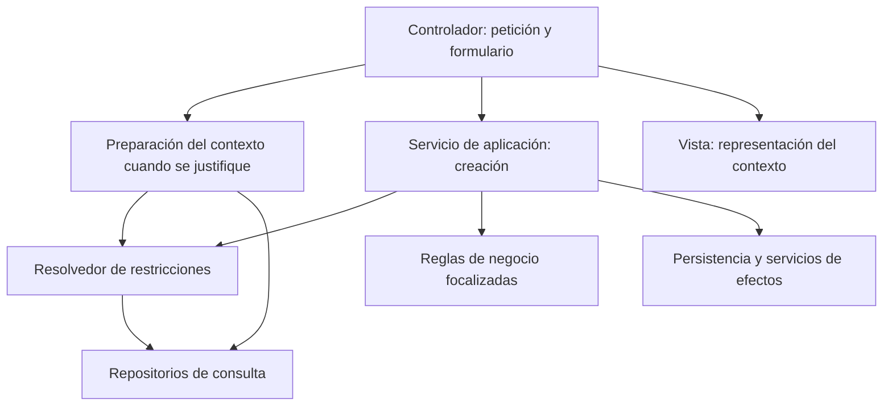

# Avance provisional para revisión docente — actualización documental al 30 de octubre de 2026

**Corte original:** 22 de octubre de 2026, 18:55:57, UTC−04:00, Bolivia. **Actualización documental:** 30 de octubre de 2026, para la predefensa del 31 de octubre. **Nivel:** maestría. **Condición de entrega:** avance provisional; no es un informe final aprobado ni una investigación concluida.

La traducción original se realizó bajo la excepción `TEMP-ALSIE-2026-10-22`. La actualización del 30 de octubre, autorizada por el tesista, corrige afirmaciones desfasadas utilizando decisiones y evidencia ya documentadas en `tesis_ds/`; no constituye una nueva traducción final ni amplía aquella excepción. No se efectuaron ejecuciones técnicas ni se aprobaron nuevos resultados o decisiones científicas. Se conserva la estructura existente y se mantienen los vacíos sustantivos. El mapa y la autoevaluación acompañantes pertenecen al corte original y no acreditan la suficiencia de esta actualización.

## Carátula

**Institución que titula y logotipo:** pendientes de confirmación. ALSIE es el modelo de presentación solicitado; no se presume por ello el nombre legal de la institución otorgante.

**Título provisional aprobado el 28 de octubre:** Diseño y evaluación de un método de refactorización arquitectónica incremental para subcircuitos de aplicaciones MVC heredadas: aplicación en la ejecución POA de SIGPP.

El título reproduce la decisión del tesista registrada el 28 de octubre. MVC delimita la clase de aplicaciones; las restricciones institucionales caracterizan el contexto, no una variante de MVC. Su extensión y sus siglas mantienen una tensión con la recomendación institucional de aproximadamente quince palabras sin abreviaturas; esta actualización no introduce otra reformulación.

**Modalidad y nivel:** tesis para optar al grado de maestría en Ingeniería de Software; denominación oficial del grado pendiente de confirmación.

**Postulante:** Mario Arturo Uriarte Marin.  
**Tutor:** Luis Roberto Pérez Rios, Ph.D.  
**Mes y año de este avance:** octubre de 2026; fecha oficial de presentación final pendiente.  
**Ciudad y país de presentación:** pendientes. El contexto institucional es boliviano, pero no se deduce de ello la sede de presentación.

## Agradecimientos

Apartado opcional, reservado para el texto personal del tesista. No se atribuyen colaboraciones, autorizaciones ni participación efectiva a personas que solo figuran como posibles revisores.

## Dedicatoria

Apartado opcional, pendiente de decisión y redacción del tesista. No se incorpora un texto personal generado en su nombre.

## Resumen

El estudio propone diseñar y evaluar un método de refactorización arquitectónica incremental para subcircuitos de aplicaciones MVC heredadas, aplicado en la ejecución de la planificación operativa y presupuestaria de SIGPP, en la Caja Petrolera de Salud. Se busca mejorar modificabilidad, testabilidad y trazabilidad de cambios sin reescritura completa. Al 28 de octubre se cerraron la fundamentación teórica y una revisión focalizada de antecedentes, y se aceptó adaptar explícitamente el ciclo de Girjoaba y Capiluppi (2024), complementado con cambio seguro y razonamiento por atributos de calidad. La comparación retrospectiva de dos estados de selección de restricciones registró trece pruebas y 65 aserciones satisfactorias por estado, con clases históricas y dobles en el entorno actual; no acredita equivalencia integral ni reducción del esfuerzo. Se recibió un cuestionario funcional con autorización académica acotada y se documentaron comprobaciones locales de fechas que delimitan discrepancias, sin validar persistencia real o el recorrido HTTP. El diagnóstico permanece abierto, con cuatro indicadores propuestos y sin línea base humana de esfuerzo. La formalización completa del método, los ciclos de evaluación y la contribución respaldada continúan pendientes; no se acreditan principios validados, una hipótesis contrastada ni mejora global de mantenibilidad.

## Índice

Índice estructural sin paginación: Markdown no tiene páginas estables. La correspondencia de páginas se comprobará después de la conversión externa. Los preliminares se excluyen de este índice conforme a los indicadores institucionales.

- 1. Introducción
  - 1.1. Pertinencia, contexto y alcance temporal
  - 1.2. Problema científico
  - 1.3. Objeto de estudio y campo de acción
  - 1.4. Objetivos y correspondencia con los capítulos
  - 1.5. Hipótesis, aporte teórico y significación práctica
  - 1.6. Métodos y técnicas: realizado y previsto
  - 1.7. Población, muestra y condiciones éticas
  - 1.8. Estado del avance
- 2. Capítulo I. Diagnóstico de la investigación
  - 2.1. Contexto y antecedentes de la caracterización
  - 2.2. Evidencia técnica registrada y límites
  - 2.3. Operacionalización e instrumentos pendientes
  - 2.4. Cierre provisional del diagnóstico
- 3. Capítulo II. Marco teórico de la investigación
  - 3.1. Cambio seguro, responsabilidades y verificación
  - 3.2. Atributos de calidad y decisiones arquitectónicas
  - 3.3. Antecedentes, valoración crítica y brecha pendiente
- 4. Capítulo III. Modelo teórico de la investigación
  - 4.1. Fundamentación epistemológica pendiente
  - 4.2. Componentes, relaciones y representación pendientes
  - 4.3. Propiedades y cierre provisional
- 5. Capítulo IV. Propuesta de la investigación
  - 5.1. Definición, objetivo y estructura de referencia
  - 5.2. Contenido y arquitectura candidata
  - 5.3. Escenario de fechas y habilitación extraordinaria
  - 5.4. Metodología de aplicación prevista
  - 5.5. Verificación registrada y validación pendiente
  - 5.6. Relación con los capítulos anteriores
- 6. Conclusiones
- 7. Recomendaciones
- 8. Referencias bibliográficas
- 9. Anexos
  - Anexo 1. Registro técnico de procedencia y reproducción pendiente
  - Anexo 2. Escenarios documentados para futuras pruebas de fechas
  - Anexo 3. Vacíos documentales para el cierre institucional

**Relación de tablas y figura:** tabla 1, Estado documental de las etapas (1.8); tabla 2, Mediciones estáticas históricas (2.2); tabla 3, Ejecuciones de pruebas registradas (5.5); figura 1, Responsabilidades y dependencias candidatas (5.2). No se atribuye paginación a estos elementos.

## 1. Introducción

### 1.1. Pertinencia, contexto y alcance temporal

SIGPP, Sistema Integral de Gestión POA Presupuesto, es el contexto institucional de aplicación de la propuesta en la Caja Petrolera de Salud. En este documento, POA designa la planificación operativa anual y ACP, las acciones de corto plazo. El Departamento Nacional de Gestión y Planificación es el área dueña del sistema, según el contexto declarado por el tesista. El sistema articula elaboración, validación y ejecución del POA, presupuesto y certificación; su continuidad de uso constituye una restricción de la intervención, no un resultado ya demostrado.

La pertinencia del estudio se relaciona con la necesidad de modificar reglas institucionales sin redistribuir decisiones de manera informal entre controladores, servicios, persistencia y presentación. El tesista es creador y desarrollador principal del sistema. Su acceso facilita el examen técnico, pero introduce sesgo de constructor y exige contrastación independiente. Existe autorización académica acotada en el cuestionario funcional recibido; la disponibilidad declarada de un revisor técnico no equivale a revisión independiente realizada.

El alcance principal es el subcircuito de ejecución POA: tareas vinculadas a operaciones y ACP, presupuesto y certificación. Elaboración, validación ministerial y evaluación trimestral se mantienen como contexto y posible trabajo posterior. No se promete una interfaz de programación nueva, migración completa de arquitectura, sustitución de Doctrine ni actualización mayor de Symfony. El encuadre comienza el 27 de septiembre de 2026; esta actualización documental incorpora avances registrados hasta el 30 de octubre. Los cambios de marzo de 2025 son antecedentes y no amplían retroactivamente ese período de investigación.

### 1.2. Problema científico

En el subcircuito de ejecución POA de SIGPP de la Caja Petrolera de Salud, el equipo encargado de mantener y evolucionar el software enfrenta una distribución de reglas y consultas entre controladores, servicios, repositorios, entidades persistentes y vistas. Esta organización dificulta localizar el impacto de cambios y verificarlos de forma controlada; los usuarios de planificación, presupuesto y certificación constituyen actores potencialmente afectados por regresiones, aunque su número y el impacto operativo no están medidos. La evidencia disponible permite reconocer señales técnicas locales, no cuantificar todavía costos institucionales ni generalizar el diagnóstico a todo el sistema.

La literatura ofrece procedimientos de cambio seguro (Feathers, 2004), razonamiento arquitectónico por atributos (Bass et al., 2021) y ciclos de refactorización de código heredado (Girjoaba & Capiluppi, 2024). El problema de investigación —que en el formato institucional se registrará como problema científico— consiste en precisar y evaluar una adaptación acotada para seleccionar y verificar incrementos en el campo delimitado. La revisión focalizada de E5, cerrada el 28 de octubre, sustenta operacionalizar esa adaptación; no demuestra ausencia universal de soluciones, superioridad u originalidad validada. La brecha se refinó después del contraste bibliográfico y no se presenta como una conclusión demostrada desde el encuadre.

**Pendiente de delimitación final:** unidades de análisis y selección de evaluación, sede específica de aplicación, magnitud del costo del cambio y respaldo empírico de la contribución. El contraste focalizado de antecedentes está documentado, pero no sustituye completar el diagnóstico ni evaluar el método.

### 1.3. Objeto de estudio y campo de acción

**Objeto de estudio, traducción provisional al sentido institucional:** la evolución arquitectónica de sistemas institucionales heredados organizados bajo modelo-vista-controlador (MVC), en el contexto del subcircuito de ejecución POA de SIGPP durante el período documentado de septiembre a octubre de 2026. Es el área de conocimiento en la que se manifiestan las dificultades de cambio y verificación. El método propuesto pasa a ser la propuesta de investigación y su aplicación en SIGPP, el medio para estudiar su utilidad; no se confunden el área de conocimiento y el producto previsto.

**Campo de acción, traducción provisional:** las responsabilidades, fronteras funcionales y dependencias entre reglas de negocio, coordinación, presentación y persistencia, y su relación con la modificabilidad, la testabilidad y la trazabilidad de cambios en el subcircuito seleccionado. La clase de referencia son sistemas institucionales monolíticos MVC con lógica dispersa y restricciones de continuidad; no todos los sistemas heredados.

Estas formulaciones corresponden a la traducción institucional provisional del 22 de octubre y su validación sigue pendiente. En la resignificación de Design Science, el objeto vigente es el método propuesto de refactorización arquitectónica incremental, con tipología de composición método más instanciación; SIGPP y el proceso POA constituyen contexto de aplicación. Se explicita la diferencia sin aprobar aquí otra definición ni sustituir el objeto y campo registrados en `tesis_ds/`.

### 1.4. Objetivos y correspondencia con los capítulos

**Objetivo general preliminar:** diseñar y evaluar un método de refactorización arquitectónica incremental para subcircuitos de aplicaciones MVC heredadas, aplicado en el subcircuito de ejecución POA de SIGPP, para mejorar la modificabilidad, la testabilidad y la trazabilidad de cambios sin reescritura completa del sistema.

Se conserva el objetivo del perfil, con equivalencias terminológicas. Su cumplimiento no se afirma. La relación con un aporte teórico original no puede cerrarse mientras la novedad y la evaluación estén pendientes.

**Objetivos específicos documentados:**

1. Diagnosticar el estado arquitectónico y de testabilidad del subcircuito de ejecución POA en SIGPP mediante análisis de controladores, servicios, repositorios, entidades, consultas SQL y pruebas existentes.
2. Sistematizar la base de conocimiento sobre arquitectura de software, refactorización incremental, testabilidad y evolución de sistemas heredados MVC.
3. Diseñar el método de refactorización arquitectónica incremental, definiendo pasos, criterios, entradas, salidas y condiciones de aplicación.
4. Aplicar el método en el subcircuito de ejecución POA de SIGPP, manteniendo compatibilidad funcional y usando datos ficticios en entorno controlado.
5. Evaluar la utilidad del método mediante métricas técnicas, revisión independiente y validación institucional acotada.
6. Formular y evaluar principios de diseño a partir de los resultados de aplicación y evaluación del método, explicitando los contextos, mecanismos y límites que la evidencia permita sostener.

**Tensión institucional pendiente:** el perfil tiene seis objetivos específicos; el sexto fue aceptado expresamente el 29 de octubre y explicita la generación de conocimiento, sin acreditar principios ya validados. La estructura ALSIE requiere correspondencia con cuatro capítulos. Los objetivos 1 y 2 sustentan diagnóstico y marco; el 3 aborda diseño; los objetivos 4 y 5, aplicación y utilidad; el 6, conocimiento previsto. Su armonización institucional continúa pendiente y no se reducen ni reformulan objetivos por conveniencia editorial.

### 1.5. Hipótesis, aporte teórico y significación práctica

**Hipótesis: pendiente.** No existe un producto de contribución final ni una evaluación que respalde los mecanismos y las características esenciales necesarios para formularla con la traducción prevista. No se fabrica una proposición causal a partir del número de pruebas o del diagrama técnico. Se requieren relaciones fundamentadas, criterios de contraste y evidencia pertinente; la fórmula institucional queda sin aplicar hasta disponer de ese sustento.

**Aporte teórico previsto:** se aspira a formular conocimiento transferible sobre cómo seleccionar y separar responsabilidades y proteger comportamiento durante cambios incrementales de subcircuitos institucionales heredados. Todavía no se dispone de conceptos, relaciones o regularidades originales validados. La oración del perfil que habla de resultados «validados» se interpreta como aspiración de contribución y no como hallazgo. El antecedente de Feathers y el diseño incremental tratado por Bass et al. obligan a distinguir adaptación útil de novedad científica.

**Significación práctica prevista:** se busca facilitar cambios verificables para el equipo técnico de SIGPP, manteniendo las condiciones institucionales de certificación. Se registró capacidad de prueba local de reglas y del servicio; no se midieron reducción de esfuerzo, disminución de fallos ni beneficio para usuarios. La magnitud de la utilidad y su correspondencia con un aporte teórico siguen pendientes de evaluación. No se aplica una fórmula de mejora cuantificada sin línea base comparable.

### 1.6. Métodos y técnicas: realizado y previsto

La estrategia del perfil es construir, aplicar y evaluar una propuesta, diferenciando utilidad local y conocimiento transferible. Esta traducción clasifica las actividades documentadas sin atribuir métodos no realizados ni presentar la búsqueda exploratoria como revisión sistemática.

**Métodos teóricos.** Se efectuaron análisis y síntesis focalizados de textos y decisiones para el objetivo 2. Se examinaron pasajes de Feathers y Fowler y, posteriormente, de Bass et al.; la lectura realizada por el asesor en los registros no acredita lectura o defensa del tesista. La modelación formal del objetivo 3 y del capítulo III está pendiente. Tampoco se acredita un análisis histórico-lógico completo ni la aplicación de un enfoque epistemológico específico.

**Métodos empíricos.** Se documentaron inspección de código, análisis de documentos técnicos e historial de versiones para el objetivo 1. Se reprodujeron ejecuciones de pruebas del estado técnico disponible como comprobación exploratoria relacionada con los objetivos 4 y 5. No se presenta la inspección como experimento controlado, la disponibilidad de un revisor como entrevista realizada ni el caso como muestra estadísticamente representativa.

**Técnicas aplicadas.** Se registraron recuentos estáticos iniciales, examen de diferencias Git, contraste de selección de restricciones y ejecuciones PHPUnit. El alcance, las fechas y las limitaciones se precisan en los capítulos I y IV y en el anexo 1. No se midió cobertura efectiva, complejidad ciclomática ni esfuerzo de cambio con protocolo cerrado.

**Métodos y técnicas previstos.** Se mantienen pendientes completar el diagnóstico y su operacionalización (objetivo 1), formalizar entradas, salidas, decisiones y condiciones de aplicación (objetivo 3), aplicar incrementos controlados (objetivo 4), realizar comparación técnica y revisión independiente (objetivo 5) y formular y evaluar principios con límites explícitos (objetivo 6). La fundamentación y revisión focalizada del objetivo 2 están cerradas al alcance registrado. La evaluación deberá incluir hallazgos, rediseño documentado y valoración final con criterios previos. Las referencias metodológicas Hevner et al. (2004), Peffers et al. (2007), Wieringa (2014) y Venable et al. (2016) no acreditan por sí solas un modelo de proceso definitivamente seleccionado ni su ejecución.

### 1.7. Población, muestra y condiciones éticas

El contexto de estudio está seleccionado intencionalmente por acceso técnico y relevancia institucional. Se propone examinar cambios y componentes del subcircuito de ejecución POA, con certificación como primer caso acotado. Los once archivos de la medición inicial son un subconjunto técnico registrado, no una población completa ni una muestra probabilística. Los casos parametrizados de pruebas tampoco constituyen personas ni unidades estadísticas independientes por el solo hecho de ser contados.

**Pendiente:** definir población de componentes o escenarios, unidades de análisis, criterios de inclusión, tamaño y justificación de la selección, y papeles finales de revisión. La fuente funcional consultada no constituye por sí sola una muestra de evaluación independiente. La eventual transferencia sería analítica a contextos semejantes, no representatividad estadística de todas las instituciones; no se simulan cálculos muestrales.

Se trabaja con datos ficticios para las comprobaciones locales documentadas. El cuestionario funcional, fechado el 29 de octubre y revisado el 30, registra autorización académica acotada e identificación pública por cargo: Planificador Nacional. No equivale a permiso general de publicación de datos institucionales ni a validación del método. Se mantienen los límites de consentimiento y no se incluyen certificaciones reales, datos privados ni enlaces de sesiones docentes.

### 1.8. Estado del avance

Los productos técnicos parciales no cambian el estado de las etapas. La tabla 1 reproduce el registro rector; una etapa pendiente puede tener notas o antecedentes sin que eso equivalga a cierre.

**Tabla 1**  
*Estado documental de las etapas al corte*

| Etapa | Estado registrado |
|:--|:--|
| E0. Encuadre | cerrado |
| E1. Áreas y temas | cerrado |
| E2. Delimitación | cerrado preliminar para perfil |
| E3. Perfil de investigación | cerrado preliminar para perfil |
| E4. Marco teórico | cerrado el 28/10: fundamentación, no validación del método |
| E5. Estado del arte | cerrado el 28/10: revisión focalizada |
| E6. Diagnóstico con indicadores | iniciado; línea base y criterios incompletos |
| E7a. Alternativas de solución | pendiente |
| E7b. Requisitos | pendiente |
| E7c. Diseño | pendiente |
| E7d. Plan de construcción y versiones | pendiente |
| E7e. Construcción y verificación interna | pendiente |
| E7f. Ficha reproducible | pendiente |
| E8. Evaluación | pendiente |
| E9. Enlace propuesta–solución | pendiente |
| E10. Contribución y conclusiones | pendiente |

*Nota.* Fuente: `tesis_ds/00_estado.md`, sección «Etapas», consultada para este corte. No se modificó el registro rector. La proporción máxima de páginas de la introducción deberá comprobarse en una versión paginada; no se presume cumplida en este avance Markdown.

## 2. Capítulo I. Diagnóstico de la investigación

Este capítulo presenta lo que puede documentarse sobre el estado técnico y el contexto del objetivo específico 1. No reemplaza el diagnóstico formal pendiente: diferencia mediciones estáticas históricas, inspección posterior y necesidades de operacionalización.

### 2.1. Contexto y antecedentes de la caracterización

La aplicación examinada utiliza PHP 7.4, Symfony 4.4, Doctrine, formularios y plantillas Twig. El dominio vincula tareas con operaciones y ACP y con presupuesto y certificación. El registro inicial describe reglas distribuidas entre varios componentes. La existencia de servicios no basta para demostrar una frontera completa: la inspección posterior encontró preparación de datos y acceso a persistencia en el controlador, coordinación de varios efectos en el servicio y validaciones temporales de distinto alcance entre servidor y presentación.

La familiaridad del tesista facilita comprender reglas implícitas y también puede sesgar la selección e interpretación de escenarios. Se recibió un cuestionario respondido por el Planificador Nacional, documentado en E6 con concordancias y discrepancias. No constituye una encuesta representativa ni una evaluación del método. Las declaraciones funcionales y aclaraciones indirectas no se atribuyen automáticamente a normativa publicada.

### 2.2. Evidencia técnica registrada y límites

La medición estática inicial documentada en el borrador del 5 de octubre identifica un volumen y una dispersión que orientan una intervención acotada. No equivale a un diagnóstico completo ni constituye medición actualizada al corte. Una instanciación con `new` no demuestra por sí sola acoplamiento perjudicial y un recuento de líneas no mide mantenibilidad. La tabla 2 conserva los valores sin convertirlos en umbrales de éxito.

**Tabla 2**  
*Mediciones estáticas históricas del subcircuito seleccionado*

| Aspecto registrado | Valor inicial | Alcance y reserva |
|:--|--:|:--|
| Archivos críticos medidos | 11 | Selección inicial, no inventario completo. |
| Líneas acumuladas | 4177 | Aproximación histórica, no reducción demostrada. |
| Instanciaciones directas `new` | 46 | Recuento, no juicio automático de calidad. |
| Llamadas a `getDoctrine()` en controladores críticos de tarea | 2 | Alcance limitado a los controladores examinados. |
| Ocurrencias de SQL nativo o construcción SQL | 9 | Sin protocolo formal de diagnóstico cerrado. |
| Métodos privados de `CreateCertificacionService` | 13 | No equivalen a trece defectos ni a reglas independientes. |

*Nota.* Fuente: `tesis_ds/propuesta_borrador_2026-10-05.md`, «Línea base técnica inicial», preparado el 4 de octubre para la revisión del 5. Faltan versión exacta de la medición, procedimiento reproducible y comparación actual equivalente. No se representan estos mismos valores en una figura.

La revisión registrada el 18 de octubre encontró selección compartida de restricciones mediante `RestriccionSubPartidaResolver`. Las dependencias de constructor pasaron localmente de siete a seis en cada uno de dos consumidores; el nuevo componente recibe dos repositorios. Esta redistribución no demuestra reducción de acoplamiento global ni menos consultas por petición. Se identificó además prueba directa de `CreateCertificacionService`; queda corregida la ausencia que describían documentos anteriores. Los resultados ejecutables se presentan solo en la tabla 3, en la propuesta.

La inspección estática ampliada de fechas y guardado registró validación local de importe positivo y saldo disponible, una validación de fecha por rango anual y controles específicos de permisos o habilitación no acreditados en el recorrido revisado. Estos límites no constituyen una auditoría de seguridad ni una aceptación inválida reproducida por HTTP. El posible efecto de transacciones externas, concurrencia y otras barreras permanece por comprobar.

### 2.3. Operacionalización e instrumentos pendientes

Existe `tesis_ds/06_diagnostico.md`, iniciado el 28 de octubre. Propone I01, correspondencia de decisiones; I02, rechazo antes de efectos; I03, esfuerzo humano activo de preparación y comprobación; e I04, extensión de un cambio posterior. La operacionalización y los criterios completos siguen pendientes. I03 no dispone de línea base humana: los tiempos de asistencia automatizada no se atribuyen al tesista. I04 tiene un escenario acordado de ampliación por configuración, pero no ejecución acreditada. Los resultados conocidos no se convierten retrospectivamente en metas previas.

El cuestionario funcional respondido y las comprobaciones locales de fechas constituyen instrumentos y registros parciales existentes. Persisten ratificación de la síntesis funcional, criterios completos, control reproducible del instante y revisión independiente formalizada. Las pruebas locales se documentan como verificación o diagnóstico acotados, no como sustituto de evaluación integral. Esta actualización no crea ni aplica instrumentos nuevos.

### 2.4. Cierre provisional del diagnóstico

Se documentaron señales locales, una fuente funcional recibida y discrepancias temporales observadas mediante pruebas acotadas. No se establecieron regularidades generales ni una caracterización integral con criterios y selección de evaluación completos. El objetivo 1 permanece parcialmente atendido y E6 continúa abierta.

## 3. Capítulo II. Marco teórico de la investigación

Este capítulo conserva la fundamentación del corte original y añade el cierre documental del 28 de octubre para el objetivo 2. E4 está cerrada como fundamentación y E5 como revisión focalizada; no se presenta una revisión sistemática exhaustiva ni validación del método. Se distingue el conocimiento consultado de la evidencia producida en SIGPP.

### 3.1. Cambio seguro, responsabilidades y verificación

Feathers (2004, pp. 14–20) aborda el problema de introducir pruebas cuando las dependencias impiden aislar el código. Esta perspectiva permite considerar separaciones conservadoras iniciales sin exigir cobertura completa antes de todo movimiento mínimo. La protección del comportamiento no autoriza una extracción masiva sin evidencia; exige explicitar riesgo residual y puntos de observación. La caracterización describe lo que hace el programa, no lo que debería hacer conforme a una regla institucional (pp. 186–190). Además, verificar el componente extraído no sustituye comprobar su conexión con los consumidores (pp. 194–195).

Esta distinción se articula con Fowler (2018, pp. 45–47): una refactorización conserva comportamiento observable, mientras que añadir capacidad modifica lo que el sistema permite hacer. En SIGPP, compartir la selección existente de restricciones y ampliar la habilitación extraordinaria son actividades diferentes. La postura de trabajo consiste en mantener pruebas y evidencia diferenciadas, aunque ambas actividades se alternen en incrementos pequeños. Es una orientación fundamentada, no una eficacia ya demostrada del método.

### 3.2. Atributos de calidad y decisiones arquitectónicas

Bass et al. (2021, secs. 3.2–3.3) permiten expresar atributos mediante escenarios con estímulo, entorno, respuesta y medida, en lugar de calificar el resultado simplemente como «más limpio». La modificabilidad requiere considerar qué cambio se solicita y cuánto cuesta introducirlo y verificarlo. El costo de preparar un mecanismo de variación y el costo posterior de utilizarlo no son intercambiables (cap. 8). En consecuencia, una futura parametrización no demostraría ahorro neto si solo se midiera el uso administrativo final y se omitiera el trabajo inicial.

La testabilidad se relaciona con control de entradas y observación de resultados (Bass et al., 2021, secs. 12.1–12.2). Un día de referencia controlable podría permitir casos temporales repetibles, pero esto no demuestra todavía integración correcta con persistencia o archivos. La selección de responsabilidades debe responder a cambios pertinentes y cohesión, no a crear una clase por cada casilla de un diagrama.

Stafford (2003) describe la capa de servicios como frontera de operaciones y coordinación. Symfony (s. f.) recomienda separar la lógica de negocio del controlador, sin prohibir universalmente que este consulte repositorios. Por tanto, restringir consultas en el controlador intervenido sería una elección local que exige justificación, no una obligación universal del marco. La recomendación candidata conserva MVC y dependencias existentes con excepciones explícitas de transición, sin atribuir independencia tecnológica que aún no existe.

El resumen contrastado de Parnas (1972) vincula la utilidad de modularizar con el criterio de descomposición. El resumen de Abbasi et al. (2026) advierte límites de la evidencia y desacuerdos sobre métricas de diseño y testabilidad. Estas fuentes solo se utilizan en el alcance de sus resúmenes documentados: no se presume lectura completa ni se transfieren automáticamente resultados a PHP. La posición provisional rechaza equiparar menos dependencias locales o más clases con calidad global demostrada.

### 3.3. Antecedentes, valoración crítica y brecha pendiente

La secuencia conceptual enlaza modularización, cambios protegidos, coordinación y escenarios de calidad. El contraste posterior incorpora una revisión focalizada de propuestas actuales, sin convertirse en revisión sistemática ni análisis histórico-lógico completo. Los antecedentes regionales y bolivianos no se presentan como revisados exhaustivamente. No se inventan experiencias nacionales ni se interpreta su ausencia documental como inexistencia en la literatura.

La lectura del 21 de octubre muestra que Feathers ya describe un procedimiento incremental de cambio y ruptura de dependencias. El texto de Bass et al. también aborda refinamiento iterativo de sistemas existentes y documentación de decisiones. Esta evidencia limita la formulación inicial de la brecha: aplicar una secuencia conocida a SIGPP no basta para reclamar originalidad. Se requiere precisar qué adaptación, relación o evidencia nueva aporta la investigación y cómo se diferencia de antecedentes existentes.

La búsqueda del 20 de octubre fue exploratoria, acotada a metadatos y resúmenes, no una revisión exhaustiva. La consulta de contenido de Bagheri-Galle y colaboradores y la literatura reciente sobre deuda técnica y refactorización de monolitos permanecen **[por verificar]**; no respaldan afirmaciones confirmadas. El acceso al texto de Bass et al. quedó resuelto mediante el adjunto posterior del tesista; no se vuelve a tratar como libro inaccesible. La fecha específica de esa ficha no está consignada y no se inventa. Las referencias normalizadas se presentan en la sección 8 y los límites documentales, en el mapa.

El mapa de fundamentación del 28 de octubre vincula nueve decisiones D01–D09 con sus fuentes y consecuencias de diseño, y documenta la prueba de eliminación y tres trabajos recientes con lectura focalizada. E4 quedó cerrada al nivel de fundamentación, no de validación. E5 quedó cerrada como revisión focalizada y comparación de antecedentes; sus límites impiden declarar inexistencia universal de soluciones o superioridad demostrada.

Girjoaba y Capiluppi (2024) constituyen la base operativa explícitamente aceptada el 28 de octubre, complementada con Feathers y ADD. La adaptación candidata distingue unidad funcional y consumidores, comportamiento observado frente a requerido, puntos de comprobación y costo de transformación frente al cambio posterior. No se reclama autoría de los pasos heredados ni novedad por combinarlos. Los registros `mapa_fundamentacion_e4_2026-10-28.md` y `05_estado_del_arte.md` conservan el detalle y los límites del contraste; la formalización completa y evaluación de la adaptación siguen pendientes.

## 4. Capítulo III. Modelo teórico de la investigación

Este capítulo conserva el lugar institucional del modelo sin confundirlo con la arquitectura del software. No existen el producto final de contribución ni relaciones originales validadas que permitan construirlo mediante traducción. El objetivo específico de modelación tampoco ha sido aprobado como reformulación del perfil.

### 4.1. Fundamentación epistemológica pendiente

El área profesional es Ingeniería de Software y la fundamentación parcial aborda evolución arquitectónica y verificación. No se dispone de una fundamentación epistemológica completa del modelo, ni de principios, ley fundamental o enfoque filosófico adoptados explícitamente por el investigador. Se requiere vincular el objeto institucional con categorías y supuestos defendidos por el tesista; no se declara un enfoque dialéctico, causal u otro solo por aparecer entre las posibilidades de la guía.

### 4.2. Componentes, relaciones y representación pendientes

Modificabilidad, testabilidad, responsabilidades y trazabilidad son dimensiones de interés documentadas, no componentes de un modelo original ya establecido. Faltan definiciones operativas integradas, relaciones explicativas, jerarquía, dinámica, condiciones de contorno y sustento de las regularidades. No se infieren leyes del recuento de pruebas.

**Representación gráfica pendiente:** no se genera un diagrama Mermaid que aparente un modelo teórico inexistente. El diagrama técnico disponible se incluye únicamente en el capítulo IV como arquitectura candidata de aplicación. Para completar este apartado se necesita un modelo sustentado y una representación de sus componentes y relaciones; entonces corresponderá incluir un diagrama provisional y convertirlo externamente en figura con título y nota APA 7.

### 4.3. Propiedades y cierre provisional

Las propiedades sistémica, multifactorial, procesal, dinámica, flexible, comunicativa, interdisciplinaria, personológica y compleja están **pendientes de valoración individual sobre un modelo que aún debe formularse**. No se declaran cumplidas ni inaplicables por conveniencia. Claridad, elegancia, originalidad y escasez de elementos arbitrarios tampoco son comprobables sin esa construcción.

En este corte no se obtuvo el resultado teórico exigido para el capítulo III. La arquitectura candidata no lo sustituye; su derivación, comprobabilidad y relación con la propuesta permanecen pendientes.

## 5. Capítulo IV. Propuesta de la investigación

Este capítulo presenta el contenido respaldado de la propuesta y los antecedentes ejecutables disponibles para los objetivos 3, 4 y 5. Separa definición preliminar, decisiones candidatas, evidencia registrada y metodología futura; no declara una solución completa al problema científico.

### 5.1. Definición, objetivo y estructura de referencia

La propuesta se define preliminarmente como un método de refactorización arquitectónica incremental: una secuencia documentada de actividades, decisiones, entradas, salidas y condiciones para intervenir un subcircuito institucional heredado, aplicada en SIGPP. Su objetivo es hacer explícitas fronteras y responsabilidades y permitir verificación de los cambios sin reescribir el sistema completo. El método es el resultado previsto; el código intervenido es su aplicación técnica, no el aporte teórico por sí mismo.

El borrador preparado para el 5 de octubre propone seis actividades: selección del subcircuito, caracterización del comportamiento, delimitación de frontera, extracción incremental, verificación y evaluación con rediseño. Esa secuencia permanece preliminar y debe contrastarse con procedimientos existentes, sin apropiarse de prácticas conocidas como si fueran originales.

**Base operativa aceptada:** adaptación explícita del ciclo de Girjoaba y Capiluppi (2024), complementada con Feathers (2004) y Bass et al. (2021). La adopción se registró el 28 de octubre y supera el pendiente de selección del antecedente operativo. No implica que se hayan formalizado todos los pasos, entradas, salidas, alternativas y versiones de E7 ni resuelve por sí sola las exigencias institucionales del capítulo III. El documento auxiliar *Resultados científicos* no fue aportado y no se presume su contenido.

### 5.2. Contenido y arquitectura candidata

La recomendación documentada del 18 de octubre es mantener el monolito MVC con una frontera de aplicación incremental, separando coordinación HTTP, preparación de contexto cuando esté justificada, creación, reglas focalizadas y efectos. No es un contrato aceptado ni el cierre de alternativas. La opción de mantener extracciones puntuales sin contrato reduce trabajo inmediato pero no resuelve límites; la independencia completa mediante puertos y adaptadores ofrece mayor aislamiento con un costo de migración aún no justificado.

El resolvedor ya observado coordina la búsqueda de una restricción específica por actividad, una alternativa general y la ausencia de restricción. Utiliza repositorios concretos; no se presenta como regla pura independiente de persistencia. La propuesta candidata pretende que la vista represente datos y que el servicio de creación compruebe las condiciones aplicables antes de los efectos. La preparación de datos no requiere obligatoriamente otra clase: solo se extraería por necesidad documentada.

La figura 1 traduce el diagrama existente de responsabilidades propuestas, no un modelo teórico ni una lista de componentes terminados.

**Figura 1**  
*Responsabilidades y dependencias candidatas para la creación de certificación*

*Nota.* Adaptación terminológica del diagrama de `arquitectura_candidata_certificacion_2026-10-18.md`, «Contrato candidato de responsabilidades». Las flechas son dependencias propuestas, no evidencia de implementación. La preparación es opcional. Mermaid es una representación provisional en Markdown y deberá convertirse externamente en figura conservando título y nota APA 7. No acredita originalidad teórica ni cumplimiento del capítulo III.

Se mantendrían dependencias concretas de Symfony y Doctrine durante la transición. El objeto de entrada transportaría datos y no leería formularios; la coordinación evitaría guardar estado de una ejecución en propiedades; las excepciones se documentarían. Estas formulaciones son propuestas por defender, no cambios ejecutados durante esta traducción.

### 5.3. Escenario de fechas y habilitación extraordinaria

El tesista confirmó `America/La_Paz` como zona horaria institucional y el significado de `fecha` como día documental, sin relevancia de hora. Estas decisiones ya están registradas; no se vuelven a plantear como incógnitas. La implementación inspeccionada usa `datetime`; cambiar formulario, almacenamiento o datos históricos no está autorizado por esa sola diferencia semántica.

Para gestión actual, la regla declarada admite hoy y el último día del mes anterior cuando pertenezca a la gestión de la tarea, con precisiones funcionales todavía pendientes. Para gestión inmediatamente anterior, las aclaraciones del 30 de octubre sustituyen la formulación fija de 29 o 31 de diciembre por el último día hábil de esa gestión, excluyendo fines de semana y días no laborables aplicables. El tesista informó, tras consultar a la referente funcional, que la jefatura comunica el plazo, habitualmente hasta el 8 de febrero, con extraordinarias dentro del trimestre. El trimestre se declaró práctica habitual, sin precedente posterior reportado; no se acredita una prohibición normativa ni una autorización universal para abrir en agosto. La síntesis completa y la fuente del calendario requieren ratificación. La habilitación extraordinaria no dispensa permisos, saldo ni demás controles.

La extensión propuesta reutilizaría la administración de parámetros: selección de gestión anterior, un tipo extraordinario y los períodos existentes. La inspección identifica lista cerrada de tipos, fábricas y carga explícita; haría falta incorporar la opción y su carga y mantener coherencia entre presentación y guardado. No se propone una entidad nueva, un motor genérico, días documentales configurables ni habilitar cualquier gestión histórica. Los períodos de planificación de tareas son referenciales y no se convierten en prohibición trimestral.

Estas reglas y aclaraciones no prueban cumplimiento actual. Se acordaron una única definición de la decisión extraordinaria en servidor y autoridad temporal operativa del servidor PHP en `America/La_Paz`; no son capacidades implementadas. Para I04 se aceptó una ventana ficticia del 1 al 8 de febrero de 2027 ampliada al 10, con días completos y seis casos de frontera. El instrumento reproducible sigue pendiente y no hay ejecución de ese escenario. La incorporación funcional se distingue de la extracción conservadora; el anexo 2 separa expectativas, comprobaciones parciales y acuerdos no ejecutados.

### 5.4. Metodología de aplicación prevista

Conforme al camino documentado, antes de otra intervención se prevé completar fundamento, contraste de alternativas e indicadores. Para cada incremento autorizado se fijarían escenario observable y versión de partida, se caracterizaría el comportamiento pertinente, se realizaría una transformación acotada, se repetirían pruebas y se registrarían diferencias. Si fuese necesaria una separación mínima para introducir pruebas, se explicitarían su alcance y riesgo, sin exigir retrospectivamente una secuencia ideal no demostrada.

Se prevé distinguir dos líneas de evidencia: preservación del comportamiento existente y aceptación de capacidades nuevas o correcciones funcionales. En fechas, se controlaría el día de referencia, la gestión y los datos de habilitación; se observarían decisión y ausencia de efectos ante rechazo. Se comprobarían límites de mes/año, distintas horas del mismo día, gestión incompatible y coherencia entre interfaz y servidor. No se alterarían campos de auditoría para simular emisión.

La metodología completa aún requiere herramientas, fórmulas, responsables, versiones, criterio de suficiencia y documentos de registro. También se prevén comprobaciones de integración con persistencia y archivos y una revisión técnica independiente formalizada. No consta que estos pasos se hayan completado como aplicación prospectiva del método.

### 5.5. Verificación registrada y validación pendiente

La evidencia disponible acredita ejecuciones y capacidad de prueba del estado inspeccionado, no un ensayo comparativo controlado. Los resultados de la tabla 3 se conservan como registros de sus fechas. El directorio focalizado forma parte de la batería general: sus cifras no se suman a ella ni equivalen a porcentaje de cobertura.

**Tabla 3**  
*Ejecuciones de pruebas registradas en las notas de investigación*

| Fecha del registro | Alcance y comando registrado | Resultado | Límite |
|:--|:--|:--|:--|
| 13/10/2026 | Batería previa, `rtk phpunit` | 151 pruebas, 235 aserciones satisfactorias | No se reprodujo aquí la versión anterior ni se acredita comparación controlada. |
| 18/10/2026 | Batería general, `make test`, invocada mediante `rtk` | 188 pruebas, 540 aserciones satisfactorias | PHPUnit 9.6.15 y PHP 7.4.29 registrados; sin cobertura medida. |
| 18/10/2026 | `docker exec --user 1000 sigpp-app vendor/bin/phpunit tests/Certificacion` | 37 pruebas, 305 aserciones satisfactorias | Subconjunto focalizado; no prueba HTTP integral ni recursos reales. |

*Nota.* Fuentes: `07e_construccion_verificacion.md`, «Resultado de ejecución de pruebas» y «Actualización verificada del 18 de octubre de 2026»; `arquitectura_candidata_certificacion_2026-10-18.md`, «Verificación reproducida». No se ejecutaron pruebas nuevas para esta traducción. Las aserciones incluyen comprobaciones con dobles y los proveedores de datos generan varios casos por método.

La prueba directa del servicio principal invocó `create()` con dobles y comprobó resultados, validaciones previas y orden de efectos. Otras pruebas cubrieron selección específica/general/ausente, delegación y propagación de errores. Esto corrige la ausencia de prueba directa señalada en el registro del 13 de octubre; no prueba transacciones reales, archivos, contrato HTTP ni conformidad institucional integral.

La revisión de historial situó `815ce6c0` el 6 de marzo de 2025 y `9d4af430` el 7 de marzo de 2025. Son antecedentes de extracción hacia servicios, anteriores a la investigación. El seguimiento del 20 de octubre registró el resolvedor y pruebas en `8dc63307` y el contrato borrador en `1294047e`; ya no corresponde describirlos como archivos sin seguimiento. Ese seguimiento no informó nueva ejecución ni envío remoto. La secuencia previa de caracterización y desarrollo guiado por pruebas continúa como declaración sin registros intermedios suficientes.

**Evidencia posterior documentada:** la comparación `5313c0e1` → `8dc63307` registró trece pruebas y 65 aserciones satisfactorias por estado con instrumento común. La comprobación es retrospectiva, con clases anteriores y dobles en el entorno actual; no reconstruye la aplicación histórica completa. El perfil registra además 188 pruebas y 540 aserciones satisfactorias en `5e0fec3d`, sin trasladar ese resultado a `7c0bca08`, que incorpora pruebas posteriores. Las cifras no se suman entre sí ni miden cobertura.

Las comprobaciones temporales posteriores registraron una prueba, una aserción y un fallo para fecha documental, y tres pruebas, cinco aserciones y un fallo para variación horaria. La primera documenta avance hasta solicitar correlativo antes del rechazo requerido, con discrepancia de gestión en un auxiliar y sin reloj controlado; la segunda documenta distinta admisibilidad local para horas del mismo día. Son registros inspeccionados, no nuevas ejecuciones para este IFI, ni pruebas HTTP o de persistencia real. E6 conserva sus límites y el esfuerzo humano permanece sin línea base.

**Validación pendiente:** E8 sigue pendiente, al igual que evaluación final, revisión independiente formalizada y validación del método. El cuestionario funcional recibido no sustituye esa evaluación. Se requiere línea base pertinente, criterios previos, rediseño y suficiencia documentados; los antecedentes no se convierten retrospectivamente en un ciclo completo validado.

### 5.6. Relación con los capítulos anteriores

La propuesta se vincula con señales técnicas del capítulo I y fundamentos parciales del capítulo II. Su concreción de un modelo original del capítulo III no está acreditada. Tampoco existe todavía el enlace final entre requisitos, componentes, indicadores, evidencia y solución; la matriz original mantiene vacíos. En este corte la propuesta constituye una vía de trabajo documentada, no la solución demostrada del problema científico.

## 6. Conclusiones

Las siguientes conclusiones se limitan al avance acreditado. No reemplazan las conclusiones finales por objetivo o capítulo ni prueban cumplimiento integral de los objetivos.

1. **Sobre el diagnóstico:** el registro disponible permitió localizar señales técnicas de responsabilidades mezcladas y precisar límites del recorrido inspeccionado. No produjo aún una caracterización integral con población, instrumentos e indicadores operacionales cerrados; por tanto, no se obtuvo el diagnóstico completo del capítulo I.
2. **Sobre el marco teórico:** E4 se cerró como fundamentación vinculada a decisiones y E5 como revisión focalizada el 28 de octubre. Se aceptó una base operativa explícita y se delimitaron adaptaciones candidatas. No se demostró una ausencia general de métodos ni originalidad validada; esos límites permanecen aunque las dos etapas documentales estén cerradas.
3. **Sobre el modelo teórico:** no se dispuso de componentes y relaciones originales sustentados ni de su representación. En consecuencia, no se obtuvo el resultado exigido para el capítulo III; una arquitectura candidata no constituyó sustituto válido de ese modelo.
4. **Sobre la propuesta:** los registros iniciales y la comparación retrospectiva posterior acreditan comprobaciones locales del servicio y selección de restricciones. El cuestionario recibido y los fallos temporales documentados delimitan el diagnóstico. No acreditan reducción global de acoplamiento, esfuerzo humano menor, cobertura medida, continuidad operativa, integración completa ni utilidad final del método. E7–E10 permanecen pendientes y los principios de diseño siguen siendo contribución prevista, no resultado validado.

El resultado de esta entrega es exclusivamente un **corte provisional traducido** con trazabilidad y vacíos explícitos. La investigación no está concluida.

## 7. Recomendaciones

1. Se recomienda completar el diagnóstico y fijar para la siguiente intervención unidades de análisis, indicadores, herramientas y criterios prospectivos, conservando los valores históricos sin redefinirlos como metas previas.
2. Se recomienda mantener explícitos los antecedentes y límites de la revisión focalizada ya cerrada, y evaluar las adaptaciones antes de formular aporte teórico o hipótesis como resultados sustentados. No se propone reabrir investigación bibliográfica como condición para preparar la predefensa.
3. Se recomienda resolver con el tesista y el asesor la correspondencia de cuatro objetivos por capítulos y la construcción del modelo teórico, sin convertir un diagrama de clases o dependencias en teoría por cambio de nombre.
4. Se recomienda formalizar aplicación, revisión independiente e integración con datos ficticios y consentimiento documentado, manteniendo separada la extracción estructural de la habilitación extraordinaria y sin modificar datos históricos por esta traducción.
5. Se recomienda confirmar carátula y documentos auxiliares institucionales y verificar extensión, paginación y figuras después de la conversión externa. Las recomendaciones atienden vacíos constatados; no prescriben despliegue de una solución todavía no validada.

## 8. Referencias bibliográficas

Se listan únicamente fuentes citadas en este avance, normalizadas a APA 7 según el registro bibliográfico disponible. No se añade ciudad editorial, por no corresponder a APA 7. La comprobación del contenido procede de los registros de lectura, no de una nueva investigación durante la traducción. Las limitaciones bibliográficas no desaparecen al normalizar la referencia.

Abbasi, N., Parsa, S., & Zakeri, M. (2026). A systematic literature review on design for testability approaches in software systems. *ACM Computing Surveys, 58*(12), 1–44. https://doi.org/10.1145/3787493

> Metadatos y resumen contrastados el 20 de octubre de 2026; texto completo pendiente; numeración final de artículo **[por verificar]**. No se atribuyen resultados ajenos al resumen documentado.

Bass, L., Clements, P., & Kazman, R. (2021). *Software architecture in practice* (4th ed.). Addison-Wesley Professional. https://www.sei.cmu.edu/library/software-architecture-in-practice-fourth-edition/

> El catálogo SEI registra publicación en 2021; el ejemplar aportado indica copyright 2022. Se conserva el año de publicación y los localizadores por secciones de la ficha, sin suponer paginación editorial a partir del archivo redistribuido.

Feathers, M. C. (2004). *Working effectively with legacy code*. Prentice Hall PTR. https://www.informit.com/store/working-effectively-with-legacy-code-9780131177055

> Publicación y pasajes primarios contrastados; primera impresión 2004 y copyright 2005. No se afirma lectura íntegra ni lectura del tesista por el solo hecho de aportar el libro.

Fowler, M. (2018). *Refactoring: Improving the design of existing code* (2nd ed.). Addison-Wesley Professional. https://martinfowler.com/books/refactoring.html

> Publicación contrastada y pp. 45–47 del ejemplar local verificadas en el registro del 21 de octubre; copyright 2019. Kent Beck figura como colaborador, no como coautor de la portada registrada.

Girjoaba, A. V., & Capiluppi, A. (2024). Refactoring legacy code using cleaning up cycles: An experience report. In *2024 IEEE International Conference on Software Maintenance and Evolution (ICSME)* (pp. 753–764). IEEE. https://doi.org/10.1109/ICSME58944.2024.00079

> Metadatos verificados en E5; contenido consultado en manuscrito aportado, sin equivalencia editorial íntegra certificada. Se reutiliza esa comprobación; no se efectuó búsqueda nueva para esta actualización.

Hevner, A. R., March, S. T., Park, J., & Ram, S. (2004). Design science in information systems research. *MIS Quarterly, 28*(1), 75–105. https://doi.org/10.2307/25148625

Parnas, D. L. (1972). On the criteria to be used in decomposing systems into modules. *Communications of the ACM, 15*(12), 1053–1058. https://doi.org/10.1145/361598.361623

> Metadatos y resumen contrastados; texto íntegro pendiente. La paráfrasis se limita al argumento registrado en el resumen.

Peffers, K., Tuunanen, T., Rothenberger, M. A., & Chatterjee, S. (2007). A design science research methodology for information systems research. *Journal of Management Information Systems, 24*(3), 45–77. https://doi.org/10.2753/MIS0742-1222240302

Stafford, R. (2003, 5 de marzo). *Service layer*. Martin Fowler. https://martinfowler.com/eaaCatalog/serviceLayer.html

Symfony. (s. f.). *The Symfony framework best practices* (documentación 4.x). https://symfony.com/doc/4.x/best_practices.html

Venable, J., Pries-Heje, J., & Baskerville, R. (2016). FEDS: A framework for evaluation in design science research. *European Journal of Information Systems, 25*(1), 77–89. https://doi.org/10.1057/ejis.2014.36

Wieringa, R. J. (2014). *Design science methodology for information systems and software engineering*. Springer. https://doi.org/10.1007/978-3-662-43839-8

> Las fuentes metodológicas se conservan con el nivel de comprobación declarado en `tesis_ds/referencias.md`: verificadas en el libro base del repositorio, no nuevas lecturas primarias acreditadas por esta entrega. Las consultas aún no utilizadas se registran en el mapa, no como referencias que respalden resultados.

## 9. Anexos

Los anexos reproducen síntesis de sustento y distinguen registros existentes de escenarios no ejecutados. El cuestionario aplicado se referencia desde E6; no se incorpora aquí su contenido personal. La operacionalización completa sigue pendiente. Se mantiene numeración ascendente; la tipografía final se comprobará externamente.

### Anexo 1. Registro técnico de procedencia y reproducción pendiente

Las ejecuciones y versiones se registran en `07e_construccion_verificacion.md`, actualización del 18 de octubre, y `arquitectura_candidata_certificacion_2026-10-18.md`, «Verificación reproducida»; la actualización de seguimiento está en `reglas_fecha_certificacion.md`, «Punto de partida Git actualizado». Véase la tabla 3 para los resultados, sin repetirlos como otra medición.

Los archivos de prueba identificados son `RestrictionSelectionFixture.php`, `RestrictionSelectionCharacterizationTest.php`, `RestriccionSubPartidaResolverTest.php`, `ConsumerResolverDelegationTest.php` y `CreateCertificacionServiceTest.php`. Se registran como materiales existentes en el repositorio separado SIGPP, no como anexos de código adjuntados aquí. Para una reproducción completa faltan paquete autorizado de datos ficticios, instrucciones de entorno, versión de cada ejecución y registros intermedios. No se declara ensayado el último commit solo por conocer su identificador.

### Anexo 2. Escenarios documentados para futuras pruebas de fechas

Fuentes: `reglas_fecha_certificacion.md`, `06_diagnostico.md` y acuerdos del 30 de octubre. Las formulaciones antiguas de días fijos y apertura universal en agosto quedan superadas; los escenarios siguientes distinguen expectativas y evidencia parcial:

1. Para día de referencia 15/06/2026 y tarea de 2026, admitir 15/06/2026 o 31/05/2026 y rechazar otros días como 14/06/2026, 30/05/2026 o 16/06/2026, con los demás controles por separado.
2. Para gestión inmediatamente anterior, contrastar el último día hábil de esa gestión con una ventana extraordinaria pertinente; calendario aplicable y ratificación de la síntesis siguen pendientes. No se presupone autorización para apertura en agosto.
3. Para I04, comprobar la ventana ficticia 01–08/02/2027 ampliada al 10/02/2027: antes del inicio, inicio, final del cierre original, comienzo de ampliación, final del nuevo cierre y comienzo del día posterior. Inicio y cierre incluyen sus días completos, con corte exclusivo a las 00:00 del siguiente en `America/La_Paz`. Escenario aceptado, no ejecutado ni autorizado como apertura institucional.
4. Obtener la misma decisión de fecha para horas distintas del mismo día, sin convertir un día inválido en válido ni alterar auditoría.
5. Ante rechazo, comprobar ausencia de creación, seguimiento, autorización y almacenamiento de adjuntos; verificar por separado permisos y saldo. Las comprobaciones locales recibidas no acreditan todavía todos esos efectos ni integración real.

### Anexo 3. Vacíos documentales para el cierre institucional

Faltan carátula confirmada, armonización institucional de los seis objetivos, diagnóstico y operacionalización completos, selección de evaluación justificada, hipótesis sustentada, modelo original, formalización completa del método, plan y criterios de suficiencia, evaluación final, enlace propuesta–solución y contribución respaldada. E4/E5 están cerradas al alcance registrado y la base operativa fue aceptada; no corresponde mantenerlas como ausentes. Existe autorización académica acotada en el cuestionario funcional, no permiso general ni revisión independiente del método realizada.

No están disponibles entre las dos normas locales los documentos auxiliares *Resultados científicos*, *Normas de redacción del documento científico* y *Guía para la elaboración del IFI* como fuentes independientes. Debe consultarse su disponibilidad al tesista antes de asumir exigencias adicionales. La lista de asuntos abiertos y sus preguntas de desbloqueo se conserva en `mapeo_ds_alsie_avance.md`; no supone que hayan sido contestadas.

**Cierre documental:** avance provisional actualizado con registros existentes al 30 de octubre. No acredita el documento completo solicitado ni cierra E6–E10. La preparación de la predefensa no añade trabajo nuevo de investigación. La conversión y los ajustes de formato paginado son pasos externos posteriores; no fueron realizados en esta actualización.
