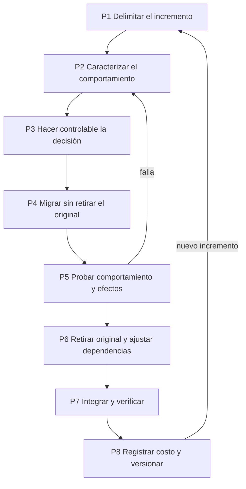
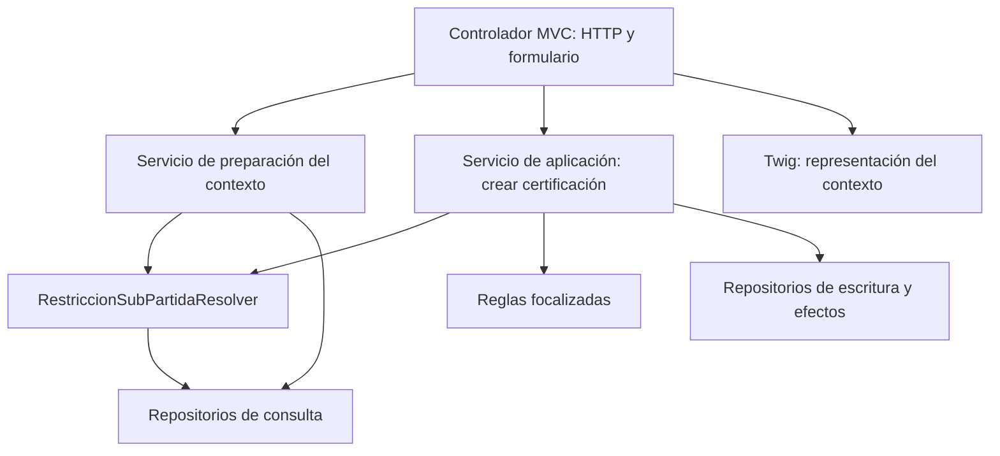

# E7c. Diseño del artefacto

**Estado:** en curso. Este documento sustituye al borrador del 13 de octubre, que describía una instanciación con «arquitectura limpia mínima» y «SIPOA4» y no incorporaba el método como artefacto central. El diseño cubre las dos caras de la composición: el método adaptado (pasos, roles, entradas, salidas, criterios) y la instanciación en el subcircuito de certificación (arquitectura MVC con frontera incremental).

## 1. Ficha de diseño

- **Artefacto:** método de refactorización arquitectónica incremental para subcircuitos de aplicaciones MVC heredadas, instanciado en la ejecución POA de SIGPP.
- **Tipología:** composición método + instanciación (E2).
- **Base operativa:** ciclo de Girjoaba y Capiluppi (2024), con adaptaciones A01–A04 y selección proporcional, complementado por el cambio seguro de Feathers (2004) y el razonamiento por atributos de Bass et al. (2021).
- **Alcance de la instanciación:** el subcircuito de creación de certificación como primer incremento; tarea, presupuesto y certificación como circuito de contexto.
- **Destino arquitectónico:** monolito MVC con frontera de aplicación incremental (sub-decisión B de E7a), sin migración a núcleo independiente.

## 2. Diseño del método adaptado

### 2.1. Diferencia frente al ciclo de origen

El ciclo de Girjoaba y Capiluppi parte de una interfaz obsoleta cuya funcionalidad interna sigue siendo necesaria, y su secuencia termina retirando el componente. El caso de este estudio es distinto: la decisión que se interviene está viva y distribuida entre interfaz, configuración y coordinación. Por tanto, la adaptación no retira una pieza muerta; separa y verifica una decisión institucional sin cambiar por ello su comportamiento salvo donde el diagnóstico lo exija. Esta diferencia motiva las adaptaciones A01–A04, que gobiernan los pasos heredados en lugar de sustituirlos.

### 2.2. Pasos, entradas, salidas y criterios

| Paso | Entradas | Salidas | Criterio de entrada | Criterio de salida | Gobernado por |
|:--|:--|:--|:--|:--|:--|
| P1. Delimitar el incremento | Escenario de cambio | Decisión funcional delimitada, lista de consumidores y efectos | Necesidad concreta de cambio (selección proporcional) | Frontera justificada por la decisión | A01, D01, R1–R2 |
| P2. Caracterizar el comportamiento | Código actual y contrato público | Prueba de caracterización; registro observado–requerido–intención | Decisión localizada y consumidores identificados | Comportamiento fijado antes de moverlo | A02, D03, D06, R3–R4 |
| P3. Hacer controlable la decisión | Decisión distribuida | Entradas explícitas (gestión, instante), punto de observación, efectos prohibidos | Dependencias identificadas | Decisión reproducible con entradas suministrables | A03, D04, R5 |
| P4. Migrar sin retirar el original | Componente destino | Regla o servicio nuevo en coexistencia con el original | Prueba de caracterización previa | Funcionalidad implementada, original intacto | paso 2 del ciclo, R11–R12 |
| P5. Probar comportamiento y efectos | Implementación nueva | Prueba de comportamiento; ausencia de efectos prohibidos ante rechazo | Coexistencia temporal estable | Comportamiento preservado o corregido intencionalmente | paso 3 del ciclo, A03, R5, I01–I02 |
| P6. Retirar el original y ajustar dependencias | Implementaciones duplicadas | Original retirado, dependencias y configuración ajustadas | P5 verde | Conexiones coherentes, dependencias transitorias declaradas | pasos 4–5 del ciclo, D07, R6, R8 |
| P7. Integrar y verificar | Cambio aislado | Integración a la rama acumuladora; prueba de integración | Comprobaciones locales verdes | Integración verificada sin regresión observada | pasos 6–7 del ciclo, D09 |
| P8. Registrar costo y versionar | Bitácora y diferencias | Versión documentada con pregunta de diseño, hallazgo y cambio | — | Costo inicial y evolución posterior separados | A04, D09, R7, R10 |

P8 es una adición de la adaptación (D09, R10), no un paso del ciclo original; se declara como tal para no atribuir al antecedente una responsabilidad que es del método adaptado. Los pasos P1–P3 tampoco existen con ese contenido en el ciclo, que comienza directamente por la interfaz; son la materialización de A01–A03 sobre la necesidad de seleccionar y verificar antes de mover.

### 2.3. Roles

| Rol | Responsabilidad en el método | Procedencia |
|:--|:--|:--|
| Practicante (desarrollador) | Ejecuta los pasos, registra observaciones y diferencias. | Caso: el tesista como desarrollador principal de SIGPP. |
| Revisor independiente | Revisa diseño y resultados para reducir el sesgo del constructor. | Disponible en el equipo, identificado en E1. |
| Fuente funcional | Ratifica las reglas de negocio observadas y los cambios intencionales. | Referente funcional de SIGPP (Planificador Nacional). |

El ciclo de origen discute cada interfaz con un arquitecto y revisa principios SOLID. La adaptación conserva la revisión, pero la ancla a un revisor independiente y a una fuente funcional, porque la decisión intervenida es de negocio y no de retiro de código muerto. Esta sustitución no reclama novedad; adapta un rol del antecedente a las restricciones del contexto institucional.

### 2.4. Diagrama del método

El bucle P5→P2 representa el rediseño documentado que exige el ciclo formativo: si la prueba de comportamiento falla, se vuelve a caracterizar, no se repara el código para hacer pasar la prueba. El bucle P8→P1 representa la naturaleza incremental del método sobre el circuito.

## 3. Diseño de la instanciación: certificación

### 3.1. Arquitectura

La instanciación conserva el monolito Symfony/Doctrine y separa responsabilidades mediante una frontera de aplicación incremental, sin contratos de puertos y adaptadores. El controlador se reduce a coordinación HTTP; la preparación del contexto y la creación quedan en servicios; las reglas focalizadas se aíslan de la coordinación; la vista recibe datos finales.

| Componente | Responsabilidad | Límite |
|:--|:--|:--|
| Controlador MVC | Petición, formulario, respuesta, mensajes, redirección | No selecciona restricciones ni ejecuta escrituras en el flujo intervenido |
| Servicio de preparación | Contexto para mostrar y procesar el formulario | No guarda certificaciones ni opera formularios |
| `CreateCertificacionService` | Coordinar validación, creación, persistencia, seguimiento y autorización | No lee `Request` ni Twig; no guarda estado de ejecución en propiedades |
| `RestriccionSubPartidaResolver` | Resolver la restricción aplicable | No decide renderizado ni guarda autorización |
| Reglas focalizadas | Decisiones con cambio independiente o difícil de probar | No acceden al contenedor ni a HTTP |
| Repositorios y servicio de archivos | Consultas, persistencia, almacenamiento | No deciden navegación ni mensajes |
| DTOs y vista | Transportar datos explícitos y representar resultados | El DTO no lee formularios; Twig no decide la regla |

### 3.2. Diagrama de componentes

Las flechas son dependencias candidatas, no clases ya implementadas en su totalidad. La decisión temporal autoritativa reside en el servidor (R12); la interfaz la representa y ayuda a validar, sin duplicarla.

## 4. Trazabilidad requisito → paso/componente → decisión

| Requisito | Paso o componente | Decisión de diseño | Justificación |
|:--|:--|:--|:--|
| R1–R2 | P1 | Selección proporcional antes de intervenir | Evita extracciones sin cambio concreto que las justifique |
| R3–R4 | P2 | Caracterización y registro observado–requerido–intención | Distingue preservación de corrección y capacidad nueva |
| R5 | P3, P5 | Entradas explícitas y efectos prohibidos | Permite comprobar decisión y rechazo sin efectos |
| R6 | P6 | Reutilizar configuración existente | No introduce infraestructura innecesaria |
| R7, R10 | P8 | Separar costo inicial y versión documentada | Hace trazable la contribución frente a la aplicación |
| R8 | P6 | Dependencias transitorias declaradas | Conserva Symfony/Doctrine sin llamarlo «limpio» |
| R9 | P8 | Evaluación por escenarios, no recuentos | Evita inferir mejora de clases nuevas o pruebas exitosas |
| R11 | Instanciación | MVC con frontera incremental | Alcance viable sin migración completa |
| R12 | Instanciación | Autoridad de regla en servidor | Evita definiciones divergentes de la misma decisión |
| R13 | P5 | I01–I02, I04 | Criterios funcionales aceptados prospectivamente |
| R14 | P8 | I03 esfuerzo humano | Medición separada de espera y automatización |

## 5. Gate de E7c

El gate exige que el diseño cubra todos los requisitos, que cada decisión significativa tenga justificación y alternativa considerada, que los componentes y relaciones estén explícitos, que exista diagrama y que el diseño se fundamente en E4. Las tablas anteriores proponen ese cumplimiento. Corresponde al tesista validar o corregir con sus palabras, en particular si el paso P3 (controlabilidad) o el rol de revisor independiente no reflejan lo que él tiene previsto operar.

**Cierre, 4 de noviembre de 2026:** el tesista confirma que el rol del revisor es independiente. P3 (controlabilidad de la decisión) no requiere confirmación nueva porque materializa decisiones ya aceptadas: D04 (contexto de decisión controlable) y el mecanismo de instante interno suministrado a la decisión, aceptado para I04. El gate de E7c se cumple: el diseño cubre los requisitos, cada decisión significativa tiene justificación y alternativa considerada, los componentes y relaciones están explícitos, existen diagramas y el diseño se fundamenta en E4.
