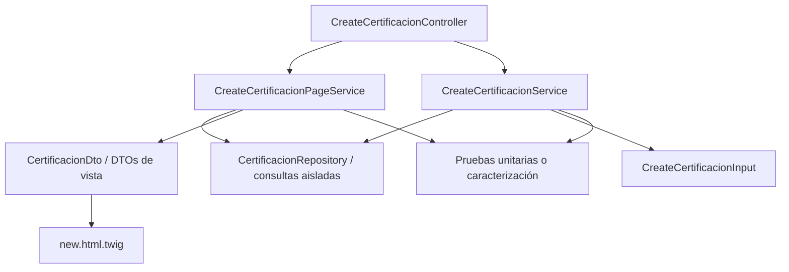

# E7c. Diseño del artefacto

## Ficha de diseño preliminar

El artefacto se diseña como un método de refactorización arquitectónica incremental, aplicado inicialmente al flujo de creación de certificación en SIGPP/SIPOA4. La intervención no busca añadir nuevas historias de usuario ni introducir una arquitectura compleja como DDD completo o arquitectura hexagonal. El propósito inmediato es convertir un flujo MVC con lógica dispersa en una arquitectura ejemplo, simple y replicable, que pueda guiar después el circuito tarea → presupuesto → certificación.

El diagnóstico técnico del controlador `CreateCertificacionController.php` muestra vestigios de MVC Symfony con responsabilidades mezcladas: obtención de datos con Doctrine, reglas de certificación, construcción de entradas para el servicio, preparación de variables de vista, manejo de redirección y gestión de mensajes. La vista Twig también contiene lógica de presentación y validaciones de fecha en JavaScript, mientras el modelo se encuentra disperso entre entidades Doctrine, repositorios, controlador y fragmentos de vista. Esta situación justifica que la primera arquitectura ejemplo se construya sobre certificación, porque allí ya existe evidencia de separación parcial y pruebas unitarias parciales.

## Arquitectura objetivo mínima

La arquitectura objetivo se define como una arquitectura limpia mínima e incremental. No se reclama una migración completa hacia DDD ni arquitectura hexagonal; esa promesa sería desproporcionada para el tiempo disponible y para un sistema institucional en operación. El objetivo es separar responsabilidades con una estructura comprensible para el equipo actual.

## Componentes propuestos

| Componente | Responsabilidad | Regla de diseño |
|:--|:--|:--|
| `CreateCertificacionController.php` | Coordinar petición, formulario, respuesta, mensajes y redirección. | No debe contener reglas de negocio ni consultas Doctrine complejas. |
| Servicio de preparación de página | Preparar los datos necesarios para renderizar la pantalla de nueva certificación. | Debe devolver DTOs de lectura para Twig, no entidades Doctrine completas cuando no sean necesarias. |
| `CreateCertificacionService.php` | Crear la certificación y aplicar reglas principales de negocio. | Debe tener prueba directa o prueba de caracterización sobre sus reglas principales. |
| `CreateCertificacionInput.php` | Transportar datos de entrada desde formulario hacia servicio. | Debe mantenerse como objeto de transferencia de datos, sin mezclar reglas de dominio. |
| DTOs de vista | Entregar a Twig información final de presentación. | Twig no debe navegar relaciones profundas del modelo ni calcular reglas de negocio. |
| Repositorios aislados | Encapsular consultas a Doctrine necesarias para el caso de uso. | El controlador no debe invocar consultas especializadas directamente. |
| Pruebas de caracterización | Capturar comportamiento actual antes de mover lógica heredada. | Toda extracción de comportamiento existente debe tener evidencia ejecutable. |
| `RestriccionSubPartidaResolver` | Resolver la restricción aplicable para una tarea o certificación. | Primero busca restricción específica por actividad; si no existe, busca restricción general; si ninguna existe, retorna `null`. |

## Trazabilidad requisito → componente → decisión

| Requisito | Componente | Decisión de diseño | Justificación |
|:--|:--|:--|:--|
| Refactorización incremental por circuito funcional | Certificación como primer flujo ejemplo | Empezar por creación de certificación antes de ampliar a tarea y presupuesto. | Ya existe evidencia Git y pruebas parciales, por lo que el rediseño puede cerrar un ciclo formativo real. |
| Prueba directa para servicios principales extraídos | `CreateCertificacionService.php` | Añadir prueba directa o caracterización antes de considerarlo refactorizado. | La evaluación formativa mostró que el servicio principal quedó sin prueba directa identificada. |
| Separación de responsabilidades | Controlador, servicio de página, servicio de creación, repositorio, DTO de vista | Reducir el controlador a coordinación y mover reglas/consultas fuera de él. | El controlador actual mezcla flujo HTTP, consultas, reglas y preparación de vista. |
| Vista sin lógica de dominio | DTOs de vista y Twig | Twig debe recibir información final, no entidades para navegar reglas o relaciones profundas. | La vista actual participa en decisiones de presentación y mantiene lógica incrustada. |
| Persistencia controlada | Repositorios aislados | Las consultas especializadas deben ubicarse detrás de repositorios o servicios de consulta. | Doctrine aparece disperso entre controlador, repositorios y vista. |

## Decisión de diseño principal

La primera versión rediseñada del método se aplicará al flujo de creación de certificación. El controlador se reducirá progresivamente a coordinación HTTP; la preparación de datos para la pantalla se moverá a un servicio específico; la vista recibirá DTOs de lectura; las consultas se aislarán en repositorios o servicios de consulta; y las reglas de creación quedarán en servicios con pruebas directas o de caracterización. Esta decisión mantiene el trabajo en nivel de maestría porque no promete una arquitectura universal, sino principios de diseño validados en una clase acotada de problemas: refactorización incremental de subcircuitos MVC legacy institucionales.

## Primer comportamiento a caracterizar

El primer comportamiento seleccionado para prueba de caracterización es la restricción de subpartida. Esta decisión es metodológicamente adecuada porque se trata de una regla de negocio real del flujo de certificación, no de una preocupación de presentación. La restricción determina si una certificación requiere autorización, tipo de contrato o archivo adjunto, y condiciona el flujo posterior entre creación normal y creación con autorización.

La elección también es arquitectónicamente significativa. Actualmente, la regla aparece acoplada al controlador mediante el método `estaRestringidaLaSubpartida(Tarea $tarea)` y depende de consultas a repositorios Doctrine. Además, existen indicios de dispersión entre controlador y servicio de creación, lo que permite mostrar con claridad el problema central de la tesis: el controlador decide demasiado y concentra decisiones que deberían estar aisladas en una regla verificable o servicio de dominio de aplicación.

No se selecciona como primer paso la preparación de datos para Twig porque corresponde principalmente a presentación y produciría una evidencia arquitectónica más débil. Tampoco se selecciona la creación de autorización porque ya existe cobertura parcial en pruebas. La restricción de subpartida conecta controlador, regla de negocio, persistencia y decisión de flujo; por ello es el mejor punto inicial para demostrar el método de refactorización incremental.

## Escenarios mínimos de caracterización

La restricción de subpartida no debe formularse como una regla fija asociada a un tipo específico de gasto, por ejemplo compra de servicios, porque esa configuración puede cambiar por decisión del Departamento Financiero. La regla defendible es configurable y depende de subpartida, gestión, administración y actividad opcional.

| Escenario | Condición de entrada | Comportamiento esperado | Prioridad |
|:--|:--|:--|:--|
| Restricción por actividad | Existe una restricción activa para subpartida, gestión, administración y actividad/proyecto específica. | El sistema devuelve la restricción específica y esta tiene prioridad sobre la restricción general. | Alta |
| Restricción sin actividad | No existe restricción específica por actividad, pero sí existe una restricción activa para subpartida, gestión y administración con `programaActividadProyecto IS NULL`. | El sistema devuelve la restricción general para esa subpartida. | Alta |
| Sin restricción | No existe restricción activa ni por actividad ni sin actividad. | El sistema considera que la certificación no requiere tratamiento especial por restricción. | Alta |

Cuando existe restricción, esta puede condicionar reglas posteriores como autorización, tipo de contrato o archivo adjunto, según la configuración definida por el área financiera. Esta relación debe mantenerse como parte del comportamiento caracterizado antes de mover la regla fuera del controlador.

## Salida observable de la primera prueba

La primera prueba de caracterización observará únicamente la resolución de la restricción. Si existe restricción específica por actividad, el comportamiento esperado es devolver esa instancia de `RestriccionSubPartida`. Si no existe restricción específica, pero sí una restricción general sin actividad asociada, el comportamiento esperado es devolver la restricción general. Si no existe ninguna restricción activa aplicable, el resultado esperado es `null` o un resultado equivalente que represente “sin restricción”.

Los efectos posteriores —activar autorización, exigir tipo de contrato o exigir archivo adjunto— se documentan como consecuencias derivadas, pero no forman parte de la primera prueba. Esta separación evita mezclar dos decisiones: primero se caracteriza la regla de selección y prioridad de la restricción; luego se probarán los efectos que esa restricción produce en el flujo de certificación.

## Componente elegido

El componente que contendrá la regla fuera del controlador será `RestriccionSubPartidaResolver`. Su responsabilidad será encapsular la selección de restricción: buscar primero una restricción activa específica por subpartida, gestión, administración y actividad/proyecto; si no existe, buscar una restricción activa general para la misma subpartida, gestión y administración sin actividad asociada; y, si ninguna existe, retornar `null`.

Este nombre evita sobrearquitectura porque describe una responsabilidad acotada, sin introducir una capa de dominio más amplia que todavía no está justificada por la evidencia. El componente no decidirá todavía autorización, tipo de contrato ni archivo adjunto; esos efectos posteriores quedarán para pruebas y refactorizaciones separadas.

## Estrategia de prueba del componente

La primera prueba se escribirá directamente contra `RestriccionSubPartidaResolver`, no contra `CreateCertificacionController.php`. Esta decisión evita arrastrar infraestructura de Symfony, Doctrine, formulario, petición HTTP, redirecciones y renderizado Twig hacia una prueba cuyo objetivo es caracterizar una regla de negocio específica. Probar el controlador completo en esta etapa produciría una prueba más frágil y menos útil para guiar la refactorización.

Metodológicamente, la prueba se formulará como caracterización de la regla extraída, no como prueba funcional del controlador. Primero se identifica el comportamiento actualmente observado en el controlador; luego se fija mediante prueba unitaria sobre el componente extraído. La formulación defendible es: se caracterizó el comportamiento existente mediante una prueba unitaria sobre `RestriccionSubPartidaResolver`, preservando la lógica observada en el controlador original.
