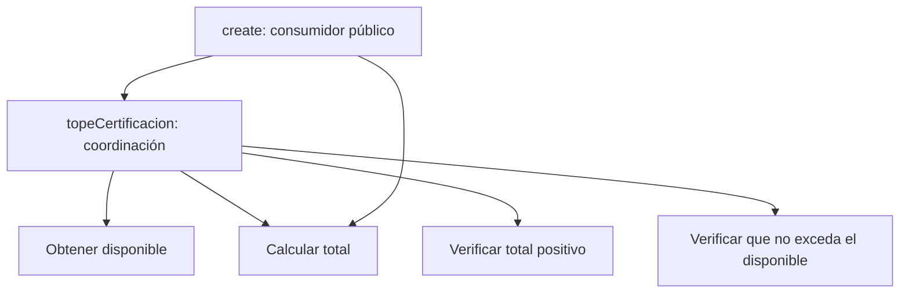

# Ejemplo documentado de aplicación: validación del importe de una certificación

**Estado:** versión de trabajo adecuada para revisión del tesista e incorporación posterior como anexo explicativo. No es traducción institucional ni cierre de la evaluación. Deriva de `docs/ejemplo-importe-autor-para-diapositivas.md` y `docs/registro-metodo-importe-autor.md`, conservados sin modificación por esta adecuación en el repositorio de SIGPP. La valoración y procedencia de la evidencia están en `revision_aplicacion_autor_importe_2026-11-07.md`.

## 1. Propósito y condiciones

La aplicación examina la validación del importe al crear una certificación en SIGPP, utilizando M-R1 con un suplemento operativo de registro progresivo posterior a P02. El autor del método y del sistema ejecutó la actividad con asistencia de IA, que produjo código, pruebas y documentación; el autor tomó decisiones de frontera, intervención y alcance, y confirmó posteriormente su revisión personal del material. No se trata de un evaluador independiente ni de un segundo sistema. El propósito fue conservar un comportamiento existente ante una intervención acotada, sin añadir capacidad o corregir reglas monetarias.

La rama de trabajo fue `eval/metodo-mr1-importe-autor`, desde `7ef29a4f438e5d2474d39b67f530cb940c922e76`. El alcance aceptado incluyó pruebas del consumidor con dobles, validación de configuración y revisión de conexiones, sin persistencia real, HTTP completo o concurrencia. Los criterios se fijaron antes de transformar y no se definió un protocolo de medición del esfuerzo. En consecuencia, el ejemplo permite examinar decisiones y conservación acotada, no ahorro o efectividad comparativa del método.

## 2. Criterios de conservación

Se fijó disponible ficticio de 100 y se mantuvieron controladas las demás condiciones necesarias para alcanzar la decisión de importe. El total se calcula como cantidad por precio unitario. En los casos rechazados se exigió no invocar guardado de certificación, seguimiento, autorización o carga de adjuntos. Los dobles permiten comprobar esas interacciones, no demostrar ausencia universal de efectos reales.

| Caso | Total | Expectativa aceptada | Comprobación final |
|:--|--:|:--|:--|
| A01 | 50 | La validación permite continuar. | Total esperado, un guardado y un seguimiento con dobles. |
| A02 | 100 | Permite continuar en el límite inclusivo. | Mismas comprobaciones en el límite. |
| A03 | 101 | Rechaza por exceso antes de los efectos acordados. | Excepción pertinente; ninguna llamada a los cuatro colaboradores de efectos. |
| A04 | 0 | Rechaza por total no positivo antes de esos efectos. | Excepción pertinente y ausencia de esas llamadas. |
| A05 | −1 | Rechaza por total no positivo antes de esos efectos. | Excepción pertinente y ausencia de esas llamadas. |

El mensaje existente «La certificación no puede ser menor a 1» se conservó, aunque el predicado observado rechaza valores no positivos. No se utilizó ese mensaje para cambiar el umbral a uno. La conservación del mensaje no constituye aprobación normativa de su redacción ni evaluación de todos los valores decimales posibles.

## 3. Decisiones y evolución de las fronteras

La primera frontera se ubicó en `topeCertificacion()`, un método privado de `CreateCertificacionService`. Para observar el rechazo antes de efectos se prepararon pruebas sobre su consumidor público `create()`, en vez de acoplar la prueba permanente a la estructura interna mediante reflexión. Durante el diseño se identificó que `create()` repetía el cálculo del total y el autor decidió ampliar también la intervención a ese punto. Por ello, la frontera de observación se amplió antes que la frontera de modificación; no fueron decisiones idénticas ni ocurrieron al mismo tiempo.

| Momento | Decisión | Razón y contrapartida |
|:--|:--|:--|
| P1 | Mantener la lógica dentro del servicio, sin clase nueva. | El autor consideró suficiente una intervención local; se acepta aumentar la descomposición interna. Una clase que recibiera datos ya preparados seguía siendo una alternativa posible, no una opción técnicamente imposible. |
| P2 | Observar mediante `create()` con dobles. | Los criterios incluyen consecuencias en colaboradores, no solo una respuesta de un método privado. Se requiere preparar más dependencias de prueba. |
| P4 | Dividir la lógica en métodos privados y reutilizar el cálculo desde `create()`. | Separar operaciones y eliminar esa duplicación; aparecen más métodos y conexiones internas. |
| P5–P6 | Comparar temporalmente y retirar la vía anterior. | El registro informa coincidencia en A01–A05. La prueba temporal fue retirada; la revisión posterior no reprodujo esa comparación histórica. |
| P7 | Comprobar el alcance acordado. | Configuración y consumidor con dobles, sin atribuir comportamiento de persistencia real. |
| P8 | Consolidar decisiones, evidencia, ayudas y límites. | El registro progresivo es explícito, pero no todo fue contemporáneo: P1 se registró después y P3 después de P2. |

## 4. Intervención resultante

La intervención añadió cuatro métodos privados: `disponibleCertificacion()`, `totalCertificacion()`, `verificarTotalPositivo()` y `verificarTotalNoExcedeDisponible()`. `topeCertificacion()` los coordina y `create()` reutiliza `totalCertificacion()` para asignar el importe de la certificación. Se mantuvieron clase, interfaz pública, mensajes y las condiciones examinadas. Esta es una refactorización interna del servicio, no una nueva separación arquitectónica entre capas.

El diagrama representa llamadas y reutilización, no flujo transaccional ni garantía de que no existan otros efectos en toda la aplicación. La implementación conserva el rechazo de total no positivo antes de examinar exceso. La evidencia de conservación se limita a los datos y observables definidos, sin convertir la equivalencia de cinco casos en equivalencia universal.

## 5. Evidencia y procedencia

| Momento | Resultado | Procedencia |
|:--|:--|:--|
| Preparación de la batería general | 159 pruebas, 260 aserciones, 1 omitida. | Ejecución de la asesoría anterior a la actividad. |
| Caracterización previa de importe | 5 pruebas, 25 aserciones; batería 164/285/1 omitida. | Registro de la aplicación con asistencia de IA; no reejecución histórica por la revisión posterior. |
| Comparación temporal de coexistencia | 10 pruebas, 30 aserciones en el conjunto de certificación; batería 169/290/1 omitida. | Registro de aplicación; prueba temporal posteriormente retirada. |
| Prueba permanente final | 5 pruebas, 25 aserciones, satisfactorias. | Reproducida por la asesoría sobre el estado final. |
| Batería completa final | 164 pruebas, 285 aserciones, 1 omitida, sin fallos o errores informados. | Reproducida por la asesoría. |
| Validación de configuración | Código de retorno 0. | Reproducida por la asesoría; no demuestra integración de persistencia. |

La prueba omitida requiere una conexión PostgreSQL específica no configurada y no se cuenta como satisfactoria. El incremento del número de pruebas describe cobertura de escenarios añadidos, no un porcentaje de cobertura del código o una mejora cuantificada de testabilidad. El registro del autor y los resultados reproducidos cumplen funciones distintas: documentar la secuencia y comprobar el estado final. Ninguno sustituye al otro.

## 6. Análisis estructural posterior y límites

El código pasa de 14 a 18 métodos activos y de dos implementaciones de la multiplicación a una, utilizada desde dos lugares. El conteo textual de líneas con llamadas internas pasa de 16 a 21 e incluye algunas apariciones comentadas presentes en ambos estados. Estos recuentos describen estructura y eliminación de una duplicación concreta; no miden facilidad de comprensión o costo de mantenimiento. El autor considera favorable la separación de operaciones, pero la contrapartida de más métodos y conexiones debe permanecer visible. La separación y reutilización se alinean con los criterios de Metz (2019, pp. 29–32), ahora cotejados con el ejemplar aportado. Ese fundamento justifica la decisión bajo criterios explícitos, no una mejora empírica de mantenibilidad ni ausencia de costo de ejecución.

Después de construir se formularon cuatro cambios hipotéticos y se contaron sus lugares de edición, sin ejecutarlos. Cambiar la fórmula pasa de dos lugares a uno; cambiar el origen del disponible o cualquiera de los dos mensajes mantiene un lugar en cada caso. Es análisis estructural exploratorio posterior, no evaluación prospectiva del esfuerzo de cambio ni cumplimiento de I04. No se reclaman ahorro, menor riesgo de error o mantenibilidad empírica a partir de esos recuentos.

El episodio muestra una aplicación a otra decisión del mismo sistema y una intervención que no requirió una clase nueva. No acredita transferencia externa, desempeño independiente, superioridad frente al ciclo de origen o suficiencia global de la tesis. Tampoco demuestra que el suplemento de registro progresivo reduzca reconstrucción retrospectiva o esfuerzo. Su aporte al análisis es hacer examinables las decisiones, los puntos de observación, las alternativas y sus límites.

## 7. Síntesis para exposición

**Lámina de decisiones:** frontera inicial en una decisión privada → observación desde el consumidor para comprobar efectos → intervención ampliada para reutilizar el cálculo → alternativa de clase nueva descartada con justificación, no prohibida por el método.

**Lámina de evidencia:** cinco escenarios aceptados antes de transformar y prueba final reproducida 5/25 → batería 164/285/1 omitida → límites: autor con IA, mismo sistema, sin persistencia real, esfuerzo o mantenibilidad medidos.

Este resumen es contenido propuesto en Markdown, no una presentación generada ni una sustitución de la explicación del tesista. La ficha `lectura_metz_diseno_2026-11-07.md` conserva los localizadores y el cotejo de los pasajes aportados; esta versión prefiere una síntesis propia, sin necesidad de reproducir todas las citas textuales. La formulación final de principios y conclusiones corresponde al análisis global de la evidencia, no a esta lámina explicativa.

## 8. Referencia de la justificación de diseño

Metz, S. (2019). *Practical object-oriented design: An agile primer using Ruby* (2nd ed.). Addison-Wesley Professional. https://www.informit.com/store/practical-object-oriented-design-an-agile-primer-using-9780134456478

**Verificada:** ejemplar aportado, pp. impresas 29–32, con las cautelas de pp. 9–10 y 13. La fundamentación no sustituye medir esfuerzo o cambios posteriores, y su incorporación documental no se presenta como criterio de éxito fijado antes de la actividad.
