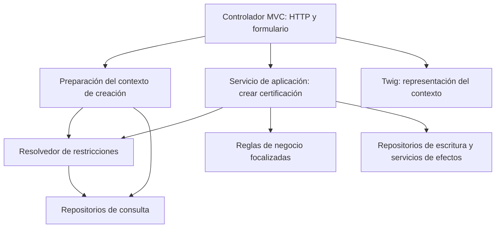

# Camino arquitectónico candidato para creación de certificación

## Resultado de la revisión

La recomendación es conservar el monolito MVC y proponer una separación por responsabilidades con una frontera de aplicación incremental en creación de certificación. No se propone adoptar íntegramente arquitectura limpia, arquitectura hexagonal ni DDD; tampoco renombrar carpetas como sustituto de diseño. Esta es una alternativa sometida a discusión, no una decisión aceptada por el tesista ni el cierre de E7a–E7c. Se registra mientras E4 permanece abierta, para vincular la fundamentación con problemas observables y evitar seguir construyendo sin criterios explícitos.

En Design Science, el objeto de estudio sigue siendo el método de refactorización incremental, no SIGPP ni su proceso POA. El código constituye su vehículo de aplicación; la contribución prevista son principios de diseño respaldados por evaluación, no la creación de otra clase. Esta distinción obliga a documentar tanto las reglas arquitectónicas como las condiciones para aplicar y evaluar el método.

## Evidencia inspeccionada

Revisión del repositorio `/home/mario/dev/sf_projects/sipoa4` el 18 de octubre de 2026, con `HEAD` en `5313c0e150859d86dd9d82b1df21f719d2242076`. Se inspeccionaron cambios sin confirmar, historial, controlador, servicio, resolvedor, DTO, formulario, plantilla principal y cinco archivos nuevos de pruebas. No se modificó código de la aplicación ni se ejecutaron migraciones. El diagnóstico no equivale a una auditoría de todo SIGPP.

| Hallazgo | Evidencia local | Alcance de la conclusión |
|:--|:--|:--|
| Selección duplicada sustituida por delegación. | Diferencias de `CreateCertificacionController.php` y `CreateCertificacionService.php`; nuevo `RestriccionSubPartidaResolver.php`. | Dos consumidores comparten una implementación de selección; no implica menos consultas por petición. |
| Dependencias de constructor de los consumidores reducidas. | Controlador: 7 → 6; servicio: 7 → 6. El resolvedor incorpora dos repositorios. | Disminución local, no prueba de reducción del acoplamiento global. |
| Controlador conserva acceso a persistencia y preparación de datos. | `new()` usa `getDoctrine()`, recupera saldos, navega presupuesto y prepara opciones de formulario y contexto Twig. | La frontera de aplicación todavía es parcial. |
| Servicio conserva estado de una ejecución. | Propiedad `$esRestringido`, asignada al resolver y consumida por métodos posteriores. | Acoplamiento temporal que conviene estudiar; no se afirma un defecto de producción demostrado. |
| DTO mezcla datos y referencias de presentación/infraestructura. | `CreateCertificacionInput` importa `FormInterface`, contiene `fromForm()` vacío y transporta `UploadedFile` y directorio de destino. | No es un objeto de valor ni una entrada independiente de Symfony. La dependencia del archivo puede tolerarse explícitamente durante la transición. |
| Persistencia tiene varios puntos de escritura. | `EmitirCertificacionRepository::save()` y `SeguimientoCertificacionRepository::save()` llaman a `flush()`; el servicio coordina ambas operaciones y autorización. | Debe analizarse atomicidad. No se verificó ausencia de una transacción externa ni se demostró pérdida de datos. |
| Validación de fechas distribuida. | Servicio comprueba gestión; JavaScript de `new.html.twig` contiene restricciones adicionales relativas al día y gestión anterior. | Diferencia de alcance que requiere confirmar reglas vigentes con el responsable funcional, no corregir silenciosamente como refactorización. |
| Prueba directa del servicio principal ya existe. | `CreateCertificacionServiceTest.php` invoca `create()` y verifica resultados y orden de efectos con dobles. | Corrige el vacío registrado el 13 de octubre; no prueba base de datos, archivos reales ni respuesta HTTP. |

## Verificación reproducida

| Comando | Resultado observado |
|:--|:--|
| `make test` | `OK (188 tests, 540 assertions)`; PHPUnit 9.6.15. |
| `docker exec --user 1000 sigpp-app vendor/bin/phpunit tests/Certificacion` | `OK (37 tests, 305 assertions)`. |
| `docker exec sigpp-app php -v` | PHP 7.4.29. |
| `git diff --check` | Sin errores informados. |

Los comandos se invocaron mediante el envoltorio `rtk`, sin cambiar sus argumentos funcionales. Las 37 pruebas y 305 aserciones del directorio nuevo coinciden aritméticamente con la diferencia respecto del resultado anterior registrado, 151/235; esta coincidencia no reemplaza una ejecución de la versión anterior. Los proveedores de datos generan varios casos por método y el número de aserciones incluye verificaciones de dobles, de modo que no se interpreta el incremento como porcentaje de cobertura. No se obtuvo un informe de cobertura ni se verificó el ciclo HTTP completo.

El historial sitúa `815ce6c0` el 6 de marzo de 2025 y `9d4af430` el 7 de marzo de 2025. Son antecedentes técnicos anteriores al encuadre de septiembre de 2026 y no deben presentarse como construcciones realizadas durante la tesis. El resolvedor y los cinco archivos de pruebas están sin seguimiento en el estado inspeccionado; por ello, el estado final y los ensayos actuales no prueban por sí solos la secuencia temporal de caracterización previa y TDD declarada por el tesista. Esta secuencia necesita registros de ejecuciones o versiones intermedias; cualquier reconstrucción posterior debe identificarse como tal.

## Alternativas y recomendación pendiente

| Alternativa | Beneficio | Costo o riesgo | Juicio provisional |
|:--|:--|:--|:--|
| A. Mantener extracciones puntuales sin contrato de dependencias. | Poco cambio inmediato; aprovecha el resolvedor actual. | No fija dónde ubicar consultas, reglas y presentación; puede desplazar la concentración del controlador al servicio. | Insuficiente como destino arquitectónico de la propuesta. |
| B. MVC con frontera de aplicación incremental y separación de lecturas, reglas y efectos. | Aprovecha servicios y repositorios existentes; permite imponer reglas locales y probarlas. | Mantiene dependencias concretas y entidades persistentes; exige declarar excepciones de transición. | Recomendada para discusión por alcance y compatibilidad. |
| C. Núcleo independiente con puertos y adaptadores para persistencia y archivos. | Mayor independencia tecnológica del núcleo. | Nuevos contratos, adaptadores y conversiones; costo de migración y evaluación mayor. | No se justifica como migración completa con la evidencia actual; interfaces puntuales no quedan prohibidas. |

La capa de servicios define operaciones y coordina la respuesta de la aplicación en el patrón descrito por Stafford (2003). La documentación de Symfony también recomienda controladores sin lógica de negocio, pero admite consultas directas desde ellos en determinados casos (Symfony, s. f.). La prohibición local de consultas en el controlador intervenido sería una elección de esta propuesta para hacer verificable la frontera, no una obligación universal del marco. Así se distingue sustento bibliográfico de adaptación al contexto y de contribución todavía por validar.

## Contrato candidato de responsabilidades

### Contraste con el borrador del proyecto

Se leyó `docs/development/architecture-contract.md` en el repositorio SIGPP, aportado por el tesista como borrador discutible. El documento distingue estado implementado, responsabilidades propuestas y excepciones; sus secciones 3–5 delimitan servidor, presentación y JavaScript, y las secciones 6–8 incorporan detección de deuda, rutas de intervención y criterios de revisión. Es un insumo técnico para el diseño del método, no una norma adoptada ni evidencia de efectividad. Sus enlaces bibliográficos todavía necesitan normalización a citas y referencias APA 7 si se incorpora como anexo de la tesis.

El borrador del proyecto introduce una precisión que debe conservarse en la discusión: la extracción de preparación es **opcional y condicionada a una necesidad documentada**, no una clase obligatoria. En consecuencia, las filas y el diagrama de esta nota describen responsabilidades lógicas candidatas; no exigen materializar cada una como componente separado. Se deberá reconciliar un único contrato de referencia antes de adoptar reglas para la intervención, sin mantener dos normas divergentes. La aprobación, los criterios de medición y el diseño completo del método siguen pendientes.

Para la presentación se distingue presencia de una decisión en JavaScript de autoridad exclusiva sobre una regla. La revisión previa de `new.html.twig` identificó funciones de restricción de fechas, mientras `CreateCertificacionService::fechaEstaEnGestion()` comprueba pertenencia a la gestión de la tarea; son comprobaciones de distinto alcance, no un defecto funcional demostrado. Debe confirmarse la regla vigente y revisar si otra validación del servidor impone las condiciones pertinentes antes de construir una prueba de rechazo sin JavaScript. No se confunden estas funciones de fechas con la precedencia de restricciones de subpartida, que sí se observó centralizada en PHP.

| Componente | Responsabilidad permitida | Límite propuesto | Dependencia transitoria admitida |
|:--|:--|:--|:--|
| Controlador MVC | Recibir petición, mantener controles de acceso, manejar formulario, traducir entrada/salida y responder. | No seleccionar restricciones, consultar saldos ni ejecutar escrituras directamente en el flujo intervenido. | Symfony Forms y entidad de formulario mientras no se evalúe su sustitución. |
| Preparación de creación | Obtener el contexto necesario para mostrar y procesar el formulario: tarea, saldos y condiciones aplicables. | No guardar certificaciones, construir `Response` ni operar formularios. | Repositorios concretos y entidades existentes, explícitamente declarados. |
| Servicio de aplicación `CreateCertificacionService` | Coordinar validación, resolución de restricciones, creación, persistencia, seguimiento y autorización. | No leer `Request`, `FormInterface`, sesión ni Twig; no guardar datos de una ejecución en propiedades del servicio. | Entidades y repositorios concretos durante esta versión. |
| Reglas de negocio extraídas | Decidir una condición específica cuando tenga cambio independiente o dificulte las pruebas. | No construir interfaz HTTP ni consultar contenedor; una regla puramente calculable no accede a la base de datos. | Entidades existentes cuando el contrato lo necesite; no se exige duplicar todo el dominio. |
| Resolvedor de restricciones | Coordinar búsqueda específica y alternativa general. | No decidir por sí mismo cómo renderizar ni cómo guardar autorización. | Dos repositorios concretos; por ello no se presenta como regla pura independiente de persistencia. |
| Repositorios y servicio de archivos | Consultas, persistencia y almacenamiento. | No decidir navegación ni mensajes de presentación. | Doctrine y mecanismo de archivos existente. |
| DTOs y vista | Transportar datos explícitos y representar resultados. | El DTO no lee formularios; Twig no determina la regla autoritativa de negocio. | Migración de entidades a DTOs de lectura por fragmentos, no sustitución global de todas las plantillas. |

Los servicios usarían propiedades para dependencias y variables locales para el estado de cada operación. No se exige una interfaz por clase ni se prohíbe comportamiento de negocio en entidades por el hecho de no adoptar DDD. Las excepciones de transición deben enumerarse y evaluarse, en lugar de llamar «limpia» a una arquitectura que todavía depende de Symfony y Doctrine. Esta es la precisión que falta a la expresión anterior «arquitectura limpia mínima».

Las flechas representan dependencias candidatas, no clases ya implementadas. El componente de preparación no reemplaza al servicio de creación ni introduce una segunda autoridad sobre las restricciones. Aunque presentación y creación consulten una misma política, la creación debe validar las condiciones aplicables al ejecutar la operación; eliminar consultas repetidas sin analizar vigencia y consistencia no es un objetivo automático.

## Camino previo a otra modificación de código

### Escenarios aportados por el tesista

El tesista identifica la restricción de subpartida como cambio real que atraviesa componentes y reporta defectos tanto en PHP como en JavaScript incorporado en Twig. También anticipa nuevos requisitos de conexión con otros sistemas, sin identificar todavía sistema externo, operación, contrato ni fecha. La duplicación de selección y la presencia de JavaScript en la plantilla fueron inspeccionadas; los defectos concretos, su causa y su impacto aún requieren un caso reproducible. La integración se registra como necesidad prevista, no como requisito aprobado ni justificación suficiente para construir una API o adoptar puertos y adaptadores.

Estos escenarios orientan la discusión hacia una operación de creación reutilizable y reglas autoritativas verificadas en el servidor, con presentación y validación de interacción separadas. No se decide todavía qué regla extraer ni se aprueba una nueva arquitectura. El siguiente insumo es un defecto concreto de restricción o validación, con comportamiento esperado y observado; si su corrección cambia el comportamiento existente, se registrará separadamente de la refactorización que lo conserva. Mover JavaScript a otro archivo, por sí solo, no demuestra separación de responsabilidades ni consistencia entre interfaz y servidor.

1. El tesista debe explicar y defender el reparto candidato, y aportar un cambio de negocio real o recurrente para decidir qué responsabilidad necesita aislamiento. La elección arquitectónica sigue pendiente; no se inicia una migración por preferencia de carpetas.
2. Completar en E4 la justificación de esa decisión y en E5 el contraste de soluciones; operacionalizar en E6 los criterios de la siguiente intervención antes de ejecutarla. Los resultados ya obtenidos se mantienen como exploratorios y no se transforman retroactivamente en objetivos cumplidos.
3. Formalizar alternativas, requisitos y diseño en E7a–E7c cuando se cierren sus prerrequisitos. Como primer cambio candidato de bajo alcance, estudiar el estado `$esRestringido` y su paso explícito entre operaciones; como cambio posterior, separar preparación de datos del controlador. El orden definitivo depende del escenario de cambio y de los criterios que se acuerden.
4. Para cada cambio autorizado: fijar comportamiento observable y versión de partida, ejecutar caracterización, realizar una transformación, repetir pruebas y medir la diferencia. Las pruebas de métodos privados por reflexión sirven como protección transitoria; no deben ser el único criterio de una arquitectura cuyos componentes públicos cambian.
5. Antes de afirmar suficiencia, agregar verificación de integración del flujo con datos ficticios y revisión independiente del método y del diseño. La persistencia de certificación, seguimiento y autorización y el manejo de archivos requieren comprobaciones de fallos; el éxito de dobles unitarios no demuestra atomicidad.

## Lectura focalizada necesaria

No se requiere leer íntegramente varios libros antes de continuar. Se requiere que el tesista pueda explicar qué decisión modifica cada lectura y qué limitación conserva. Las fuentes siguientes son fundacionales o documentación de compatibilidad, no sustituyen la literatura reciente pendiente para cerrar E4.

| Lectura | Pregunta que debe resolver |
|:--|:--|
| Feathers (2004), capítulos 4, 13 y 17, sobre puntos de separación, selección de pruebas y estructura. | ¿Dónde se puede intervenir sin cargar toda la infraestructura y qué comportamiento hay que proteger primero? |
| Fowler (2018), proceso de refactorización y ejemplo inicial. | ¿Cómo distinguir una transformación que conserva comportamiento de una corrección funcional nueva? |
| Stafford (2003), descripción de la capa de servicios. | ¿Qué operación ofrece la aplicación y qué coordina el servicio sin convertirse en un controlador trasladado? |
| Symfony (s. f.), apartados de controladores y lógica de negocio de la documentación 4.x. | ¿Qué acoplamiento al marco se conserva legítimamente en presentación y cuál se quiere evitar en aplicación? |

## Referencias verificadas en esta sesión

- Feathers, M. C. (2004). *Working effectively with legacy code*. Pearson. https://www.informit.com/store/working-effectively-with-legacy-code-9780131177055
- Fowler, M. (2018). *Refactoring: Improving the design of existing code* (2nd ed.). Addison-Wesley Professional. https://martinfowler.com/books/refactoring.html
- Stafford, R. (2003, 5 de marzo). *Service layer*. Martin Fowler. https://martinfowler.com/eaaCatalog/serviceLayer.html
- Symfony. (s. f.). *The Symfony framework best practices* (documentación 4.x). https://symfony.com/doc/4.x/best_practices.html

Se verificaron las páginas primarias/editoriales y el índice de Feathers, no la lectura íntegra de los libros. La página editorial de Feathers indica publicación en septiembre de 2004 y copyright 2005; se mantiene el año de publicación consignado. La página de la capa de servicios identifica a Randy Stafford como autor, aunque esté alojada en el sitio de Martin Fowler.
