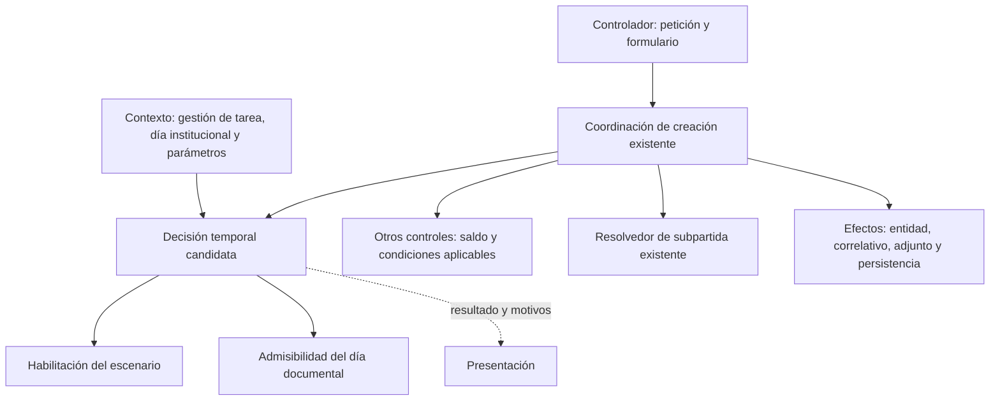

# Certificación: contraste de responsabilidades y separación candidata

**Resultado:** la separación deseada no exige reconstruir todos los controles. La frontera prioritaria candidata es la **decisión temporal de certificación**, distinguiendo habilitación de registro y admisibilidad del día documental, con aplicación antes de los efectos de creación. Saldo, permisos y resolución de restricciones conservan responsabilidades distintas. Es una recomendación fundamentada durante E4, no un diseño aprobado de E7 ni una implementación realizada.

## 1. Corte, alcance y límites

Inspección del 26 de octubre de 2026, a las 18:17, hora local UTC−04, sobre `/home/mario/dev/sf_projects/sipoa4`, `HEAD` `1294047effc21a97b86758eeedc99f1703b6d8ca`. El árbol conserva modificaciones previas en `.gitignore` y `tmp/propuesta-tesis.md`; no se modificó ningún archivo de aplicación. Se revisaron controlador, servicio, formulario, dos plantillas, resolvedor, mecanismos de parámetros, seguridad general y pruebas directas. CodeGraph proporcionó fuente actual y relaciones, complementadas por lectura focalizada de archivos no cubiertos; no se realizó auditoría integral de despliegue, extensiones o base de datos.

`docker ps --format '{{.Names}}'` no mostró contenedores en ejecución. No se inició infraestructura ni se ejecutó PHPUnit, una petición HTTP o una operación sobre datos institucionales. Las 188 pruebas y 540 aserciones registradas anteriormente siguen siendo un resultado histórico del 18 de octubre, no una verificación nueva. La lectura de pruebas acredita qué comportamientos se intentan comprobar, no que hayan pasado hoy.

El tesista aclaró que la separación de controles describe **el estado deseado**, no una propiedad que afirme ya implementada. No se vuelve a preguntar por el funcionamiento extraordinario, registrado en `reglas_fecha_certificacion.md`. El objeto de estudio continúa siendo el método de refactorización incremental, con tipología compuesta método más instanciación; el proceso POA es contexto de aplicación. No se convierte una corrección local en contribución científica por disponer de una nueva clase.

## 2. Responsabilidades actuales y diferencias

Los localizadores son relativos a SIGPP y corresponden al corte indicado.

| Responsabilidad | Evidencia observada | Diferencia frente al estado deseado |
|:--|:--|:--|
| Entrada, formulario y respuesta HTTP. | `src/Controller/poa/Certificacion/CreateCertificacionController.php:62–178`: carga tarea/saldos, obtiene restricción, configura formulario, construye entrada, invoca creación y renderiza o redirige. | Conserva consultas y preparación además de transporte. No obliga a extraer todo en el primer incremento. |
| Habilitación visible. | `templates/poa/emitir_certificacion/mostrar_emitir_certificaciones.html.twig:15–29`: combina permiso por unidad, parámetro ordinario y saldo para mostrar el enlace. | Control de presentación, no prueba de precondición al guardar; no contempla explícitamente el tipo extraordinario propuesto. |
| Consulta de habilitados. | `CreateCertificacionController.php:137–151`: el servicio se invoca antes de `findArrayDeHabilitados()`. | Esa consulta posterior no protege el guardado previo; no se descartan controles externos al recorrido observado. |
| Fecha documental en servicio. | `src/Service/Certificacion/CreateCertificacionService.php:94–108`: rango anual de gestión con fin construido a `23:59`. | No decide hoy/cierre mensual/días extraordinarios ni compara uniformemente días calendario. |
| Fecha en navegador. | `templates/poa/emitir_certificacion/new.html.twig:113–200`: hoy/cierre mensual; gestión anterior limitada a enero–marzo y días 29/31 de diciembre; reloj del navegador. | Condiciones adicionales a las del servicio; enero–marzo difiere del objetivo funcional acordado. No se ejecutó JavaScript en esta revisión. |
| Campo del formulario. | `src/Form/poa/EmitirCertificacionType.php:33–39,196–210`: formato con hora; `verificarDia()` termina devolviendo `true` incluso fuera del ciclo 1–8. | No acredita restricción efectiva por esos días ni reemplaza la política institucional. |
| Saldo e importe. | `CreateCertificacionService.php:111–128`: rechaza total no positivo o superior al disponible. | Método privado dependiente de navegación por tarea/asignación; no se acreditó atomicidad ni control de concurrencia. No requiere reescritura para aislar primero la decisión temporal. |
| Permiso específico y acceso general. | `config/packages/security.yaml:54–58`: roles generales; plantilla comprueba unidad. No se observa esa comprobación específica en `new()` o `create()` revisados. | No se demuestra aplicación específica al guardar ni una vulnerabilidad explotada. Requiere contraste controlado, sin convertir el incremento en auditoría de permisos. |
| Restricción de subpartida. | `src/Service/Certificacion/RestriccionSubPartidaResolver.php:23–44`; controlador `181–184` y servicio `156–159` delegan. | Extracción parcial existente, reutilizable. Consulta dos repositorios y recarga tarea: no es función pura ni elimina automáticamente consultas repetidas. |
| Coordinación y efectos. | `CreateCertificacionService.php:48–89`: fecha → saldo → restricción → entidad/código/datos → contrato/adjunto → guardado → seguimiento/autorización. | Existe un punto temprano para hacer cumplir decisiones, pero coordinación y validaciones siguen combinadas. No se propone una clase por cada método. |

Separar métodos privados no basta para demostrar una frontera arquitectónica, porque pueden compartir estado y dependencias. A la inversa, algunas separaciones ya existen y no necesitan rehacerse. La pregunta útil es qué decisiones cambian por motivos distintos, qué datos necesitan y dónde se comprueba su resultado antes de producir efectos. El diagnóstico no sostiene ausencia total de separación.

## 3. Protección existente y vacíos de prueba

`tests/Certificacion/CreateCertificacionServiceTest.php:73–180` contempla restricción, contrato, devolución y adjunto mediante dobles y registro de orden de efectos. Las líneas `183–198` comprueban falta de adjunto antes de persistencia, seguimiento y autorización. Las líneas `200–225` describen fecha fuera de gestión, total cero, negativo y exceso de saldo, con rechazo previo a consulta de restricción, correlativo y escrituras. Ese contrato público de `create()` es protección útil y no debe reemplazarse por pruebas exclusivamente de métodos privados.

En ese archivo no se identifican casos de ventana extraordinaria, global cerrada con extraordinaria vigente, habilitación de otra gestión o equivalencia de horas del mismo día. Los dobles tampoco comprueban HTTP sin JavaScript, permisos por unidad, transacciones o archivos reales. No se declara revisión exhaustiva de toda la batería ni se confunde lectura con ejecución. Esta revisión conserva como pendiente la integración del recorrido completo.

## 4. Fundamento → decisión candidata → evidencia necesaria

Se reutilizan pasajes primarios contrastados en `lectura_bass_clements_kazman.md` y `lectura_fuentes_locales_2026-10-21.md`, sin atribuir una nueva lectura íntegra ni resultados de SIGPP a los autores. La fundamentación debe modificar decisiones concretas y no limitarse a describir autores. Los reglamentos CPS sustentan el dominio y las autoridades, no esta estructura de software. La literatura reciente y el contraste de originalidad continúan pendientes.

| Decisión candidata | Fundamento comprobado | Comprobación futura, no resultado obtenido |
|:--|:--|:--|
| Separar interpretación temporal de consultas, transporte y guardado. | Bass et al. (2021, sec. 8.2): redistribución de responsabilidades según cohesión y escenarios de cambio. | Un cambio de regla temporal no obliga a modificar saldo, correlativo o persistencia; debe observarse en un escenario predefinido. |
| Distinguir lectura de configuración, habilitación y día documental. | Bass et al. (2021, sec. 8.2, «Defer Binding», y secs. 15.1–15.3): configuración y semántica explícita de interfaces. | Reutilizar gestión/períodos/fábricas; una ventana abierta no admite cualquier fecha. No crear un motor genérico. |
| Controlar día de referencia y observar decisión y efectos. | Bass et al. (2021, secs. 12.1–12.2); Feathers (2004, pp. 21–28 y 30–36). | Casos repetibles sin reloj del navegador, con rechazo temprano y conexión comprobada a `create()`. |
| Proteger interfaz pública y conexión de la extracción. | Feathers (2004, pp. 138–141, 186–190 y 194–195). | Conservar pruebas de consumidor; caracterizar la comprobación anual si se extrae, sin atribuirle cobertura de la política completa. |
| Separar extracción conservadora de corrección/extensión extraordinaria. | Fowler (2018, pp. 45–47). | Registrar qué aceptaciones/rechazos se conservan y cuáles cambian; no llamar refactorización a introducir controles antes ausentes. |

### Reparto lógico propuesto

| Responsabilidad | Entradas/salida | Límite |
|:--|:--|:--|
| Obtener contexto temporal. | Gestión de tarea, día institucional y datos ordinarios/extraordinarios. | Reutiliza consultas; URL no sustituye gestión de tarea. No decide saldo ni guarda. |
| Decidir habilitación. | Escenario, gestión y vigencia → habilitación temporal o rechazo con motivo. | No concede permiso por usuario ni admite cualquier fecha documental. |
| Decidir admisibilidad documental. | Día solicitado, gestión y día de referencia → fecha admisible o rechazo con motivo. | No consulta repositorios, altera auditoría ni escribe. Fecha del documento y apertura tienen semánticas distintas. |
| Coordinar creación. | Entrada y contexto → controles, construcción y efectos existentes. | Hace cumplir decisión temporal antes de efectos; no reduce toda la autorización a un booleano temporal. |
| Presentar disponibilidad y errores. | Resultado y motivos → botón, formulario o mensaje. | No mantiene política autoritativa paralela; al guardar debe comprobarse de nuevo porque el contexto pudo cambiar. |

Son responsabilidades, no cinco clases obligatorias ni firmas aprobadas. Un componente temporal puede componer habilitación y admisibilidad si recibe datos explícitos y mantiene sus significados diferenciados. El primer incremento no requiere rehacer saldo, permisos, resolvedor de subpartida o almacenamiento histórico. Los controles no acreditados quedan pendientes de verificación, no se silencian ni se corrigen como efectos secundarios.

Las flechas representan dependencias lógicas propuestas, no una secuencia implementada. El avance a efectos estará condicionado a los controles aplicables; el esquema no afirma que el permiso específico esté ya resuelto. Tampoco una aceptación de pantalla constituye una autorización permanente para guardar.

## 5. Alternativas y recomendación provisional

| Alternativa | Ventaja | Costo o riesgo | Juicio |
|:--|:--|:--|:--|
| A. Incorporar condiciones en el controlador de creación. | Menor movimiento inicial y acceso directo al formulario y usuario. | Acopla política al transporte; otro consumidor del servicio podría omitirla y probar exige más contexto HTTP. | Corrección local posible, pero frontera reutilizable más débil. |
| B. Decisión temporal aplicada por coordinación, con lectura separada y presentación coherente. | Pruebas controladas de regla y conexión; reutiliza configuración existente. | Exige contrato, contexto y verificación de coherencia; introduce costo inicial. | **Recomendada para discusión**, sin reescritura general. |

No hay evidencia que justifique un motor genérico como destino. La recomendación B no cierra E7a ni presupone aceptación de una clase concreta. Su costo inicial debe separarse del costo posterior de configurar ventanas, conforme a Bass et al. (2021, introducción al cap. 8). No se demuestra ahorro midiendo solo uso administrativo final.

## 6. Orden candidato y condiciones previas

1. Fijar versión y ejecutar pruebas públicas existentes. Si se extrae primero la comprobación anual, preservar sus resultados y mensajes, declarando limitaciones; no incorporar todavía la extraordinaria como si fuese solo refactorización.
2. Especificar el cambio funcional con HU-FEC-01/HU-FEC-02 ya acordadas, sin repetir preguntas resueltas sobre gestión o ventanas.
3. Definir antes de cambiar código el contrato, casos de aceptación/rechazo, control del día y observación de efectos. Resolver formalmente la transición del formulario/fecha, sin migración histórica implícita.
4. Cuando se cierren prerrequisitos, comprobar aplicación antes de correlativo, adjunto y escrituras, conservando saldo y restricciones; la pantalla no sustituye esta comprobación.
5. Evaluar el método con esfuerzo/extensión de cambios y revisión independiente, no solo con pruebas unitarias exitosas.

Este orden es prospectivo, no ejecución ni autorización de construcción. E4 permanece abierta por fuentes recientes y decisiones pendientes; E5 y E6 siguen pendientes. No se fijan umbrales retrospectivos ni se reclama originalidad por combinar prácticas conocidas. El resultado inmediato es la conexión explícita entre responsabilidad observada, separación candidata y fundamento.

## Referencias

- Bass, L., Clements, P., & Kazman, R. (2021). *Software architecture in practice* (4th ed.). Addison-Wesley Professional. https://www.sei.cmu.edu/library/software-architecture-in-practice-fourth-edition/
- Feathers, M. C. (2004). *Working effectively with legacy code*. Prentice Hall PTR. https://www.informit.com/store/working-effectively-with-legacy-code-9780131177055
- Fowler, M. (2018). *Refactoring: Improving the design of existing code* (2nd ed.). Addison-Wesley Professional. https://martinfowler.com/books/refactoring.html

**Verificación:** fuentes y pasajes primarios contrastados previamente; localizadores y límites en las dos fichas citadas. No se añadieron fuentes recientes en esta inspección.
